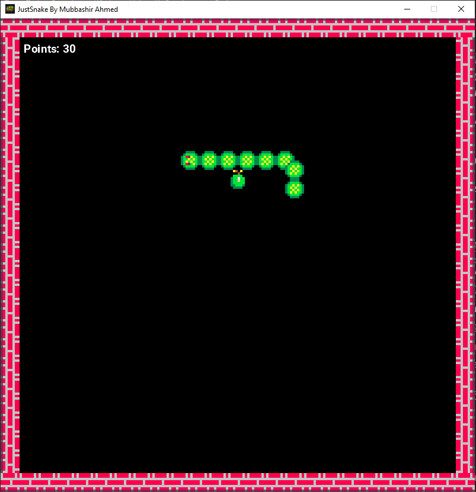

# Just Snake - MonoGame

A professional, multi-platform classic Snake game developed using C# and the MonoGame framework. This project demonstrates advanced game development concepts including screen management, animated sprites, particle systems, and localization across Desktop and Mobile platforms.


[](YOUR_ITCH_IO_URL_HERE)

## 📋 Features

- **Classic Gameplay** - Responsive snake movement with growth and shrinking mechanics.
- **Multi-Platform Support** - Fully compatible with Windows (DirectX/OpenGL), Android, and iOS.
- **Dynamic Food System** - Various food types (Apples, Cherries, Cookies) with different point values.
- **High Score Leaderboard** - Persistent tracking of your best performances.
- **Customizable Settings** - Integrated toggles for background music and sound effects.
- **Visual Polish** - Particle effects on consumption, camera shake on collisions, and smooth screen transitions.
- **Localization** - Multi-language support (English-US) managed via a dedicated localization manager.
- **Input Flexibility** - Support for Keyboard, GamePad, and Touch controls.

## 📁 Project Structure

```
JustSnake-MonoGame/
├── Snake.Core/          # Shared game logic, screens, and assets
│   ├── Collisions/      # Collision detection logic
│   ├── Common/          # Helper classes and utilities
│   ├── Content/         # Texture atlases, audios, and fonts
│   ├── Effects/         # Particle effects and visual polish
│   ├── Enums/           # Game enumerations (GameState, Direction, etc.)
│   ├── Events/          # Event arguments and handlers
│   ├── Graphics/        # Sprites, animations, and rendering
│   ├── Inputs/          # Input state management (Keyboard, Touch, GamePad)
│   ├── Localization/    # Multi-language string resources
│   ├── Managers/        # Screen, Settings, and Leaderboard management
│   ├── Models/          # Data models (Food, SnakeSegment, MenuEntry)
│   ├── Screens/         # Menu, Gameplay, and Settings screens
│   ├── Settings/        # Game settings configuration
│   └── Storages/        # Data persistence (JSON storage)
├── Snake.WindowsDX/     # Windows DirectX platform project
│   ├── Program.cs       # Application entry point
│   ├── app.manifest     # Windows application manifest
│   └── Icon.ico         # Application icon
├── Snake.sln            # Visual Studio Solution file
├── Snake.slnx           # Visual Studio Solution file (SLNX)
└── README.md            # Project documentation
```

## 🚀 Getting Started

### Prerequisites

- Windows OS (for development)
- [.NET 6.0 SDK](https://dotnet.microsoft.com/download) or later
- [Visual Studio 2022](https://visualstudio.microsoft.com/) with "Game development with C++" or ".NET desktop development"
- [MonoGame Extension](https://www.monogame.net/downloads/) for Visual Studio

### Installation & Usage

1. **Clone the repository**
   ```bash
   git clone https://github.com/mubbashir-ahmed/JustSnake-MonoGame.git
   ```

2. **Open the solution**
   - Open `Snake.sln` in Visual Studio.

3. **Restore Tools**
   - Run the following command in the project root to restore MonoGame content tools:
     ```bash
     dotnet tool restore
     ```

4. **Build & Run**
   - Choose your preferred platform (e.g., `Snake.WindowsDX`) as the Startup Project.
   - Press `F5` to build and launch the game.

## 🛠️ Technologies Used

- **C# .NET** - Core application logic and object-oriented structure.
- **MonoGame Framework** - Low-level graphics, audio, and input handling.
- **XML Documentation** - Used for texture atlas and tilemap definitions.
- **JSON Serialization** - Persistent storage for game settings and leaderboards.
- **GDI+ / XNA** - Rendering and coordinate transformations.

## 🎮 Asset Credits

This game features high-quality assets from the following creators:

- **Snake Sprites** - [Cosme](https://cosme.itch.io/snake)
- **Background Pixel Pack** - [Blue00](https://blue00.itch.io/backgrounds-pixel-pack)
- **Background Music** - [Mass-Kamm](https://mass-kamm.itch.io/free-bgm)
- **Sound Effects** - [Brackeys (Platformer Bundle)](https://brackeysgames.itch.io/brackeys-platformer-bundle)
- **Engine** - [MonoGame](https://www.monogame.net/)

## 📸 Preview



## 📝 License

This project is licensed under the MIT License - see the [LICENSE](LICENSE) file for details.

## 👤 Contributors

- **Mubbashir Ahmed** (Author & Maintainer) [@mubbashir-ahmed](https://github.com/mubbashir-ahmed)

## 🤝 Contributing

Contributions, issues, and feature requests are welcome! Feel free to check the issues page or submit a pull request.

## ⭐ Show Your Support

⭐ If you find this project helpful, please consider giving it a star!
