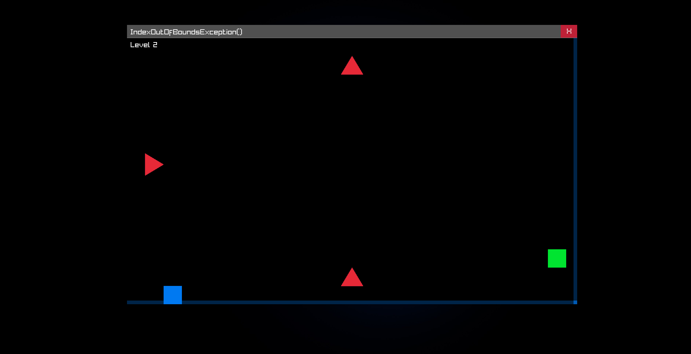
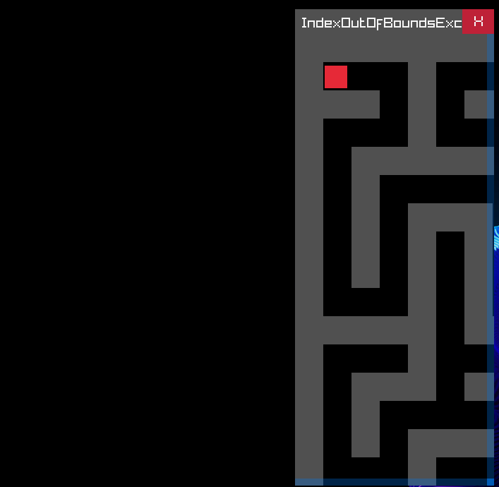

# IndexOutOfBoundsException()

A simple C++ game built with raylib featuring three progressive levels:

1. **Window Control** - Learn to drag and resize a custom undecorated window
2. **Cube Bouncer** - Navigate a bouncing cube past spike obstacles
3. **Gravity Maze** - Solve a deterministic 21×21 maze using gravity and window shake mechanics

## Screenshots




## Requirements

- **MSYS2** with UCRT64 toolchain
- **GCC/G++** compiler
- **Make** build system
- **raylib** graphics library

## Installation

### 1. Install MSYS2

Download and install MSYS2 from [msys2.org](https://www.msys2.org/)

Open the **UCRT64 terminal** and update:
```bash
pacman -Syu
```

### 2. Install Build Tools
```bash
pacman -S mingw-w64-ucrt-x86_64-toolchain
pacman -S mingw-w64-ucrt-x86_64-make
pacman -S mingw-w64-ucrt-x86_64-raylib
```

### 3. Verify Installation
```bash
g++ --version
mingw32-make --version
```

## Build & Run

Navigate to the project directory in **MSYS2 UCRT64 terminal**:
```bash
mingw32-make
mingw32-make run
```

## Optional Tools

### Debugger (GDB)

For debugging:
```bash
pacman -S mingw-w64-ucrt-x86_64-gdb
gdb build/game.exe
```

## Notes

- Use **UCRT64 terminal** only (not MSYS or MinGW32)
- Ensure raylib is properly installed before building
- For raylib documentation, visit [raylib.com](https://www.raylib.com/)

## Contributing
this is just a simple hobby vibe coded project so no need lol but if you wanna open a PR or issue you can do it!