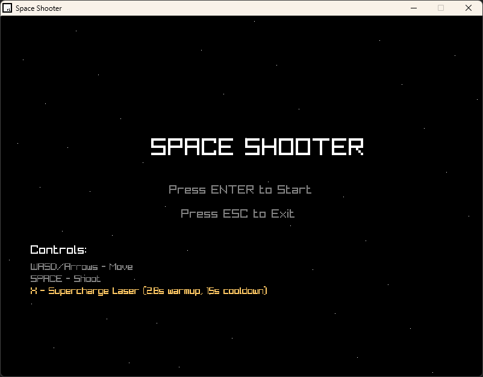
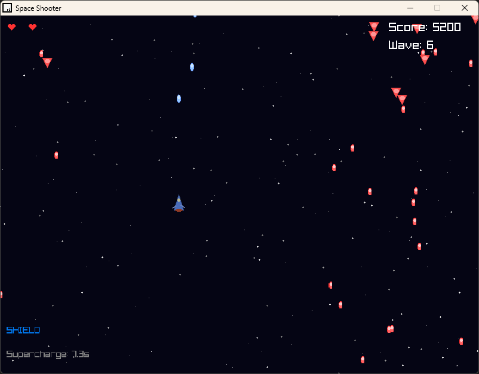
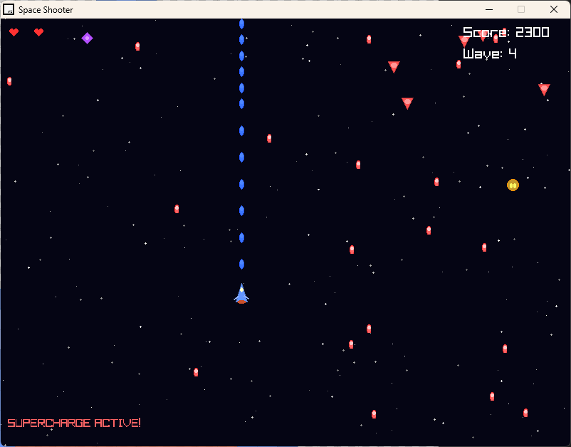
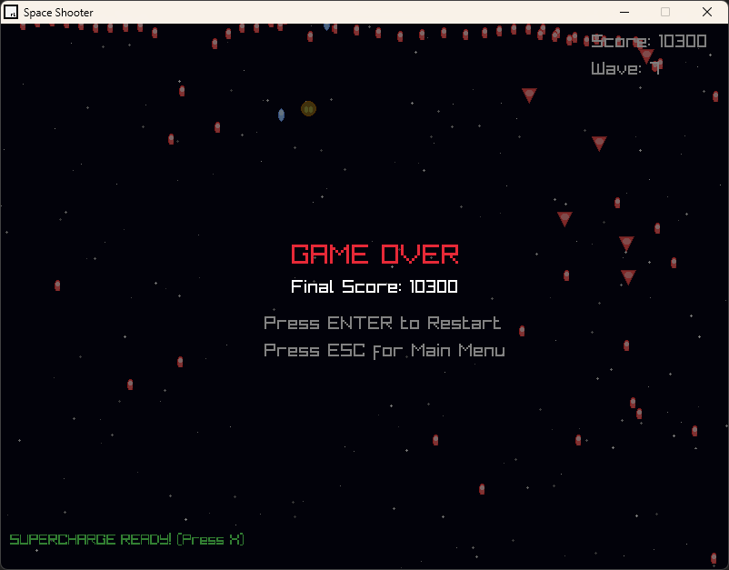

# Space Shooter Game

A simple 2D space shooter game made with C++ and Raylib.

## Preview

<table>
  <tr>
    <td align="center">
      
      <br><b>Main Menu</b>
    </td>
    <td align="center">
      
      <br><b>Gameplay</b>
    </td>
  </tr>
  <tr>
    <td align="center">
      
      <br><b>Laser Canon</b>
    </td>
    <td align="center">
      
      <br><b>Game Over</b>
    </td>
  </tr>
</table>

## Start
- Press F5 in vs code

## Features

- Move your spaceship with arrow keys or WASD
- Shoot bullets with spacebar
- Fight against three types of enemies:
  - Basic enemies (2 health)
  - Fast enemies (2 health, moves faster)
  - Heavy enemies (8 health, shoots rapidly)
- Collect power-ups:
  - Double Shot: shoot two bullets at once
  - Shield: extra protection
  - Speed Boost: move faster
- Score points by destroying enemies
- Game gets harder with more waves
- Supercharge laser beam (hold spacebar when ready)
- Explosion effects when enemies are destroyed

## How to Play

1. Use arrow keys or WASD to move your ship
2. Press spacebar to shoot
3. Avoid enemy bullets and enemies
4. Collect power-ups to get stronger
5. Try to survive as many waves as possible
6. Press ESC to pause the game

## Controls

- Movement: Arrow Keys or WASD
- Shoot: Spacebar
- Pause: ESC key
- Switch Background Music: M key

## Build Requirements

- Raylib 5.5
- MinGW-w64 compiler
- Windows OS

## How to Build

Run the build task in VS Code or use:
```
mingw32-make RAYLIB_PATH=C:/raylib/raylib PROJECT_NAME=space-shooter
```

## Game Mechanics

- Player starts with 3 health (hearts)
- Enemies get faster and more dangerous each wave
- Some enemies enter "kamikaze mode" when damaged
- Power-ups last for 10 seconds
- Score increases based on enemy type destroyed
