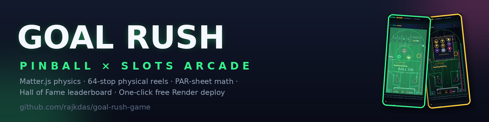
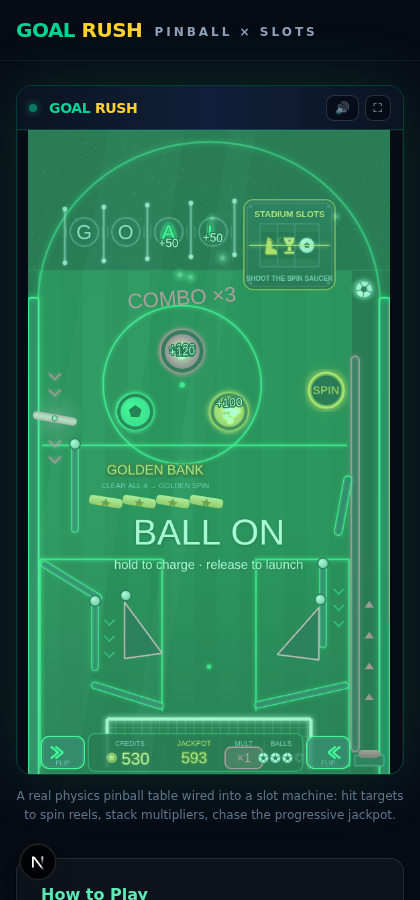

# ⚽ GOAL RUSH — Pinball × Slots



[](https://github.com/rajkdas/goal-rush-game/actions/workflows/ci.yml)


A neon-arcade **soccer pinball machine wired into a slot machine**. Real rigid-body
physics (Phaser 3.90 + Matter.js) drive the ball; hitting the right table feature
spins 64-stop physical reels, stacks multipliers and chases a **progressive jackpot**
that grows with every bumper hit. The reel math is documented as a PAR sheet and
verified by exact computation plus 2,000,000-spin Monte-Carlo simulation — all in
~12,400 lines of strict TypeScript with **zero binary game assets**.

> 🎮 Virtual credits only. This is an arcade prototype — no real-money gambling.

## Features

- **Play a real pinball table** — flippers, plunger, 3 pop bumpers, slingshots,
  a 4-target drop bank, a spinner, and a ball-capturing SPIN saucer.
- **Trigger slot spins from table play** — capture the ball in the SPIN saucer for a
  base spin; clear all 4 **Golden Bank** targets for a Golden Spin with **1-in-13** jackpot odds.
- **Chase the progressive jackpot** — every bumper/slingshot/spinner/target hit feeds
  the pot; **3 trophies** pay it in full with a stadium light-show.
- **Ride the multipliers** — spell **G·O·A·L** in the top rollover lanes to boost
  every award ×2–×5; 5 spinner passes on the left-orbit loop earn a **FREE SPIN**.
- **Fair, certified-style reel math** — 64-stop physical strips, Web Crypto RNG with
  rejection sampling (no modulo bias), outcomes decided up-front and animated to land.
- **Persistent Hall of Fame** — top-10 leaderboard backed by Prisma + SQLite, zod-validated
  submissions, 1-submit-per-5-s-per-IP rate limit, auto-trimmed to 200 rows.
- **Zero binary assets** — every sprite is drawn at runtime into one texture atlas;
  all SFX are synthesized live with WebAudio. Nothing to download, nothing to license.
- **Smooth on any screen** — fixed-timestep physics (identical ball speed on 60/120/144 Hz),
  540×960 portrait-first scaling, keyboard + touch + gamepad input.



## Requirements

- **Node.js ≥ 20.9** (20 LTS and 22 tested; the Render blueprint pins `22.11.0`)
- **npm 10+** (or **Bun 1.2+** — `bun.lock` is committed alongside `package-lock.json`)
- ~400 MB disk for `node_modules` + the standalone build; 512 MB RAM is enough (proven by the Render free tier)
- Any modern browser with WebGL (canvas fallback included)

## Installation

1. Clone and install (the `postinstall` hook runs `prisma generate` automatically):

   ```bash
   git clone https://github.com/rajkdas/goal-rush-game.git
   cd goal-rush-game
   npm install
   ```

2. Create your env file (`Copy-Item .env.example .env` on Windows PowerShell):

   ```bash
   cp .env.example .env
   ```

3. Create/sync the leaderboard SQLite schema:

   ```bash
   npm run db:push
   ```

## Quick start

```bash
npm run dev          # http://localhost:3000
```

Press **Space** (or hold the LAUNCH pill) to plunge, **Z / M** or the on-screen
arrow buttons for the flippers. Hit targets → the SPIN saucer captures the ball →
the reels spin → the ball is ejected back into play. Submit your initials to the
Hall of Fame when the ball drains.

## Configuration

| Setting | Type | Default | Description |
|---|---|---|---|
| `DATABASE_URL` | env var | `file:./db/custom.db` | SQLite file for the leaderboard. On Render's free tier use `file:/tmp/goalrush.db` (set automatically by `render.yaml`). |
| `?debug=1` | URL flag | off | Matter.js wireframe overlay — bodies, sensors and statics. |
| `window.__goalrush` | JS bridge | — | Deterministic QA hooks: `start()`, `phase()`, `plunge(power)`, `flip(side, down)`, `spin(kind)`, `ballPos()`, `dumpBodies()`, `debug()` and more. |

All game tuning lives in three data files — change them, not the scenes:

| File | Owns |
|---|---|
| `src/game/config/table.config.ts` | Playfield geometry: walls, dome, drop targets, lanes |
| `src/game/config/game.config.ts` | Gravity, flipper/plunger/bumper constants, palette |
| `src/game/config/slots.config.ts` | Reel strips, paytable, golden-reel rules |

## The hybrid gameplay loop

```
        PINBALL TABLE                     SLOT MACHINE
  ┌──────────────────────────┐    ┌────────────────────────────┐
  │ SPIN saucer (right orbit)├────┤ BASE SPIN  (64-stop reels) │
  │ Golden Bank (4 drop tgts)├────┤ GOLDEN SPIN (trophy ×23)   │
  │ Left loop (5 passes)     ├────┤ FREE SPIN                  │
  │ G·O·A·L rollover lanes   ├────┤ MULTIPLIER ×2…×5 (all pays)│
  │ Bumpers/slings/spinner   ├────┤ PROGRESSIVE JACKPOT POT    │
  └──────────────────────────┘    └────────────────────────────┘
        ball physics feeds              reels pay back
```

A blank reel line can be flagged **OFFSIDE** (multiplier reset) — a miss is a
risk, not a dead pause. Extra balls at 2,500 / 6,000 / 12,000 credits. A
9-second **ball save** runs on every launch, and an anti-stuck watchdog nudges
with escalating force so the ball never parks.

## Controls

| Action | Keyboard | Touch | Gamepad |
|---|---|---|---|
| Left flipper | `Z` `A` `←` | tap ◀ button / left half | LB / L1 |
| Right flipper | `M` `L` `→` | tap ▶ button / right half | RB / R1 |
| Launch (hold to charge) | `Space` `↓` | hold LAUNCH pill / lane | A / Cross |
| Nudge | `N` `↑` | quick swipe | X / Square |

## Tech stack

| Layer | Choice | Why |
|---|---|---|
| Game framework | **Phaser 3.90** (WebGL, canvas fallback) | Mature 2D engine, integrated Matter.js |
| Physics | **Matter.js** via Phaser | Rigid bodies, constraints/hinges, sensors |
| Language | **TypeScript 5**, strict | Casino math + physics code needs types |
| Shell | **Next.js 16** (App Router) | Responsive landing shell, API routes |
| Database | **Prisma + SQLite** | Zero-config leaderboard persistence |
| Audio | **WebAudio synth** (no audio assets) | Whistle, thwacks, crowd roar generated live |
| Styling | Tailwind CSS 4 + shadcn/ui | Dark neon shell around the canvas |

## Architecture

```
src/
├── game/                     # framework-agnostic game engine (Phaser)
│   ├── config/               #   ALL tuning: table geometry, physics, slot math
│   ├── scenes/               #   BootScene (asset pipeline) + PlayScene (orchestrator)
│   ├── physics/              #   Ball, Flipper, Plunger, Bumper, Slingshot,
│   │                         #   DropTargetBank, Spinner, Saucer
│   ├── slots/                #   rng (crypto, bias-free), SlotMachine presentation
│   ├── ui/                   #   in-canvas HUD + JackpotFx celebration
│   ├── gfx/                  #   TextureFactory (runtime atlas) + FieldPainter
│   ├── audio/                #   AudioKit procedural SFX
│   └── state/                #   GameState event bus (+ React CustomEvent bridge)
├── components/game/          # React shell: canvas mount, paytable, leaderboard
└── app/api/leaderboard/      # GET top-10 / POST submit (zod + rate limit)
```

Deep dives: **[docs/ARCHITECTURE.md](docs/ARCHITECTURE.md)** (physics & rendering
decisions) and **[docs/MATH.md](docs/MATH.md)** (the slot PAR sheet).

## Casino-grade math

- Reels are **physical 64-stop strips**; a spin draws one stop per reel uniformly —
  probabilities emerge from strip composition, exactly like a mechanical machine.
- Outcomes are **decided up-front and animated to land** — the certified-slot model.
- `bun scripts/rtp-simulation.ts` recomputes exact probabilities **and** cross-checks
  with 2,000,000 Monte-Carlo spins per mode. Current results (see
  [docs/RTP-RESULTS.md](docs/RTP-RESULTS.md)):

| Mode | Paying-hit freq. | RTP excl. jackpot¹ | Jackpot odds |
|---|---|---|---|
| Base spin | **51.42 %** | 446.65 % | 1 in 262,144 |
| Golden spin (bonus) | **57.90 %** | 1,546.02 % | **1 in 13** |

¹ Against a nominal 10-credit spin cost used only for PAR-sheet accounting — in GOAL
RUSH every spin is *earned* through pinball play (the >100 % return is the fun-first
arcade design), and line wins are multiplied by the pinball multiplier (up to ×5).

## Performance engineering (60 fps target)

- **Fixed-timestep physics accumulator** — the ball moves at identical real-world speed
  on 60/120/144 Hz displays and never tunnels (speed clamp + chamfered thick walls).
- **Runtime texture atlas** — every sprite (ball, flippers, bumpers, 8 reel symbols,
  particles) is drawn once onto ONE canvas and packed as named frames: a single GPU
  texture source, zero binary assets.
- **Single-sprite playfield art** — the whole stadium/pitch/goal background is painted
  once into one texture: one draw call.
- **Zero allocation in the hot loop** — pooled particles, reused tweens, prebuilt reel
  columns (base + golden swap instantly).
- Neon glow via Phaser FX post-pipelines (WebGL) with graceful degradation on canvas.

## QA / testing hooks

- `window.__goalrush` exposes a deterministic bridge used for automated end-to-end
  verification (incl. the spin-interruption / watchdog-recovery path).
- `?debug=1` enables the Matter wireframe overlay.
- `scripts/e2e-driver.sh` drives a full 3-ball game headlessly via the bridge.
- `bun scripts/probe-loop.ts` — pure-physics regression suite for the left-orbit
  loop: every descent path must reach a flipper with **zero stalls**.
- `bun scripts/rtp-simulation.ts` — re-verifies the PAR sheet (writes `docs/RTP-RESULTS.md`).

## Deploy to Render (free)

One-click blueprint: `render.yaml` builds with `npm install && npm run build` and
boots with `npm run start:cloud` (schema sync → demo-leaderboard seed → standalone
server, health check on `/api`). Full walkthrough + troubleshooting:
**[docs/DEPLOY.md](docs/DEPLOY.md)**.

> Free-tier notes: the service sleeps after 15 min idle (~1 min wake-up), and the
> ephemeral disk resets the leaderboard to the 6 seeded demo scores on every boot.

## FAQ / Troubleshooting

**`npm run build` or `npm run dev` fails on Windows PowerShell?**
The scripts use POSIX `cp` and `NODE_ENV=` syntax. Run them from **Git Bash or
WSL**, or on Render (Linux), where they work as-is.

**First request after idle hangs ~1 minute on the Render demo?**
Normal free-tier cold start after a 15-minute sleep. Keep it warm with a free
[UptimeRobot](https://uptimerobot.com) HTTP monitor pinging `/api/leaderboard`
every 10 minutes.

**`POST /api/leaderboard` returns 429?**
Rate limiting is intentional: 1 submission per 5 s per IP. Wait 5 seconds.

**Leaderboard returns 500 or stays empty?**
The SQLite file is missing. Locally: `npm run db:push`. On Render: check the boot
logs for `prisma db push` — `start:cloud` recreates and seeds the DB on every boot.

**Port 3000 is already in use?**
Run `npx next dev -p 3001` (the `dev` npm script pins 3000 for the sandbox default).

## Changelog

See [CHANGELOG.md](CHANGELOG.md).

## License

[MIT](LICENSE) © 2026 rajkdas. Phaser, Matter.js, Next.js, React and Render are
trademarks of their respective owners — this project is not affiliated with or
endorsed by them. Contains no real-money gambling; all credits are virtual.
