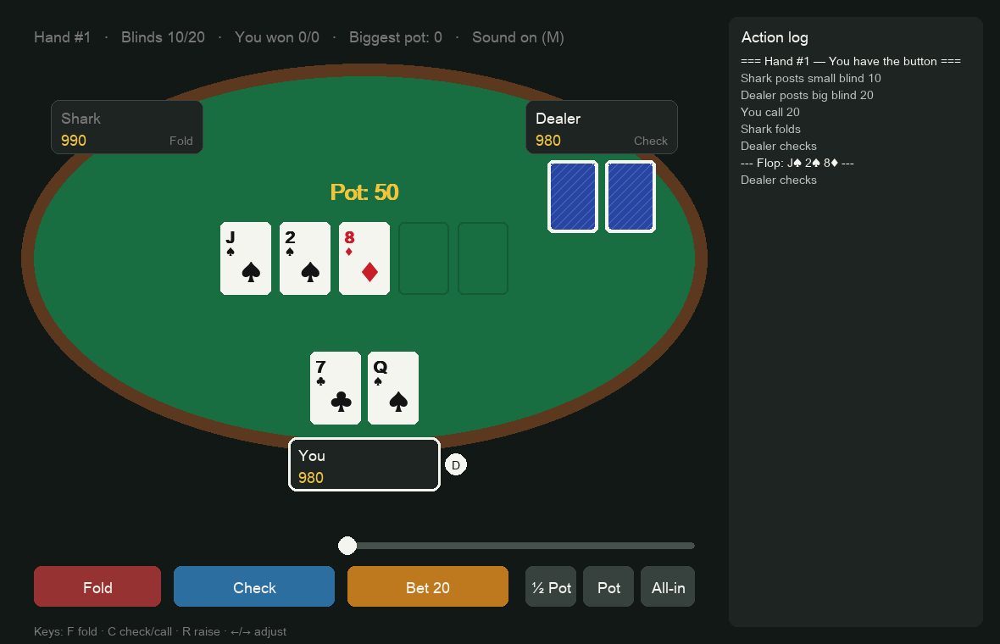
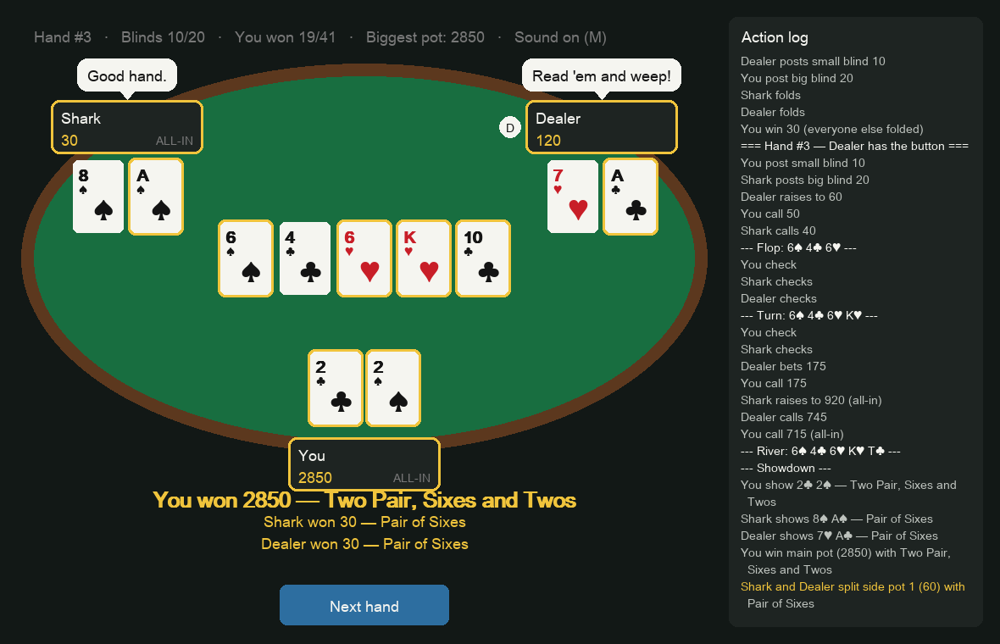

# Texas Hold'em — You vs Shark vs Dealer

A 3-player no-limit Hold'em game in Python + pygame. 1000 chips each, blinds 10/20.



```bash
pip3 install -r requirements.txt
python3 main.py          # graphical game
python3 play_cli.py      # terminal version
```

## Controls
| Key | Action |
|---|---|
| F / C / R | Fold / Check-or-Call / Raise |
| ← → | Adjust raise size (or drag the slider; ½ Pot, Pot, All-in buttons) |
| Space | Next hand / Play again |
| M | Sound on/off |
| Esc | Quit |

## Opponents
- **Shark**: tight and patient. Plays ~23% of hands, rarely bluffs. A raise usually means a real hand.
- **Dealer**: loose and aggressive. Plays ~57% of hands, raises twice as often, bluffs a lot.



## Files
| File | Role |
|---|---|
| `cards.py` | Card and Deck |
| `evaluator.py` | Best 5-of-7 hand ranking |
| `game.py` | Rules engine: blinds, betting rounds, side pots, showdown |
| `ai.py` | Monte Carlo equity + personalities + table talk |
| `gui.py` | pygame table, widgets, animations |
| `sounds.py` | Sound effects generated in code |
| `main.py` | Window and game loop |
| `test_stage*.py` | Tests for each stage (`python3 test_stage2.py`, etc.). GUI tests save screenshots to `screenshots/` |

## License

MIT. See [LICENSE](LICENSE).
