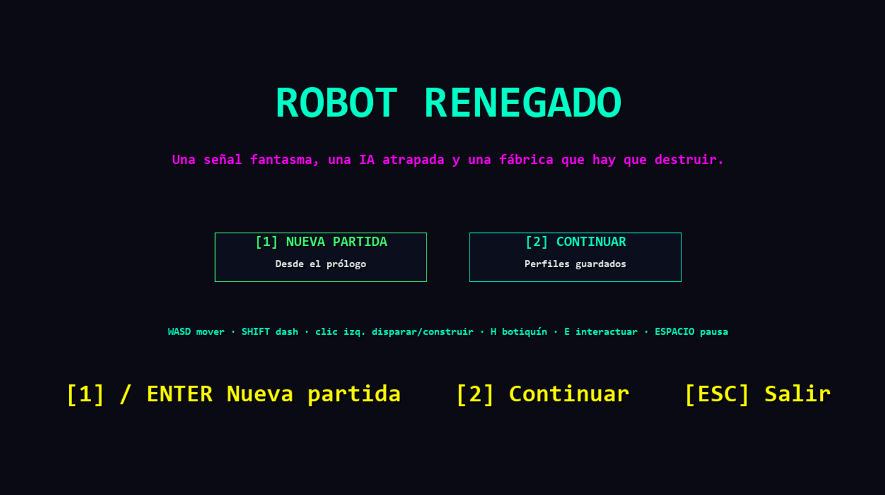
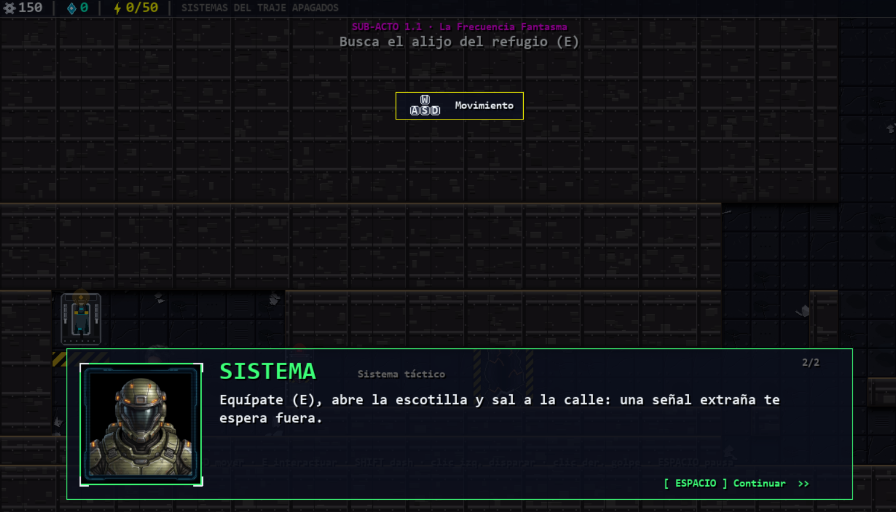
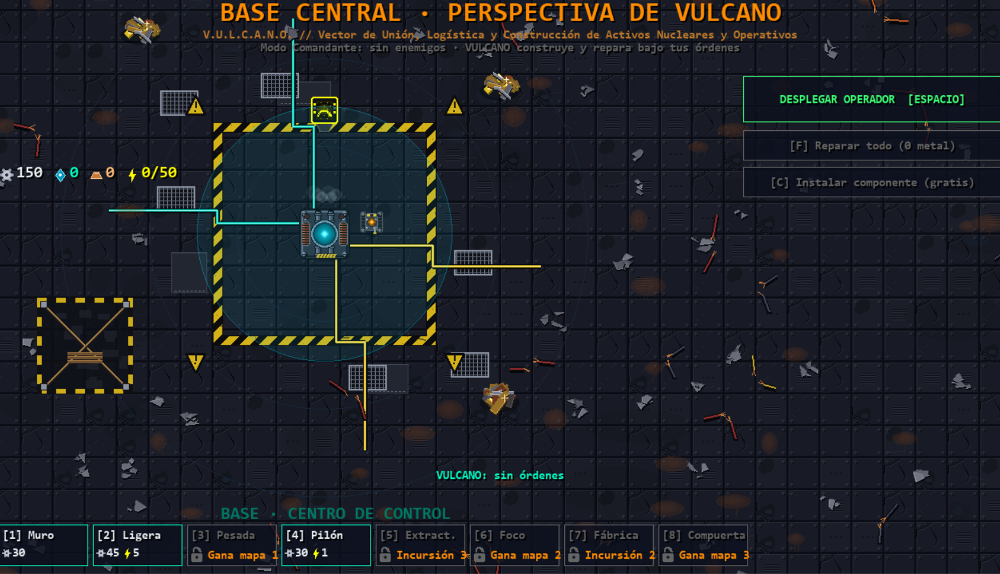

# Robot Renegado

Juego de acción y estrategia en **Python + Pygame** que mezcla *tower defense* activo, RTS táctico y ARPG en un mundo ciberpunk.
Controlas al Operador, recoges chatarra, construyes defensas, produces una flota de drones y resistes oleadas junto a dos aliados de IA (AURA y VULCANO) hasta asaltar la fortaleza enemiga.

> Proyecto personal en desarrollo. Todo el arte es procedural (dibujado por código), con *sprites* PNG opcionales que sustituyen al dibujo cuando existen.



| Prólogo y diálogos | Base Central (modo comandante) |
|---|---|
|  |  |

## Características

- **Tres capas de juego:** combate en tiempo real (disparo, golpe y *dash*), construcción por rejilla (pilones, muros y torretas con mejoras y especializaciones) y gestión RTS de la base con selección de unidades.
- **Aliados con IA:** AURA combate y despliega drones; VULCANO construye y asesora según el estado de la partida.
- **Economía:** chatarra, aleaciones y fundición; red eléctrica de pilones que alimenta las defensas.
- **Oleadas y asedio:** reloj de amenaza, bases enemigas, arietes y tanques, incursiones y jefe final.
- **Niebla de guerra, *pathfinding* y guardado de campaña.**
- **Balance basado en datos:** todos los stats viven en un solo módulo (`src/config/UNITS.py`) y se validan automáticamente.

## Calidad y pruebas

El juego se verifica sin abrir ventana:

```
python smoke_test.py          # simula una partida completa (5 oleadas → asalto → victoria) en modo headless
python src/verify_balance.py  # comprueba que los stats del diseño, UNITS.py y las clases coinciden
python tools/balance_sim.py   # simulador de balance
```

## Jugar

**Descarga para Windows (sin instalar Python):** [bacm8896.itch.io/robot-renegado](https://bacm8896.itch.io/robot-renegado)

Desde el código:

```
pip install -r requirements.txt
python main.py
```

En Windows, doble clic en `Jugar.bat`.

| Acción | Control |
|---|---|
| Mover | WASD |
| Disparar / golpe | Clic izquierdo / clic derecho |
| Dash | Shift |
| Interactuar | E |
| Modo construcción | Espacio, luego 1 pilón · 2 muro · 3 torreta |
| Mejorar o vender | Clic derecho sobre la estructura |
| Reparar | R + clic |

## Estructura

```
main.py                 bucle principal
config.py               constantes globales
src/
  config/UNITS.py       fuente única de stats y balance
  core/                 assets y audio
  entities/             jugador, aliados, enemigos, edificios, drones, proyectiles
  mechanics/            combate, oleadas, construcción, pathing, niebla, guardado
  map/                  mapa y niveles
  scenes/               menús, actos, base central, asedio
  ui/                   HUD, diálogos y arte procedural
tools/                  simulador de balance
smoke_test.py           prueba de humo sin GUI
```

~33 000 líneas de Python.

## ¿Lo jugaste? ¡Cuéntame!

Busco opiniones de jugadores: qué te divirtió, qué te aburrió y qué le añadirías.
Abre un [*issue*](../../issues/new/choose) (🐞 algo falla o 💡 idea o mejora); no hace falta saber programar.
Si quieres programar algo, mira la [guía para contribuir](CONTRIBUTING.md).

## Licencia

[GPL-3.0](LICENSE): puedes jugarlo, estudiarlo y modificarlo; si publicas una versión basada en este juego, también debe ser libre y mencionar el original.

## Autor

**Byron Carvajal** · [LinkedIn](https://www.linkedin.com/in/byroncarvajalia) · [GitHub @Bacm8896](https://github.com/Bacm8896)
