# Serpentis

**Current release:** [Serpentis 1.11.1](https://github.com/Curun1r/Serpentis/releases/tag/serpentis_1.11.1)

A fast-paced 2-D space shooter built with Python and pygame.  
Destroy waves of alien invaders, survive boss encounters, collect power-ups, and chase the high score.

---

## Download

**No Python required — just download and play.**

| Platform | Download |
|----------|----------|
| 🪟 Windows | [Serpentis-Windows.exe](https://github.com/Curun1r/Serpentis/releases/latest/download/Serpentis-Windows.exe) |
| 🍎 macOS | [Serpentis-macOS.zip](https://github.com/Curun1r/Serpentis/releases/latest/download/Serpentis-macOS.zip) |
| 🐧 Linux | [Serpentis-Linux.tar.gz](https://github.com/Curun1r/Serpentis/releases/latest/download/Serpentis-Linux.tar.gz) |

Or browse all releases → **[github.com/Curun1r/Serpentis/releases](https://github.com/Curun1r/Serpentis/releases)**

**macOS — first launch:**

1. Extract `Serpentis-macOS.zip`, move `Serpentis.app` to **Applications**, and open it.
2. If macOS says **“Apple could not verify Serpentis”**, click **Done**.
3. Open **System Settings → Privacy & Security**, scroll to **Security**, and click **Open Anyway** beside the Serpentis notice.
4. Confirm **Open** and authenticate if requested. macOS remembers the exception for this copy of the app.

The current Mac build is not signed with an Apple Developer ID or notarized by Apple.
Use these steps for the copy downloaded from this repository's releases; they grant an exception for Serpentis.
See [Apple's opening instructions](https://support.apple.com/en-us/102445).

**Linux:** extract the archive, then `chmod +x Serpentis && ./Serpentis`.

For an optional Linux application-menu entry with the Serpentis icon, run
`./Serpentis --install-desktop` from the extracted standalone download. This copies
the game and icon into your per-user XDG data folder (normally `~/.local/share`)
without administrator privileges or a separate Python installation. Run the command
again from a new download to update that installed copy. The archive's `README.txt`
also explains removal while preserving your scores and settings.

The running game uses its own window icon on supported desktop environments.
On macOS, use the packaged `Serpentis.app` for its Finder/Dock identity; a game
started through PyCharm can still appear under the Python application's identity.

---

## Screenshots

Previews rendered from version 1.11.1 with the current sprite scales and 16:10 display mode.
Gameplay scenes and leaderboard entries use demonstration runs.

<table>
  <tr>
    <td>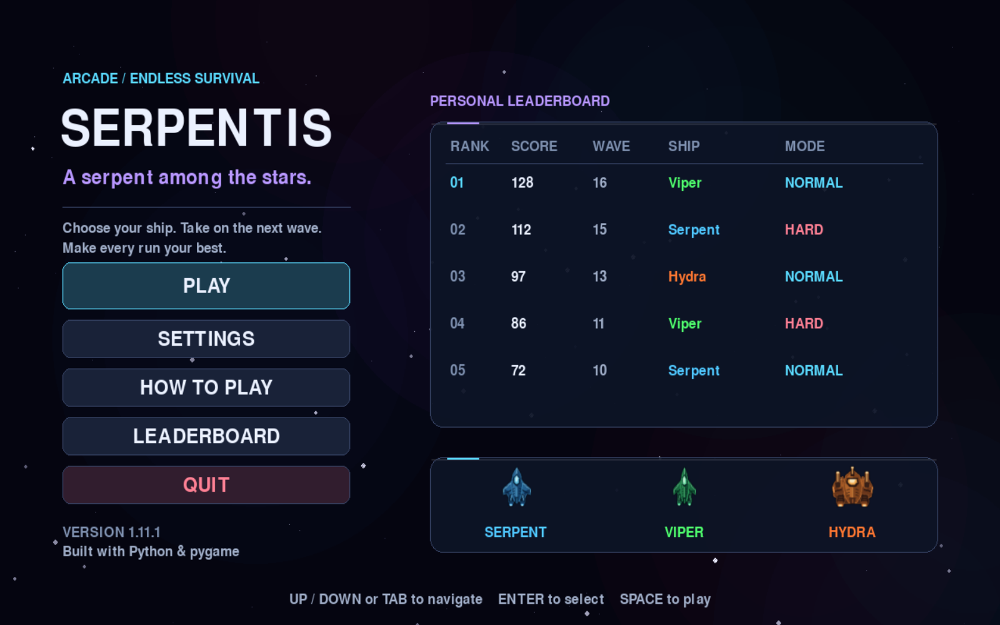</td>
    <td>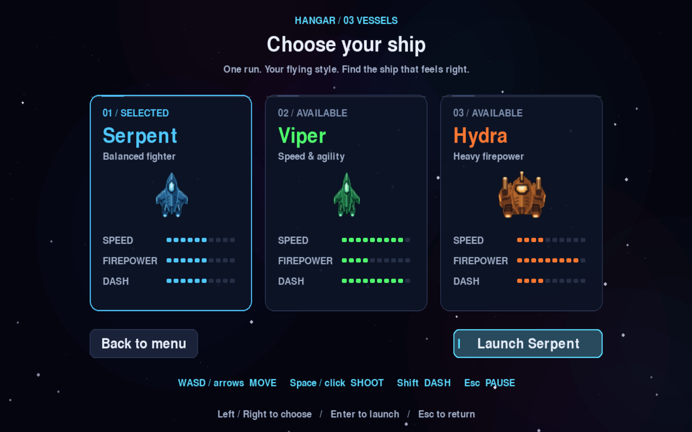</td>
  </tr>
  <tr>
    <td align="center"><em>Main Menu</em></td>
    <td align="center"><em>Ship Selection</em></td>
  </tr>
  <tr>
    <td>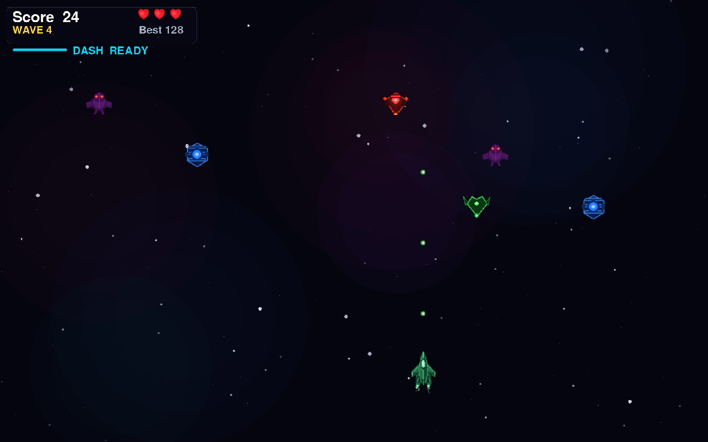</td>
    <td>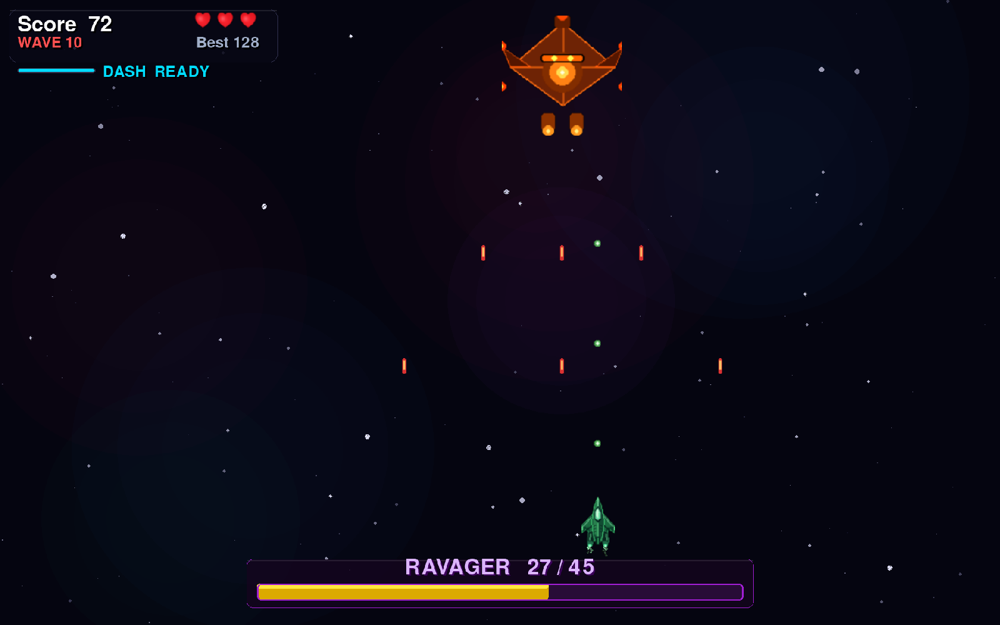</td>
  </tr>
  <tr>
    <td align="center"><em>Gameplay</em></td>
    <td align="center"><em>Boss Fight</em></td>
  </tr>
  <tr>
    <td>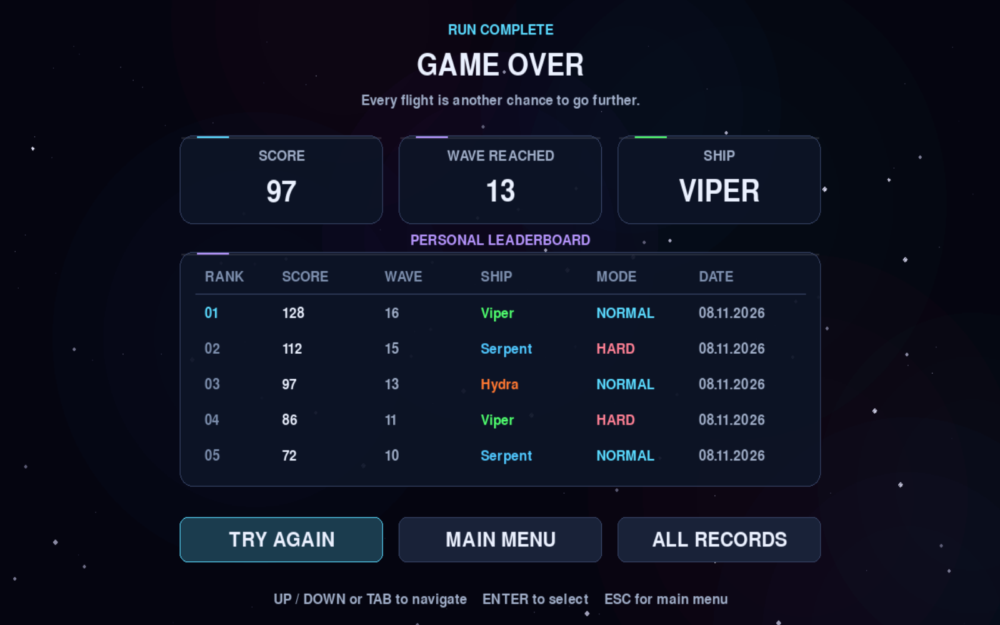</td>
    <td>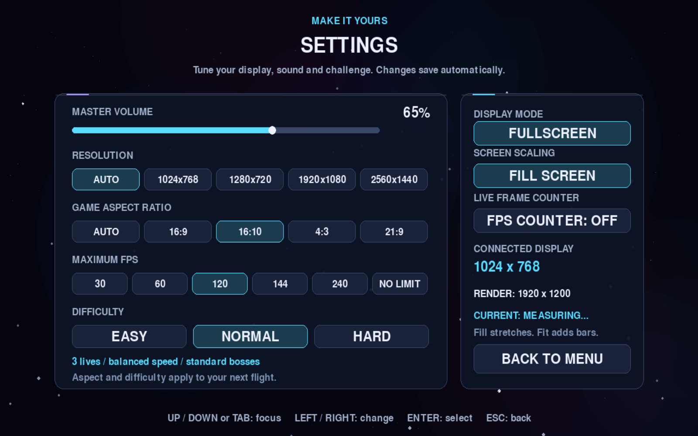</td>
  </tr>
  <tr>
    <td align="center"><em>Run Summary</em></td>
    <td align="center"><em>Settings</em></td>
  </tr>
  <tr>
    <td>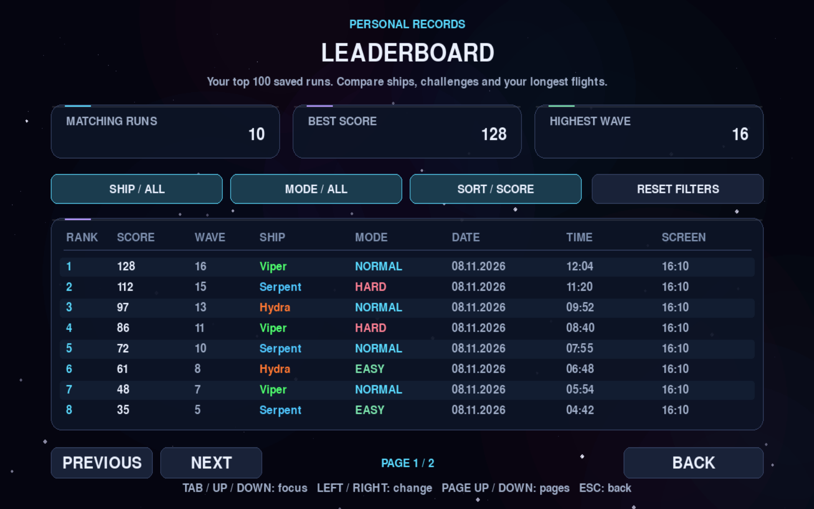</td>
    <td>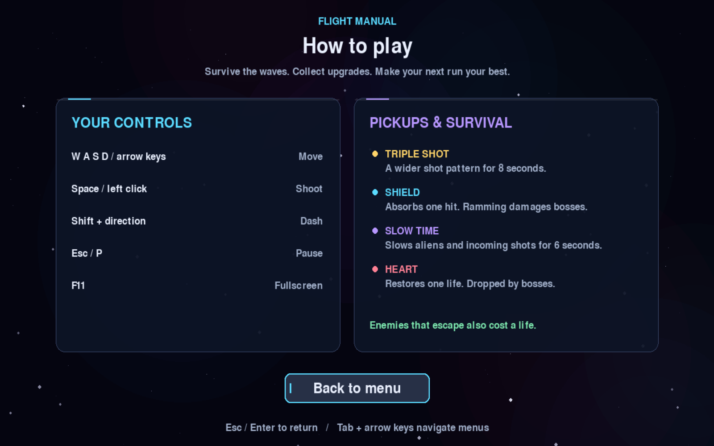</td>
  </tr>
  <tr>
    <td align="center"><em>Personal Records</em></td>
    <td align="center"><em>How to Play</em></td>
  </tr>
  <tr>
    <td>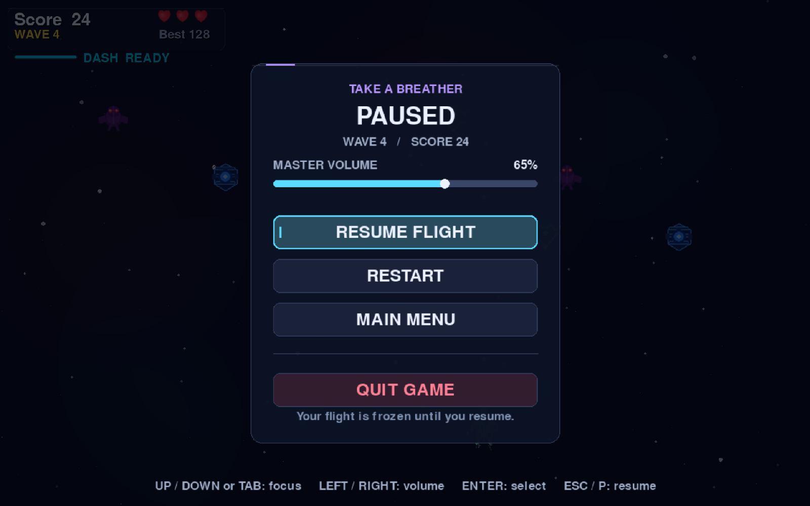</td>
    <td>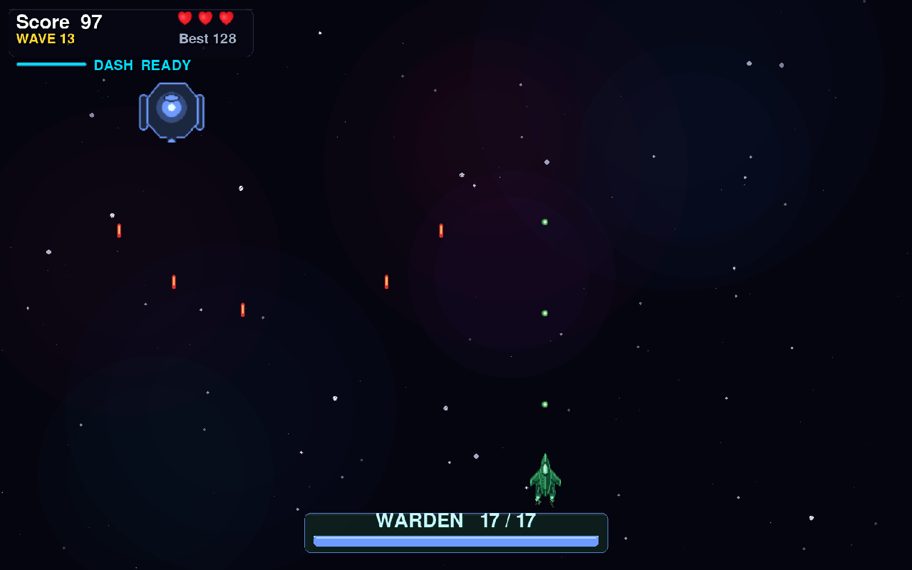</td>
  </tr>
  <tr>
    <td align="center"><em>Pause Menu</em></td>
    <td align="center"><em>Warden Mini-boss</em></td>
  </tr>
</table>

---

## Features

- **Endless wave system** — waves get harder every round (+1 alien, +15% speed per wave)
- **4 alien types** — Normal, Armoured (multi-hit), Zigzag, and Shooter aliens that fire back
- **3 mini-boss roles** — Raider dives at marked positions, Hunter tracks you before firing aimed bursts, and Warden patrols in an ellipse and fires fans with shifting escape lanes; cycle through waves 3, 8, 13 …
- **Full boss fights** — every 5th wave; three visual tiers (Phantom → Ravager → Leviathan) each with unique multi-phase attack patterns
- **3 playable ships** — each with unique procedurally-drawn sprites, stats, and dash timing; a cobalt Serpent interceptor, emerald Viper and armoured amber Hydra share a detailed fleet style with paired engine trails
- **Dash mechanic** — short-range burst in any direction with a cooldown bar
- **Hit recovery** — 0.7 seconds of protection after a physical hit or shield break, with a visible ship blink and timing independent of FPS
- **4 power-ups** — Triple Shot, Shield (absorbs one hit + sound), Slow Time, Heart (+1 life)
- **Floating damage numbers** — real-time score and hit feedback above every enemy
- **Visual effects** — particle explosions, engine trail, camera shake, shield ring, slow-time tint
- **Procedural audio** — every sound generated at runtime via numpy (no audio files required)
- **Top-100 personal leaderboard** — filter by ship and difficulty, sort by score, wave or date, and browse eight runs per page; each run records its date, duration and game aspect ratio
- **Settings** — volume, automatic or manual resolution, game aspect ratio, Fill/Fit scaling, maximum FPS, live FPS counter, difficulty and fullscreen
- **Keyboard-friendly menus** — shared focus states, readable panels, and an in-game How to Play guide
- **Automatic Mac display mode** — follows the current monitor and respects macOS display scaling; manual resolution remains available
- **Selectable game aspect ratio** — Auto, 16:9, 16:10, 4:3 or 21:9 set the playfield shape; Fill covers the display and Fit preserves proportions with bars, with matching mouse coordinates
- **HD gameplay rendering** — world geometry and HUD fonts render directly at the selected resolution, starting at Full HD, independently of movement and collision coordinates; 16:10 starts at 1920×1200
- **Efficient rendering** — precomposed nebulae, reusable pause artwork and narrow warning strips reduce alpha blending; the HD pixel-art world uses fast final scaling while menus retain smooth scaling
- **Precise frame pacing** — 30, 60, 120, 144 or 240 FPS caps and a No Limit option, with a measured frame counter

---

## Ships

| Ship | Style | Speed | Firepower | Dash |
|------|-------|:-----:|:---------:|:----:|
| **Serpent** | Balanced | ●●●●●●○○○○ | ●●●●●○○○○○ | ●●●●●●○○○○ |
| **Viper** | Speed & agility | ●●●●●●●●●○ | ●●●●○○○○○○ | ●●●●●●●●●○ |
| **Hydra** | Heavy firepower | ●●●●○○○○○○ | ●●●●●●●●●○ | ●●●●○○○○○○ |

---

## Controls

| Key | Action |
|-----|--------|
| `←` `→` `↑` `↓` or `WASD` | Move |
| `Space` or Left Click | Shoot |
| `Shift` | Dash |
| `P` / `Esc` | Pause |
| `F11` | Toggle fullscreen |

In menus, use `Up` / `Down` or `Tab` to navigate and `Enter` to select. Settings use `Left` / `Right` to adjust the focused row. In the hangar, use `Left` / `Right` to choose a ship and `Enter` to launch. Open **How to Play** from the main menu for controls and pickup descriptions.

On macOS, **AUTO** resolution is enabled by default. Fullscreen uses the current monitor's desktop resolution; windowed mode leaves room for the system menu bar and Dock. The game adapts when moved to another monitor and keeps its proportions. Choose a fixed resolution in Settings to disable Auto. Fullscreen always uses the desktop-sized window; the chosen resolution controls gameplay rendering quality.

**Game aspect ratio** is separate from the window resolution. Choose **Auto**, **16:9**, **16:10**, **4:3** or **21:9** to set the playfield for your next flight. Auto uses the connected display's proportions, within the supported 4:3 to 32:9 range. The camera width changes while object sizes in the game stay consistent. **Fill Screen** fills the entire window and may stretch the image when its ratio differs from the playfield; **Fit / Keep Ratio** preserves proportions with black bars. Fill is the default. New source installations on macOS prefer **16:10** when the connected display is closest to that format, including MacBook display modes. Other displays keep the 16:9 default, and existing saved choices take precedence. Aspect and difficulty changes take effect when you start or retry a flight.

**Rendering resolution:** the game scene starts at Full HD: 1920×1080, or 1920×1200 for 16:10. Higher resolution selections increase that framebuffer. Auto follows the current desktop mode with the same HD minimum; explicit 720p/lower presets remain available to reduce rendering work. Windowed mode fits within the desktop; fullscreen covers the desktop even with a lower selected rendering resolution. Settings shows both the connected display size and the actual game render size. Menus retain their 1280×720 design canvas and scale for presentation.

**Maximum FPS** applies immediately: choose **30**, **60**, **120**, **144**, **240** or **No Limit** (`0` as the frame cap). The live counter reports measured rendering FPS in Settings and during play. A cap is a maximum, so demanding scenes or slower hardware can run below it. Rendering FPS and monitor refresh rate are different: a 60 Hz monitor cannot display 144 distinct frames each second.

Open **Leaderboard** from the main menu or **All Records** after a flight. Filter by ship or difficulty, sort by score, highest wave or newest date, and use **Page Up / Page Down**, the mouse wheel or the page buttons to browse. Existing scores remain available; older runs without duration metadata show `--:--`.

After a physical hit or shield break, the ship blinks during **0.7 seconds of recovery**.
Projectiles and direct contact cannot immediately remove another life during that window;
pausing freezes the recovery timer. Each enemy that escapes still costs a life.

The best-score display updates immediately during combat. Pending improvements are saved
at wave transitions, pause, restart/menu, normal exit and the end of a flight, instead of
writing to disk after every kill. Abandoned flights retain their best score without creating
a completed-run entry. Force quitting before a checkpoint can lose an improvement from the current wave.

---

## Installation

**Requirements:** Python 3.10 or newer. Python 3.12 is used for desktop releases.
Internet access is needed for the first source setup or when dependencies change.

```bash
git clone https://github.com/Curun1r/Serpentis.git
cd Serpentis
```

**Source launchers:**

| Platform | Launch |
|----------|--------|
| macOS | double-click `run.command` |
| Linux | `bash run.sh` |
| Windows | double-click `run.bat` |

The launchers prepare a project-local `.venv`, install the complete dependency list there,
and reuse it on later runs. They do not install packages into the system Python and do not require Pipenv.
An existing valid `.venv` (including a symlink to a Pipenv environment) is preserved.
The launcher stops if setup fails; it never starts the game with a failed installation.

**Setup without opening the game:**

```bash
python3 launcher.py --setup
python3 launcher.py --check
```

On Windows, use `python` in place of `python3`, or run `run.bat --setup` / `run.bat --check`.
The same options work with `run.command` and `run.sh`.
After setup, the source launchers work offline while the dependency list remains unchanged.
`--check` makes no changes and returns a nonzero exit code if setup or repair is needed.
It validates the installed runtime versions as well as imports; `--setup` repairs a version
mismatch in the existing environment without replacing the environment itself.

**PyCharm:** open this folder, select `.venv/bin/python` on macOS/Linux or
`.venv\Scripts\python.exe` on Windows as the project interpreter, and run `main.py`.
If the environment is missing, run the source launcher once or use `launcher.py --setup` first.
The game resolves its images, configuration and saves independently of PyCharm's working directory.

**Manual environment:**

```bash
python3 -m venv .venv
.venv/bin/python -m pip install -r requirements.txt
.venv/bin/python main.py
```

On Windows, use `.venv\Scripts\python.exe` for the last two commands.
Pipenv remains an optional Python 3.12 alternative: `pipenv install` followed by
`pipenv run python main.py`. Its `Pipfile` mirrors the runtime pins; the tracked
`requirements*.txt` files are the canonical dependency lists used by CI and releases.

## Development

Install the pinned runtime and development tools into the project environment:

```bash
.venv/bin/python -m pip install -r requirements-dev.txt
.venv/bin/python -m pip check
.venv/bin/python -m pytest -q
.venv/bin/python -m ruff check .
```

On Windows, replace `.venv/bin/python` with `.venv\Scripts\python.exe`.
Tests use invisible display/audio drivers and disposable save folders, so they do not
modify your scores or settings.

`requirements.txt` pins the runtime packages. Python 3.10 uses NumPy 2.2.6;
Python 3.11 and newer use the tested NumPy 2.4.6 branch. `requirements-dev.txt`
also pins pytest, Ruff and their transitive dependencies with platform/Python markers.

Desktop builds use **Python 3.12** and the complete pinned build toolchain:

```bash
.venv/bin/python -m pip install -r requirements-build.txt
```

The platform build commands live in `.github/workflows/release.yml`; the Mac app recipe
is `packaging/serpentis-macos.spec`. Update dependency pins deliberately, then run the
CI matrix and built-executable startup checks before publishing a release.

### Application icons

The app uses a large Serpent ship mark adapted to each desktop: a dark rounded tile
with transparent outer margins for macOS, and a transparent ship for Windows/Linux.
Small icons use simplified artwork. The Mac ICNS contains standard/Retina representations
through 1024 px; the Windows ICO includes 16–256 px sizes, and the runtime/Linux PNG is 512 px.

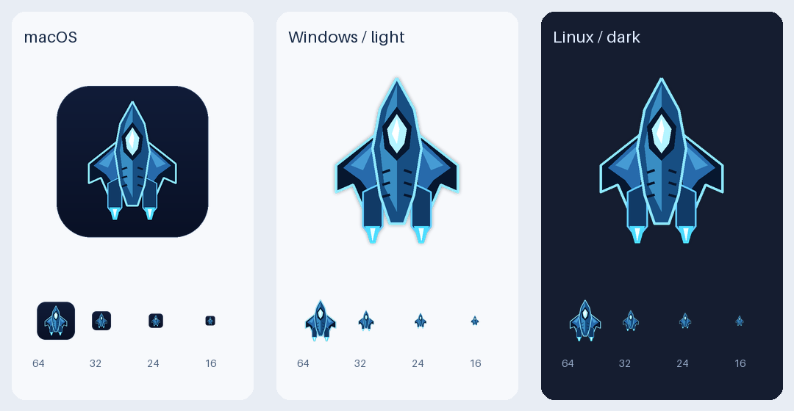

The scalable drawing and all export rules live in `scripts/build_icons.py`.
With the pinned build dependencies installed, regenerate or verify the assets:

```bash
.venv/bin/python scripts/build_icons.py --preview packaging/icons/preview.png
.venv/bin/python scripts/build_icons.py --check
```

Release builds validate these exports before packaging. Updating the source icon takes
effect in a newly built app; an installed app uses its bundled artwork. macOS may retain
an older Dock icon: close the previous app and add the new app bundle to the Dock again.

## Startup checks and releases

A bounded check starts the real game with invisible SDL drivers, renders all nine screens,
loads bundled images, generates audio, and verifies settings and scores in disposable save data:

```bash
.venv/bin/python main.py --smoke-test --smoke-report startup-report.json
```

The report includes the application/version, success status, and actual alien/projectile dimensions.
Release verification rejects builds with incorrect sprite sizes. It checks the application itself;
it does not validate Apple's signing/notarization requirements or the first-launch Gatekeeper prompt.
This check leaves player saves untouched.
Normal startup failures are recorded in `data/startup.log` for source runs, or in the application's
per-user save folder for desktop builds. Source saves stay in this project's `data/` directory regardless
of the working directory. Packaged saves remain in:

- macOS: `~/Library/Application Support/Serpentis/`
- Windows: `%APPDATA%\Serpentis\`
- Linux: `$XDG_DATA_HOME/Serpentis/`, or `~/.local/share/Serpentis/` by default.

`SERPENTIS_DATA_DIR` can explicitly select another save folder for isolated testing.
If source setup fails, check the launcher's error message and retry `--setup` after fixing the cause.
An incomplete `.venv` is reported rather than overwritten; preserve any files you need before replacing it.

CI checks Windows, macOS and Linux on Python 3.12, plus the Python 3.10 minimum on Linux.
On all three platforms it also tests the source launcher from a clean copy in a path with spaces,
including first setup, dependency checks, and reuse of the prepared environment.
Release builds must pass `scripts/verify_build.py` against the actual executable, from an unrelated
working directory, before they are archived or uploaded. Every new release also includes
`SHA256SUMS.txt` for its three desktop downloads.

Before publishing, update `APP_VERSION` in `app_info.py` and `RELEASE_NOTES.md`, then tag the matching
commit with `serpentis_<version>`. A manual **Build & Release** run on a branch creates test artifacts
without publishing a release. No release is created by an ordinary commit or branch push.

---

## Configuration

Copy the example config to customise speeds, scales, or the window title:

```bash
cp config.example.json config.json
```

`config.json` is gitignored — changes stay local.

---

## Project structure

```
main.py              — entry point, startup diagnostics and bounded smoke check
launcher.py          — isolated source setup and launch for all platforms
app_info.py          — shared application name, tagline, and release version
game.py              — application setup, screen transitions and frame coordination
game_state.py        — shared screen-state enum without controller dependencies
combat.py            — ordered gameplay updates, shooting, collisions and rewards
rendering.py         — world layers, visual overlays and loading-screen drawing
hud.py               — score, lives, cooldowns and boss/power-up indicators
effects.py           — particles, engine trails, floating labels and camera shake
fighter.py           — player ship (movement, dash)
alien.py             — Alien, ArmoredAlien, ZigzagAlien, ShooterAlien
boss.py              — full bosses with phase-based attacks
mini_boss.py         — Raider, Hunter and Warden movement, windups and attacks
ball.py              — player bullet
alien_bullet.py      — enemy bullet
powerup.py           — TripleShot, Shield, SlowTime, Heart pick-ups
explosion.py         — explosion animation sprite
ship.py              — ShipConfig definitions (Serpent / Viper / Hydra)
ship_sprites.py      — procedural ship sprite builder
ui_fx.py             — glass panels, damage numbers, glow effects
ui_theme.py          — shared menu colors, buttons, focus, and leaderboard
display_layout.py    — monitor detection, automatic sizing, proportional viewport
frame_timing.py      — precise FPS limits and measured frame rate
world_painter.py     — logical world coordinates to HD geometry, fonts and cached sprites
score_manager.py     — top-100 records, validation, filters and atomic JSON saves
settings_manager.py  — display, aspect, FPS, sound and difficulty preferences (JSON)
assets.py            — image / sound cache + procedural audio
music.py             — procedural background music player
background.py        — parallax star field
config.py            — runtime constants (loaded from project config.json)
paths.py             — source/bundled resources and persistent save locations
scripts/             — built-executable verification and release checksums
screens/             — main menu, hangar, results, leaderboard, pause, settings, controls
tests/               — pytest suite for logic and headless gameplay regressions
```

`Game` owns the active run and coordinates its components. Its main loop processes
events, advances the current screen, applies a fade, and presents the result.
`combat.update()` names each simulation step and stops after lethal damage before
collecting pickups or advancing a wave. `rendering` and `hud` read the run state;
`VisualEffects` owns and resets temporary visual state for each new flight.

Drawing does not advance the simulation. The world painter draws directly into the HD framebuffer using logical 720-unit world coordinates. It scales geometry and rasterizes HUD fonts at the target resolution without changing actor images, movement or collision bounds. Text and sprite caches avoid repeating static work.

The controller advances flash/shake
counters after painting the world, preserving the existing visual timing.
Imports used only for type annotations stay behind `TYPE_CHECKING`, so these
modules do not need to import the application controller at runtime.

---

## License

[MIT](LICENSE) © Yehor Petrenko
