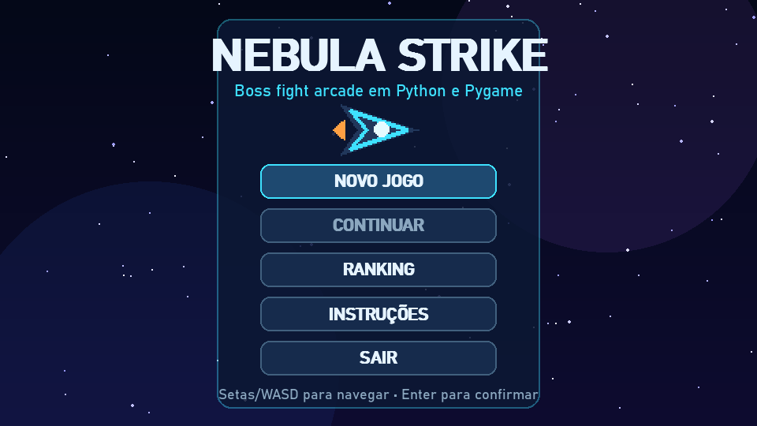
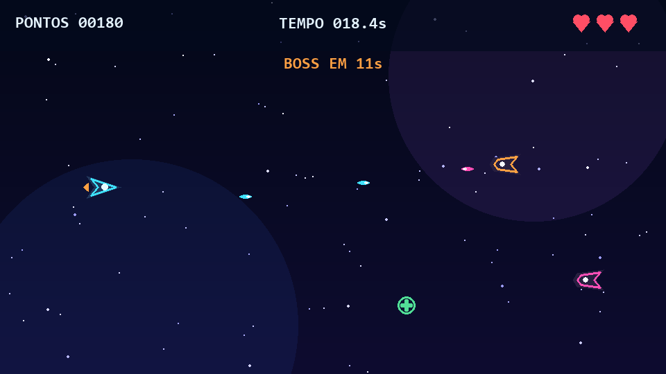
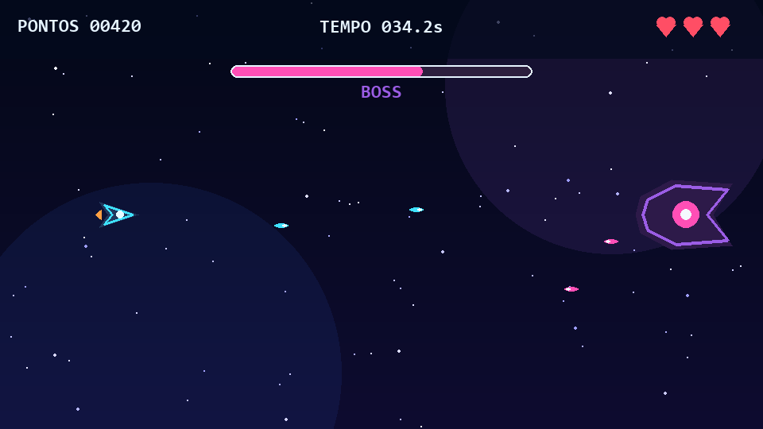

# Nebula Strike

Um shoot 'em up arcade feito em Python e Pygame. Pilote uma nave, enfrente dois tipos de inimigo, colete melhorias e sobreviva por 30 segundos para encarar o boss.

O projeto é uma reescrita limpa de um trabalho acadêmico anterior. Os gráficos são desenhados em tempo de execução e os efeitos sonoros são sintetizados pelo próprio código: nenhum arquivo de imagem, música ou efeito de origem externa é distribuído aqui.



| Partida | Boss fight |
| --- | --- |
|  |  |

## Destaques

- arquitetura orientada a objetos, com entidades e cenas separadas;
- menu, instruções, ranking, vitória e derrota;
- dois tipos de inimigo com dificuldade progressiva;
- boss acionado após 30 segundos;
- power-ups de escudo e turbo;
- salvamento seguro de progresso e ranking em JSON;
- colisões por retângulos e invulnerabilidade temporária após dano;
- gráficos e áudio procedurais, sem assets externos;
- testes automatizados para entidades, persistência e cenas.

## Como executar

Requisitos: Python 3.11 ou mais recente.

```bash
python -m venv .venv
```

No Windows PowerShell:

```powershell
.\.venv\Scripts\Activate.ps1
python -m pip install -r requirements.txt
python main.py
```

No Linux ou macOS:

```bash
source .venv/bin/activate
python -m pip install -r requirements.txt
python main.py
```

## Controles

| Ação | Teclas |
| --- | --- |
| Mover | Setas ou WASD |
| Atirar | Barra de espaço |
| Confirmar no menu | Enter ou espaço |
| Voltar e salvar durante a partida | Esc |

O progresso fica em `data/progress.json` e o ranking em `data/ranking.json`. Esses arquivos são criados localmente e não são versionados.

## Testes

```bash
python -m unittest discover -s tests -v
```

Para recriar as capturas de tela sem abrir uma janela interativa:

```bash
python main.py --capture-screenshots docs/screenshots
```

## Organização

```text
game/
  app.py       # máquina de estados da aplicação
  scenes.py    # menu, jogo, ranking e resultado
  entities.py  # jogador, inimigos, boss, tiros e power-ups
  storage.py   # progresso e ranking em JSON
  visuals.py   # desenho procedural dos elementos visuais
  audio.py     # tons e trilhas sintetizados em tempo de execução
tests/         # testes automatizados
docs/          # auditoria de licenças e capturas de tela
main.py        # ponto de entrada e captura de telas
```

## Licenças

O código, os gráficos procedurais e a composição do áudio procedural deste repositório são disponibilizados sob a [Licença MIT](LICENSE). A dependência Pygame possui licença própria; consulte [THIRD_PARTY_NOTICES.md](THIRD_PARTY_NOTICES.md).

Os arquivos externos do projeto acadêmico original não foram incluídos porque não havia documentação suficiente para redistribuí-los com segurança. O nome anterior também foi substituído por **Nebula Strike** para evitar confusão com a obra cinematográfica de mesmo nome. A análise completa está em [docs/LICENSING.md](docs/LICENSING.md).

## Autor

Daniel Christofer
