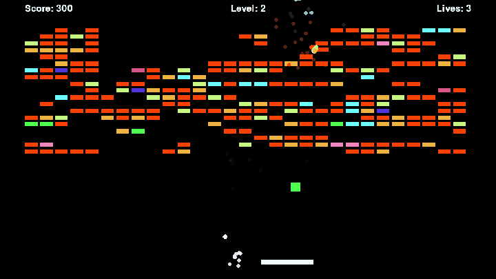
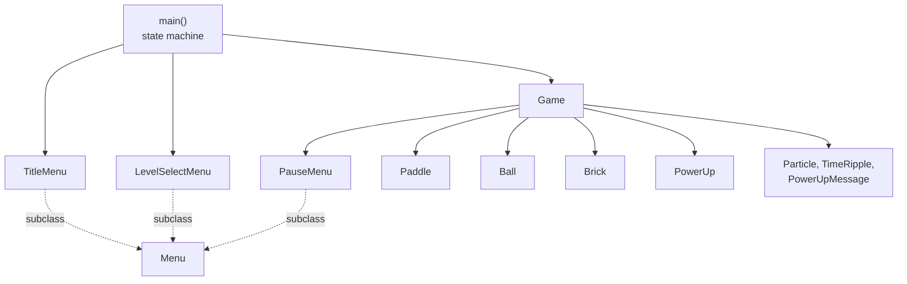
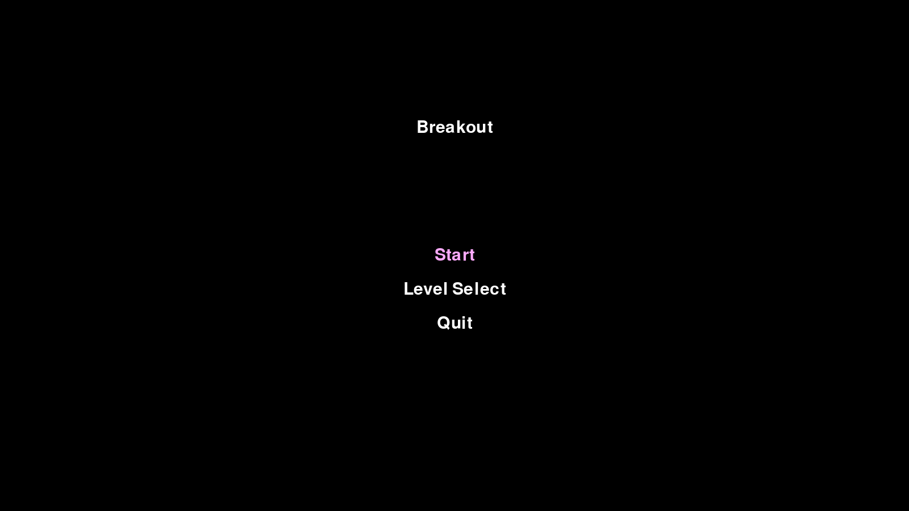
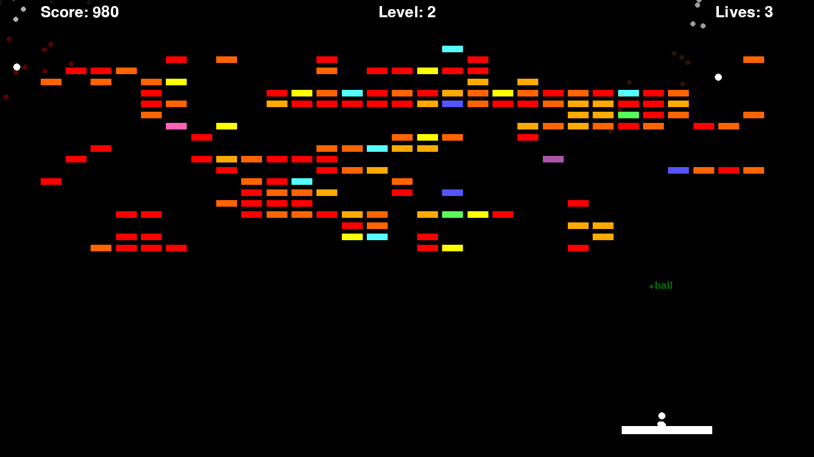
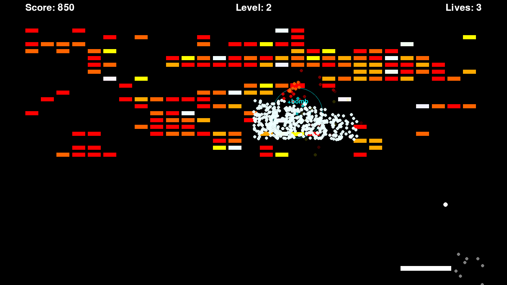
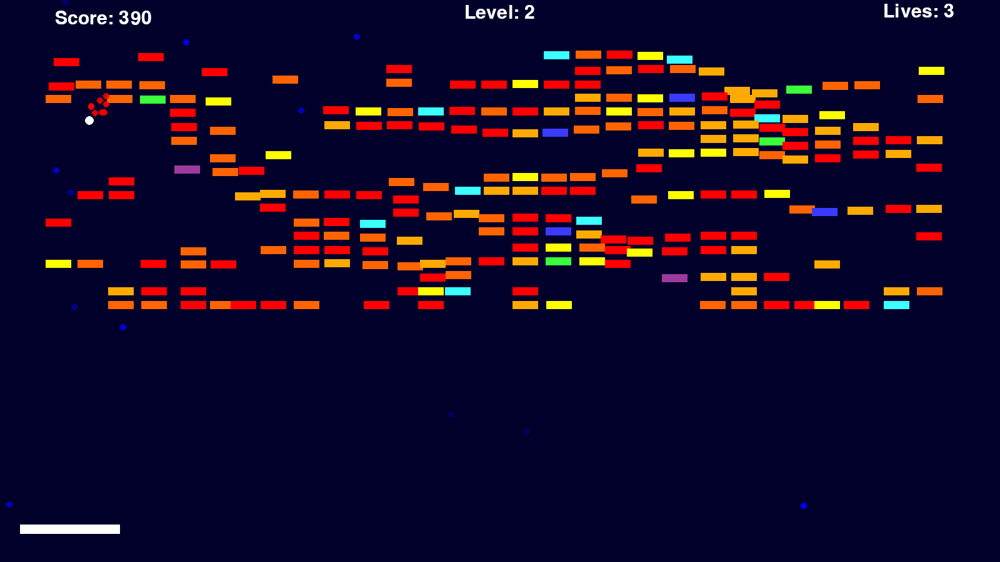

# Breakout


[](LICENSE)

**A fullscreen Pygame take on Atari Breakout with a new random brick field every level, power-ups, multiball, and bombs.**

Clear the field, keep at least one ball alive, and each level comes back with more rows, tougher bricks, and a faster ball.



## Features

- **Random brick fields**: every level builds a new layout from a smoothed noise grid, so no two runs look the same.
- **Rising difficulty**: each level adds two rows (up to 25), shifts bricks toward 3 and 4 hits, and makes the ball 5% faster.
- **Multi-hit bricks** that take one to four hits and change color from yellow to red as they wear down.
- **Five power-ups**: slow time, a wider paddle, an extra ball, an extra life, and bomb bricks that blow up their neighbors.
- **Multiball**: every extra-ball pickup adds another ball to the field.
- **Paddle aim**: where the ball lands on the paddle sets its bounce angle, up to 45 degrees either way.
- **Effects**: particles on every hit, a ripple distortion from bombs, and a blue warp while slow time is active.
- **Menus**: title, level select (levels 1 to 4), and a pause menu with a 3 second resume countdown.
- **Scales to your screen**: paddle, bricks, ball, fonts, and power-ups are sized from the display resolution.

## Quick start

```bash
python3 -m venv .venv && .venv/bin/pip install -r requirements.txt && .venv/bin/python breakout.py
```

The game opens fullscreen on the largest connected display (by pixel area), which is not always the primary monitor.

## Controls

| Action | Control |
| --- | --- |
| Move paddle | Left / Right arrows |
| Launch ball | Space |
| Pause | `P` or `Esc` |
| Navigate menus | Up / Down arrows or mouse |
| Select | Enter or left click |

## How it plays

You start with 3 lives. Losing every ball on the field costs a life and puts a new ball on the paddle; a new ball still comes at Lives: 0, so you effectively get four. Clearing every brick moves you to the next level and resets the wide-paddle effect.

| Power-up | Color | Effect |
| --- | --- | --- |
| Slow time | Blue | Halves ball speed for about 10 seconds and warps the screen. |
| Extend platform | Purple | Widens the paddle by 50% for the next 5 paddle hits. |
| Extra ball | Green | Drops a new ball in from the top. |
| Extra life | Pink | Adds one life. |
| Bomb | Cyan | Goes off on contact and breaks every regular brick around it. |

Power-up bricks flash and always break in one hit. The first four drop a pickup you catch with the paddle; bombs trigger right away. A brick that survives a hit also has a 2% chance of turning into a power-up brick. Each broken brick and each bomb scores 10 points; bricks destroyed by a blast score nothing.

## How it works

Everything lives in one file, `breakout.py`, running a fixed 60 FPS loop.



1. `main()` switches between title, level select, and play states.
2. `Game.create_bricks()` samples a 10x25 random grid with bilinear interpolation and places a brick wherever the value is above 0.5. The hit distribution depends on the level.
3. Each frame, `Game.update()` moves balls, resolves wall, paddle, and brick collisions, applies bombs and pickups, and ages particles and ripples. `Game.draw()` renders it all with the ripple and slow-time offsets applied.

## Screenshots

| | |
| --- | --- |
|  Title menu. |  Three balls after an extra-ball pickup. |
|  A bomb brick going off on level 2. |  Slow time with the blue tint. |

One more on level 3 is in [docs/screenshots](docs/screenshots/level-3-powerups.png).

## Limitations

- **Fullscreen only.** There is no windowed mode or resolution option.
- **Speed depends on resolution and frame rate.** Ball speed is a fixed number of pixels per frame, so the game feels faster on smaller screens, and physics slow down if the machine cannot hold 60 FPS.
- **No sound, high scores, or saves.** A game over drops you straight back to the title menu.
- **Level select stops at 4**, though play continues past it with rows capped at 25.
- **Rectangle collisions.** The ball uses a bounding box, so corner hits can bounce a little off.
- **No automated tests or CI yet.**

## Project structure

```
breakout.py              the whole game: menus, entities, effects, main loop
docs/media/gameplay.gif  README demo
docs/screenshots/        gameplay screenshots
requirements.txt         pygame
```

## Docs

- [Changelog](CHANGELOG.md)

## License

MIT. See [LICENSE](LICENSE).
