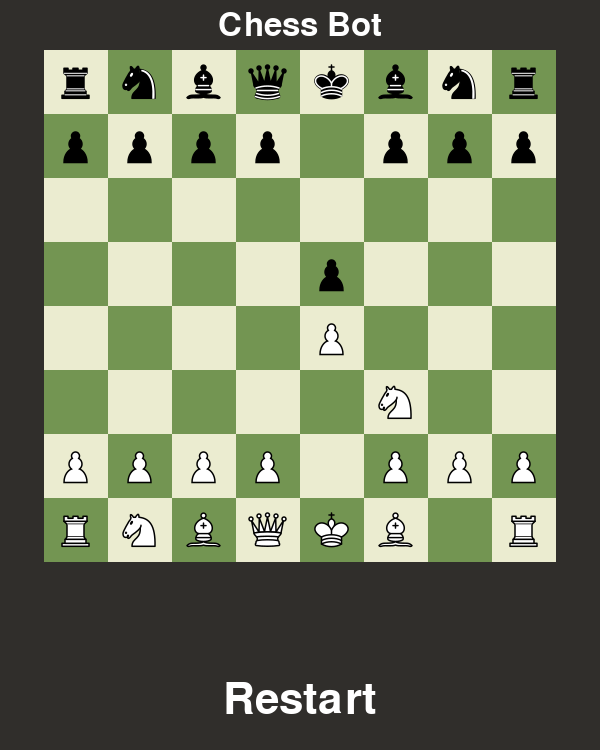
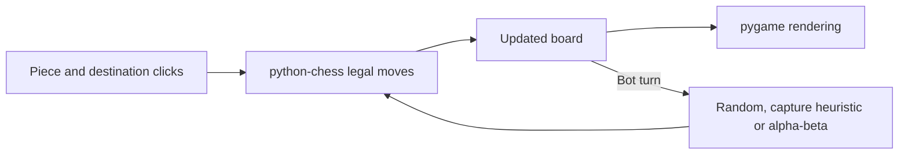

<div align="center">

# Chess

**A desktop board for a game with a friend—or a small chess bot.**

Click to move, choose a difficulty, and see how a simple search turns rules into an opponent.

[](requirements.txt) [](Bot/Bot.py) [](LICENSE)

[**Play locally**](#play-locally) · [**Meet the bot**](#three-ways-to-pick-a-move) · [**Explore the code**](#explore-the-code)

</div>

## From legal moves to a playable opponent

This learning project connects a graphical board to three move-selection strategies. The rules come from `python-chess`; the project adds a pygame interface, turn handling, promotion choices and a bot you can inspect in one small engine module.

<p align="center"></p>

*Captured from the unmodified game's pygame event loop using a headless display. Scripted mouse clicks played `e2e4`, `e7e5`, `g1f3`; the shown position is real game state.*

| Play face to face | Try a bot | Keep the controls simple |
| --- | --- | --- |
| Two players share the same machine | Play White against Easy, Medium or Hard | Click a piece and destination; switch selection, choose a promotion or confirm a restart |

## Play locally

Use Git, Python and a desktop display. Python 3.13 is the verified environment; pygame and python-chess are installed from the requirements file.

```sh
git clone https://github.com/Muneer320/Chess.git
cd Chess
python -m pip install -r requirements.txt
python Bot/Bot.py
```

Choose **Player vs Player** or **Player vs Bot**, then a bot difficulty. White moves first. Click a piece and a legal destination; a pawn reaching the last rank opens a queen/rook/bishop/knight picker. The bot's last move is highlighted. **Restart** asks for confirmation.

Piece images load relative to `Bot/Bot.py`, so the game can also be launched with its full path from another directory. No account, network service or configuration secrets are required.

## Three ways to pick a move

| Level | Actual strategy |
| --- | --- |
| Easy | Random legal move |
| Medium | Most valuable available capture; random legal move if none exists |
| Hard | Three-ply alpha-beta search, scoring material and simple positional terms |



Castling, en passant, checks, mate and draw outcomes use the rules library. Claimable threefold/fifty-move draws are treated automatically by this interface. Hard is a small educational engine: it has no playing-strength rating, time-control system or guaranteed response-time benchmark. Search runs in the game process and may pause the UI while thinking.

## Explore the code

| Path | Role |
| --- | --- |
| [Bot/Bot.py](Bot/Bot.py) | Rendering, input, mode selection, promotion and restart |
| [Bot/engine.py](Bot/engine.py) | Difficulty strategies, evaluation, search and outcome messages |
| [tests/test_engine.py](tests/test_engine.py) | Legal move, capture, mate, draw and search checks |
| [pieces/](pieces/) | Local piece images |
| [legacy/](legacy/) | Earlier experiments retained as history |

<details>
<summary><strong>Earlier versions and their limitations</strong></summary>

The legacy Tkinter, notation-input and pygame move-list scripts are not maintained. The Tkinter version has known bugs, and the earlier pygame move list does not work correctly. They are historical experiments, not alternative verified interfaces. Run them from the repository root if exploring their relative asset paths.

</details>

## Tests and contributions

```sh
python -m pip install pytest
python -m pytest tests
```

Report a reproducible bug in [Issues](https://github.com/Muneer320/Chess/issues), ideally with the move sequence or position and selected mode. For a focused PR, run the engine tests and check affected UI behavior. Keep changes to legal-move rules in the library boundary rather than duplicating them in the interface.

Created by [Muneer Alam](https://github.com/Muneer320). [MIT license](LICENSE); game rules provided by the separately licensed [python-chess](https://python-chess.readthedocs.io/) dependency.
