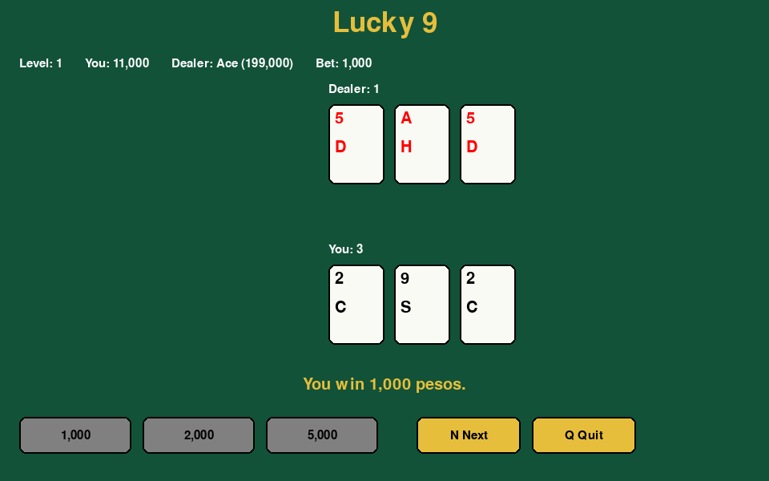

# Python Game Suite

[](https://github.com/Onehand-Coding/python-game-suite/actions/workflows/ci.yml)
[](https://opensource.org/licenses/MIT)
[](https://www.python.org/downloads/)
[](https://github.com/astral-sh/ruff)

A collection of classic terminal and GUI games built with Python. Games are
discovered automatically at runtime, so adding a new one does not require
editing the launcher.



## Games

| Game | Mode | Description |
| --- | --- | --- |
| Hangman | Terminal | Word guessing with ASCII art |
| Lucky9 | Terminal | Card game with saves, levels, and debt |
| Lucky9 | GUI | Playable pygame card game with mouse and keyboard |
| Mastermind | Terminal | Code-breaking logic puzzle |
| Number Guessing | Terminal | Guess the computer's number with hints |
| Rock, Paper, Scissors | Terminal | Best-of-five hand game |

## Quick Start

Requirements: Python 3.10+ and [uv](https://github.com/astral-sh/uv).

```bash
git clone https://github.com/Onehand-Coding/python-game-suite.git
cd python-game-suite
uv sync --extra dev
uv run run-games
```

## Controls

### Lucky9 GUI

| Input | Action |
| --- | --- |
| `1`, `2`, `3` or chip click | Bet 1,000, 2,000, or 5,000 |
| `H` or Hit | Draw one card |
| `G` or Stand | Let the dealer draw and reveal |
| `N` or Next | Start the next round |
| `R` or Restart | Restart after game over |
| `Q` | Quit |

The dealer draws while under 7, up to three cards. Hearts and diamonds are red;
spades and clubs are black. Cards are drawn with pygame primitives, so there
are no external art assets.

### Lucky9 Terminal

The terminal game accepts bets, `H`/`G` moves, `SAVE`, `DELETE`, `PLAYERS`,
`CLEAR`, and `Q`/`EXIT`. Saved games go to the data directory.

### Other Games

Each terminal game prompts for its own input and supports a play-again loop.

## Data Directory

Lucky9 save data lives outside the package:

- Default: `~/.local/share/python-game-suite`
- Override: `PYTHON_GAME_SUITE_DATA_DIR=/path/to/data`

No data or asset directories are created in `src` at import time.

## Architecture

```text
src/python_game_suite/
  main.py                         discovery and menu
  common/game_template.py         Game abstract base class
  hangman/                        terminal game
  mastermind/                     terminal game
  number_guessing/                terminal game
  rock_paper_scissors/            terminal game
  lucky9/
    terminal_engine.py            shared rules, players, dealers, persistence
    terminal.py                   terminal prompts and commands
    gui_engine.py                 pure Lucky9Session state machine
    gui.py                        pygame rendering and events
    config.py                     user data directory
    colors.py                     shared colors
```

The GUI session has no pygame imports. The view renders the session and
translates key and mouse events. Terminal and GUI Lucky9 share the same engine.

## Development

```bash
uv sync --extra dev
uv run ruff check .
uv run ruff format --check .
uv run pytest
```

Tests use `SDL_VIDEODRIVER=dummy`, so they do not open a window. CI runs the same
commands on push and pull request.

Regenerate the screenshot with:

```bash
uv run python scripts/render_screenshot.py
```

## Adding a Game

1. Create a package under `src/python_game_suite/`.
2. Subclass `Game` from `python_game_suite.common.game_template`.
3. Implement `get_name()` and `run()`.
4. The launcher discovers the class automatically.

```python
from python_game_suite.common.game_template import Game


class MyGame(Game):
    @staticmethod
    def get_name() -> str:
        return "My Game"

    def run(self) -> None:
        print("Hello from My Game")
```

Add tests under `tests/` and run `uv run pytest`.

## License

MIT. See `LICENSE`.
