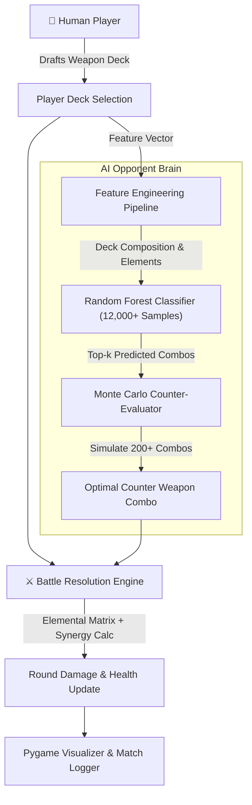

# 🏹 Archery Combat Strategy Game: AI-Enhanced ML Opponent

<div align="center">


<p align="center">
  <b>An interactive turn-based tactical strategy game with 30 weapons across 12 elemental affinities, featuring an adaptive AI opponent powered by Random Forest behavioral classification and Monte Carlo counter-evaluation.</b>
</p>

</div>

---

## 🌟 Overview

**Archery Combat Strategy Game** is an intelligent tactical game that bridges game design and machine learning. Unlike conventional scripted game bots, the AI opponent models player behavior in real-time by analyzing player deck distributions, predicting impending attack combos using a trained **Random Forest Classifier**, and executing probabilistic **Monte Carlo counter-evaluations** to maximize its tactical advantage.

---

## 🚀 Key Features

### 🧠 Intelligent Machine Learning Opponent
- **Predictive Opponent Modeling:** Uses a Random Forest model trained on 12,000+ match rounds to anticipate player weapon combos.
- **Monte Carlo Strategy Search:** Evaluates 200+ counter-combos per turn, scoring elemental effectiveness, synergy bonuses, and defensive resilience.
- **Adaptive Difficulty:** Dynamically adjusts decision confidence and falls back to strategic heuristics under novel deck configurations.

### ⚔️ Deep Combat Mechanics
- **30 Unique Weapons:** Spanning 12 distinct elemental types (Fire, Ice, Lightning, Wind, Earth, Holy, Shadow, Poison, Arcane, Physical, etc.).
- **Elemental Matrix & Synergies:** Multiplicative damage buffs based on elemental alignment, elemental weaknesses, and combo synergies.
- **Combo Damage Engine:** Real-time damage resolution incorporating base power, synergy multipliers, and defensive counters.

### 🎮 Pygame Graphical Interface
- Interactive weapon selection deck, real-time particle effects, animated battle resolution, and comprehensive round telemetry.

---

## 🏛️ AI & Battle Architecture



---

## 📂 Project Structure

```
Archery-Combat-Game-_MAIN/
├── ai_agent.py                     # ML opponent agent & Monte Carlo decision engine
├── archery_pygame.py               # Main Pygame GUI, animations, and game loop
├── battle_engine.py                # Core combat mechanics & elemental synergy matrix
├── model_train.py                  # Training pipeline for Random Forest classifier
├── human_game_log.csv              # Match dataset used for training & telemetry
├── archery_combo_classes.joblib    # Serialized combo class encoders
├── archery_feature_columns.joblib  # Serialized feature extraction schema
├── archery_weapon_map.joblib       # Serialized weapon-to-element mapping
├── requirements.txt                # Python project dependencies
├── .gitignore                      # Git ignore rules
├── LICENSE                         # MIT License
├── README.md                       # Repository documentation
└── RESUME_PROJECT_DESCRIPTION.md   # Resume portfolio summary & bullet points
```

---

## 🛠️ Quick Start Guide

### 1. Prerequisites
- Python 3.10 or higher

### 2. Installation
```bash
git clone https://github.com/Sankarshan-Mahamuni/Archery-Combat-Game-_MAIN.git
cd Archery-Combat-Game-_MAIN
pip install -r requirements.txt
```

### 3. Launch the Game
```bash
python archery_pygame.py
```

### 4. (Optional) Retrain the Machine Learning Model
To retrain the Random Forest agent on latest gameplay telemetry:
```bash
python model_train.py
```

---

## 📊 Technical Highlights

- **Dataset Size:** 12,000+ synthetic and human game rounds recorded in `human_game_log.csv`.
- **Feature Pipeline:** 40+ engineered features including elemental distributions, average deck damage, affinity ratios, and weapon frequency.
- **Top-3 Prediction Accuracy:** Over 85% accuracy in anticipating human combo types.

---

## 📄 License

This project is licensed under the MIT License - see the [LICENSE](LICENSE) file for details.
