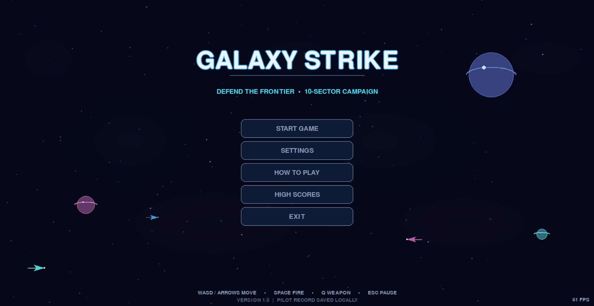
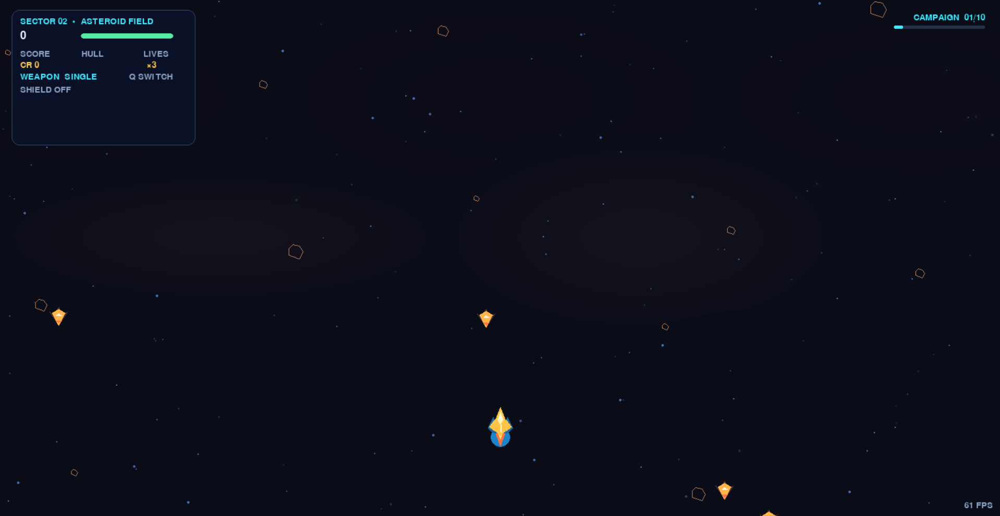
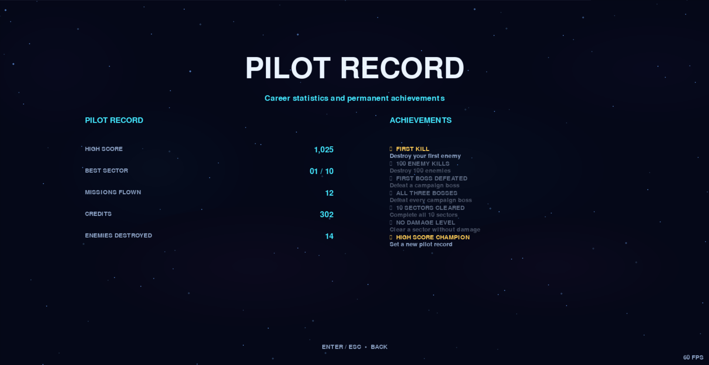

# Galaxy Strike

Galaxy Strike is a fast-paced, single-player space shooter built with Python and Pygame. Pilot a customizable ship through a ten-sector campaign, survive escalating enemy formations, collect upgrades, and take on three multi-phase bosses.

The game draws its ships, effects, backgrounds, and interface procedurally and synthesizes its music and sound effects at runtime. No external art or audio assets are required.

## Features

- Ten campaign sectors with distinct themes, challenges, and escalating waves.
- Six enemy archetypes, varied formations, and three multi-phase boss encounters.
- Four selectable ship skins and weapon upgrades, including double and triple shots.
- Pickups for hull repair, extra lives, shields, rapid fire, lasers, and score multipliers.
- Persistent campaign progress, high scores, credits, pilot statistics, and achievements.
- Animated menus, starfields, nebulae, particle effects, and synthesized audio.
- Adjustable difficulty, volume, window mode, resolution, and FPS display.
- Resizable window, keyboard and mouse menu navigation, and audio-safe fallback.

## Requirements

- Python 3.13 (developed and tested with Python 3.13.9).
- Pygame 2.6.1.

## Installation and Launch

Clone the repository and enter its folder:

```shell
git clone https://github.com/Siddu-119/Galaxy-Strike.git
cd Galaxy-Strike
```

Create and activate a virtual environment.

**Windows PowerShell**

```powershell
py -3.13 -m venv .venv
.\.venv\Scripts\Activate.ps1
```

**macOS / Linux**

```shell
python3.13 -m venv .venv
source .venv/bin/activate
```

Install dependencies and start the game:

```shell
python -m pip install --upgrade pip
python -m pip install -r requirements.txt
python main.py
```

## Controls

| Input | Action |
|---|---|
| W / A / S / D or arrow keys | Move the ship |
| Hold Space | Fire |
| Q | Switch to the next unlocked weapon |
| Enter | Select, launch, or continue |
| Escape | Pause, resume, or go back |
| R | Restart a sortie while paused or after game over |
| N | Return to the main menu while paused or after a run |
| M | Toggle music |
| Mouse | Navigate menus and interact with settings |

## Screenshots

### MAIN MENU



### GAMEPLAY



### PILOT RECORD



## Saved Data

On first launch, the game creates `data/save.json` to store campaign progress, achievements, scores, selected ship, and local preferences. This file is personal/generated data and is intentionally excluded from version control. Delete it locally to reset progress.

## Project Structure

```text
Galaxy-Strike/
├── main.py
├── settings.py
├── requirements.txt
├── LICENSE
├── README.md
├── .gitignore
├── screenshots/
│   ├── main-menu.png
│   ├── gameplay.png
│   └── high-scores.png
├── data/
│   └── save.json
└── src/
    ├── game.py
    ├── level.py
    ├── player.py
    ├── enemy.py
    ├── boss.py
    ├── bullet.py
    ├── powerup.py
    ├── particle.py
    ├── audio.py
    ├── menu.py
    ├── settings_menu.py
    ├── save_manager.py
    └── __init__.py
```

## Future Improvements

- Add a short gameplay video.
- Add automated tests for campaign progression, save-data handling, and core gameplay.
- Add optional controller support and configurable key bindings.
- Add localization and more accessibility options.
- Package standalone builds for supported desktop platforms.

## Credits

Galaxy Strike is built with [Python](https://www.python.org/) and [Pygame](https://www.pygame.org/). Its visuals and audio are generated by the game; it does not require third-party asset packs.

## License

This project is released under the MIT License. See [LICENSE](LICENSE).
