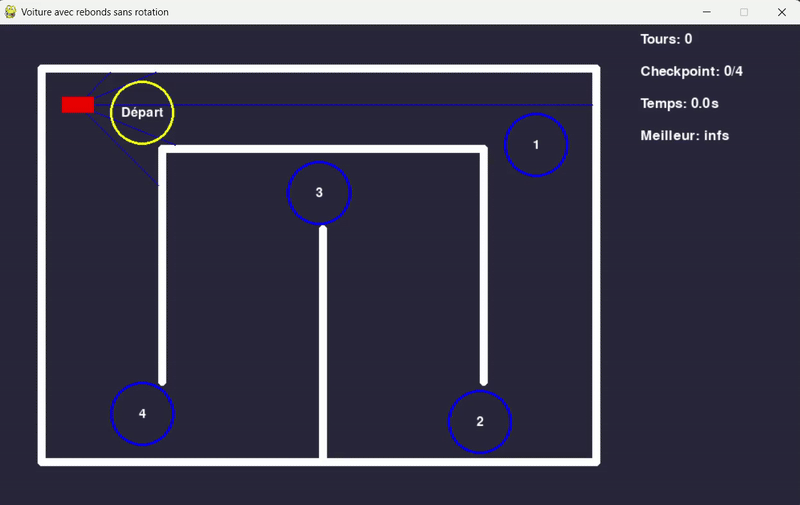
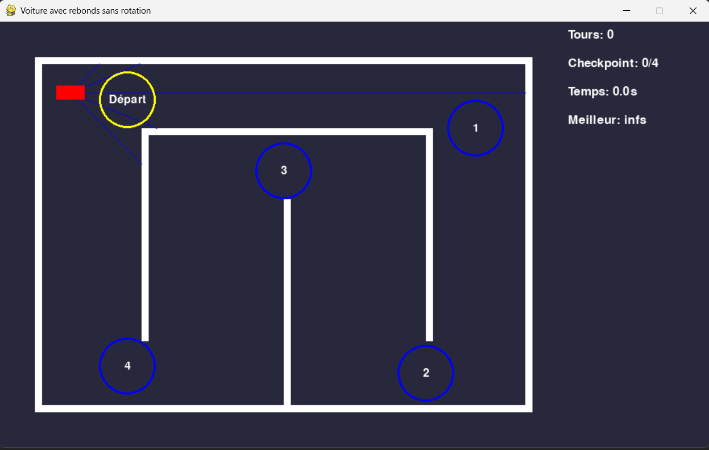

# 🚗 Driving Game


  
  

<p align="center">
  
</p>

## 📝 Project Description 
This project is a **2D driving game** made with Pygame.  
You control a red car on a closed track, avoiding walls, passing checkpoints in order, and trying to beat your **best lap time**.  
Collisions with walls are handled with a **bounce effect** (the car is pushed back without rotating).  

This project helped me with [Driving AI - GA](https://github.com/Thibault-GAREL/AI_driving_genetic_version) and [Driving AI - DQL](https://github.com/Thibault-GAREL/AI_driving_DQN_version) ! I just change the control **ZQSD** to control by my AI.

---

## Controls
- **Z** → Accelerate  
- **S** → Brake / Reverse  
- **Q** → Turn left  
- **D** → Turn right  

---


## 🎮 Example Screenshots
Here is what the game looks like:



---

## 🗺️ How it works

Track layout and checkpoints are hardcoded in the code as rectangles and circles.  

You can easily **customize the circuit** by editing the `walls` and `checkpoints` lists in `main.py`.

The blue rays are sensors showing the distance to the nearest wall (useful for the AI versions).

---

## 📂 Repository structure  
```bash
├── img/
│   └── start.png
│
├── main.py
│
├── LICENSE
├── README.md
```

---

## 💻 Run it on Your PC  
Clone the repository and install dependencies:  
```bash
git clone https://github.com/Thibault-GAREL/driving_game.git
cd driving_game

python -m venv .venv # if you don't have a virtual environment
source .venv/bin/activate   # Linux / macOS
.venv\Scripts\activate      # Windows

pip install pygame

python main.py
```

---

## 📖 Inspiration / Sources
Code created by me 😎, Thibault GAREL - [Github](https://github.com/Thibault-GAREL)
