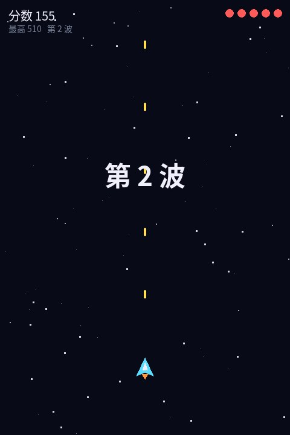
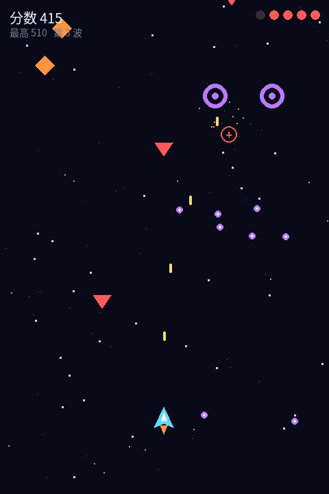
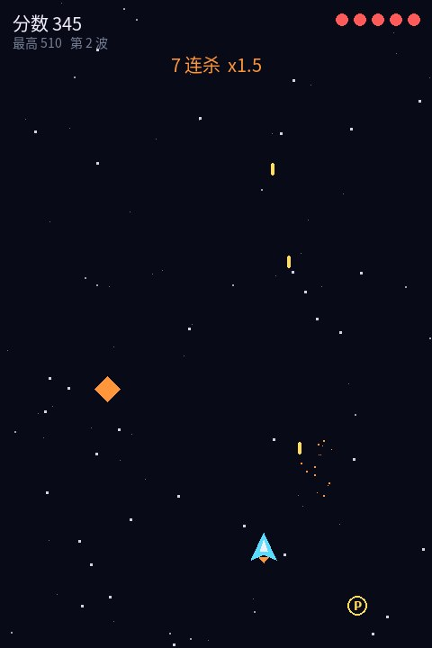

# 太空射击 Space Shooter（Pygame 课程小组项目）


| 波次开场 | 悬停炮台三向弹 | 连杀与道具 |
|---|---|---|
|  |  |  |

**[⬇ 下载源码](https://github.com/bailiyyds/SpaceShooter-Pygame/archive/refs/heads/main.zip)**

《Python 程序设计》课程大作业 · 3 人小组 · 2025.12—2026.01

## 运行
```
pip install pygame
python space_shooter/main.py          # 正常游戏：WASD 移动，空格 射击，Enter 开始
python space_shooter/main.py --demo   # AI 自动演示
python space_shooter/main.py --test   # 无窗口冒烟测试（3000 帧）
```

## 小组分工
| 成员 | 负责内容 |
|---|---|
| 贺奕博（组长） | 任务拆分与进度把控；主循环、碰撞检测、波次与难度曲线；Git 分支规范 |
| 组员 A | 敌人类型与道具系统 |
| 组员 B | HUD、菜单、音效（代码合成方波 / 噪声音效） |

## 内容
- 三种敌人：直线俯冲、正弦摆动、悬停三向弹
- 道具：火力升级（最高 3 级）、护盾、回血；连杀倍率最高 ×3
- 波次难度：数量 8+3n，生成间隔与速度随波次提升
- 视差星空、粒子爆炸、受击震屏、最高分存档
- 帧间隔上限 1/20 秒，防止卡顿后子弹穿透

---
作者：贺奕博 · 南通大学 · 更多作品见 [github.com/bailiyyds](https://github.com/bailiyyds)
