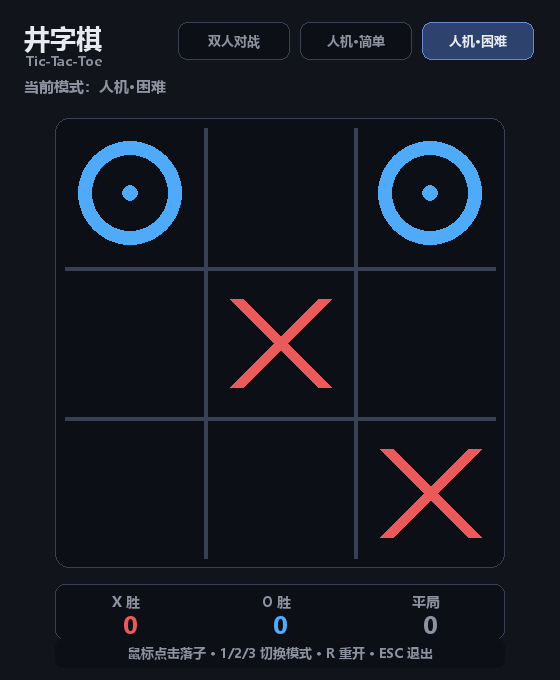

# 井字棋 Tic-Tac-Toe（Python + Pygame）

用 Python + Pygame 实现的井字棋小游戏：支持双人对战与人机对战，
困难模式的电脑使用 **minimax 完全博弈搜索**——它永远不会输，
你能争取的最好成绩就是平局。代码约 400 行、全部中文注释，
逻辑与渲染分离并配有单元测试，适合作为 Python 入门 / 课程设计参考。



## 功能特性

- **三种模式**：双人对战 / 人机·简单（随机走子）/ 人机·困难（minimax 必不败）
- **鼠标点击落子**：悬停格子有高亮提示，误点占用格无副作用
- **胜利连线高亮**：获胜的三连用金色连线标出
- **比分统计**：X 胜 / O 胜 / 平局实时记分，跨局累计
- **终局快速重开**：点击棋盘或按 R / 空格立即再来一局

## 操作说明

| 操作 | 功能 |
|---|---|
| 鼠标左键 | 点击棋盘落子 / 点击右上角按钮切换模式 |
| 1 / 2 / 3 | 切换 双人 / 人机·简单 / 人机·困难 模式 |
| R 或 空格 | 重新开始（终局后点击棋盘也可以） |
| ESC | 退出 |

## 快速开始

### 方式一：双击启动（Windows）

双击项目里的 **`启动井字棋.bat`** 即可。

### 方式二：命令行

```bash
pip install -r requirements.txt   # 首次运行先装依赖（仅 pygame）
python main.py
```

## 项目结构

```
井字棋/
├── tictactoe.py        # 核心逻辑：胜负判定、minimax 博弈搜索、随机 AI（纯逻辑）
├── renderer.py         # 渲染层：棋盘、棋子、胜利连线、模式按钮、比分面板
├── main.py             # 主程序：事件处理、模式切换、烟雾自测
├── test_tictactoe.py   # 核心逻辑单元测试（9 项，含"AI 必不败"300 局验证）
├── requirements.txt    # 依赖：pygame
├── 界面预览.png         # 运行效果截图
└── 启动井字棋.bat       # Windows 双击启动脚本
```

## 技术实现要点

- **逻辑与渲染彻底分离**：`tictactoe.py` 不 import pygame，棋盘就是一个
  9 元素列表，可以直接单元测试；`renderer.py` 只负责画。
- **minimax 博弈搜索**：`_minimax(board, me, turn, depth)` 递归穷举所有走法，
  胜 = `10 - depth`（越快赢分越高）、负 = `depth - 10`（越慢输分越高）、
  平 = 0，因此 AI 在优势时会选最快获胜路线，劣势时坚持最久。
  井字棋搜索空间极小（最多 9! 量级），无需剪枝即可瞬时算出。
- **必不败验证**：单元测试里让随机玩家与困难 AI 对战 300 局，断言 AI 一局不输；
  另有 minimax 自我对弈必为平局的验证。

## 自测

```bash
python test_tictactoe.py     # 核心逻辑 9 项测试（无需 GUI）
python main.py --smoke       # 无窗口模拟运行，生成界面预览图
```

## 开源许可

本项目采用 **GPL-3.0** 许可证开源——任何人可以自由使用、修改和分发本项目，
但基于本项目的衍生作品同样必须以 GPL-3.0 开源。详见 [LICENSE](LICENSE)。
