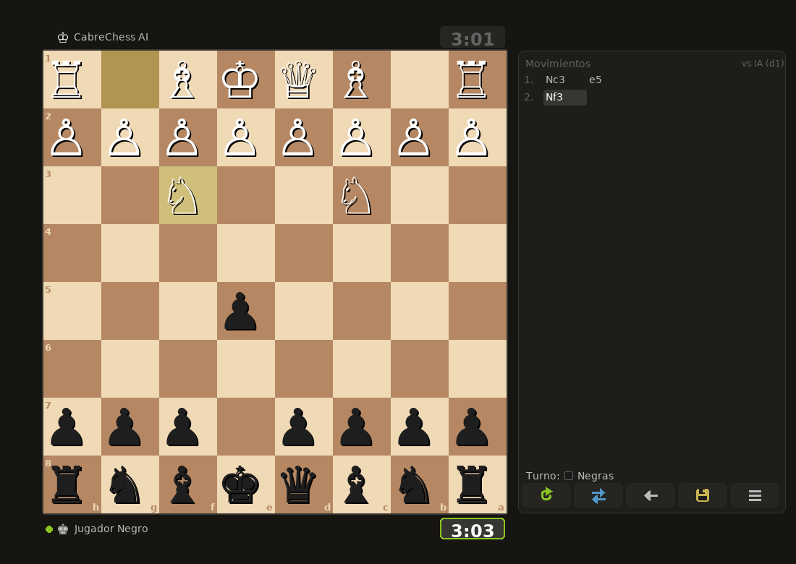

<p align="center">
  
</p>

<p align="center">
  <a href="https://github.com/federicocabrera1978-svg/cabrechess/actions/workflows/ci.yml"></a>
  <a href="LICENSE"></a>
  
  <a href="https://ko-fi.com/federicocabrera"></a>
</p>

# CabreChess

Ajedrez de escritorio hecho con `pygame` y `python-chess`, inspirado en Lichess.
Por Federico Cabrera.

*[English version below](#english)*

<p align="center">
  
  
</p>
<p align="center">
  
  
</p>

## Funcionalidades

- **Contra la IA** con tres niveles (Fácil / Normal / Difícil). El motor es propio:
  minimax con poda alfa-beta y tablas pieza-casilla, y corre en un hilo aparte para
  que la interfaz no se trabe.
- **Elegís el color** contra la IA: blancas, negras o al azar (con negras el tablero se gira solo).
- **2 jugadores** en la misma compu (PvP).
- **Modo análisis** con barra y gráfico de evaluación.
- **Reloj** de 1, 3, 5 o 10 minutos con +3 s de incremento. Si se te cae la bandera
  y al rival no le alcanza el material para ganar, son tablas (como en el reglamento).
- **Abandonar y ofrecer tablas** (botones de la bandera y ½ del panel). Contra la IA, acepta
  tablas solo si va perdiendo o si la posición está pareja desde la jugada 30;
  en 2 jugadores responde el rival.
- **Deshacer** completo: devuelve también los relojes, las piezas capturadas y la evaluación.
- **Premoves**, arrastrar y soltar, resaltado de jugadas legales y de la última jugada,
  promoción con selector.
- **Nombre de la apertura** con su código ECO arriba de la lista de jugadas (reconoce
  transposiciones) y en los headers `ECO`/`Opening` del PGN.
- **Exportar a PGN** (se abre en Lichess, ChessBase, etc.).
- Piezas **cburnett** (las de Lichess) y ejecutable para Windows con checksum SHA-256.

## Partidas guardadas y análisis

- **Cada partida terminada se guarda sola** (2 jugadores y vs IA) en una base local
  SQLite: `%APPDATA%\CabreChess\partidas.db` en Windows, `~/.cabrechess/partidas.db`
  en Linux/macOS. Guarda PGN, fecha, jugadores, modo, resultado, motivo, apertura (ECO)
  y control de tiempo. "Guardar PGN" sigue disponible para exportar a mano.
- **Menú → Partidas guardadas**: lista (fecha, modo, resultado, apertura), abrir en
  análisis (doble click o Enter), exportar PGN y borrar (pide confirmación).
- **Análisis**: en el modo Análisis y al revisar una partida terminada se muestran la
  **mejor jugada** (flecha verde + SAN) y la evaluación. Por defecto lo calcula el motor
  propio en un hilo del mismo proceso: no lanza programas externos.
- **Stockfish (opcional, apagado por defecto)**: creá `settings.json` en la misma
  carpeta de datos con `{"stockfish_path": "C:/ruta/stockfish.exe"}` (o definí la
  variable `CABRECHESS_STOCKFISH`). Si la ruta no anda, vuelve solo al motor propio.
  `analysis_depth` (1-5, por defecto 3) ajusta la profundidad del motor propio.
  `board_theme` (`marron`, `azul`, `verde` o `gris`) elige el tablero; también se cambia con `T`.

## Controles

| Acción | Cómo |
|---|---|
| Mover | Click en origen y destino, o arrastrar y soltar |
| Premove | Mover una pieza propia mientras le toca al rival |
| Cancelar premove | Click derecho o `Esc` |
| Deshacer | `Ctrl+Z` o el botón ← |
| Abandonar | Botón de la bandera (pide confirmación) |
| Ofrecer tablas | Botón ½ (una oferta por jugada; `Esc` cierra el diálogo) |
| Girar el tablero | `F` |
| Activar / silenciar el sonido | `M` (se recuerda para la próxima vez) |
| Cambiar el tema del tablero (Marrón, Azul, Verde, Gris) | `T` (se recuerda para la próxima vez) |
| Reiniciar la partida | `R` |
| Volver al menú / salir | `Esc` |
| Guardar PGN | Botón del disquete o "Guardar PGN" al terminar (sin diálogo disponible, se guarda en `~/Documents/CabreChess/`) |
| Pantalla completa | `F11` o `Alt+Enter` (la ventana también se puede redimensionar y maximizar) |
| Cerrar / reabrir el panel de fin de partida | `Esc` o "Cerrar" / "Resultado" |
| Revisar la partida terminada | `←` `→` `Inicio` `Fin`, la barra `|< < > >|`, o deshacer (`Ctrl+Z` / ←): con la partida terminada no deshace jugadas, solo retrocede en la revisión |

## Requisitos y cómo ejecutarlo

Python **3.9 o más nuevo** (CI usa 3.12).

Instalarlo como comando (las piezas y el logo vienen dentro del paquete):

```
pip install .
cabrechess
```

O directo desde el código, sin instalar:

```
pip install -r requirements.txt
python -m cabrechess
```

Para desarrollar conviene `pip install -e ".[dev]"`.

> En Linux, guardar PGN usa el diálogo de `tkinter`; si falta, instalá `python3-tk`.

## Tests y lint

Los tests corren sin pantalla (pygame en modo `dummy`):

```
pip install -r requirements-dev.txt
ruff check .
python -m pytest
```

Cubren el reloj, deshacer, el logo, el motor (encuentra mates en 1 y nunca devuelve
jugadas ilegales) y que el PGN exportado se pueda volver a leer con `chess.pgn`.
CI los corre en Ubuntu y Windows en cada push y PR.

## Descargar el ejecutable (Windows)

Los `.exe` se publican en [Releases](../../releases), junto con un archivo `.sha256`
para verificar que el archivo descargado es exactamente el que se generó a partir del
código fuente publicado en este repositorio:

```powershell
Get-FileHash CabreChess.exe -Algorithm SHA256
```

Compará el resultado con el contenido de `CabreChess.exe.sha256`.

Hay dos formatos:

- **`CabreChess-win64.zip` (recomendado)**: descomprimilo y ejecutá
  `CabreChess\CabreChess.exe`. Arranca directo, sin extraerse a `%TEMP%`, y suele
  generar menos falsos positivos de antivirus.
- **`CabreChess.exe`**: un solo archivo. Cada vez que arranca se autoextrae a una
  carpeta temporal, y algunos antivirus (Avast CyberCapture / Escudo de
  comportamiento) desconfían de eso.

El juego no lanza procesos, no usa internet ni motores externos y no toca el
registro: el análisis y la IA corren dentro del mismo proceso (hay un test que lo
verifica). Los builds se hacen sin UPX.

### Por qué Windows o el antivirus pueden marcarlo como sospechoso

El ejecutable no está firmado con un certificado de firma de código (requiere una
identidad verificada y tiene costo). Los `.exe` generados con PyInstaller sin firmar
suelen dar falsos positivos en SmartScreen o en algunos antivirus, porque ese
empaquetado también lo usa malware. El release se genera automáticamente desde este
código fuente público con GitHub Actions (ver `.github/workflows/release.yml`), así que
cualquiera puede auditar exactamente qué se compiló.

Si Avast lo bloquea, podés reportarlo como falso positivo en su formulario oficial:
<https://www.avast.com/false-positive-file-form.php>.

Se solicitó firma de código gratuita para proyectos open source a
[SignPath Foundation](https://signpath.org/). Ver [CODE_SIGNING_POLICY.md](CODE_SIGNING_POLICY.md).

## Build local

```
pip install -r requirements-dev.txt
pyinstaller CabreChess.spec
```

El spec arranca desde `packaging_entry.py`, empaqueta `cabrechess/assets/` (piezas y logo), usa `cabrechess/assets/logo/cabrechess.ico`
como ícono del `.exe` y toma los metadatos de versión de `version_info.txt`.
El logo se regenera con `python tools/make_logo.py` (necesita Pillow).

## Estructura del código

```
cabrechess/
├── __init__.py    # API pública: CabreChess, SimpleEngine, main
├── __main__.py    # python -m cabrechess
├── constants.py   # tamaños de ventana, colores, glifos
├── engine.py      # motor propio (minimax + alfa-beta + tablas pieza-casilla)
├── clock.py       # formato del reloj y resultado por bandera
├── pgn.py         # exportación a PGN
├── openings.py    # nombres de aperturas (ECO), búsqueda por posición
├── sprites.py     # piezas cburnett / dibujadas, ícono, ubicación de assets
├── ui.py          # interfaz pygame (clase CabreChess, loop, eventos)
└── assets/        # piezas cburnett y logo (se instalan con el paquete)
```

## Créditos y licencia

- Piezas: set **cburnett** de Colin M.L. Burnett (GPLv2+), el mismo que usa Lichess.
  Ver `cabrechess/assets/pieces/cburnett/LICENSE`. El logo usa el caballo de ese set.
- Código: **GPL-3.0-or-later**. Ver [LICENSE](LICENSE).

## Apoyar el proyecto

CabreChess es gratis y de código abierto. Si te gusta y querés bancar su desarrollo,
podés invitarme un café en [Ko-fi](https://ko-fi.com/federicocabrera). ☕

---

## English

**CabreChess** is a desktop chess game written in Python with `pygame` and `python-chess`,
inspired by Lichess.

**Features:** play against a built-in AI (minimax + alpha-beta, 3 levels, runs in a
background thread) as white, black or random; local 2-player mode; analysis mode with
evaluation bar and graph; 1/3/5/10-minute clocks with +3 s increment and proper
flag-vs-insufficient-material handling; full undo (clocks, captures, eval); premoves,
drag and drop, promotion picker; PGN export; Lichess cburnett pieces; Windows `.exe`
built reproducibly by GitHub Actions with a SHA-256 checksum.

**Saved games & analysis:** every finished game is stored automatically in a local SQLite database (`%APPDATA%\\CabreChess\\partidas.db` on Windows, `~/.cabrechess/` elsewhere); browse, open in analysis, export or delete them from *Partidas guardadas*. Analysis shows the best move (arrow + SAN) and evaluation using the built-in engine in-process; Stockfish can optionally be configured via `settings.json` (`stockfish_path`) or `CABRECHESS_STOCKFISH`.

**Controls:** click or drag to move · right-click/`Esc` cancels a premove · `Ctrl+Z` undo ·
`F` flip board · `M` mute/unmute sound · `T` board theme (brown, blue, green, grey) · `R` restart · `F11`/`Alt+Enter` fullscreen (window is resizable) · `Esc` closes the game-over panel / back to menu / quit · after the game, `←` `→` `Home` `End` review the moves.

**Run it** (Python 3.9+):

```
pip install .
cabrechess          # or, without installing: python -m cabrechess
```

**Tests:** `pip install -r requirements-dev.txt && ruff check . && python -m pytest`
(headless, SDL dummy driver). Windows builds are in [Releases](../../releases).

License: GPL-3.0-or-later. Pieces: cburnett by Colin M.L. Burnett (GPLv2+).

**Support:** CabreChess is free and open source. If you enjoy it, you can buy me a coffee
on [Ko-fi](https://ko-fi.com/federicocabrera). ☕
