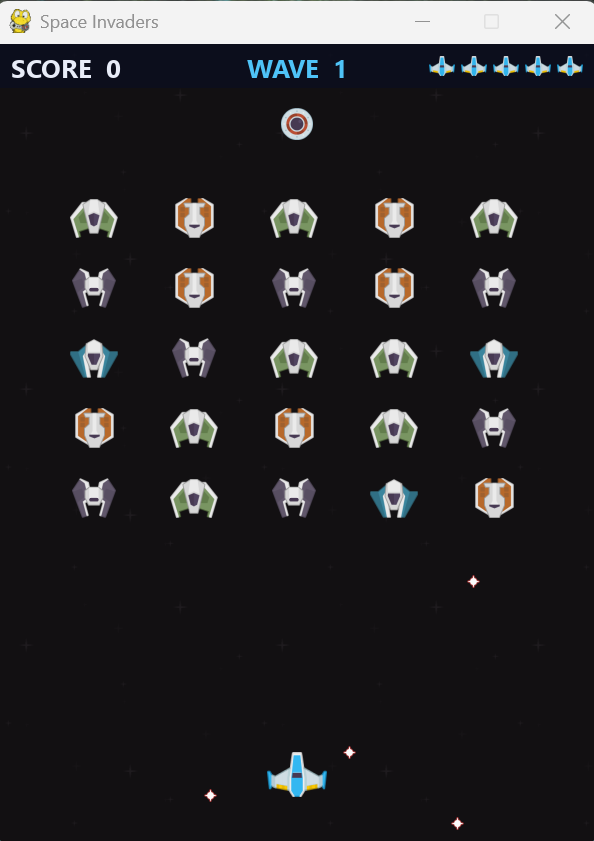

# Space Invaders
A Space Invaders-style arcade shooter written in Python. I first built it for my A-level
Computer Science project, and have since come back to it to tidy up the code and add
password hashing, custom explosion animations and an automated test suite. The game itself
is built with [pygame-ce](https://pyga.me/), and it sits behind a tkinter account system with
registration, logins, password resets and a high-score leaderboard.



## Features
- **Arcade gameplay:** the aliens move as one formation that drops down a step each time it
  reaches the edge, and shoot back. You have five lives, and the game ends early if the
  aliens reach your ship. Waves are endless, each one faster than the last, with a bonus for
  every wave cleared
- **Game screens:** a start screen, pause (P), a readable top bar with score, wave and lives,
  and a game-over screen showing your score, your high score and whether you beat it
- **Invincibility after a hit:** the ship blinks and can't be hit for a moment after losing a
  life
- **Sound:** balanced effect volumes, a volume slider on the menu that's remembered between
  sessions, and M to mute during a game
- **Mystery alien:** a special enemy crossing the top of the screen that gives a random
  reward: an extra life or 100, 150 or 200 points
- **Player accounts:** register, log in, delete an account, and reset a forgotten password
  by answering a security question. New passwords need at least 8 characters and must be
  typed twice, and the security question is picked from a list.
- **Polished interface:** one dark-themed window that switches between screens, works with
  the keyboard (Return, Escape, Tab), and stays sharp with Windows display scaling
- **Leaderboard:** a table of the top ten players by high score, with equal scores sharing a
  rank and your own row highlighted (and added at the bottom if you're outside the top ten)
- **Algorithms written by hand:** insertion sort keeps accounts in username order, a
  recursive binary search finds accounts, and a bubble sort ranks the leaderboard

## Added since my A-levels
- **Secure password storage:** the original game saved passwords and security answers as
  plain text. They're now stored as salted PBKDF2-HMAC-SHA256 hashes using Python's
  `hashlib`, and old account files are upgraded automatically (see
  [How passwords are stored](#how-passwords-are-stored))
- **Custom explosion animations:** the explosions are drawn frame by frame by my own script,
  [`tools/make_explosions.py`](tools/make_explosions.py), rather than using ready-made images
- **Automated tests:** a pytest suite covering the accounts, validation rules, settings,
  tkinter screens and game logic. The game tests run frame by frame without opening a window

## Getting started
You need Python 3 with tkinter. Tested with Python 3.13 and pygame-ce 2.5 on Windows.
tkinter comes with the python.org installers. On Linux you may need to install it separately
(for example `sudo apt install python3-tk`).

```bash
git clone https://github.com/finnleaverland/Space-Invaders.git
cd Space-Invaders
python -m venv .venv
```

Activate the virtual environment (`.venv\Scripts\activate` on Windows,
`source .venv/bin/activate` on macOS/Linux), then install the dependencies and start the game:

```bash
pip install -r requirements.txt
python main.py
```

> pygame-ce replaces the original `pygame` package. If `pygame` is already installed in the
> same environment, uninstall it first (`pip uninstall pygame`).

Register an account to get started. Accounts and scores are saved in `Clientfile.txt`, and
the volume in `settings.json`, both in the project folder and created the first time they're
needed.

## Controls
| Key | Action |
| --- | --- |
| Space (start screen) | Start the game |
| Left / Right arrow | Move the ship |
| Space | Shoot (hold it down to keep firing) |
| P | Pause and carry on |
| M | Sound on / off |
| Space (after game over) | Return to the menu |
| Esc | Stop playing and return to the menu |

## Running the tests
```bash
pip install -r requirements-dev.txt
python -m pytest
```

## Project structure
```text
main.py                  Starts the game at the welcome screen
space_invaders/
    accounts.py          Client and ClientList: accounts, hashing, sorting, searching, saving
    validation.py        Rules for usernames, passwords and security questions
    settings.py          Saves and loads the volume
    app.py               The single tkinter window that switches between screens
    theme.py             Dark space theme: colours, font, ttk styles, display scaling
    widgets.py           Screen base class with shared form helpers
    login_screen.py      Welcome, log in, register and reset password screens
    menu_screen.py       Menu, leaderboard, how to play and delete account screens
    game.py              The pygame game
assets/
    images/              Sprites and background
    sounds/              Sound effects
tools/
    make_explosions.py   Draws the explosion animations
tests/
    test_accounts.py     pytest tests for the account system
    test_screens.py      pytest tests that drive the tkinter screens
    test_game.py         pytest tests that run the game frame by frame without a window
    test_validation.py   pytest tests for the account rules
    test_settings.py     pytest tests for saving the volume
```

## How passwords are stored
Each password and security answer is hashed with PBKDF2-HMAC-SHA256 using 600,000 iterations
and its own random 16-byte salt, and stored as `pbkdf2_sha256$iterations$salt$hash`. Security
answers are lower-cased and trimmed before hashing, so they aren't case-sensitive. A forgotten
password can't be recovered, only reset. Account files from earlier versions of the game,
which stored plain text, are upgraded to hashes automatically the first time they load.

## Future developments
Ideas I'd like to add next:

### Gameplay
- **Defence bunkers** above the ship that get chipped away by bullets from both sides, as in
  the original arcade game
- **Points by alien type:** each of the four alien designs worth a different score, instead
  of every alien being worth 10
- **Power-ups** dropped by some aliens, such as a faster fire rate, a shield or a spread shot
- **Boss waves** every few waves, with a large alien that takes several hits to destroy
- **Difficulty levels** (easy, normal, hard) that change the lives, alien speed and fire rate

### Accounts and scores
- **SQLite database** in place of the CSV client file, so saving is safer and scores are
  easier to query
- **Score history** for each player, with a chart of their recent games
- **Online leaderboard** so players on different computers can compete

### Controls and settings
- **Rebindable keys** (including WASD), saved in `settings.json` alongside the volume
- **Gamepad support** through pygame's controller module
- **Fullscreen mode** and a window that scales to different screen sizes

### The project
- **A standalone download** built with PyInstaller, so people can play without installing
  Python
- **GitHub Actions** to run the test suite automatically on every push
- **Background music** and more sound effects

## Credits
- Ship, alien, UFO, laser and background graphics:
  [Space Shooter Remastered](https://kenney.nl/assets/space-shooter-remastered) by
  [Kenney](https://kenney.nl), released under
  [CC0](https://creativecommons.org/publicdomain/zero/1.0/)
- Sound effects: [Sci-fi Sounds](https://kenney.nl/assets/sci-fi-sounds) by
  [Kenney](https://kenney.nl), released under CC0
- Explosion animations: drawn by [`tools/make_explosions.py`](tools/make_explosions.py) in
  this project
- The original game was built while following the
  [Coding With Russ Space Invaders tutorial](https://github.com/russs123/Space_Invaders)

Kenney's assets are public domain. Credit isn't required, but it's given here with thanks.

## License
The code is released under the MIT License. See [LICENSE](LICENSE).