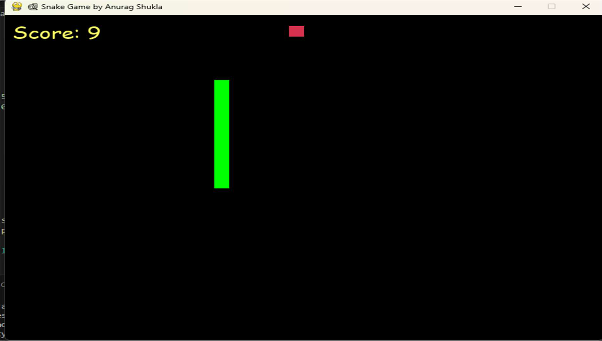
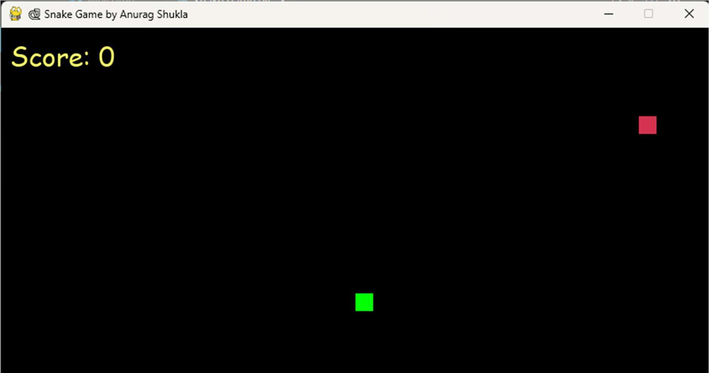
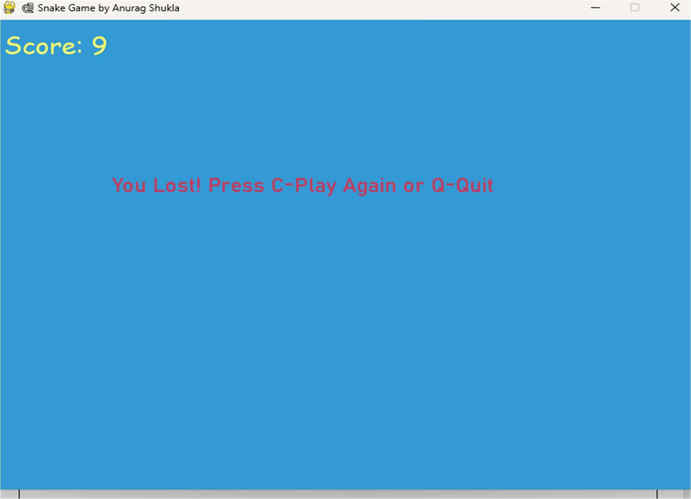

# AI Snake Game — Autonomous Pathfinding with Dijkstra's Algorithm 🐍🎮

[](https://www.python.org/)
[](https://www.pygame.org/)
[](https://en.wikipedia.org/wiki/Dijkstra%27s_algorithm)
[](https://www.cuchd.in/)
[](LICENSE)

An intelligent, interactive 2D arcade Snake Game implemented in Python using the **Pygame** engine, enhanced with **Dijkstra's Shortest Path Algorithm** for autonomous pathfinding, obstacle avoidance, and real-time decision-making.

Developed as a mini-project for **Design and Analysis of Algorithms (26CAH-612)**, **Master of Computer Applications (MCA) in Data Science**, **Chandigarh University**.

---

## 📌 Academic Credentials

* **Course / Subject:** Design and Analysis of Algorithms (`26CAH-612`)
* **Project Title:** AI Snake Game
* **Student Name:** Saksham Jaryal
* **UID / Roll No:** `26MCD10073`
* **Class & Section:** 26MCD (Data Science) — Section 2(A)
* **Faculty Supervisor:** Ms. Divyanshi Sharma (Assistant Professor)
* **Institution:** University Institute of Computing (UIC), Chandigarh University, Gharuan, Mohali
* **Academic Session:** 2026 – 2028

---

## 📖 Table of Contents

- [Project Overview](#-project-overview)
- [Background & Historical Context](#-background--historical-context)
- [Objectives of the Project](#-objectives-of-the-project)
- [Algorithm & Mathematical Formulation](#-algorithm--mathematical-formulation)
  - [Graph Modeling of the Grid](#1-graph-modeling-of-the-grid)
  - [Dijkstra's Algorithm Implementation](#2-dijkstras-algorithm-implementation)
  - [Dynamic Obstacle Avoidance](#3-dynamic-obstacle-avoidance)
  - [Complexity Analysis](#4-complexity-analysis)
- [System Architecture & Modules](#-system-architecture--modules)
- [Visual Output & Gameplay Screenshots](#-visual-output--gameplay-screenshots)
- [System Requirements](#-system-requirements)
- [Getting Started & Installation](#-getting-started--installation)
- [Game Controls](#-game-controls)
- [Project Directory Structure](#-project-directory-structure)
- [Conclusion & Future Scope](#-conclusion--future-scope)
- [References](#-references)

---

## 🌟 Project Overview

Games have evolved from mechanical board games to complex computer simulations. Among arcade classics, the **Snake Game** (popularized globally on early Nokia devices in the late 1990s) holds a prominent place. 

While the standard game tests human reflexes, this project bridges **classic arcade game design** with **classical algorithmic theory**:
1. **Manual Human Mode:** Players guide the snake using standard keyboard arrow keys.
2. **Autonomous AI Mode:** The snake acts as an intelligent autonomous agent that evaluates the game board as an unweighted graph, computes the optimal shortest route to the food item using Dijkstra's algorithm, navigates around its own growing body, and avoids boundary collisions.
3. **Seamless Runtime Toggle:** The player can switch between Manual control and AI autopilot on the fly by pressing the `A` key.

---

## 🎯 Objectives of the Project

* **Demonstrate Graph Search in Real-Time:** Apply graph traversal and priority-queue-based shortest path algorithms to an interactive real-time visual environment.
* **Autonomous Decision Making:** Implement collision-free autonomous movement where the snake dynamically routes towards targets while avoiding static (walls) and dynamic (self-body) obstacles.
* **Dual Interaction Architecture:** Seamlessly toggle between human input event handlers and algorithmic path execution without interrupting gameplay state.
* **Educational Exploration:** Provide a clean, modular, and extensible codebase for exploring algorithmic heuristics ($A^*$, BFS, Hamiltonian cycles, flood-fill).

---

## 🧠 Algorithm & Mathematical Formulation

### 1. Graph Modeling of the Grid
The game window of dimensions $W \times H$ ($800 \times 600$ pixels) is discretized into a uniform grid of block size $B = 20$ pixels.
* **Grid Dimensions:**
  $$\text{GRID\_W} = \frac{W}{B} = \frac{800}{20} = 40, \quad \text{GRID\_H} = \frac{H}{B} = \frac{600}{20} = 30$$
* **Total Graph Vertices:**
  $$|V| = \text{GRID\_W} \times \text{GRID\_H} = 40 \times 30 = 1,200 \text{ cells}$$
* **Adjacency / Edges ($E$):** Each cell $u = (x, y)$ connects to up to 4 orthogonal neighbors:
  $$\text{Neighbors}(x, y) = \{(x+1, y), (x-1, y), (x, y+1), (x, y-1)\} \cap \text{Valid Grid Space}$$

### 2. Dijkstra's Algorithm Implementation
Dijkstra's algorithm is formulated with a min-priority queue (using Python's native binary min-heap `heapq`):
* **Source Vertex ($s$):** Snake's current head coordinates $(x_{\text{head}}, y_{\text{head}})$.
* **Target Vertex ($g$):** Food coordinates $(x_{\text{food}}, y_{\text{food}})$.
* **Edge Cost:** Uniform unit cost $w(u, v) = 1$ for every valid cardinal step.
* **Relaxation Step:**
  $$\text{if } d[u] + 1 < d[v] \implies d[v] \leftarrow d[u] + 1, \quad \text{prev}[v] \leftarrow u$$

```python
def dijkstra(start, goal, blocked):
    if start == goal:
        return [start]

    dist = {start: 0}
    prev = {}
    pq = [(0, start)]
    visited = set()

    while pq:
        d, node = heapq.heappop(pq)
        if node in visited:
            continue
        visited.add(node)

        if node == goal:
            # Backtrack optimal shortest path
            path = []
            cur = goal
            while cur != start:
                path.append(cur)
                cur = prev[cur]
            path.append(start)
            path.reverse()
            return path

        for nbr in neighbors(node):
            if nbr in blocked:
                continue
            nd = d + 1
            if nd < dist.get(nbr, float('inf')):
                dist[nbr] = nd
                prev[nbr] = node
                heapq.heappush(pq, (nd, nbr))

    return []
```

### 3. Dynamic Obstacle Avoidance
On every animation tick:
* The snake body segments $\text{Body} \setminus \{\text{Tail}\}$ are passed as the `blocked` set.
* Cells occupied by the snake's body are treated as infinite-weight barriers ($w = \infty$).
* **Safe Survival Heuristic:** If the food is trapped and no direct path exists, the snake evaluates all non-blocked adjacent cells to maintain motion without colliding, awaiting an open path.

### 4. Complexity Analysis
* **Time Complexity:** $O((|V| + |E|) \log |V|)$ where $|V| \le 1200$ and $|E| \le 4800$. The min-heap operations execute in sub-millisecond time (< 1.5 ms), comfortably supporting 60 FPS real-time rendering.
* **Space Complexity:** $O(|V|)$ auxiliary space for distances, previous node pointers, and the heap.

---

## 🏗️ System Architecture & Modules

```
┌────────────────────────────────────────────────────────┐
│                   Pygame Initialization                │
│    (Window 800x600, Color Palettes, Bahnschrift Fonts) │
└────────────────────────────────────────────────────────┘
                            │
                            ▼
┌────────────────────────────────────────────────────────┐
│                       Game Loop                        │
│ ┌────────────────────────────────────────────────────┐ │
│ │ 1. Event Polling (Quit, Arrow Keys, 'A' Toggle)    │ │
│ ├────────────────────────────────────────────────────┤ │
│ │ 2. Mode Evaluation:                                │ │
│ │    - If AI: Run Dijkstra(Head, Food, BodyObstacles)│ │
│ │    - If Manual: Use Active Arrow Key Direction     │ │
│ ├────────────────────────────────────────────────────┤ │
│ │ 3. Position Updates & Boundary Collision Check     │ │
│ ├────────────────────────────────────────────────────┤ │
│ │ 4. Food Consumption & Snake Growth Engine          │ │
│ ├────────────────────────────────────────────────────┤ │
│ │ 5. Rendering: Snake (Blue), Food (Red), HUD (Score)│ │
│ └────────────────────────────────────────────────────┘ │
└────────────────────────────────────────────────────────┘
                            │
               ┌────────────┴────────────┐
               ▼                         ▼
      [Collision Occurred]      [Space Exhausted]
        Game Over Screen            Win Screen
     (Press 'C' or 'Q')
```

---

## 📸 Visual Output & Gameplay Screenshots

### Figure 1: Game Launch & Home Screen
Snake starts at the center of the display grid with Score: 0 and Food spawned at a random coordinate.



### Figure 2: Real-time In-Game Action
Snake dynamically navigates across the grid, grows in length upon consuming food, and updates the live score counter.



### Figure 3: Game Over & Replay Screen
When collision occurs against wall boundaries or self-body segments, the Game Over banner offers instant replay (`C`) or quit (`Q`).



---

## 💻 System Requirements

### Hardware Requirements
| Component | Minimum Specification | Recommended Specification |
|---|---|---|
| **Processor** | Intel Core i3 / AMD Ryzen 3 | Intel Core i5 / AMD Ryzen 5 or higher |
| **RAM** | 4 GB | 8 GB or higher |
| **Storage** | 100 MB free hard disk space | SSD storage |
| **Display** | 1024 × 768 resolution | 1920 × 1080 Full HD |

### Software Requirements
| Tool / Component | Version | Purpose |
|---|---|---|
| **Operating System** | Windows 10/11, macOS, or Linux | Host execution environment |
| **Python Runtime** | Python 3.10 or higher | Core programming language |
| **Game Engine** | Pygame 2.5+ | Graphics, audio, and event loop |
| **IDE / Editor** | VS Code / PyCharm / IDLE | Code development & debugging |

---

## 🚀 Getting Started & Installation

### Step 1: Clone the Repository
```bash
git clone https://github.com/jaryalsaksham/AI-Snake-Game-.git
cd AI-Snake-Game-
```

### Step 2: Set Up Virtual Environment (Recommended)
```bash
# Windows
python -m venv venv
venv\Scripts\activate

# macOS / Linux
python3 -m venv venv
source venv/bin/activate
```

### Step 3: Install Required Dependencies
```bash
pip install -r requirements.txt
```

### Step 4: Run the Game
```bash
python ai_snake_game.py
```

---

## 🎮 Game Controls

| Key | Action / Function |
|---|---|
| `A` | **Toggle AI Mode / Manual Mode** on the fly |
| `↑` (Up Arrow) | Move Snake Up (in Manual Mode) |
| `↓` (Down Arrow) | Move Snake Down (in Manual Mode) |
| `←` (Left Arrow) | Move Snake Left (in Manual Mode) |
| `→` (Right Arrow) | Move Snake Right (in Manual Mode) |
| `C` | **Play Again / Restart Game** (on Game Over screen) |
| `Q` | **Quit Application** (on Game Over screen or in-game) |

---

## 📁 Project Directory Structure

```
AI-Snake-Game-/
│
├── ai_snake_game.py        # Complete game logic with Dijkstra AI and Pygame GUI
├── requirements.txt        # Python dependency manifest (pygame)
├── README.md               # Detailed academic project documentation
├── .gitignore              # Git ignore rules for Python artifacts
│
├── docs/
│   └── DAA_Mini_Project_Report_AI_Snake_Game.pdf  # Complete University Project Report
│
└── screenshots/
    ├── home_screen.png     # Figure 1: Initial Game Launch Interface
    ├── gameplay_screen.png # Figure 2: Snake Navigation & Score Progression
    └── game_over_screen.png# Figure 3: Game Over and Restart Prompt
```

---

## 🏁 Conclusion & Future Scope

### Conclusion
The **AI Snake Game** demonstrates the practical fusion of fundamental Python concepts, event-driven game architecture, and graph traversal algorithms. Implementing Dijkstra's algorithm transforms the traditional arcade game into an autonomous decision-making simulation, illustrating:
* Real-time graph discretization and shortest-path calculation.
* Dynamic obstacle avoidance using set lookups.
* Robust event handling and decoupled rendering loops.

### Future Scope
1. **$A^*$ Search Heuristic Integration:** Implement the Manhattan distance heuristic ($h(n) = |x_1 - x_2| + |y_1 - y_2|$) to benchmark search efficiency against Dijkstra's algorithm.
2. **Hamiltonian Cycle Traversal:** Guarantee 100% win rate (filling all 1,200 grid tiles) by integrating pre-computed Hamiltonian cycles.
3. **Reinforcement Learning:** Train a Deep Q-Network (DQN) agent to learn survival policies through reward signals.
4. **Multiplayer AI vs Human:** Enable split-screen head-to-head competition between a human player and the Dijkstra AI agent.

---

## 📚 References

1. **Python Official Documentation:** https://docs.python.org/3/
2. **Pygame Community Documentation:** https://www.pygame.org/docs/
3. **Thomas H. Cormen, Charles E. Leiserson, Ronald L. Rivest, and Clifford Stein:** *Introduction to Algorithms* (CLRS), 3rd Edition, MIT Press (Chapter 24: Single-Source Shortest Paths).
4. **GeeksforGeeks:** *Dijkstra's Shortest Path Algorithm in Graph Theory* — https://www.geeksforgeeks.org/dijkstras-shortest-path-algorithm-greedy-algo-7/
5. **W3Schools:** *Python Game Development & Data Structures Guide*.

---

## 📄 License
This project is open-source under the [MIT License](LICENSE) for educational and research demonstration purposes.
