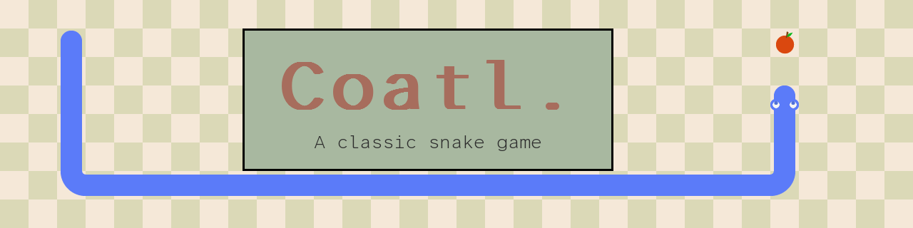

[](https://github.com/landoicco/coatl/actions/workflows/build.yml)
[](https://www.python.org/downloads/)
[](LICENSE)

A polished, classic **Snake-like arcade game** built from scratch with Python and Pygame.

This project serves as a learning milestone focused on clean code structure, environment reproducibility, audio integration, and modern development tooling.

> **What does "Coatl" mean?** It is the Nahuatl word for *snake* or *serpent* (commonly referenced in historical dictionaries like [Gran Diccionario Náhuatl](https://gdn.iib.unam.mx/diccionario/coatl/111897)).

---

## ✨ Features
* **Retro Audio Experience:** Dynamic background music and sound effects to elevate gameplay.
* **Polished Flow:** Seamless arcade-style transition loops featuring fully integrated Start and Game Over splash screens.
* **Reproducible Environment:** A Nix flake pinned by `flake.lock` provides the same development shell on every machine.
* **Prebuilt Binaries:** Linux and Windows executables are built automatically by GitHub Actions on every push to `master`.

---

## 🚀 Getting Started

### Download a prebuilt binary 📦
Grab the latest build for your OS from the [Rolling Development Build](https://github.com/landoicco/coatl/releases/tag/latest) release. No Python installation needed.

On Linux, make the file executable before running it:
```shell
chmod +x coatl-linux
./coatl-linux
```

### Run from source

This repository supports two running workflows: a fully-isolated development environment via **Nix Flakes** (ideal for NixOS/Linux), and a modernized cross-platform setup using **`uv`**.

#### Option A: Using Nix Flakes (Recommended) ❄️
If you have Nix installed, you can drop into a perfectly configured shell with Python, Pygame, PyInstaller, Ruff, and the GitHub CLI pre-installed by simply running:

```shell
nix develop
```
Then start the game:
```shell
python src/main.py
```

#### Option B: Using `uv` (Cross-platform) 🚀
If you prefer a traditional Python pipeline or are on a non-Nix system, ensure you have [uv](https://docs.astral.sh/uv/) installed, then execute:

```shell
uv run src/main.py
```

### Controls 🎮
* **Arrow keys:** Move the snake
* **Any key:** Start or restart from the splash screen
* **Click the link on the splash screen:** Open the developer's portfolio

---

## 🛠️ Tech Stack & Tooling
* **Core:** Python 3.11+ & Pygame-CE (Community Edition)
* **DevOps / Environment:** Nix Flakes (System level) & `pyproject.toml` (Metadata)
* **Linter & Formatter:** Ruff
* **Distribution:** PyInstaller, built and published by a GitHub Actions pipeline

---

## 📌 Roadmap & Version 2.0.0 Goals

- [x] Migrate ecosystem to high-performance dependency tracking
- [x] Implement smooth Splash Screen and Game Over flows
- [x] Add dynamic background audio tracks
- [x] Overhaul general UI look, text scaling, and feel
- [x] Setup a CI/CD Pipeline (GitHub Actions) to auto-build Windows (.exe) and Linux binaries
- [x] Optimize modular sprite rendering logic
- [x] Add a clickable developer portfolio link to the game interface

---

## 🎨 Credits & Assets
* **Developed by:** Lando Icaza C. — [licaza.dev](https://licaza.dev)
* **Origin:** Started by following Clear Code's [Snake game tutorial](https://youtu.be/QFvqStqPCRU), then extended with spritesheet rendering, sound effects and music, and a CI/CD pipeline.
* **Tooling:** The original game was written by hand; the v2.0.0 polish (CI/CD pipeline, gameplay fixes, spritesheet refactor and docs) was done with [Claude Code](https://claude.com/claude-code) as a pair-programming assistant.
* **Graphics, Music & Sound Effects:** CC0 assets by Clear_code, Sketlux, Memoraphile @ You're Perfect Studio and AntumDeluge, found on [OpenGameArt](https://opengameart.org).
* **Font:** [Atkinson Hyperlegible Mono](https://github.com/googlefonts/atkinson-hyperlegible-next-mono) by the Braille Institute, under the SIL Open Font License 1.1.

See [CREDITS.md](CREDITS.md) for the full list of assets, links and licenses.

---

## 📄 License
The source code is released under the [MIT License](LICENSE). Third-party assets keep their own licenses, listed in [CREDITS.md](CREDITS.md).
