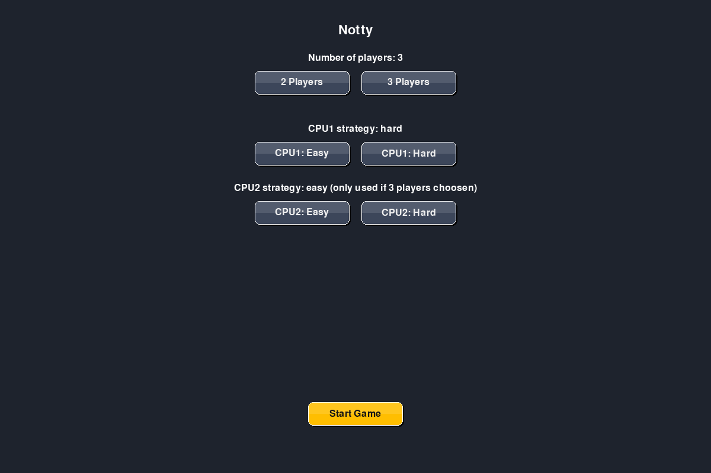
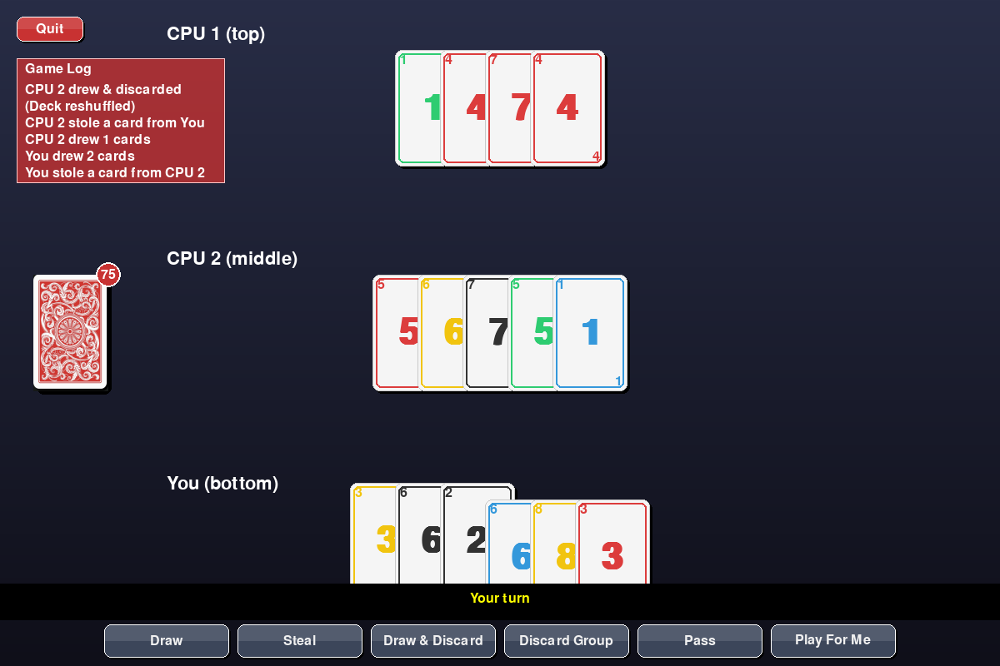

# Notty

A Rummy-style card game built from scratch in Python and Pygame — custom deck, rule engine, two CPU AI strategies, and an animated UI.

[](https://github.com/YOUR_USERNAME/notty/actions/workflows/ci.yml)


[](LICENSE)

Originally built as coursework for Programming (COMP3085 / COMP4008), then cleaned up and hardened as a standalone project.

## Screenshots

| Setup menu | In-game |
|---|---|
|  |  |

## Overview

Notty is played with a custom 90-card deck: 5 colours (red, green, yellow, blue, black) numbered 1–9, two of each. 2–3 players (one human, up to two CPU opponents) race to empty their hand by discarding valid **sequences** (3+ consecutive numbers, same colour) and **sets** (4+ cards of the same number, all different colours).

## Features

- Full Pygame UI — animated card dealing, drawing, and stealing, with a live game log
- Configurable setup menu (2 or 3 players, per-CPU difficulty)
- Two CPU AI strategies with genuinely different behaviour:
  - **Easy** — picks a random legal action each step
  - **Hard** — greedily discards valid groups first, then draws, then steals from whoever holds the most cards
- Full turn action set: draw up to 3 cards, steal a card, draw-and-discard (reshuffles the deck), discard a valid group, or pass
- "Play For Me" — let the AI take your turn for you
- Headless smoke tests + CI, so regressions get caught before they reach a player

## Requirements

- Python 3.10+
- [Pygame](https://www.pygame.org/) 2.6.1

## Installation

```bash
git clone https://github.com/YOUR_USERNAME/notty.git
cd notty
python3 -m venv venv
source venv/bin/activate   # Windows: venv\Scripts\activate
pip install -r requirements.txt
```

## Running the game

```bash
python3 main.py
```

## How to play

1. Choose the number of players and CPU difficulty in the setup menu.
2. On your turn, pick **one** of:
   - **Draw** — draw up to 3 cards from the deck (draw one at a time, then Stop)
   - **Steal** — take a random card from an opponent's hand
   - **Draw & Discard** — draw a card, then discard any card back into the deck (reshuffles it)
   - **Discard Group** — select 3+ cards forming a valid sequence or set and discard them (repeatable while you have valid groups)
   - **Pass** — end your turn
3. Click cards in your hand to select/deselect them before discarding a group.
4. The first player to empty their hand wins.

## Testing

A headless smoke test exercises the deck/group/turn rules, both AI strategies, and UI module init (via the SDL dummy driver, no window needed) and runs on every push via GitHub Actions.

```bash
python3 tests/smoke_test.py
```

## Project structure

```
main.py                     Entry point — menu loop and game loop
core/
  card.py                   Card model (colour, number)
  deck.py                   Deck creation, shuffling, drawing
  groups.py                 Sequence/set validation rules
  player.py                 Player hand management, stealing
  game.py                   Game state and turn actions
  turn.py                   Per-turn action-usage tracking
ai/
  strat1.py                 "Hard" greedy CPU strategy
  strat2.py                 "Easy" random CPU strategy
  utils.py                  Shared group-finding logic
ui/
  screen.py                 Main game screen, input handling, animations
  menu.py                   Setup menu screen
  renderer.py                Card/board rendering
  buttons.py                 Reusable button widget
  assets/                    Card front/back images
tests/
  smoke_test.py              Headless regression checks used by CI
scripts/
  generate_screenshots.py    Regenerates the README screenshots
```

## License

MIT — see [LICENSE](LICENSE).
