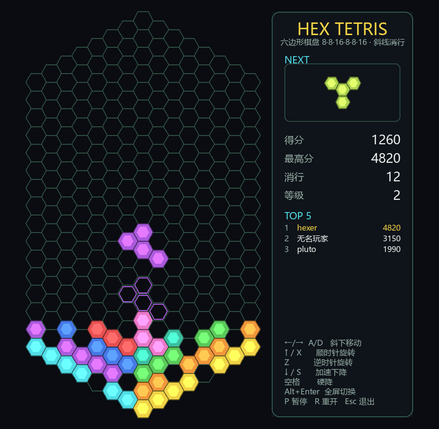

# Hex Tetris

A hex-grid Tetris written in pure `pygame-ce`. The board itself is a hexagon, and only **diagonal lines** clear when filled.
All graphics are drawn procedurally; the game loads no image assets.

[中文说明](README.zh-CN.md) · [License: GPL-3.0-or-later](#license)

## Board structure

- Cells are **flat-top** hexagons laid out in axial coordinates `(q, r)`; every column is a straight vertical line.
- The whole board is a hexagon: `|q| ≤ 7`, `|r| ≤ 11`, `|s| ≤ 11` (`s = -q - r`).
- Its six sides are, in order, **16, 8, 8, 16, 8, 8** cells (i.e. 8×8×16×8×8×16):
  the two vertical sides `q = ±7` have **16 cells** each, the other four slanted sides have 8 each. **289 cells** in total.
- The tallest column (`q = 0`) has 23 cells, so the board is 23 row-heights tall and 23 half-widths wide.



*(Left: the hexagonal board. Right: the score panel. The faint hexagons are the landing preview of the current piece.)*

## Line-clear rule (rows parallel to the bottom edges)

A row is a diagonal parallel to a bottom edge (lower-left / lower-right), judged per half; each row holds at most 8 cells:

| Row | Columns | Direction | Clears? |
|-----|---------|-----------|---------|
| `r = const` | left 8 columns `q = -7..0` | parallel to the lower-left edge | ✅ only when exactly 8 cells and all filled |
| `s = const` | right 8 columns `q = 0..7` | parallel to the lower-right edge | ✅ only when exactly 8 cells and all filled |
| `q = const` | vertical column | — | ❌ never clears |

- The board is left-right symmetric: the left half uses `r` diagonals, the right half uses `s` diagonals, and the two bottom edges (8 cells each) are the bottom two rows.
- Since each row covers only one half, a check only looks at the left 8 or right 8 columns; rows near the vertices are naturally shorter (at most 8),
  and such **rows with fewer than 8 cells never clear**, even when completely filled.
- **After a clear**, blocks above the cleared cells **fall down** within each vertical column by exactly the number of cells removed from that column (gaps at the top stay).

## Movement / falling

- **Gravity**: within a column `r + 1`, axial `Δ(0, +1)` — **always vertical, one cell at a time**.
- **Left / right**: adjacent columns are offset by half a cell vertically, so horizontal movement is necessarily **diagonal downward**:
  - left = down-left `Δ(-1, +1)`
  - right = down-right `Δ(+1, 0)`

| Key | Action |
|-----|--------|
| `←` `→` / `A` `D` | move down-left / down-right |
| `↑` / `X` / `W` | rotate 60° clockwise |
| `Z` | rotate 60° counter-clockwise |
| `↓` / `S` | soft drop (still vertical, one cell at a time) |
| `Space` | hard drop |
| `Alt`+`Enter` | toggle fullscreen / windowed |
| `P` | pause / resume |
| `R` | restart |
| `Esc` | quit |

## High scores (Top 5)

- The panel shows the **best score** and a **TOP 5** leaderboard.
- When the game ends with a score that makes the top 5, you are asked to **enter a name**
  (up to 10 characters, `Backspace` to delete, `Enter` to confirm); confirming with an empty name stores "无名玩家".
- Scores are kept in `highscores.json` next to the script (created on the first record).
  A missing or corrupted file is treated as "no records yet" and never breaks the game.

## Window

The window is **freely resizable** and the board rescales to fit entirely inside it (a sensible size is
chosen at startup based on your screen). The grid is never clipped. `Alt`+`Enter` toggles **fullscreen** and
**windowed** mode (fullscreen re-lays out at the desktop resolution; leaving fullscreen restores the previous window size).

## Running

```bash
cd hex_tetris
python3 -m venv .venv                        # skip if already created
.venv/bin/pip install pygame-ce              # skip if already installed
.venv/bin/python hex_tetris.py
```

## Self-checks

`test_hex_logic.py` runs headless logic checks and writes a rendered screenshot to `/tmp/hex_shot.png`:

```bash
.venv/bin/python test_hex_logic.py
```

Covered: side lengths (16,8,8,16,8,8) and cell count, piece connectivity, vertical one-cell falling,
diagonal left/right movement, rigid rotation, **rows = left/right half diagonals**, **clearing a full 8-cell row
plus falling of everything above**, **short rows never clearing**, **vertical columns never clearing**,
spawn/lock (including game over when the spawn area is occupied), and whole-board rendering.

## All tetrahexes

`utils/find_pieces.py` enumerates every distinct 4-cell connected shape on the hex grid
(deduplicated by rotation, mirrors counted separately), draws them to `utils/pieces.png` and compares
them with the `PIECES` table in the game:

```bash
.venv/bin/python utils/find_pieces.py            # show a window and save utils/pieces.png
.venv/bin/python utils/find_pieces.py --no-show  # save the image only
```

Result: 44 fixed placements, **10 distinct pieces** after rotation dedup (7 if mirrors are deduplicated too).
The game ships all 10: `I O N Y` (self-mirrored) and the mirror pairs `T/L`, `J/R`, `S/Z`.

## License

Copyright (C) 2026 Pluto Yang.

This project is free software: you can redistribute it and/or modify it under the terms of the
**GNU General Public License, version 3 or (at your option) any later version**
(`GPL-3.0-or-later`). It is distributed in the hope that it will be useful, but **without any warranty**,
without even the implied warranty of merchantability or fitness for a particular purpose.
See the [LICENSE](LICENSE) file for the full text of the GNU General Public License v3.
