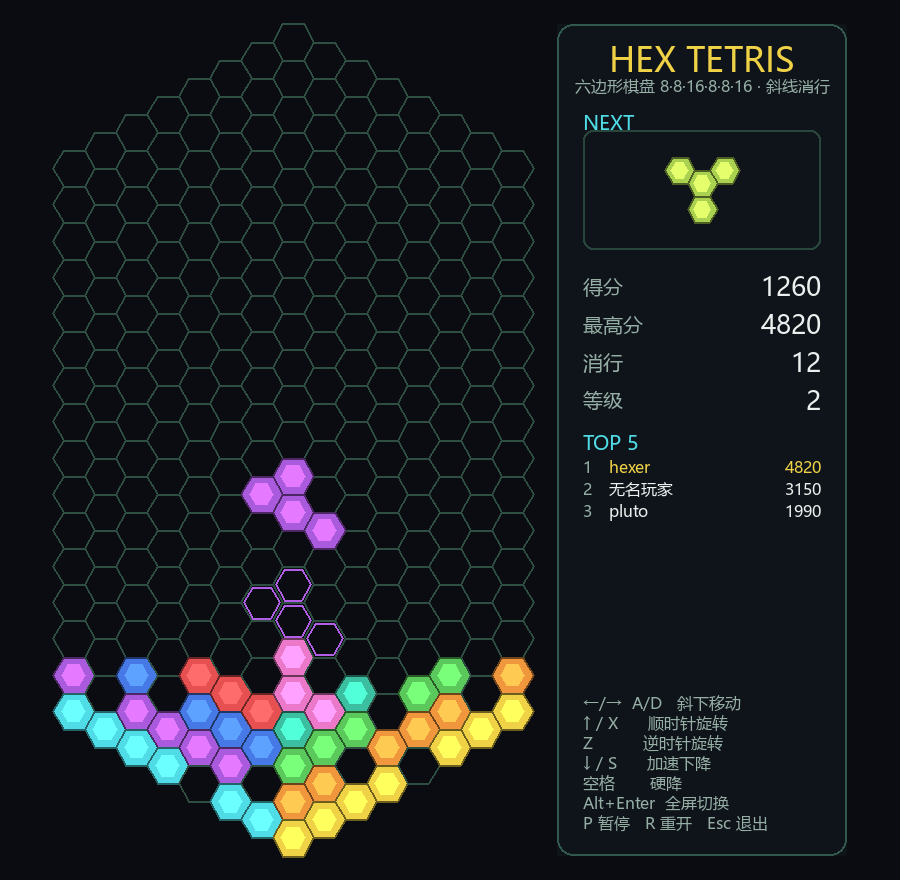

# 六边形网格俄罗斯方块 (Hex Tetris)

纯 `pygame-ce` 实现的六边形俄罗斯方块。棋盘本身是一个六边形，只有**斜线**填满才消行。
全部图形均由代码绘制，游戏不加载任何图片素材。

[English](README.md) · [许可证: GPL-3.0-or-later](#许可证)

## 棋盘结构

- 格子是**平顶 (flat-top)** 六边形，按轴向坐标 `(q, r)` 排列，每一列是竖直直线。
- 整个棋盘是一个六边形：`|q| ≤ 7`，`|r| ≤ 11`，`|s| ≤ 11`（`s = -q - r`）。
- 六条边依次是 **16, 8, 8, 16, 8, 8** 格（即 8×8×16×8×8×16）：
  左右两条竖边 `q = ±7` 各 **16 格**，其余四条斜边各 8 格。共 **289 格**。
- 最高的一列（`q = 0`）有 23 格，所以棋盘纵向 23 个行距、横向 23 个半宽。



（截图：左侧六边形棋盘，右侧记分牌；淡色六边形是当前方块的落点预示。）

## 消行规则（与底边平行的行）

行是与底边（左下 / 右下斜边）平行的斜线，并按左右两半分开判定，每行最多 8 格：

| 行 | 所在列 | 方向 | 是否消行 |
|----|--------|------|----------|
| `r = 常数` | 左 8 列 `q = -7..0` | 与左下斜边平行 | ✅ 恰好 8 格且填满才消 |
| `s = 常数` | 右 8 列 `q =  0..7` | 与右下斜边平行 | ✅ 恰好 8 格且填满才消 |
| `q = 常数` | 竖直列 | — | ❌ 不消 |

- 棋盘六边形左右对称：左半用 `r` 斜线、右半用 `s` 斜线，两条底边（各 8 格）就是最底下两行。
- 每行只占半边，所以判定时**只需看左边 8 列或右边 8 列**；靠近顶点的行会自然变短（最多 8 格），
  这些**不足 8 格的行不参与消除**，即使填满也不消。
- **消行后**，同一竖列中位于被消格子上方的方块**整体下落**，下落格数 = 该列被消去的格子数（顶部的空洞保持不变）。

## 移动 / 下落

- **重力**：同一列里 `r + 1`，轴向 `Δ(0, +1)`，**始终垂直、每次只下落 1 格**。
- **左右**：相邻列在竖直方向错开半格，所以左右移动必然是**斜下**：
  - 左 = 左下 `Δ(-1, +1)`
  - 右 = 右下 `Δ(+1,  0)`

| 按键 | 功能 |
|------|------|
| `←` `→` / `A` `D` | 左下 / 右下 斜向移动 |
| `↑` / `X` / `W` | 顺时针旋转 60° |
| `Z` | 逆时针旋转 60° |
| `↓` / `S` | 加速下降（仍为垂直 1 格） |
| `空格` | 硬降 |
| `Alt`+`Enter` | 全屏 / 窗口切换 |
| `P` | 暂停 / 继续 |
| `R` | 重新开始 |
| `Esc` | 退出 |

## 最高分（Top 5）

- 面板显示**最高分**和 **TOP 5** 排行榜。
- 游戏结束时若得分能进入前 5，会提示**输入名字**（最多 10 个字符，`Backspace` 删除），
  `Enter` 确认；不输入直接确认则记为“无名玩家”。
- 记录保存在脚本同目录的 `highscores.json`（首次创纪录时自动创建），
  文件缺失或损坏时视为暂无记录，不影响游戏运行。

## 窗口

窗口**可自由缩放**，棋盘会自动缩放以完整放进窗口（默认按屏幕大小开一个合适尺寸）。
不会出现网格被裁掉的情况。按 `Alt`+`Enter` 可在**全屏**与**窗口**模式间切换
（全屏时按桌面分辨率重新布局，退出全屏后恢复原来的窗口大小）。

## 运行

```bash
cd hex_tetris
python3 -m venv .venv                        # 已创建过可跳过
.venv/bin/pip install pygame-ce              # 已安装可跳过
.venv/bin/python hex_tetris.py
```

## 自检

`test_hex_logic.py` 做无头逻辑自检并输出渲染截图 `/tmp/hex_shot.png`：

```bash
.venv/bin/python test_hex_logic.py
```

覆盖：棋盘六边长度（16,8,8,16,8,8）与格数、方块连通性、下落垂直且 1 格、左右斜下、
旋转等距、**行 = 左/右半斜线**、**满 8 格消除 + 上方整体下落**、**不足 8 格不消**、**竖列不消**、
生成/锁定（含出生点被占即结束），以及整区渲染。

## 方块全集

`utils/find_pieces.py` 穷举六边形网格上全部独立的四格连通方块（旋转去重、镜像另算），
图形化输出为 `utils/pieces.png`，并与现有 `PIECES` 对照：

```bash
.venv/bin/python utils/find_pieces.py            # 弹窗显示并保存 utils/pieces.png
.venv/bin/python utils/find_pieces.py --no-show  # 只保存图片
```

结果：固定摆放 44 种，旋转去重后 **10 种独立方块**（连镜像也去重则 7 种）。
游戏现已收录全部 10 种：`I O N Y`（自身镜像）与互为镜像的 `T/L`、`J/R`、`S/Z`。

## 许可证

Copyright (C) 2026 Pluto Yang。

本项目是自由软件：你可以根据自由软件基金会发布的 **GNU 通用公共许可证第 3 版或（由你选择）任何更新版本**
（`GPL-3.0-or-later`）的条款重新发布和/或修改它。分发本项目是希望它有用，但**不提供任何担保**，
甚至不包括适销性或特定用途适用性的默示担保。
完整的 GNU GPL v3 条款见 [LICENSE](LICENSE) 文件。
