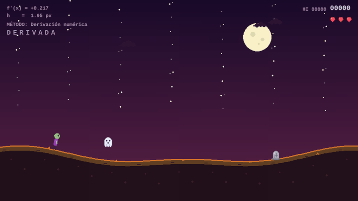

# Runner Matemático

> Endless runner estilo el dinosaurio de Chrome, pero el terreno no está
> dibujado a mano: sale de una función, y la pendiente se calcula **derivando
> numéricamente**. El salto se integra con **Euler**.

[](https://python.org)
[](https://pygame.org)
[](https://github.com/urreadiego0518-code/runner-matematico/releases/latest)
[](LICENSE)



---

## Qué es

Un atleta corre sin parar sobre un terreno que sube y baja. Tienes que saltar
las piedras y **agacharte** para pasar debajo de los drones. Cada 10 000 puntos
la velocidad sube y los obstáculos salen más seguidos.

Lo interesante no es el juego, es cómo está hecho:

- El **terreno** es una suma de senos y cosenos, no un dibujo.
- La **pendiente** del suelo se obtiene con diferencia central:
  `f'(x) ≈ (f(x+h) − f(x−h)) / 2h`.
- El **salto** se resuelve integrando con el método de Euler.
- La **rotación** del atleta usa `atan` de la derivada, para que se incline
  según el terreno.
- La **música y los efectos** se sintetizan por código: no hay ni un `.wav`.
- El juego **no usa imágenes**: todo se dibuja con primitivas de pygame.

---

## Descargar y jugar

### Windows

1. Entra a **[Releases](https://github.com/urreadiego0518-code/runner-matematico/releases/latest)**.
2. Descarga `RunnerMatematico-windows.exe`.
3. Doble clic y listo. No hace falta instalar Python.

> Windows va a mostrar el aviso de "Windows protegió tu PC" porque el `.exe` no
> está firmado. Es normal: clic en **Más información** → **Ejecutar de todas
> formas**.

### Linux

1. Entra a **[Releases](https://github.com/urreadiego0518-code/runner-matematico/releases/latest)**.
2. Descarga `RunnerMatematico-linux`.
3. Dale permisos y ejecútalo:

```bash
chmod +x RunnerMatematico-linux
./RunnerMatematico-linux
```

Si te falta alguna librería de SDL, instálala según tu distro:

```bash
# Fedora
sudo dnf install SDL2 SDL2_mixer

# Debian / Ubuntu
sudo apt install libsdl2-2.0-0 libsdl2-mixer-2.0-0
```

### macOS

1. Entra a **[Releases](https://github.com/urreadiego0518-code/runner-matematico/releases/latest)**.
2. Descarga `RunnerMatematico-macos`.
3. Quítale la cuarentena y ejecútalo:

```bash
chmod +x RunnerMatematico-macos
xattr -d com.apple.quarantine RunnerMatematico-macos
./RunnerMatematico-macos
```

> El binario no está firmado con una cuenta de Apple, así que Gatekeeper lo
> bloquea la primera vez. También puedes hacer clic derecho → **Abrir**.
>
> El binario se compila para Apple Silicon (M1 en adelante). Si tienes un Mac
> Intel, corre el juego desde el código fuente (abajo) o compílalo tú.

### Otra opción: desde el código fuente

Funciona en cualquier sistema con Python 3.10 o superior:

```bash
git clone https://github.com/urreadiego0518-code/runner-matematico.git
cd runner-matematico
python3 -m pip install -r requirements.txt
python3 main.py
```

En Windows cambia `python3` por `py`.

---

## Controles

| Tecla | Acción |
|---|---|
| `Espacio` o `↑` | Saltar |
| `↓` | Agacharse (para pasar bajo los drones) |
| `ESC` o `P` | Pausa |
| `TAB` | Reiniciar |
| `M` | Música sí / no |
| `F11` | Pantalla completa |
| `T` (en Opciones) | Cambiar tema: Halloween, Clásico, Navidad, Oscuro |

**Bonus del camino:**

- Junta las letras de `DERIVADA`, `NEWTON`, `GAUSS`, `JACOBI`, `EULER` o
  `BISECCION` y ganas 500 puntos.
- Cada 3 000 puntos aparece un corazón (hasta 5 vidas).

---

## Cómo se genera el terreno

```python
def terreno_f(x):
    return SUELO_BASE + 18 * math.sin(x * 0.007) + 10 * math.cos(x * 0.014)

def derivada_numerica(x, h=1.0):
    return (terreno_f(x + h) - terreno_f(x - h)) / (2 * h)
```

La derivada se usa para tres cosas: inclinar al atleta, decidir si el suelo
sube o baja, y calcular el ángulo de la cámara.

Las amplitudes están calibradas para que la pendiente máxima quede en 0.235.
Con eso, en el ancho de solape horizontal (36 px) el terreno nunca cambia más de
8.41 px. Ese margen es lo que garantiza la regla del juego: **el dron se pasa
agachándose, jamás saltando**. El `docs/manual-tactico.txt` lo demuestra paso a
paso.

---

## Compilar tu propio binario

Los binarios de Releases los genera solo GitHub Actions cada vez que se publica
un release (ver `.github/workflows/build.yml`). Si quieres hacerlo en tu
máquina:

```bash
python3 -m pip install pygame pyinstaller
pyinstaller --onefile --windowed --name RunnerMatematico main.py
```

El resultado queda en `dist/`:

| Sistema | Archivo |
|---|---|
| Windows | `dist/RunnerMatematico.exe` |
| Linux | `dist/RunnerMatematico` |
| macOS | `dist/RunnerMatematico` |

> **Ojo:** un `.exe` de Windows solo se puede compilar **en Windows**.
> PyInstaller no compila para otras plataformas. Por eso el workflow usa una
> máquina distinta para cada sistema.

---

## Estructura

```
runner-matematico/
├── main.py                       # El juego completo
├── audio.py                      # Música y efectos sintetizados por código
├── requirements.txt
├── docs/
│   ├── como-jugar.txt            # Resumen rápido
│   ├── manual-de-usuario.txt     # Manual para el jugador
│   └── manual-tactico.txt        # La matemática y el modelo de colisión
├── .github/workflows/build.yml   # Compila los binarios de las 3 plataformas
├── LICENSE
└── README.md
```

---

## Créditos

Proyecto en equipo de la materia de **Métodos Numéricos**. El código está aquí
completo, pero los nombres de mis compañeros no los publico para no exponerlos
sin su permiso.

---

## Lo que le falta

- El puntaje alto no se guarda entre sesiones.
- No hay pruebas automáticas (el modelo de colisión se presta para escribirlas).
- `main.py` es un solo archivo de ~1 400 líneas; se puede separar en módulos
  (terreno, jugador, obstáculos, HUD).

Si quieres mejorar algo, abre un issue o mándame el PR.

---

## Licencia

MIT. Úsalo, modifícalo y compártelo. Ver [LICENSE](LICENSE).

---

<div align="center">
  <sub>Hecho por <a href="https://github.com/urreadiego0518-code">Diego Urrea</a></sub>
</div>
