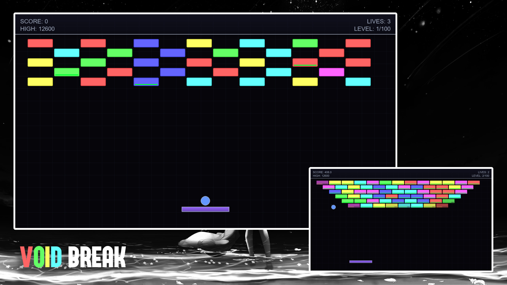
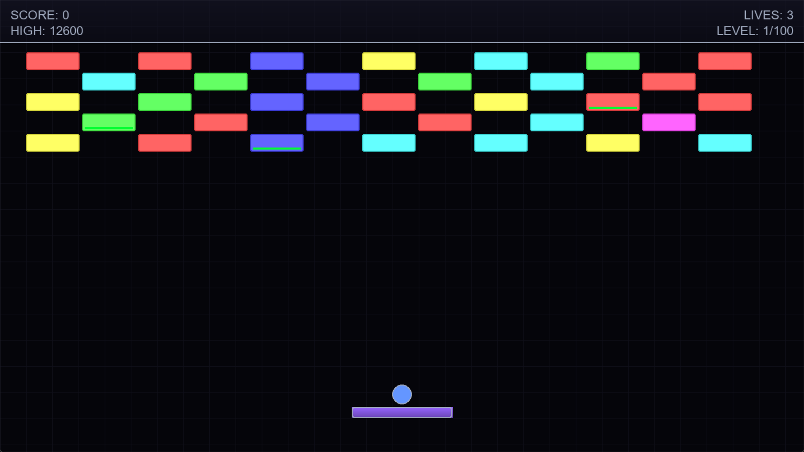
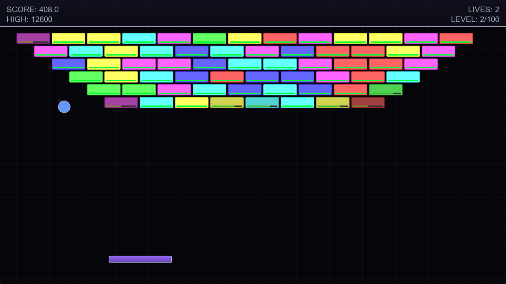
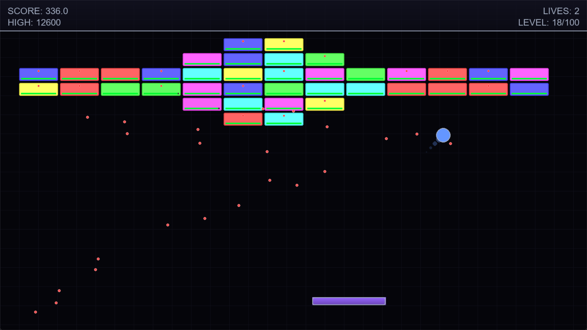
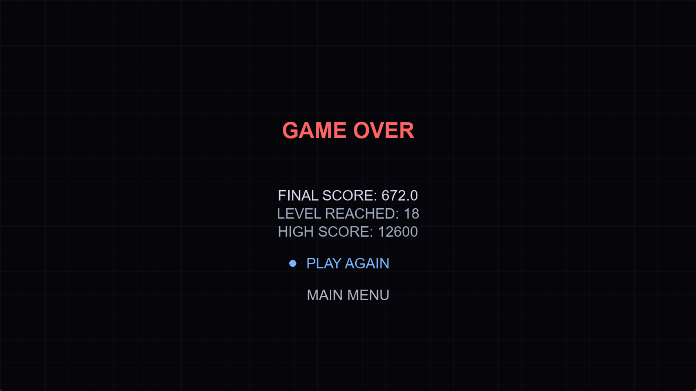
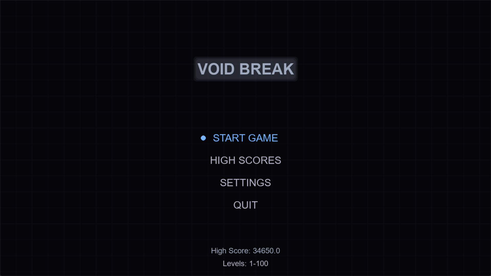
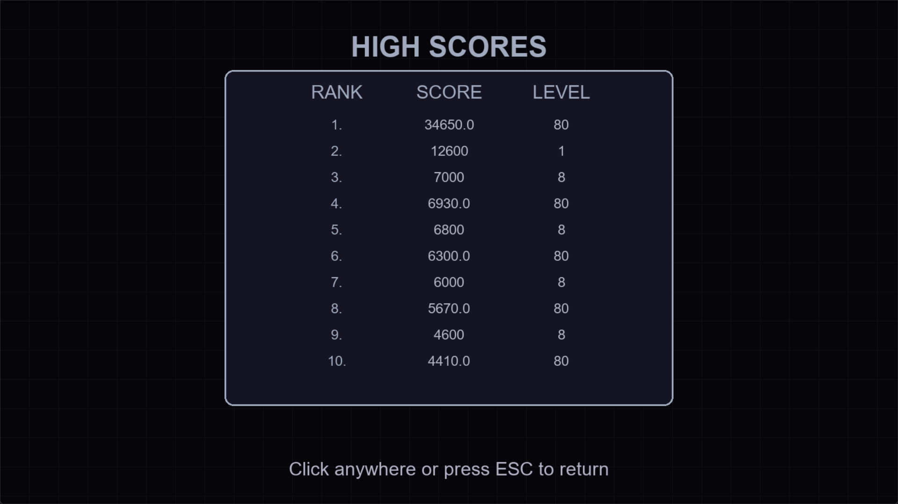

<p align="center">
  
</p>

<h1 align="center">⚫ Void Break</h1>
<p align="center">
  <strong>A modern arcade brick-breaker game built with Python and Pygame.</strong>
</p>

<p align="center">
  
  
  
  
</p>

## Overview

Void Break is a polished desktop arcade game inspired by classic brick-breaker mechanics. The player controls a paddle, launches a ball, destroys procedural brick formations, collects power-ups, avoids enemy projectiles, and progresses through up to 100 levels of increasing difficulty.

The project is intentionally compact and easy to study. Most of the game is implemented in `main.py`, making it suitable for learning game loops, collision handling, state management, procedural level generation, and simple data persistence in Python.

## Features

- Full-screen responsive Pygame window with resizable display support.
- Classic paddle-and-ball brick-breaking gameplay.
- 100-level progression system with procedural brick layouts.
- Multiple level pattern styles including rows, checkerboards, pyramids, fortress shapes, spirals, clustered bricks, and advanced randomized structures.
- Enemy bricks that can fire projectiles at the player.
- Health-based bricks with visual damage indicators.
- Eight power-up types:
  - Extra life
  - Expanded paddle
  - Multi-ball
  - Laser shot
  - Slow ball
  - Fast ball
  - Shield
  - Damage boost
- Paddle laser ability and temporary shield system.
- Ball trail rendering for a more energetic visual style.
- Menu, pause, settings, high-score, level-complete, and game-over screens.
- Persistent local high-score storage using `highscores.json`.
- Keyboard and mouse menu navigation.
- Clean neon/sci-fi visual theme with grid background and HUD overlays.

## Screenshots

The project includes screenshots in the `screenshots/` folder.

<table>
  <tr>
    <td align="center"></td>
    <td align="center"></td>
  </tr>
  <tr>
    <td align="center"></td>
    <td align="center"></td>
  </tr>
  <tr>
    <td align="center"></td>
    <td align="center"></td>
  </tr>
</table>

## Technology Stack

| Area | Technology |
| --- | --- |
| Language | Python |
| Game Framework | Pygame |
| Graphics | Pygame drawing primitives and alpha surfaces |
| Audio | Pygame mixer |
| Persistence | JSON file storage |
| Runtime File | `main.py` |

## Project Structure

```text
void-break/
├── README.md
├── LICENSE
├── main.py
├── banner.jpg
├── highscores.json          # Created automatically after the first game
└── screenshots/
    ├── 1.png
    ├── 2.png
    ├── 3.png
    ├── 4.png
    ├── 5.png
    └── 6.png
```

## Installation

### Prerequisites

- Python 3.10 or newer
- `pip`

### 1. Clone or Download the Project

```bash
cd void-break
```

### 2. Install Pygame

```bash
pip install pygame
```

### 3. Run the Game

```bash
python main.py
```

On some systems, use:

```bash
python3 main.py
```

## Controls

| Action | Key / Input |
| --- | --- |
| Move paddle left | `Left Arrow` or `A` |
| Move paddle right | `Right Arrow` or `D` |
| Launch ball | `Space` |
| Fire laser while active | `Space` or `Z` |
| Pause / resume | `P` |
| Navigate menu | `Up Arrow` / `Down Arrow` |
| Select menu option | `Enter` |
| Adjust settings | `Left Arrow` / `Right Arrow` |
| Back / pause / quit | `Esc` |
| Select menu item | Mouse click |
| Highlight menu item | Mouse movement |

## Gameplay

The objective is to clear every brick in the current level without running out of lives. The ball bounces off walls, the paddle, and bricks. The angle of the bounce changes depending on where the ball hits the paddle, which gives the player control over shot direction.

Some bricks have multiple health points and become visually weaker as they take damage. Higher-level bricks may become enemy bricks, which periodically shoot projectiles toward the paddle. Power-ups drop from destroyed bricks and create temporary advantages or risks depending on the type collected.

The player advances after clearing all bricks in a level. The game supports progression from level 1 to level 100.

## Power-Ups

| Power-Up | Label | Effect |
| --- | --- | --- |
| Extra Life | `+1` | Adds one life. |
| Expand Paddle | `++` | Temporarily increases paddle width. |
| Multi-Ball | `MB` | Adds extra balls to the playfield. |
| Laser | `LZ` | Enables paddle laser shots. |
| Slow Ball | `SL` | Reduces ball speed. |
| Fast Ball | `SP` | Increases ball speed. |
| Shield | `SH` | Temporarily protects the paddle from enemy projectiles. |
| Damage Boost | `DM` | Increases ball damage against bricks. |

## License

This project is licensed under the MIT License. See [LICENSE](LICENSE) for details.

## Author

Ashish Kumar