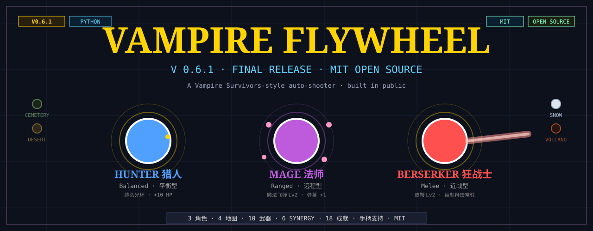

<p align="center">
  
</p>

# VampireFlywheel

一款完全公开开发的 **Vampire Survivors 风格生存射击 Roguelite**，6 周 7 个版本迭代完成，纯 Python + pygame-ce 单文件实现。

> 暗黑哥特版海报：[banner_dark.svg](banner_dark.svg)

## 快速试玩（3 步）

1. 装 Python 3.11 / 3.12 / 3.13 / 3.14 任一版本（[python.org](https://python.org)）
2. 装游戏库：
   ```bash
   pip install pygame-ce
   ```
3. 运行：
   ```bash
   python vampire_flywheel_v0_6.py
   ```

> Python 3.14 用户必须用 `pygame-ce` 而非原版 `pygame`（后者 font 模块在 3.14 上有问题）。

## 控制

| 操作 | 键盘 | 手柄 |
|---|---|---|
| 移动 | WASD / 方向键 | 左摇杆 / D-pad |
| 暂停 | P | Start |
| 菜单确认 | Enter / Space | A |
| 取消 / 退出 | Esc | B |
| 切换面板 | Tab | Y / LB |
| 重开 | R | Back |
| 分享战绩 | S | X |
| 全屏 | F | — |

## 特性

- **3 起始角色** — 猎人 / 法师 / 狂战士
- **4 地图** — 墓园 / 荒漠 / 雪原 / 火山（DLC）
- **10 武器** + **5 进化形态** + **6 Synergy 隐藏组合**
- **7 被动** + **4 元进化永久升级**
- **3 难度** — 轻松 / 普通 / 困难（自动调整 i-frames）
- **3 DLC 包** — 武器包 / 地图包 / 皮肤包
- **18 成就** + 本地 Top-10 排行榜 + 在线榜占位
- **完整手柄支持** — Xbox / PS / 通用 USB
- **手感** — 屏幕震动、Hitstop 慢动作、低血红屏、Combo 里程碑

## 打包成 exe（可选）

```bash
pip install pyinstaller pygame-ce

# macOS / Linux:
pyinstaller --onefile --windowed --name VampireFlywheel \
  --add-data "sfx:sfx" --add-data "bgm:bgm" --add-data "assets/fonts:assets/fonts" \
  --hidden-import=pygame._sdl2 --collect-all pygame_ce \
  vampire_flywheel_v0_6.py

# Windows (PowerShell):
pyinstaller --onefile --windowed --name VampireFlywheel `
  --add-data "sfx;sfx" --add-data "bgm;bgm" --add-data "assets/fonts;assets/fonts" `
  --hidden-import=pygame._sdl2 --collect-all pygame_ce `
  vampire_flywheel_v0_6.py
```

输出在 `dist/VampireFlywheel.app`（macOS）或 `dist/VampireFlywheel.exe`（Windows）。

## 版本历史

| 版本 | 主题 | 关键功能 |
|---|---|---|
| V0.2 | 卡牌升级 | 三选一卡牌系统、5 武器、7 被动 |
| V0.3 | 武器进化 + 元进化 | 5 进化形态、金币元商店、墓园主题、音效占位 |
| V0.4 | Synergy + 多地图 | 6 Synergy、武器图鉴、暂停菜单、成就、真实音效框架 |
| V0.5 | 手柄 + 3 角色 | 完整手柄支持、雪原地图、角色选择、震动 + Hitstop |
| V0.6 | 发布候选版 | DLC 框架、难度选择、火山地图、标题画面、退出确认 |
| **V0.6.1** | **最终发布** | **V0.6 Fix 全部完成 + 视觉抛光 + 发布级文档** |

## License

MIT — 详见 [LICENSE](LICENSE)。可以随意 fork、改、商用、自己发自己的版本。

## Built with Four-Ring Flywheel

**Build / Sale / Test / Fix 同步循环** — 每周一个可玩版本，玩家反馈直接驱动下一版。

六周一个项目从 0 做到能发布，重要的是节奏。
