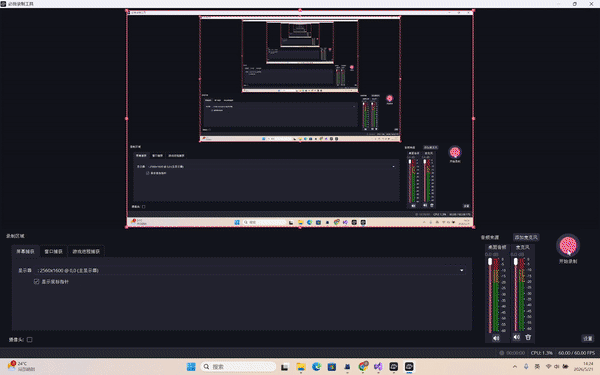
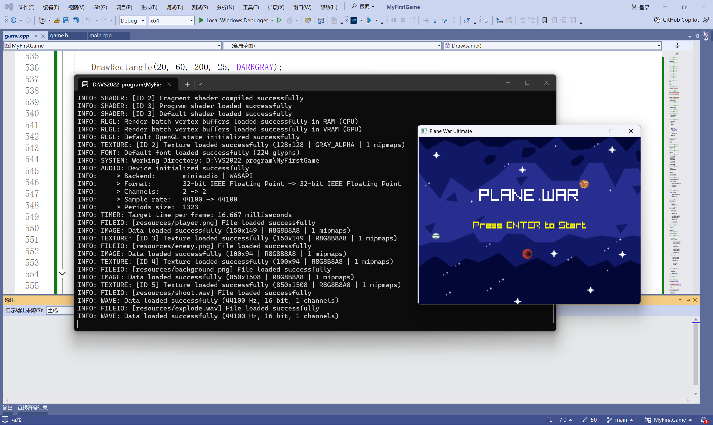
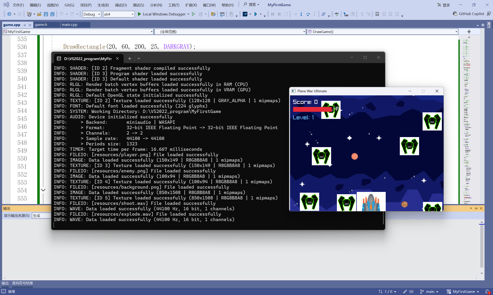
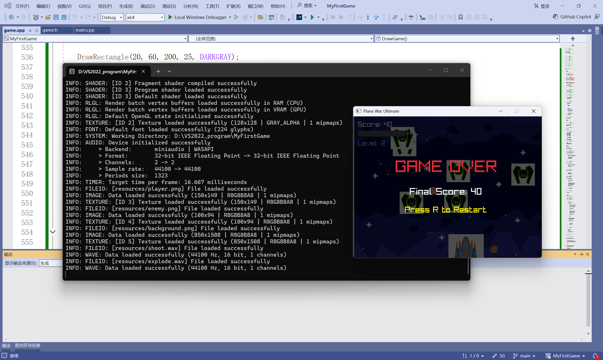
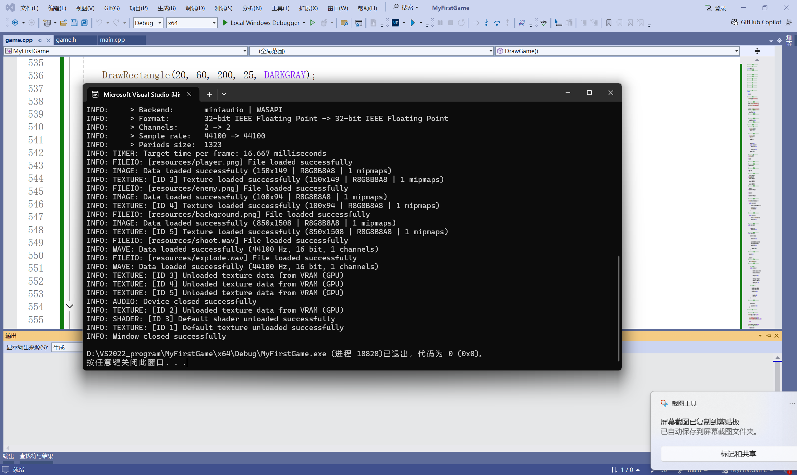

# ✈ Plane War Ultimate

> **A complete 2D shoot-'em-up built from scratch in ~3500 lines of C++ — no game engine, just [raylib](https://www.raylib.com/).**

<p align="center">
  
</p>

[]()
[]()
[]()
[](LICENSE)
[]()

---

## Why This Project Is Interesting

Most "game programming" tutorials stop at a triangle moving on screen. This is a **fully playable arcade game** with all the systems you'd find in a commercial STG:

- 🔫 **Charge laser** — hold to charge, release for a screen-piercing beam
- 💣 **Bomb stock** — 3 per life, press B to clear the screen
- ⚡ **Graze scoring** — near-miss bullets for bonus points
- 💎 **Item collection chain** — magnetic gold stars with x5.0 score multiplier
- 👑 **3 unique Bosses** — Carrier, Destroyer, Hellbringer — each with 2 attack phases
- 👾 **Mid-bosses** — mini-boss encounters at waves 3 and 7
- 🌊 **10-wave JSON-configurable stage** — edit `waves.json` to design your own
- 🎚️ **4 difficulty levels** — Easy / Normal / Hard / Lunatic
- 🏅 **Top-10 leaderboard** — persistent local rankings with timestamps
- 🎵 **BGM support** — drop an `.mp3` in `resources/` and it plays

**All built without a game engine** — only C++17 and raylib as a rendering/audio layer.

---

## Gameplay

| | |
|---|---|
|  |  |
|  |  |

---

## Controls

| Key | Action |
|-----|--------|
| `WASD` / Arrow Keys | Move |
| `SPACE` (tap) | Fire bullet |
| `SPACE` (hold) | Charge → release for **laser beam** |
| `B` | **Bomb** — screen clear (3 per life) |
| `P` / `ESC` | Pause |
| `F11` | Fullscreen |
| `M` | Mute |

---

## Architecture

```
main.cpp
  └── Game (state machine: MENU → PLAYING → PAUSED → GAMEOVER)
        ├── Player         Movement, shooting, charge laser, invincibility
        ├── Enemy[30]      3 types (Stinger / Ravager / Juggernaut)
        ├── Boss           3 variants (Carrier / Destroyer / Hellbringer)
        ├── Bullet[160]    Object-pooled, player + boss
        ├── Particle[300]  Explosion FX, object-pooled
        ├── PowerUp[10]    Heal / Triple-shot drops
        ├── StarItem[80]   Magnetic collectible chain
        ├── WaveManager    10-wave JSON-configurable spawner
        ├── UIManager       Menus / HUD / Settings / Leaderboard
        └── Input           Single-point key binding (remap in one file)
```

### Design Patterns

| Pattern | Where | Why |
|---------|-------|-----|
| **Object Pool** | `pool.h` — bullets, enemies, particles | Zero heap allocation during gameplay |
| **State Machine** | `GameState` enum — 6 states | Clean menu→game→pause→gameover flow |
| **Delta Time** | All movement/timers use `GetFrameTime()` | Game runs correctly at any framerate |
| **Namespace** | `namespace pwu` on all types | No global namespace pollution |
| **Input Abstraction** | `input.h` — `Input::Shoot()` | Change one file to remap all keys |
| **Data-Driven** | `waves.json` — external config | Edit waves without recompiling |

---

## Build

### Quick Start (CMake)

```bash
git clone https://github.com/Tomzkl/PlaneWarUltimate.git
cd PlaneWarUltimate
mkdir build && cd build
cmake .. -DRAYLIB_PATH=/path/to/raylib-6.0
cmake --build .
```

### Visual Studio 2022

1. Open `MyFirstGame.sln`
2. Set `RaylibPath` in `.vcxproj` to your raylib folder
3. Build → Build Solution

Raylib will be auto-downloaded via `FetchContent` if not found.

---

## Project Structure

```
PlaneWarUltimate/
├── main.cpp              Entry point
├── game.h / .cpp         Core engine (~900 lines)
├── player.h / .cpp       Player + charge shot (~280 lines)
├── enemy.h / .cpp        3 enemy types (~290 lines)
├── boss.h / .cpp         3 boss variants (~260 lines)
├── particle.cpp          Explosion particles
├── powerup.cpp           Heal / Triple drops
├── pool.h                Generic O(1) object pool
├── ui_manager.h / .cpp   All UI (~490 lines)
├── wave_manager.h / .cpp Wave system + JSON parser (~250 lines)
├── input.h               Key binding map
├── types.h / constants.h Shared types & tuning values
├── tests.cpp             12 unit tests
├── resources/
│   ├── waves.json        Wave configuration
│   ├── bgm.mp3           (optional) Background music
│   └── *.png / *.wav     Game assets
└── CMakeLists.txt
```

---

## Run Unit Tests

```bash
g++ -std=c++17 tests.cpp -o tests && ./tests
# Output: 12/12 passed
```

---

## Technical Deep-Dive

### Object Pool (O(1) amortized)
`Pool<T, N>` wraps a fixed-size array. `Acquire()` uses a circular hint to avoid O(n) scanning. No `new`/`delete` during gameplay — memory is allocated once at startup.

### Delta-Time Physics
All movement, timers, and animations scale with `GetFrameTime() * 60.0f`. The game plays identically at 30fps, 60fps, or 144fps.

### Procedural Art Fallback
Every entity has a fully detailed procedural drawing path. If PNG textures are missing, the game still looks great with hand-coded geometric ships. The player is an X-wing style fighter with animated engine flames, cockpit reflections, and wing markings.

### JSON Wave Parser
`wave_manager.cpp` contains a ~120-line hand-written recursive-descent JSON parser. It reads `waves.json` at startup and falls back to compiled-in wave definitions if the file is missing or malformed.

### Procedural Audio
If `.wav` files are missing, sound effects are generated from sine/square/saw/triangle waveforms with amplitude envelopes.

---

## Credits

- **raylib** by Ramon Santamaria — graphics, audio, input
- Sound effects from the Dravenx Space Shooter SFX pack
- Built by **Dominic Harmon**

---

## License

MIT — see [LICENSE](LICENSE)
