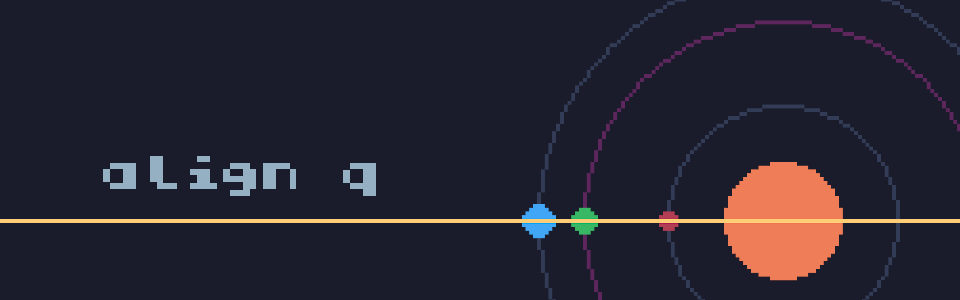

# Align Q

[jam]: https://itch.io/jam/tweettweetjam-4
[tic80]: https://tic80.com/
[palette]: https://lospec.com/palette-list/sweetie-16
[grafxkid]: https://grafxkid.tumblr.com/palettes

Align all planets! Or don't. Just enjoy a nice pixelated simulation of a star
system. More likely than not, the planets will align on their own sooner or
later!

## Controls

\<Z\> or \<Button 1\> - Slow down the planet.

\<X\> or \<Button 2\> - Reset.

## Credits

Created by Theo Ratkin for the [TweetTweetJam 4][jam].

Made with [TIC-80][tic80].

Palette used: [Sweetie 16][palette] by [GrafxKid][grafxkid].
