<p align="center">
  <a href="https://furkiozknn.github.io/cini-ustasi/"></a>
</p>

<p align="center">
  <a href="https://furkiozknn.github.io/cini-ustasi/"></a>
  
  
  <a href="LICENSE"></a>
  
</p>

<p align="center"><b>A calm 3D edge-matching puzzle in a warm tile workshop: rotate, swap and flip hand-painted Iznik tiles until every tulip, carnation, saz leaf and rumi scroll connects, then fire the finished panel in the kiln and hang it on your wall.</b></p>

<p align="center">
  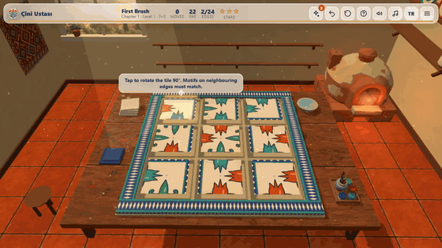
</p>

<p align="center"><b>Play online: <a href="https://furkiozknn.github.io/cini-ustasi/">https://furkiozknn.github.io/cini-ustasi/</a></b> (desktop and phone, no install)</p>

<!-- portals:start -->
<p align="center">Also on: <a href="https://furkiozknn.itch.io/cini-ustasi">itch.io</a> &middot; <a href="https://playgama.ai/play/3w2c2uyo35qj3q">Playgama</a></p>
<!-- portals:end -->

## Highlights

- **30 levels in 3 chapters.** Chapter 1 is about rotating tiles, chapter 2 adds swapping, chapter 3 adds fixed tiles
  and double-sided tiles you can flip; boards grow from 3x3 to 6x6.
- **Every level is solvable.** Boards are generated solved and then scrambled, and the built-in solver solves all 30
  levels and the daily boards from the scrambled state (checked by the tests).
- **Readable motifs.** Five Iznik motifs in cobalt, turquoise, coral and emerald are painted in code; each motif is
  widest at the edge, so a matched pair forms one medallion, and matched edges glow gold.
- **Moves against par.** 1 to 3 stars per level, undo, restart, three hints per level that each fix one tile, a
  matched-edge counter in the top bar and a **daily board** that unlocks after chapter 1.
- **The kiln is a craft step.** A solved board glazes with a shine sweep and slides into the glowing kiln; there a heat
  gauge rises and you press **Fire** while the needle is in the glaze band. Inside the band the glass frit melts into a
  glossy finish, dead centre earns the master glaze, too early or too late comes out matte. The finish is kept on the
  panel and shows as a sheen on the wall and in the collection (stars and moves are not affected; one click skips it).
- **Excavation boards.** On odd days of the month the daily board has three weathered tiles: the motif lies under a
  layer of earth until one edge meets its correct neighbour, then it restores with a shimmer.
- **Coaching in play, no tutorial wall.** Level 1 pulses the first wrong tile with a one-line tip; the first swap level
  and the first fixed/double-sided level name the new rule once, over the tile it applies to.
- **Live star meter.** A thin bar under the top bar counts the moves left before the next star threshold (gold,
  silver, bronze); crossing one chimes and pops the stars, and a rotation that breaks a matched edge nudges the tile.
- **Master's gallery.** The collection lists all 30 panels (unsolved ones as outlines) plus your daily boards; pick
  one to see its name, stars and glaze, and unlock four short craft notes about Iznik tile, one per chapter.
- **A living workshop.** Dust motes in the window light, a view of Lake Iznik, a flickering kiln, glossy bevelled tiles
  on lime-plaster grout and a cat that comes to sit on the stool; oud-like plucks on a Hicaz scale over a soft drone,
  made with Web Audio.

## How to play

> [!TIP]
> **Goal:** connect every edge on the board: each motif must meet its twin on the neighbouring tile. Solve the level in
> as few moves as possible to earn 3 stars, then fire the panel in the kiln at the right heat for a glossy finish.

Click a tile to rotate it by 90 degrees. From chapter 2 on, drag a tile onto another to swap them. In chapter 3 some
tiles are fixed in place, and double-sided tiles can be flipped with a right-click (or a long press). The top bar shows
your moves, the level's par, how many edges already match and the star meter. When the board is solved it slides into
the kiln: press **Fire** (or tap the card, `Enter`, `Space`) while the needle is in the glaze band.

<details>
<summary><b>More rules</b></summary>

- Each level has a par, the length of the planned solution. Finishing at or under par gives 3 stars, within
  `ceil(1.6 x par) + 2` moves 2 stars, and any solve at least 1 star.
- Every level starts with three hints. A hint fixes one tile, planned against the board's own generated solution, so it
  is instant and never fails; undoing a hint gives it back.
- Fixed tiles stay at their home position and cannot be rotated, swapped or flipped.
- The kiln step rates the finish: matte, glossy (needle in the band) or master glaze (needle in the narrow core).
  A panel keeps its best finish; skipping the step or letting the needle run to the end gives matte.
- The daily board is a fresh 4x4 puzzle seeded by the date, with rotations and swaps; it unlocks after chapter 1. On
  odd days it is an excavation board with three weathered tiles; the solution, hints and par are the same as the plain
  board for that date.
- Solved panels join the collection and the gallery wall of the workshop (the wall shows the 12 latest, the collection
  keeps all of them); your best stars and finish per level are kept.

</details>

### Controls

| Action | Mouse / touch | Keyboard |
|---|---|---|
| Rotate a tile 90 degrees | click / tap | |
| Swap two tiles (chapter 2 on) | drag one onto the other | |
| Flip a double-sided tile (chapter 3) | right-click / long press | `F` on the hovered tile |
| Tilt the camera / zoom | drag on the table / wheel or pinch | |
| Fire the kiln (after a solve) | Fire button or tap the card; Skip | `Enter` / `Space` / `F` |
| Undo / hint / restart | top bar | `Z` / `H` / `R` |
| Pause menu | menu button | `P` / `Esc` |
| Music / effects / language | pause menu, settings | `M` / `X` / `L` |
| Buttons | tap | `Tab`, `Enter` / `Space` |

Settings (master, music and effects volume, TR / EN, Low / High graphics, fullscreen) are saved in `localStorage` under
`arena.cini.settings`; stars, unlocked levels and the collection under `arena.cini.save`, and the title offers
**Continue**. The first visit follows the browser language and picks Low graphics on touch devices or CPUs with 4
threads or fewer.

<details>
<summary><b>URL flags for testing</b></summary>

| Flag | Effect |
|---|---|
| `?auto` | the game solves each board itself (plans to the generated solution) and moves on |
| `?debug` | draw calls, fps and JS errors on screen; `window.ciniSim(seconds)` fast-forwards the game |
| `?sim=N` | fast-forward N seconds before the first frame |
| `?level=N` / `?level=daily` | jump to a level or the daily board |
| `?daykey=YYYY-MM-DD` | force the daily board's date (an odd day gives the excavation board) |
| `?screen=levels` | open a screen: `levels`, `collection`, `howto` (`&ch=N` picks the page), `settings` or `pause` |
| `?low` | Low graphics for this visit (not saved) |
| `?noassets` | skip the asset files and use the procedural models and textures |
| `?lang=en` / `?lang=tr` | language |
| `?fresh` | start with empty progress and default settings |
| `?fill` | fill the collection for screenshots (saving disabled) |
| `?noanim` / `?nohowto` / `?nokiln` | skip CSS animations / skip the coach tips / skip the kiln firing step |

The live state is on `window.cini` (with a small test API on `window.cini.api`: `performMove`, `plan`, `lockKiln`,
`mem`, `calls`, `tileScreenPos`).

</details>

## Screenshots

<table>
  <tr>
    <td width="33%">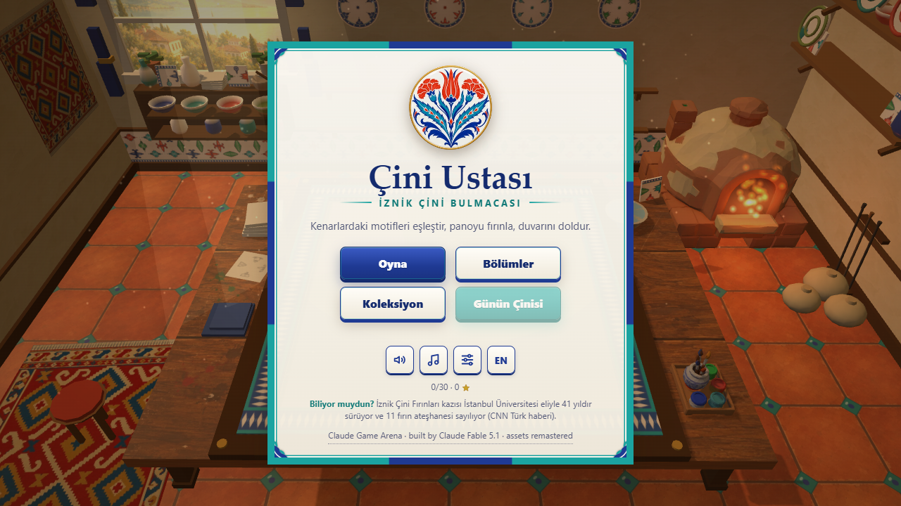<br><sub>Title screen</sub></td>
    <td width="33%">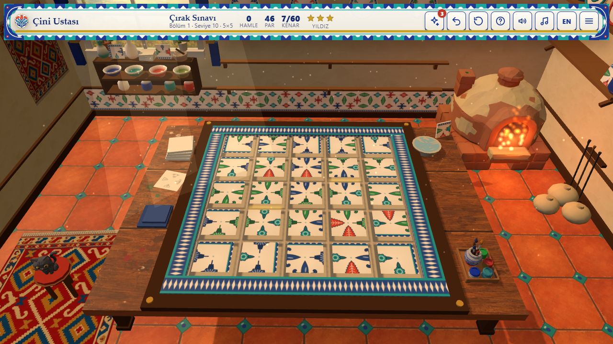<br><sub>Level 10, a 5x5 board mid-solve</sub></td>
    <td width="33%">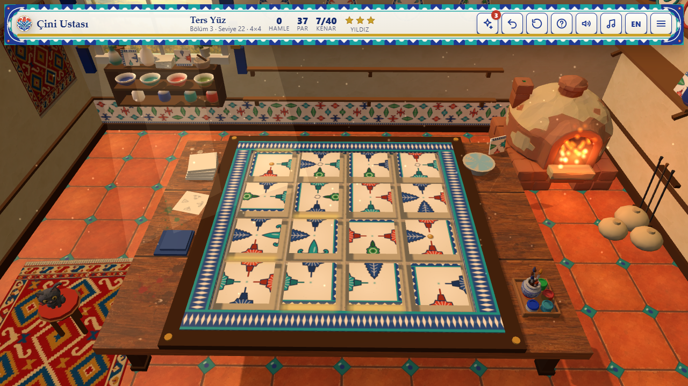<br><sub>Chapter 3: fixed and double-sided tiles</sub></td>
  </tr>
  <tr>
    <td>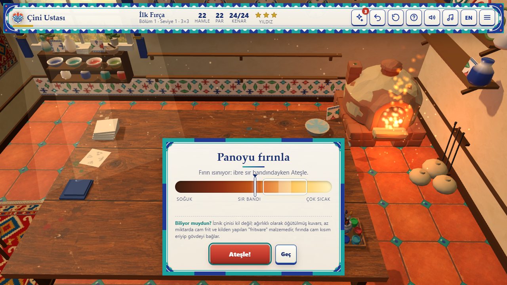<br><sub>The kiln step: fire inside the glaze band</sub></td>
    <td>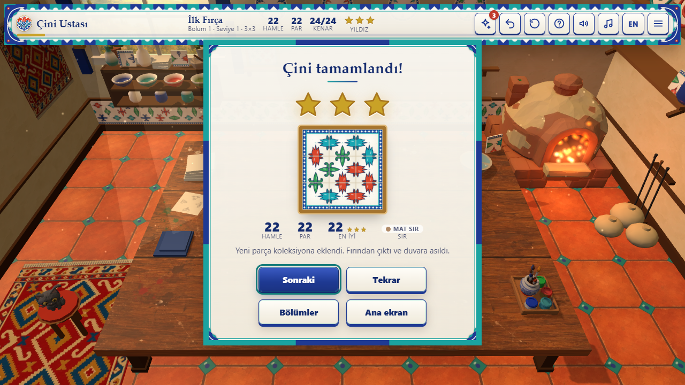<br><sub>Level complete, three stars, master glaze</sub></td>
    <td>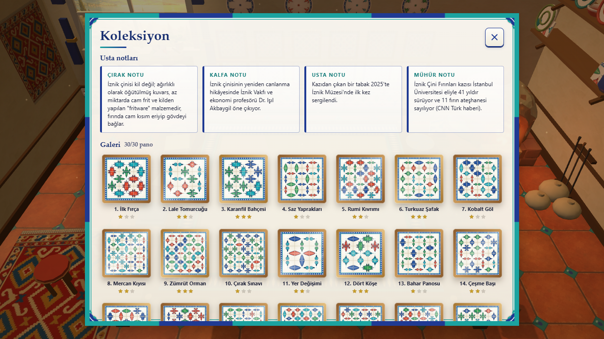<br><sub>The master's gallery</sub></td>
  </tr>
</table>

<details>
<summary><b>Coaching, the excavation board, pause, settings and the phone layout</b></summary>

<table>
  <tr>
    <td width="50%">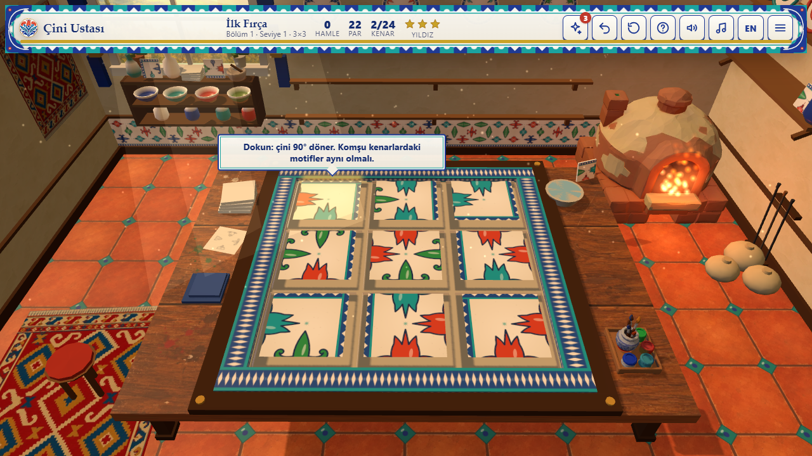<br><sub>Level 1: the tip points at the first wrong tile</sub></td>
    <td width="50%">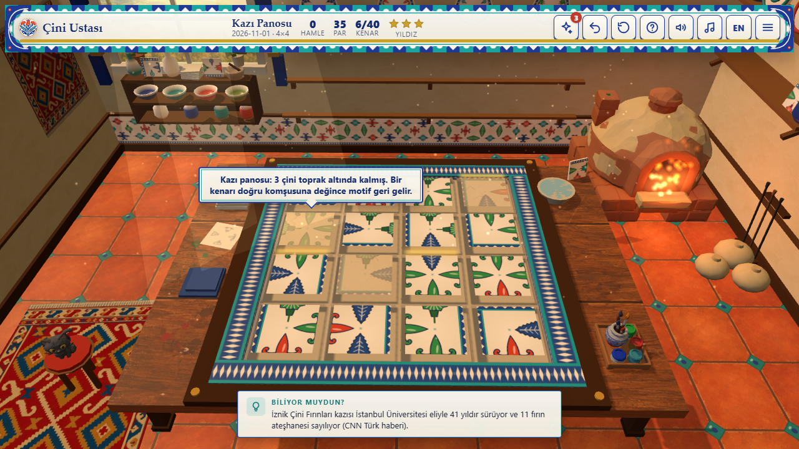<br><sub>Excavation board: three weathered tiles</sub></td>
  </tr>
  <tr>
    <td>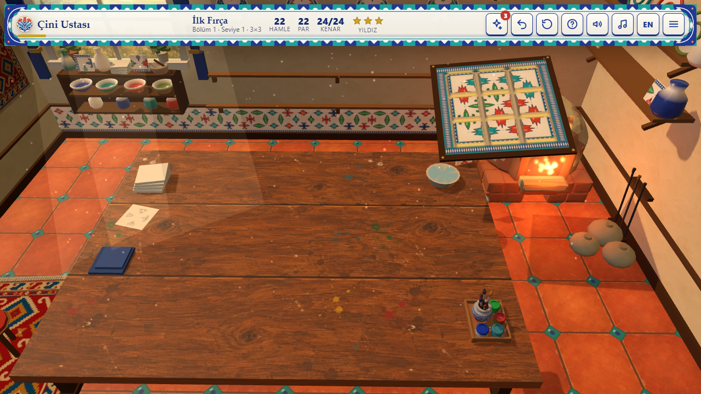<br><sub>The panel slides into the kiln</sub></td>
    <td>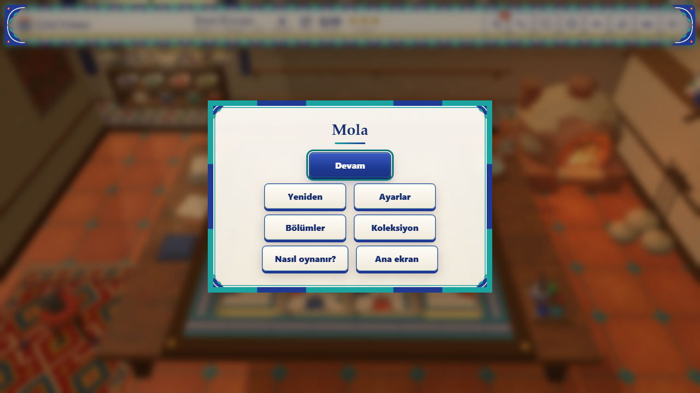<br><sub>Pause menu</sub></td>
  </tr>
  <tr>
    <td>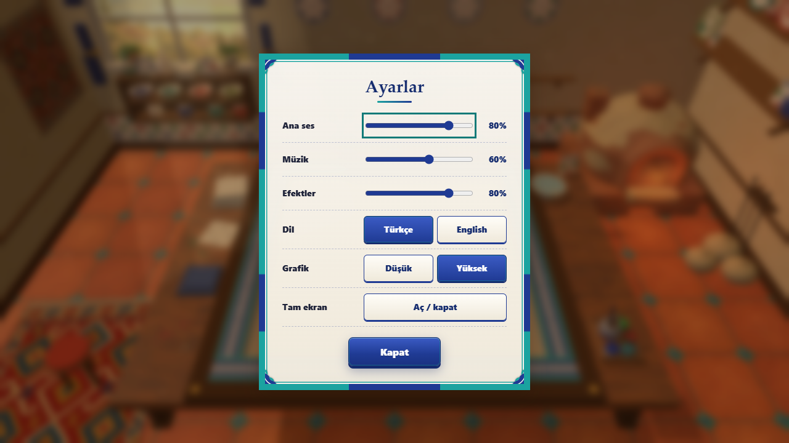<br><sub>Settings</sub></td>
    <td>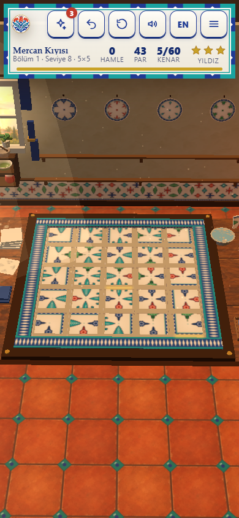<br><sub>Phone, level 8</sub></td>
  </tr>
  <tr>
    <td>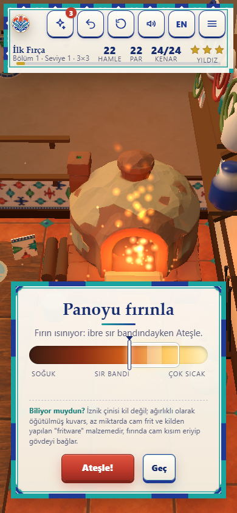<br><sub>Phone, the kiln step</sub></td>
    <td></td>
  </tr>
</table>

</details>

## Tests

The puzzle core (the block between `CORE BEGIN` and `CORE END` in `index.html`) has no DOM or Three.js dependencies and
is tested under Node, with no packages to install:

```
node tests/core.test.mjs
```

It checks all 30 levels and 5 daily boards (two of them excavation boards): deterministic generation, a scrambled
start, fixed tiles at home, the home solution solves the board, par equals the planned solution's length and earns 3
stars, the solver finds a solution, weathering keeps the start and par, and the glaze bands. Current result:
`TESTS PASSED 358/358`. The `?auto` bot also clears all 30 levels in a headless browser with 0 JS errors, with and
without the asset files.

## Running locally

Serve the folder over HTTP (opened from `file://`, the browser blocks the asset files and the game uses its procedural
models and textures):

```
python -m http.server 8000
```

then open <http://localhost:8000/>.

## How it was made

Built by **Claude Fable 5.1** with Claude Code from one prompt: [prompts/cini-ustasi.md](prompts/cini-ustasi.md). The
tile faces are painted at runtime on canvas from four edge motifs that must meet their twin exactly at the edge, the
workshop was first built from procedural low-poly parts, and the music and sounds are synthesised with the Web Audio API.

The assets were remastered by the orchestrator, **Claude Opus 5.5**, with generated models and textures: Tripo
text-to-3D (through Higgsfield) for the kiln, the sitting cat and the paint set, and GPT Image for the table wood, the
terracotta floor, the plaster, the window view, the kilim, the crest and a small panorama for the glaze reflections.
They were processed with glTF-Transform and sharp (about 1.1 MB in `assets/`). The tile faces stay procedural on purpose,
because generated art cannot guarantee that the motifs meet exactly at the edges, and every replaced part keeps its
procedural version as the fallback. Prompts, sizes and remaining issues: [docs/assets.md](docs/assets.md). A Godot 4
remake was made in round 2.

### v2 update

Upgraded by **Claude Fable 5.1** with Claude Code from [prompts/cini-ustasi-v2.md](prompts/cini-ustasi-v2.md):

- the how-to overlay is gone; level 1 and the first level of each chapter coach inside the board (`?` still opens the
  how-to card);
- the kiln became a craft step with a heat gauge and a glaze rating (matte / glossy / master) kept per panel and drawn
  as a sheen on the wall and in the collection; old saves load unchanged and get a rating on their next firing;
- the daily board is an excavation board on odd days, with three weathered tiles that restore on their first matched
  edge (same solution, so hints, the solver and the bot are unchanged);
- a live star meter with a chime, a star pop and a "wasted move" nudge;
- the master's gallery with all 30 panels, a detail box and four craft notes;
- lime-plaster grout, a bright bevel rim and a glossier glaze on the tiles, a sheen pass when a tile's last edge
  matches, and the matched-edge glow now updates one preallocated geometry instead of rebuilding one per move;
- the web font request is gone (system font stack), the load-failure message is bilingual.

The in-game facts (kiln step, excavation intro, craft notes, title line) come from the research pool behind the brief;
the source of each is noted in a code comment next to the `FACTS` table in `index.html`.

### Redesign (2026-11)

A visual pass by **Claude Fable 5.1** with Claude Code; the puzzle core, levels, par, stars, bot, saves and flags are
unchanged. Art direction: an İznik palette (cobalt `#1F3A93`, turquoise `#1BA3A0`, coral `#C0392B`, sage `#6E8B3D`,
glaze white `#F7F4EC`) in a warm, lamp-lit workshop, with every panel framed like a tile.

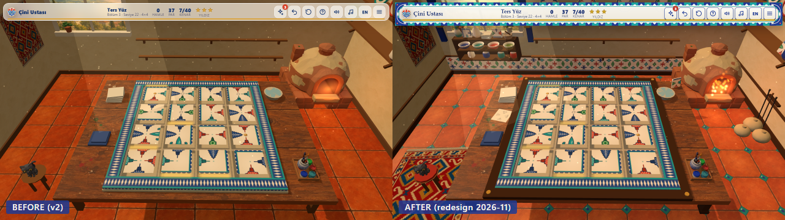

- Lighting: a warm key light with a lamp glow over the table and a cooler fill from the window; the kiln mouth lights
  its surroundings and sheds a plume of ember particles.
- Environment: a glazed terracotta floor with turquoise inserts, a tile dado along the walls, a paint cabinet with glaze
  bowls, plates and a pitcher on the shelves, a brick kiln base and firing tools, the cat on its stool.
- UI skin: tile-bordered panels with rumi spandrels in the corners (SVG) for the title, pause, settings, how-to, level
  and collection screens, the kiln step and the level-complete card; a tile band as the top bar with the star meter
  under it; cobalt primary and cream secondary buttons; the phone portrait and landscape layouts were re-checked.
- Measured on an Intel UHD 620 at 1280x720: 60 fps before and after; draw calls 46 -> 58 on level 10, 37 -> 49 on
  level 22, 21 -> 32 on the title. The `?auto` bot clears all 30 levels with 0 JS errors with and without the asset
  files; `?lang=en` checked, and the low-quality path is the one the phone shots use.

Çini Ustası is part of the **Claude Game Arena** series, where each game is built by a Claude model from one prompt.
The other games: [Hisar](https://furkiozknn.github.io/kale-savunmasi/) ·
[Çay Ocağı](https://furkiozknn.github.io/cay-ocagi/) · [Martı](https://furkiozknn.github.io/marti/) ·
[Kervan](https://furkiozknn.github.io/kervan/) ·
[Dolmuş](https://furkiozknn.github.io/dolmus/) · [Peri Golf](https://furkiozknn.github.io/peri-golf/) ·
[Mehter](https://furkiozknn.github.io/mehter/) · [Boğaz Vapuru](https://furkiozknn.github.io/bogaz-vapuru/) ·
[Simit Fırını](https://furkiozknn.github.io/simit-firini/) · [Karagöz](https://furkiozknn.github.io/karagoz/) ·
[Lale Bahçesi](https://furkiozknn.github.io/lale-bahcesi/)

**Round 5:** [Kapadokya Balonu](https://furkiozknn.github.io/kapadokya-balonu/) ·
[Ebru](https://furkiozknn.github.io/ebru/) · [Kırkpınar](https://furkiozknn.github.io/kirkpinar/) ·
[Çarşı Kaçışı](https://furkiozknn.github.io/carsi-kacisi/)

**Round 6:** [Topkapı Gecesi](https://furkiozknn.github.io/topkapi-gecesi/) ·
[Hamsi](https://furkiozknn.github.io/hamsi/) · [Pamukkale](https://furkiozknn.github.io/pamukkale/) ·
[Mimar Sinan](https://furkiozknn.github.io/mimar-sinan/)

## Türkçe

**Çini Ustası**, sıcak bir çini atölyesinde geçen sakin bir 3D kenar eşleştirme bulmacası. El boyaması İznik çinilerini
çevir, yer değiştir ve ters yüz et; her lale, karanfil, saz yaprağı ve rumi kıvrımı komşusuyla birleşsin. Biten panoyu
fırında pişir ve atölyenin duvarına as. Üç bölümde 30 seviye ve her gün yeni bir pano var. Kurulum yok; masaüstünde ve
telefonda tarayıcıda oynanır. Claude Fable 5.1 tarafından Claude Code ile tek bir prompt'tan yapıldı.

**Oyna:** https://furkiozknn.github.io/cini-ustasi/

## License

MIT, see [LICENSE](LICENSE).

Like the game? You can support new rounds on [Buy Me a Coffee](https://buymeacoffee.com/furkiozkann). The game stays free.
