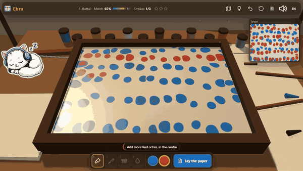
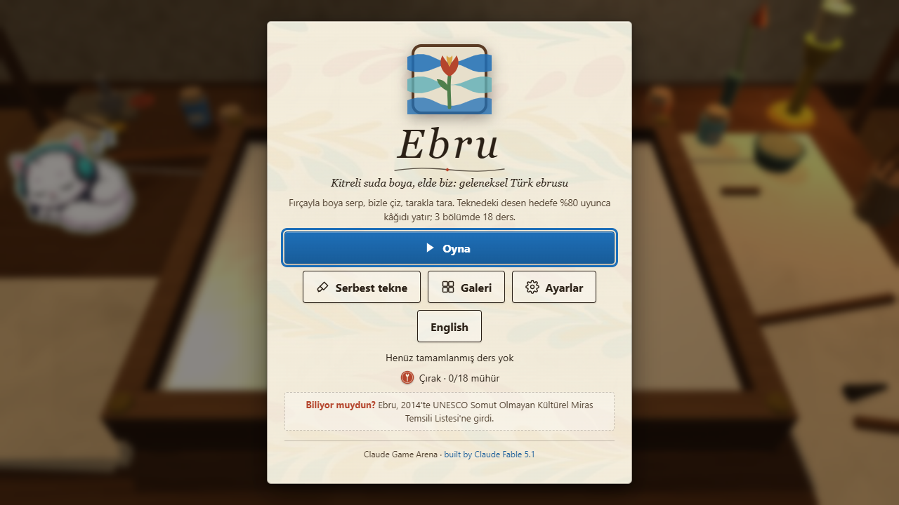
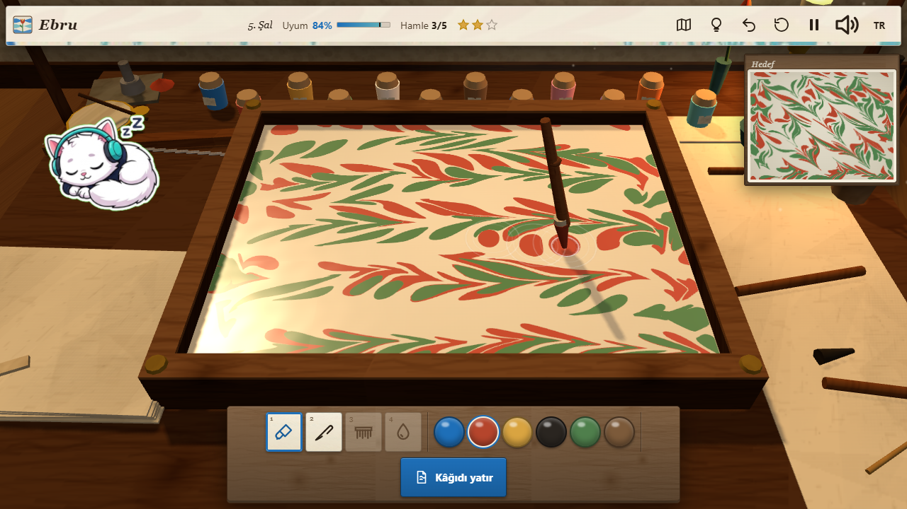
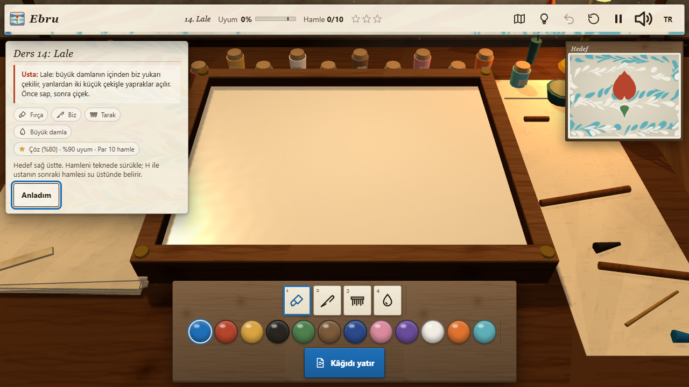
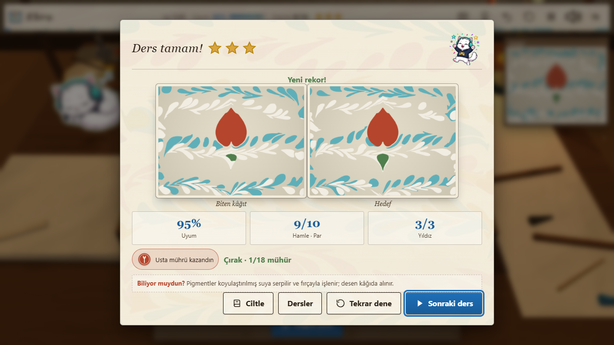
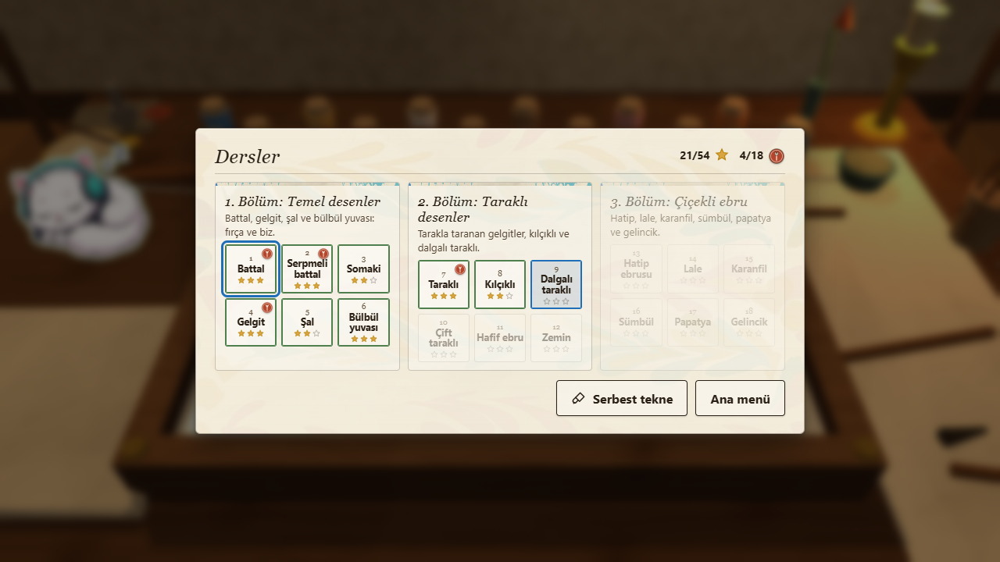
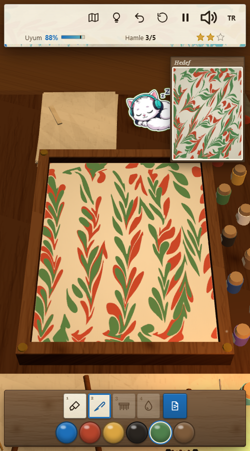

<p align="center">
  <a href="https://furkiozknn.github.io/ebru/"></a>
</p>

<p align="center">
  <a href="https://furkiozknn.github.io/ebru/"></a>
  
  
  <a href="LICENSE"></a>
  
</p>

<p align="center"><b>A 3D art puzzle about traditional Turkish paper marbling (ebru): sprinkle earth pigments on thickened water, draw through them with the awl and the comb, shape tulips and carnations, and lay the paper when the tray matches the master's pattern.</b></p>

<p align="center">
  
</p>

<p align="center"><b>Play online: <a href="https://furkiozknn.github.io/ebru/">https://furkiozknn.github.io/ebru/</a></b> (desktop and phone, no install)</p>

<!-- portals:start -->
<p align="center">Also on: <a href="https://furkiozknn.itch.io/ebru">itch.io</a> &middot; <a href="https://playgama.ai/play/ke6m2clqm3wudz">Playgama</a></p>
<!-- portals:end -->

## Highlights

- **Marbling that behaves like marbling.** Every drop is a closed polygon and every tool is a closed-form deformation of
  the whole surface (the "mathematical marbling" model): a new drop pushes older paint outward in rings, the awl drags a
  chevron wake behind it, the comb pulls twenty-five tines at once. Colours never mix into mud because each band stays
  its own polygon. The same deterministic simulation runs for the player, the targets and the bot.
- **18 lessons in 3 chapters.** Basic patterns (battal, gelgit, şal, bülbül yuvası), combed patterns (taraklı, kılçıklı,
  wavy and double combing, hafif) and flower ebru (hatip, tulip, carnation, hyacinth, daisy, poppy). Each lesson unlocks
  tools and pigments and starts with a short TR / EN technique note from the master on a card over the tray.
- **One click to the water.** Play drops you straight into the first unsolved lesson; the master's note fades at your
  first stroke, and lessons 1-3 show the first stroke of the recipe as a ghost on the water.
- **The master's critique.** The match score already knows how much of each pigment you used and where its centre is;
  v2 reads it out: "Add more Red ochre, upper right", "Lamp black is not in the target", live under the tray and on the
  result card. The rim of the screen glows at 80 % and a chime rings at 90 %.
- **Master's seal.** A lesson solved at 90 % or better, within par and without a hint earns a red seal; 18 seals rank you
  from çırak (apprentice) through kalfa (journeyman) to usta (master). The 54 stars are unchanged.
- **Provably solvable targets.** Every target is a recorded stroke list replayed in the same simulation; the live match %
  compares the tray with the target, and the hint replays the next stroke as a ghost on the water.
- **Played by a bot.** `?auto` plays every lesson through the same stroke API as a player, with a small hand tremor.
  Measured after the 2026-11 redesign: **18/18 lessons solved, 48/54 stars, 12/18 seals**, 60 fps on an Intel UHD 620, 14-18 draw calls.
- **Free tray, water thickness, gallery and book covers.** Paint whatever you like on thin, medium or thick water (drops
  spread wider and the awl drags a broader wake on thin water), lay the paper and keep up to 12 sheets in the gallery;
  bind any sheet into a book cover (leather spine and corners, the sheet as the board paper). Your last sheets hang to
  dry on the line behind the table, and the workshop kitten dozes on the table edge.
- **Paint rasterised on the GPU.** The polygons are filled with a signed-winding stencil pass into a multisampled render
  target, so a tray with a hundred thousand points still runs at 60 fps on an Intel UHD 620.
- **One file, made in code.** One `index.html` with Three.js r170 from a CDN; every mesh, texture, icon and sound
  (drips, swishes, paper rustle, a ney and kanun loop) is generated in code.

## How to play

> [!TIP]
> **Goal:** make the tray look like the target in the corner. Reach 80 % match and lay the paper. Three stars per lesson:
> solve, reach 90 %, and stay within par strokes.

Pick a tool and a pigment from the tray at the bottom. Drag over the water: the brush sprinkles drops as you move, the awl
(biz) and the comb (tarak) drag the paint with them, the big drop opens a wide circle for flowers. Press `H` to see the
next stroke of the master's recipe as a ghost. When the match reaches 80 %, lay the paper with `Enter`.

<details>
<summary><b>More</b></summary>

- The lessons are a data table of recipes in the code; targets are generated by replaying them when the game loads.
- Undo keeps the last 12 strokes; clearing the tray is undoable too.
- In the free tray, `Enter` lays the paper and saves a 256 px JPEG of the sheet to the gallery (localStorage); the
  bind button (or `B`) turns the sheet you just saved into a book cover, and every gallery sheet has a bind toggle.
- Water thickness (free tray only, `T` cycles it) scales the drop radius and spacing and the awl / comb falloff; the
  lessons, the targets and the bot always use the medium table, so every target is bit-identical to v1.
- The master's seal needs 90 % match, par or fewer strokes and no hint. The free first-stroke ghost of lessons 1-3 does
  not count as a hint; pressing `H` does.
- "Did you know?" facts on the title and result cards come from the UNESCO Representative List entry for ebru
  (inscribed 2014): pigments on thickened water worked with a brush, the pattern taken up on paper, used on book covers
  and bindings, at least two years to learn the basics, passed from master to apprentice. Source links are in
  `CREDITS.md` and in the code.

</details>

### Controls

| Action | Mouse / touch | Keyboard |
|---|---|---|
| Stroke | drag on the water | |
| Tool: brush, awl, comb, big drop | tool tray | `1` `2` `3` `4` |
| Colour | swatches | |
| Zoom | wheel, pinch | |
| Undo / clear the tray | HUD buttons | `Z` / `R` |
| Lay the paper | tray button | `Enter` |
| Hint (ghost of the next stroke) | HUD button | `H` |
| Lesson map | HUD button, pause menu, result card | |
| Pause | HUD button | `P` / `Esc` |
| Music / effects / language / fullscreen | HUD buttons | `M` / `X` / `L` / `F` |
| Water thickness (free tray) | thin / medium / thick switch | `T` |
| Bind the last saved sheet (free tray) | tray button | `B` |
| Gallery (free tray) | tray button | `G` |

Settings are saved in `localStorage` under `arena.ebru.settings`; stars, seals and the current lesson under
`arena.ebru.save`, the best star total under `arena.ebru.best`, the gallery under `arena.ebru.gallery` and the bound
flags under `arena.ebru.bound` (v1 saves load unchanged). Turkish is the default language (English when the browser is
not Turkish); phones start on the Low tier.

<details>
<summary><b>URL flags for testing</b></summary>

| Flag | Effect |
|---|---|
| `?auto` | a bot plays all 18 lessons to the ending, making the recipe strokes through the same stroke API as the player, with a small hand tremor (`&jitter=N` units, default 6) |
| `?debug` | fps, JS ms per frame, draw calls, triangles, polygon and point counts, GPU name and JS errors on screen; `window.ebruSim(seconds)` and `window.ebruDebug` |
| `?sim=N` | fast-forward N seconds before the first frame |
| `?low` | shadows off, pixel ratio 1, 512 px paint target, half the dust |
| `?lesson=N` | open lesson N (1-18) directly; `?free` opens the free tray |
| `?lang=en` / `?lang=tr` | language |
| `?nosave` | do not write to `localStorage` |
| `?noassets` | skips the three mascot PNGs (the only asset files); everything else is generated in code |

The live state is on `window.ebru` (state, lesson, match, strokes, stars, seals, rank, thickness, critique, polys,
points, fps, calls, bot log, errors, assets).

</details>

## Screenshots

<table>
  <tr>
    <td width="33%"><br><sub>Title screen</sub></td>
    <td width="33%"><br><sub>Drops rippling on the wet size</sub></td>
    <td width="33%"><br><sub>A lesson and the master's note</sub></td>
  </tr>
  <tr>
    <td><br><sub>The finished sheet, three stars and the seal</sub></td>
    <td><br><sub>Three chapters, 18 lessons, seals</sub></td>
    <td><br><sub>On a phone</sub></td>
  </tr>
</table>

## Running locally

Serve the folder over HTTP (ES modules do not load from `file://`):

```
python -m http.server 8000
```

then open <http://localhost:8000/>.

## How it was made

Built by **Claude Fable 5.1** with Claude Code from one prompt: [prompts/ebru.md](prompts/ebru.md). Everything is
generated in code:

- **Simulation:** a drop at C with radius r moves every point P to `C + (P - C) * sqrt(1 + r² / |P - C|²)`; the awl and the
  comb move points along their motion by `exp(-d/λ)` across the path and a window along it, applied in fixed 8-unit steps
  so the result does not depend on the pointer event rate. Polygons are resampled after every step and clamped to the
  tray walls; a point budget coarsens the sampling when the tray gets busy.
- **Match:** the tray and the target are rasterised small on the CPU; the score is a lenient colour comparison on a
  16x12 grid plus, for every pigment the target uses, how much of it the player used and where its centroid is.
- **Paint rendering:** one dynamic BufferGeometry of triangle fans with three material groups per colour (stencil +1 on
  front faces, -1 on back faces, colour quad where the stencil is non-zero), rendered in one call into a 4x MSAA
  render target that textures the water.
- **3D:** a flat-shaded, vertex-coloured workshop merged into one draw call, instanced pigment jars, one shadow-casting
  directional light over the table, soft-sprite dust in the window light, the active tool following the pointer and
  a paper sheet that drops, takes the pattern and lifts. About 7-10 draw calls per frame (6-9 without the kitten).
- **Audio:** Web Audio only: drips tuned by drop size, a band-passed swish that follows the awl's speed, paper rustles,
  and a slow ney phrase in a Hicaz-like scale over a drone with a kanun answering.

### v2 update

Upgraded by **Claude Fable 5.1** with Claude Code from [prompts/ebru-v2.md](prompts/ebru-v2.md):

- Play goes straight into the first unsolved lesson; the master's note is a card over the tray that fades at the first
  stroke; lessons 1-3 show the first recipe stroke as a ghost and pulse "Lay the paper" at 80 %. The map stays one
  click away from the HUD, the pause menu and the result card.
- The master's critique: the worst two per-pigment deviations (unused, too little, too much, wrong place, not in the
  target) as a live line and on the result card, with a rim glow at 80 % and chimes at 80 / 90 %. The critique classes
  pixels against the pigments actually in play, so antialiased edges never name a colour nobody used.
- Master's seals (90 %, within par, no hint) and the çırak / kalfa / usta rank on the title, map, result and ending;
  stored as `seals` in `arena.ebru.save`.
- Water thickness in the free tray (thin / medium / thick scales the drop radius, spacing and the awl / comb falloff);
  lessons and the bot keep the medium table, so the targets are unchanged.
- "Bind it": a 2D book-cover composite of a sheet on the result card, in the free tray and in the gallery; bound flags in
  `arena.ebru.bound`.
- Notes cleaned of unsourced names and dates; "Did you know?" facts from the UNESCO entry on the title and result cards.
- The arena's Turkish Van kitten: asleep on the table edge (a sprite, one extra draw call) and cheering or thinking on
  the result card. Measured after the upgrade: bot 18/18, 48/54 stars, 12/18 seals, 58-60 fps and 7-10 draw calls on
  the UHD 620, zero JS errors with and without assets.

### Redesign (2026-11)

Redesigned by **Claude Fable 5.1** with Claude Code (branch `redesign`). Art direction: **ink & paper fine art**, the
master's workshop in the morning window light. Palette: walnut, cream paper, lime plaster, ebru blue, red-ochre wax,
brass, zinc. Nothing in the rules moved: lessons, targets, scoring, seals, saves, flags and the bot are the v2 ones.

What changed:

- **Room.** Canvas-generated wood grain, lime plaster and laid-paper textures on three merged static meshes with
  world-projected UVs; a woven kilim; the window now shows a morning sky, a cypress and a far dome, and throws a soft
  shaft of light across the table. Golden window sun, a cool room fill, a flickering oil lamp (point light and flame
  sprite) and a little fog towards the far wall. A PMREM environment from a canvas equirect so the water and the steel
  catch the window.
- **Wet size.** The water is a low-roughness surface with a slowly creeping ripple normal map under the paint, so the
  window's reflection shimmers on the kitre and the pigment reads wet rather than printed.
- **The master's table.** Oil lamp, bowl of size with a ladle, ox-gall bowl, muller and a pile of ground ochre, a cup
  of rose-twig brushes, a reed pen, a tulip in a vase, spare combs, a framed marbled sheet and a calligraphy panel on
  the wall, marbled sheets drying on the line (drawn by the same simulation), a basket of scrap paper, a drawer with a
  brass knob, turned legs, brass nails on the walnut tray rim.
- **Tools and pots.** Rose-twig brush with bound horsehair, awl with a turned handle and brass ferrule, walnut comb with
  a brass strip and a grip, glazed paint bowl with a spoon; glazed pigment pots with cork stoppers and paper labels.
- **Animation.** Rings spread where every drop falls, the brush dips when it sprinkles, the paper bows while it falls
  and bellies while it is peeled off the water, the drying sheets sway, the flame flickers.
- **UI.** Every panel is a sheet of light (hafif) ebru paper drawn by the game's own simulation under a cream wash:
  dark ink text, calligraphic italic serif headers with an ink flourish, ebru-blue ink buttons, red wax seals with a
  stamp animation, a paper HUD strip with a marbled band, a walnut tool tray with paper labels and wet pigment dabs,
  the target in a walnut frame. Phone portrait and landscape reworked: full-width tray, swatches on their own row.

Measured on an Intel UHD 620 at 1280x720 (headless Chrome): 60 fps before and after; draw calls 9-10 before, 14-18
after; triangles 2.8k before, 5.4-5.9k after; `?low` 60 fps, 14 calls; the `?auto` bot 18/18, 48/54 stars, 12/18 seals
with assets and with `?noassets`, zero JS errors. Before/after: `docs/redesign-before-after.png`.

Ebru is part of the **Claude Game Arena** series, where each game is built by a Claude model from one prompt. The
other games: [Hisar](https://furkiozknn.github.io/kale-savunmasi/) ·
[Çay Ocağı](https://furkiozknn.github.io/cay-ocagi/) · [Çini Ustası](https://furkiozknn.github.io/cini-ustasi/) ·
[Martı](https://furkiozknn.github.io/marti/) · [Kervan](https://furkiozknn.github.io/kervan/) ·
[Dolmuş](https://furkiozknn.github.io/dolmus/) · [Peri Golf](https://furkiozknn.github.io/peri-golf/) ·
[Mehter](https://furkiozknn.github.io/mehter/) · [Boğaz Vapuru](https://furkiozknn.github.io/bogaz-vapuru/) ·
[Simit Fırını](https://furkiozknn.github.io/simit-firini/) · [Karagöz](https://furkiozknn.github.io/karagoz/) ·
[Lale Bahçesi](https://furkiozknn.github.io/lale-bahcesi/)

**Round 5:** [Kapadokya Balonu](https://furkiozknn.github.io/kapadokya-balonu/) ·
[Kırkpınar](https://furkiozknn.github.io/kirkpinar/) · [Çarşı Kaçışı](https://furkiozknn.github.io/carsi-kacisi/)

**Round 6:** [Topkapı Gecesi](https://furkiozknn.github.io/topkapi-gecesi/) ·
[Hamsi](https://furkiozknn.github.io/hamsi/) · [Pamukkale](https://furkiozknn.github.io/pamukkale/) ·
[Mimar Sinan](https://furkiozknn.github.io/mimar-sinan/)

## Türkçe

**Ebru**, eski bir ebru atölyesinde geçen 3D sanat bulmacası. Kitreli suya fırçayla toprak boya serp, bizle çiz, tarakla
tara, lale ve karanfil aç; teknedeki desen ustanın hedefine %80 uyunca kâğıdı yatır. 3 bölümde 18 ders, her derste ustadan
kısa bir not ve canlı eleştiri ("Daha çok Aşı kırmızısı ekle, sağ üstte"); ipucusuz ve par içinde %90'a ulaşan derslere
usta mührü (çırak, kalfa, usta). Serbest teknede su kıvamı (ince / orta / kalın), 12 kâğıtlık galeri ve kâğıtları kitap
kapağına ciltleme. Kurulum yok; masaüstünde ve telefonda tarayıcıda oynanır. Claude Fable 5.1 tarafından Claude Code ile
tek bir prompt'tan yapıldı; v2 güncellemesi `prompts/ebru-v2.md` ile.

**Oyna:** https://furkiozknn.github.io/ebru/

## License

MIT, see [LICENSE](LICENSE).

Like the game? You can support new rounds on [Buy Me a Coffee](https://buymeacoffee.com/furkiozkann). The game stays free.
