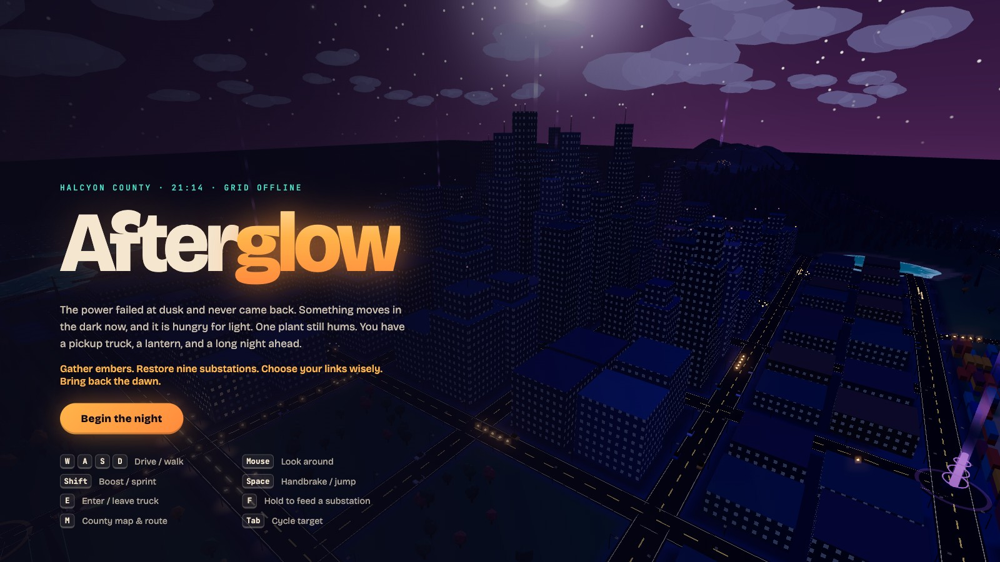
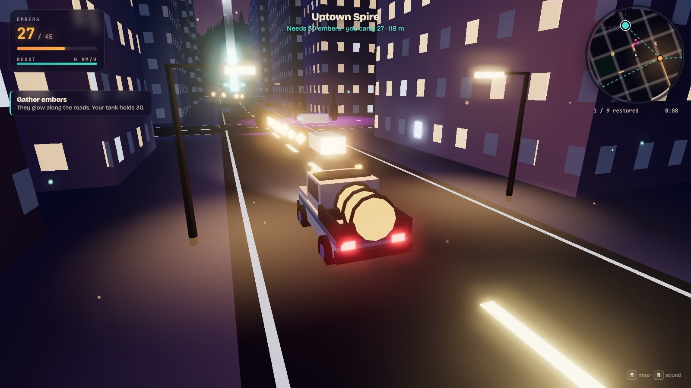

# Afterglow

An open-world night drive through a county that lost its power grid. Carry embers in a battered pickup, relight substations one link at a time, and push the dark back until morning.

**[Play it in your browser →](https://gabemoraru.github.io/OpenWorld/)**




## The night

Halcyon County went dark at dusk. One plant, the Works, still hums, and its glow is the only place the Hollows won't follow you.

- **Gather embers.** They trail along roads, ring the substations, and hide in clusters across the map. Ten wishing lanterns sit in the far corners for anyone willing to look.
- **Feed the grid.** Hold `F` inside a substation's ring to pour embers in. Power only travels along a live link, so a substation can be restored only once a neighbor is lit.
- **Watch the light spread.** Each restored substation sends a wave of light across its district: windows come on, streetlamps warm up, traffic returns, and its Hollow den collapses.
- **Plan your route.** Every substation grants a permanent upgrade (bigger tank, ember radar, faster boost recharge, stronger pull, slower Hollows, higher yield, bigger stockpiles, higher top speed) and slowly refills a stockpile you can come back to empty. Every den left standing grows stronger each time you light one, so the order matters.
- **End the night.** The Summit Beacon on the mountain draws on the whole grid. Light it, and the sun comes up.

A full run takes roughly 25–40 minutes. **Another night** reshuffles every ember and every Hollow den, and your best time is saved locally.

## The county

| District | What's there |
| --- | --- |
| City | A grid of towers whose windows light up block by block, parked cars, parks, traffic once power returns |
| Saltline Docks | Container stacks on the bay |
| Maple Court & Linden Heights | Winding suburban streets, houses with driveways and yard trees |
| Coldwater Orchard & Barley Flats | Striped wheat and lavender fields, barns, silos, hay bales, blossom orchards |
| Windmill Ridge | Spinning wind turbines and old windmills on the eastern hills |
| The mountain | Pine forest, switchback roads, snow, and the Summit Beacon |

## Controls

| Key | Action |
| --- | --- |
| `W` `A` `S` `D` / arrows | Drive or walk |
| Mouse (click to capture) | Look around |
| `Shift` | Boost (truck) / sprint (on foot) |
| `Space` | Handbrake drift / jump |
| `E` | Get in or out of the truck |
| `F` (hold) | Feed embers into a substation |
| `M` | County map: plan links and pick your target |
| `Tab` | Cycle between reachable substations |
| `N` | Toggle sound |

Hollows drain 40% of what you carry when they catch you; half of it scatters nearby. Ram them above roughly 50 km/h to banish them, or retreat into the light.

## How it's built

Plain [three.js](https://threejs.org) and [Vite](https://vitejs.dev). No models, textures or audio files: everything is generated at load time from a fixed seed.

- **One heightfield, many uses.** A single grid drives the terrain mesh, gameplay ground height, the minimap image, and a height texture the water shader samples for shoreline foam and depth color. Roads are Catmull-Rom splines that flatten the terrain beneath them.
- **One shader patch for the whole grid.** Every world material is patched to read the same uniform array of substation positions and light radii. Restoring a substation animates a single radius, and the warm tint, lit windows, streetlamps and light pools spread across the district on the GPU, with no per-object updates.
- **Procedural windows.** Building windows are computed in the fragment shader from world position and face normal, so towers, houses and the plant all get lit facades without textures.
- **Instanced everything.** Trees, buildings, houses, cars, lamps, pylons, embers and Hollows are instanced meshes, which keeps the whole county to a few dozen draw calls.
- **Synthesized sound.** The engine, pickups, the restore chord and the ambient pad are WebAudio oscillators.

```
src/
  data.js     substations, links, roads, lantern spots
  world.js    terrain, roads, districts, props, sky, water, shader patch, collision
  actors.js   truck, walker, Hollow and traffic meshes
  main.js     game state, physics, Hollow AI, camera, loop
  hud.js      minimap, county map, toasts
  audio.js    WebAudio synthesis
```

## Run locally

```bash
npm install
npm run dev
```

`npm run build` produces a static site in `dist/`. Pushes to `main` deploy to GitHub Pages through the included workflow.

## License

MIT
