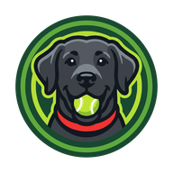
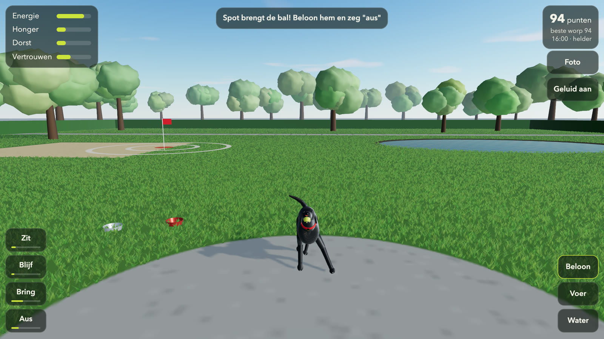
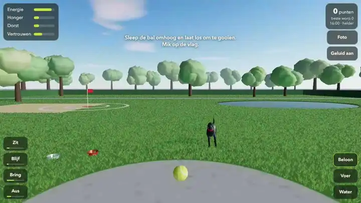
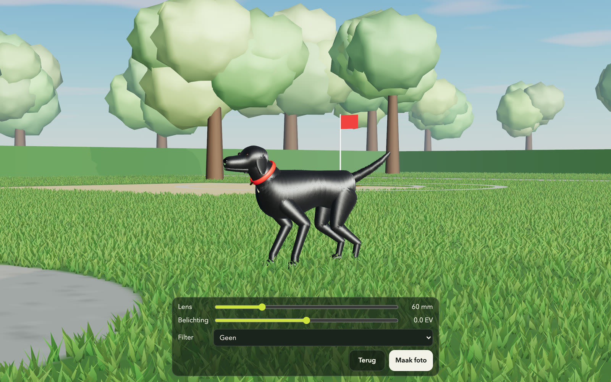

<div align="center">



# Spot apporteert

**A fetch game in the browser. Throw a ball across a park for Spot, a black labrador, and look after him.**

[Playing](#playing) · [Photo mode](#photo-mode) · [Running it](#running-it) · [Contributing](#contributing)




</div>

Spot gets tired, hungry and thirsty, and he listens better the more he trusts you. The interface is in Dutch.

Everything runs on your own device. The game saves Spot's state and your best throw in the browser's `localStorage` and makes no network requests.

<!-- live-links -->
**Live:** [gitguy268.github.io/spot-fetch](https://gitguy268.github.io/spot-fetch/) · [spot-fetch.vercel.app](https://spot-fetch.vercel.app)
<!-- /live-links -->

<!-- run-steps:start -->
## Run it locally, step by step

1. **Install [Node.js](https://nodejs.org) 22** or newer.

2. **Get the code:**

   ```sh
   git clone https://github.com/Gitguy268/spot-fetch.git
   cd spot-fetch
   ```

3. **Install the dependencies:**

   ```sh
   npm ci
   ```

4. **Start it:**

   ```sh
   npm run dev
   ```

5. **Open <http://localhost:5173/>** in your browser. Press `Ctrl+C` in the terminal to stop.
<!-- run-steps:end -->

## Playing



Drag the ball upwards and let go to throw. Aim for the flag: a throw scores up to 100 points, more the closer its first bounce lands to the middle, and nothing beyond 6 m.

| Button | What it does |
| --- | --- |
| **Zit**, **Blijf**, **Bring**, **Aus** | Commands: sit, stay, fetch, drop. The bar under each one shows how well Spot has learnt it. |
| **Beloon** | Reward him |
| **Voer**, **Water** | Fill his food and water bowls |
| **Foto** | Open photo mode |
| **Geluid** | Sound on or off |
| **Volledig scherm** | Full screen on or off. The button is hidden where the browser cannot do it, as on an iPhone |

Tap Spot to pet him. The four bars in the corner are his energy (*energie*), hunger (*honger*), thirst (*dorst*) and trust (*vertrouwen*).

The park has a day and night cycle and weather. Three URL switches fix them, which helps when you want the same conditions twice:

| Switch | Effect |
| --- | --- |
| `?tijd=18` | Fixes the hour (0 to 23.99) |
| `?weer=helder`, `?weer=regen`, `?weer=sneeuw` | Fixes the weather: clear, rain or snow |
| `?reset` | Starts without the saved game |

## Photo mode



**Foto** stops the game and frees the camera. Drag to move around Spot, set the lens from 14 to 200 mm and the exposure from −2 to +2 EV, pick a filter (black and white, sepia, warm, cool, vintage) and press **Maak foto** to save a PNG.

## Running it

Needs Node 20.19 or newer.

```sh
git clone https://github.com/Gitguy268/spot-fetch.git
cd spot-fetch
npm ci
npm run dev
```

| Command | What it does |
| --- | --- |
| `npm run dev` | Local dev server |
| `npm test` | Unit tests for the physics, the throw and Spot's behaviour |
| `npm run build` | Production bundle in `dist/` |
| `npm run preview` | Serve the built bundle |

`dist/` is a static bundle and can be served by any static host.

## Contributing

Bug reports and pull requests are welcome. See [CONTRIBUTING.md](CONTRIBUTING.md) and the [Code of Conduct](CODE_OF_CONDUCT.md). Report security problems privately, as [SECURITY.md](SECURITY.md) describes.

## Licence and credits

[MIT](LICENSE) © Lucas Van De Weerd.

- Rendering uses [three.js](https://threejs.org) (MIT). Its licence text is in [NOTICE](NOTICE).
- Three ideas follow [Phaser](https://github.com/phaserjs/phaser) (MIT), written from scratch: the burst of particles where the ball lands, the full-screen toggle, and the sound stopping while the tab is hidden. Its licence text is in [NOTICE](NOTICE).
- Spot, the park, the fur and the sounds are generated in code. There are no model, texture, font or audio files in this repository.
