<p align="center">
  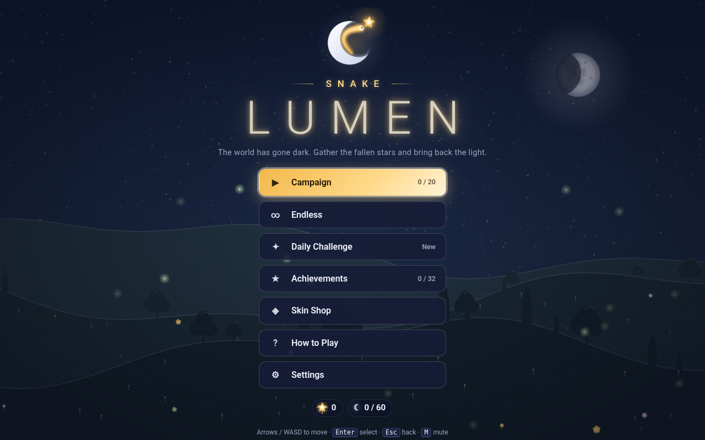
</p>

<h1 align="center">Snake: Lumen 3D</h1>

<p align="center"><em>A glowing serpent gathers fallen stars to bring light back to a darkened world, now in real 3D light.</em></p>

<p align="center">
  
  
  
  
  
</p>

<p align="center">
  <a href="#play">Play</a> ·
  <a href="#features">Features</a> ·
  <a href="#screenshots">Screenshots</a> ·
  <a href="#controls">Controls</a> ·
  <a href="#graphics-quality">Graphics</a> ·
  <a href="#project-structure">Structure</a> ·
  <a href="#tests">Tests</a>
</p>

---

## The story

The world has fallen into darkness. The stars fell one by one, and the Moon went quiet. Only one small
light is left: a glowing serpent. Gather the fallen stars, grow longer and brighter, and bring four
worlds back to life on the way to the Moon.

**Snake: Lumen 3D** is the three.js edition of Snake: Lumen. It is the same game, story, levels, menus and
music, with every run drawn as a small lit 3D diorama: light wraps around hedges and houses, falls off
naturally, reflects from water and polished stone, and casts real shadows.

> A 2D edition of Snake: Lumen (canvas only, no WebGL needed) is also available. The 3D edition falls back
> to 2D drawing on its own where WebGL is missing.

## Play

**On your computer**

1. Download the project (on GitHub: **Code → Download ZIP**) and unzip it.
2. Double-click `index.html`.

No server, no build step, no internet. three.js is bundled in `vendor/` and loaded with a plain script tag.
Every model, texture and sprite is built in code and every sound and note of music is synthesised with
WebAudio, so the folder carries no images, models, fonts or audio files. Keep the folder together: the page
loads `js/` and `css/` from next to it (opened straight from inside an archive, it says so).

**In the browser, from GitHub Pages**

1. In your fork or copy of the repository, open **Settings → Pages**.
2. Under **Build and deployment**, choose **Deploy from a branch**, branch `main`, folder `/ (root)`, and save.
3. After a minute the game is live at `https://<user>.github.io/<repo>/`.

The 3D view needs WebGL, which every browser from the last several years has. Where it is missing or
switched off, the game says so in your language and keeps playing with its 2D renderer. Adding `?2d` to the
address forces the 2D renderer.

## Features

- **Real 3D light.** A warm golden point light rides at the serpent's head and grows with its length; cool
  moonlight with soft shadows and a hemisphere sky light light the diorama; ACES filmic tone mapping and
  gentle fog finish the night.
- **Stars that shine.** Fallen and golden stars, power-ups, gates, tram headlamps and lanterns glow, and the
  most important ones borrow real point lights from a small fixed pool.
- **Four worlds that wake up.** Each world starts asleep and grows brighter with every star: flowers open,
  windows light up, constellations return, the Moon fills.
- **Six dark levels** where the moonlight nearly goes out and the serpent's own light reveals the board.
- **Three modes:** a 20-level Campaign on an old star chart, Endless, and a Daily Challenge built from the date.
- **32 achievements** drawn as star charms, seven of them secret.
- **Skin Shop** with ten serpent skins, bought with stardust.
- **A short story** with an intro, world interludes and a finale, all skippable.
- **Graphics quality** Auto / Low / Medium / High, plus adaptive resolution for slower phones.
- **English and Russian**, detected from the browser and switchable at any time.
- **Phone friendly:** swipes or on-screen arrows, portrait and landscape layouts.
- **Accessible options:** reduced flashing mode, screen shake toggle, full keyboard navigation in menus.

## Screenshots

Every gameplay shot is a real run rendered by three.js (on High), steered by the built-in bot.

<table>
  <tr>
    <td align="center">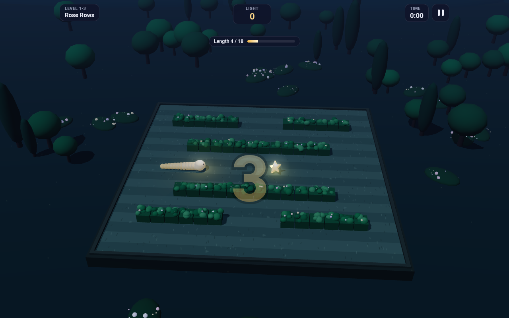<br><sub>The Whispering Garden</sub></td>
    <td align="center">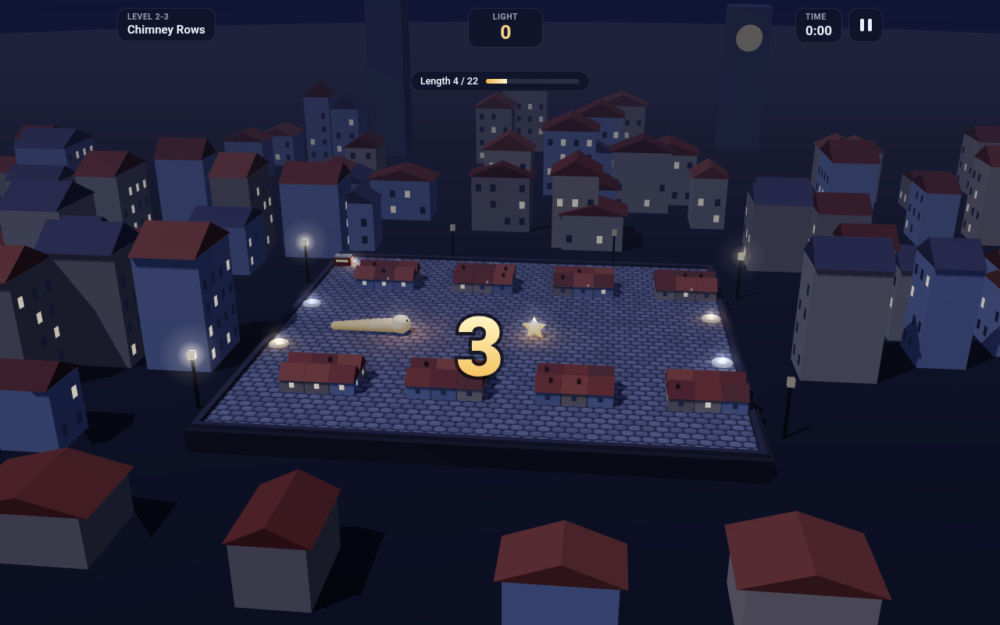<br><sub>The Sleeping City: rooftops, chimneys, lanterns</sub></td>
  </tr>
  <tr>
    <td align="center">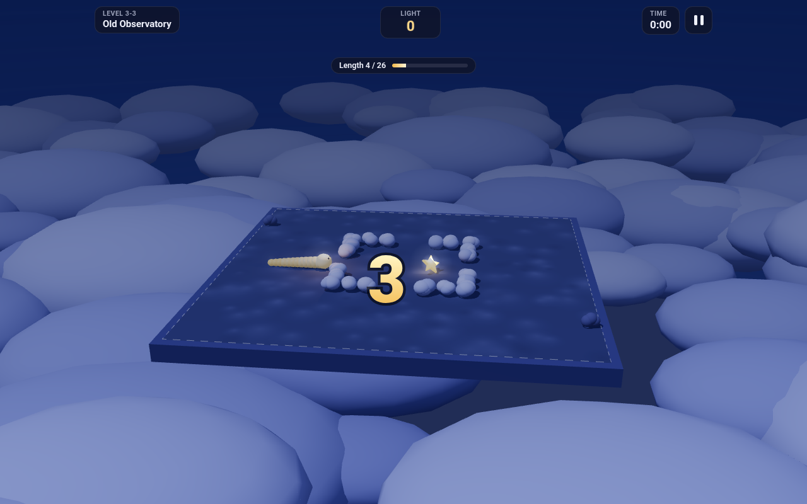<br><sub>The Hollow Sky above a sea of clouds</sub></td>
    <td align="center">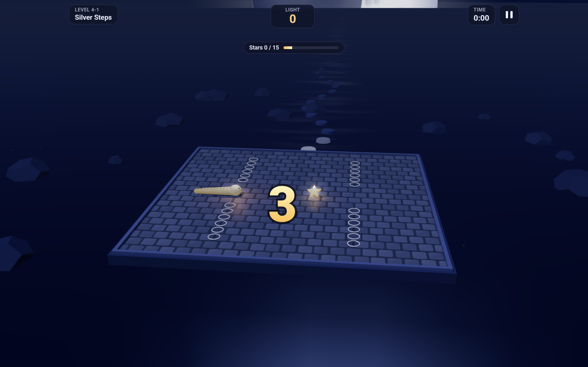<br><sub>The Moon's Path over still water</sub></td>
  </tr>
  <tr>
    <td align="center">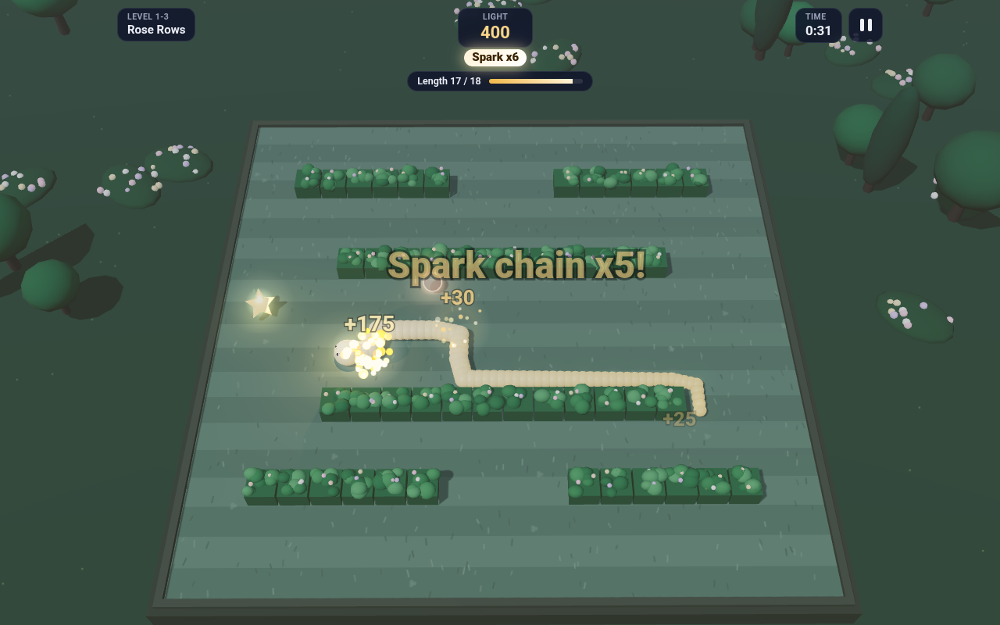<br><sub>The garden in full light</sub></td>
    <td align="center">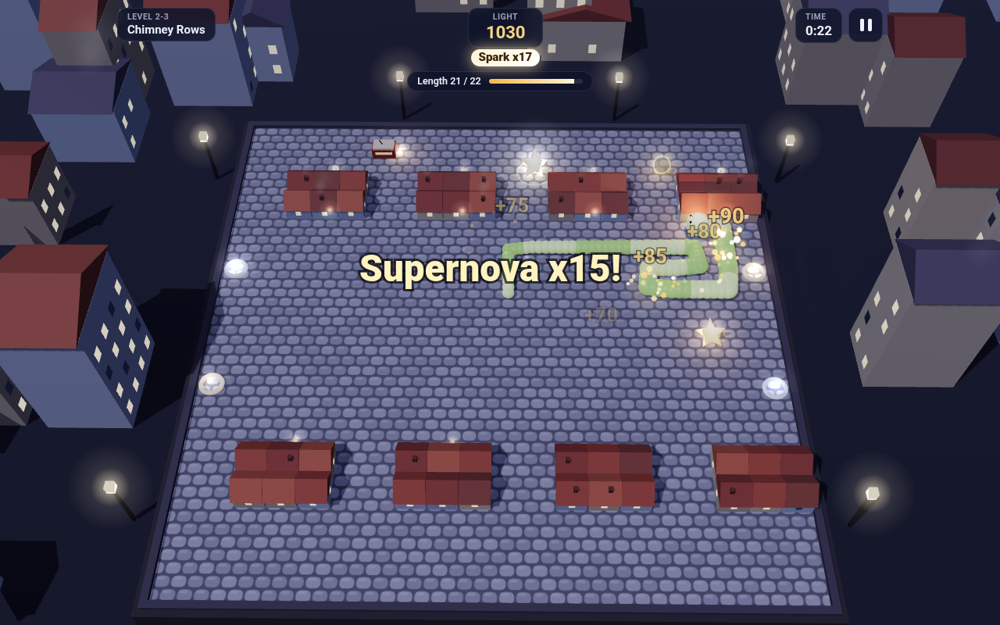<br><sub>The city wakes up</sub></td>
  </tr>
  <tr>
    <td align="center">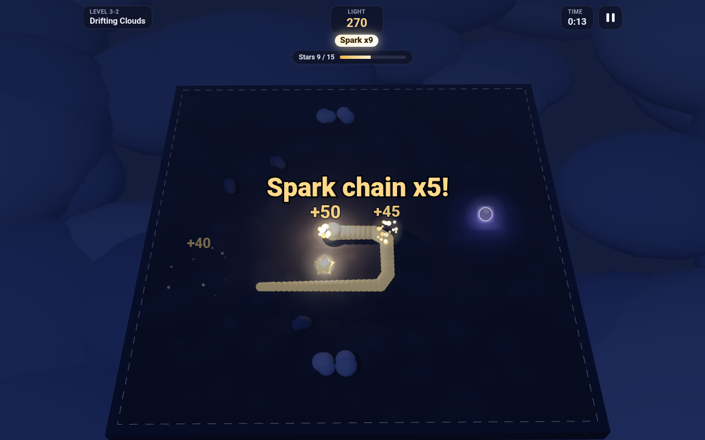<br><sub>A dark level: only the serpent's light shows the way</sub></td>
    <td align="center">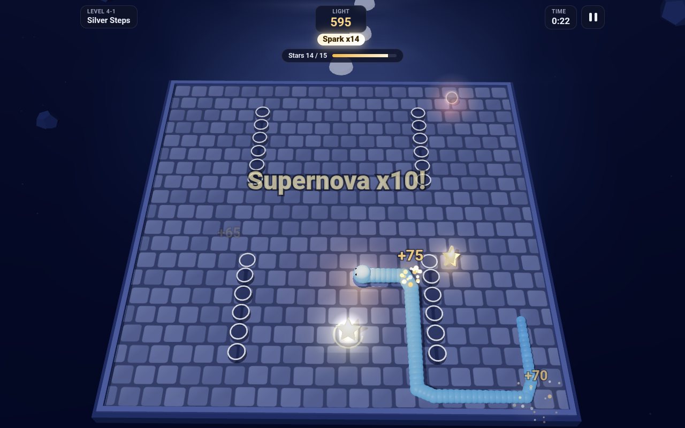<br><sub>Eclipse stones on the Moon's Path</sub></td>
  </tr>
  <tr>
    <td align="center">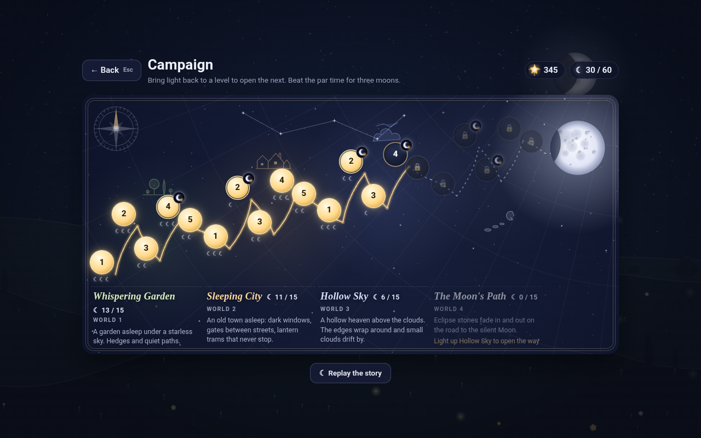<br><sub>The world map: an old star chart</sub></td>
    <td align="center">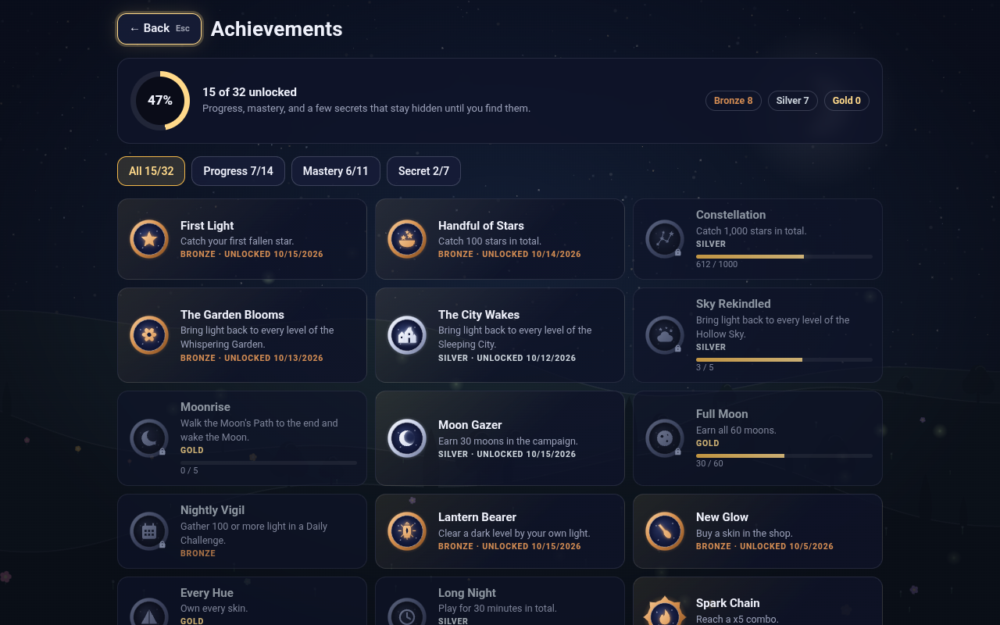<br><sub>32 achievements as star charms</sub></td>
  </tr>
  <tr>
    <td align="center">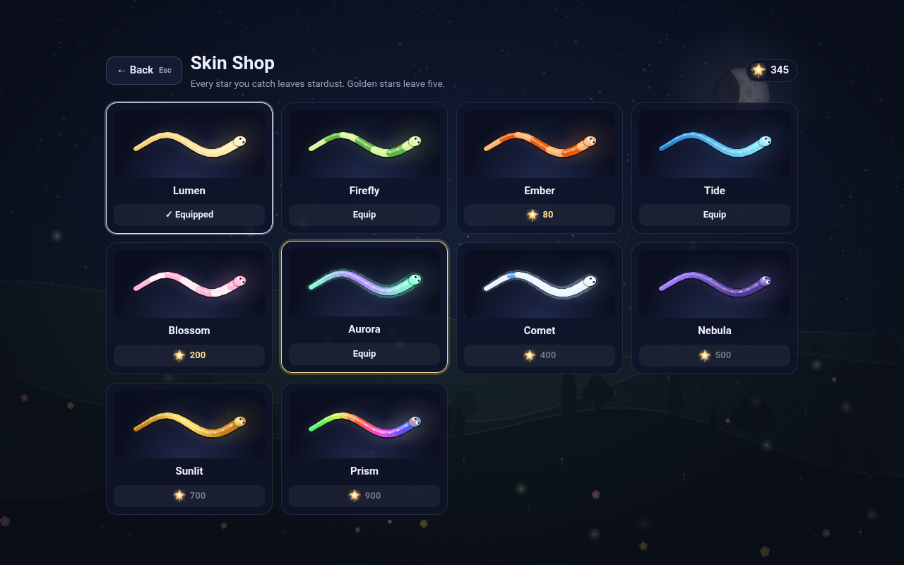<br><sub>The Skin Shop</sub></td>
    <td align="center">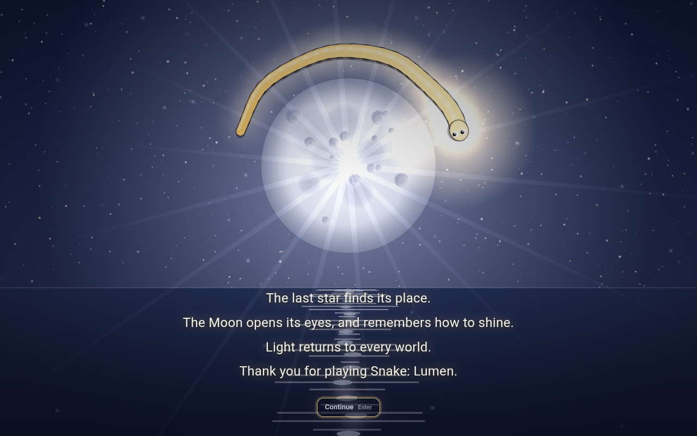<br><sub>The finale</sub></td>
  </tr>
  <tr>
    <td align="center">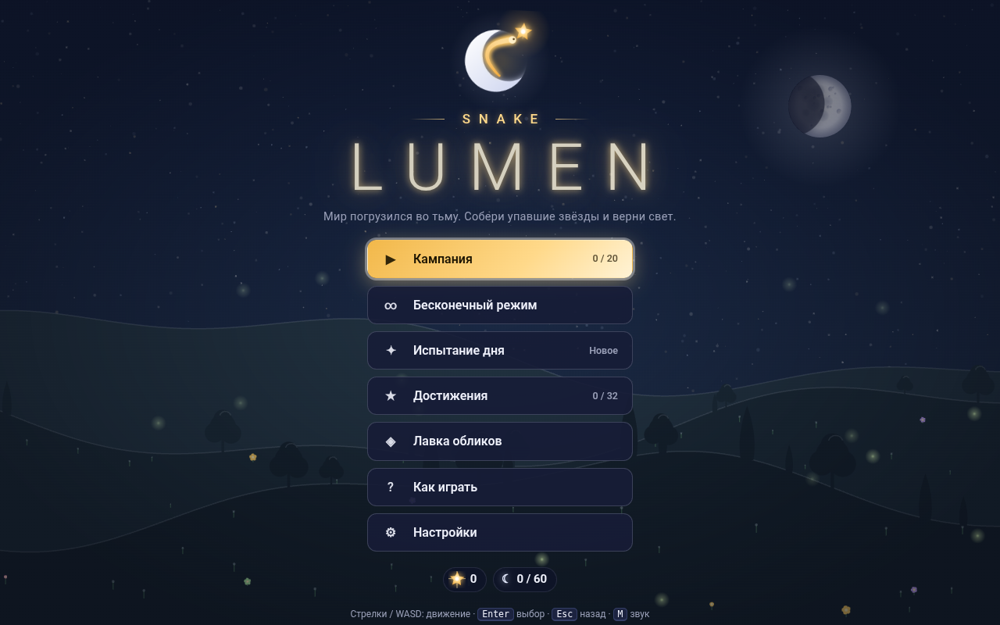<br><sub>Title screen in Russian</sub></td>
    <td align="center">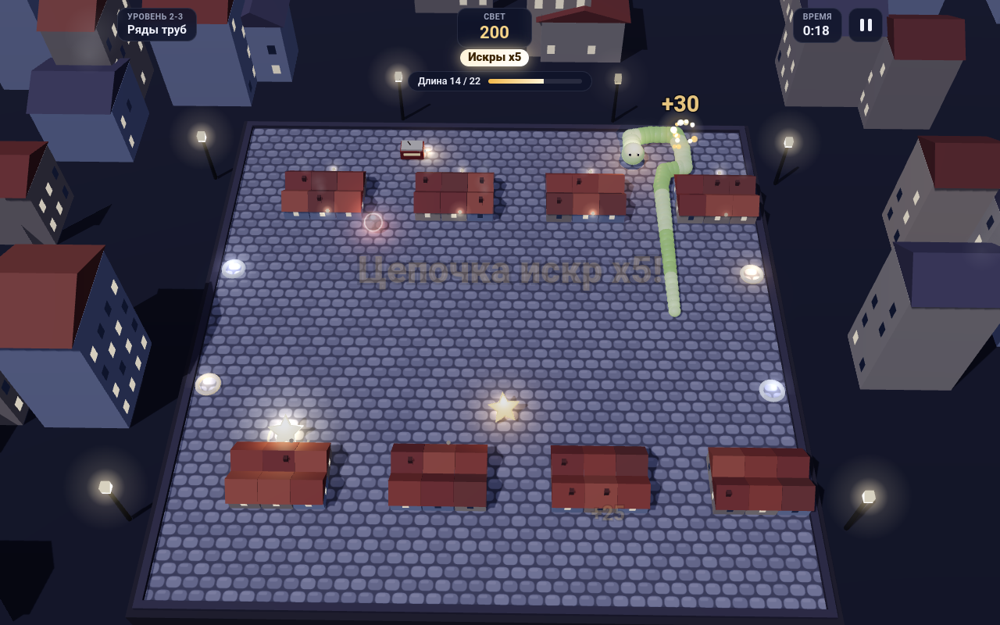<br><sub>Playing in Russian</sub></td>
  </tr>
  <tr>
    <td align="center">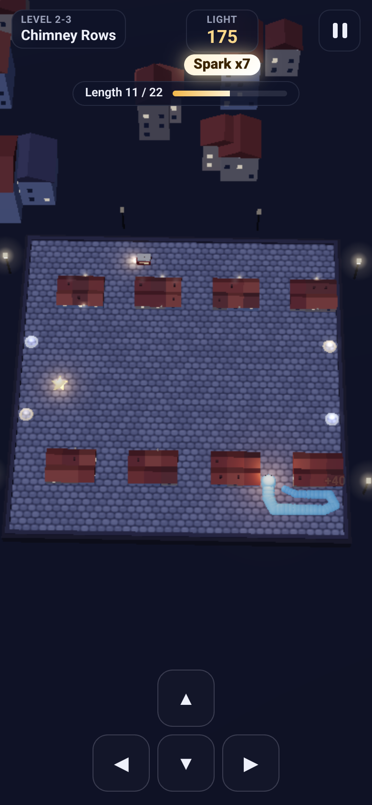<br><sub>On a phone (Auto picks Low)</sub></td>
    <td align="center">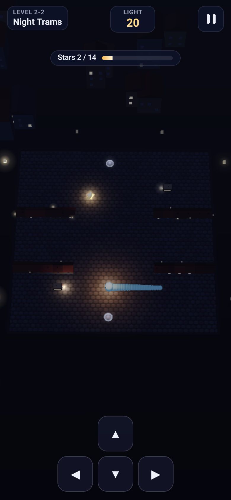<br><sub>A dark level on a phone</sub></td>
  </tr>
</table>

## Controls

| Keys | Action |
| --- | --- |
| **Arrows** or **WASD** | move (two quick taps queue up, so tight turns are not lost) |
| **Space** or **P** | pause and resume |
| **Enter** | select, continue, next level, skip a story scene |
| **Esc** | back in menus, pause during a run, skip a story scene |
| **M** | sound on/off, anywhere |

On a phone: swipe on the board or use the on-screen arrows. Every menu also works from the keyboard: the
arrows move the focus to the nearest button in that direction.

## Modes

- **Campaign.** 20 levels in four worlds of five, laid out on an old star chart with a path of light toward
  the Moon. Each level has a goal (catch N stars, grow to length N, survive N seconds, or gather N light) and
  earns one to three moons: clear it for one, beat the par time for more. Clearing a level opens the next.
- **Endless.** One long night on an open board. Every 12 stars the journey moves on to the next world and its
  music, and the pace keeps climbing. A local table keeps your ten best runs.
- **Daily Challenge.** One board a day, built from the date: the world, the layout, the trams and clouds, and
  the order every star and power-up will fall in. Same date, same board, for everyone. One life.

### Stars and power-ups

| | |
| --- | --- |
| **Fallen star** | 10 light and one cell longer. Catch the next within 4 seconds to build a spark chain. |
| **Golden star** | rare and gone in a few seconds: 50 light and 5 stardust |
| **Hush** | time crawls for 8 seconds |
| **Wisp** | drift through your own tail for 7 seconds |
| **Lodestar** | stars drift toward you for 9 seconds |
| **Radiance** | every bit of light counts twice for 10 seconds |

Every star leaves **stardust**. Spend it in the **Skin Shop**: Lumen, Firefly, Ember, Tide, Blossom, Aurora,
Comet, Nebula, Sunlit and Prism, each with its own pattern and glow.

## Worlds

| World | What you will find | Music |
| --- | --- | --- |
| **The Whispering Garden** | a moonlit garden: hedges, trees, fireflies, flowers that open as the light returns | a soft triangle lullaby |
| **The Sleeping City** | an old town at night: tiled rooftops, smoking chimneys, iron lanterns, gates between streets, little red trams, windows that light up one by one | a gentle walking arp |
| **The Hollow Sky** | the night sky above a sea of clouds: the edges wrap around, small clouds drift, constellations reappear | slow pads and bells |
| **The Moon's Path** | a road of moonstone over still, mirror-like water toward a huge Moon: eclipse stones fade in and out | a quiet, rising sine theme |

Trams, clouds and shadows are polite: they wait instead of running into you, so a crash is always your head
meeting them. Eclipse stones pulse before they close and never close on the serpent.

**Dark levels.** Six campaign levels (1-4, 2-2, 3-2, 3-4, 4-2 and 4-3) are night levels. The moonlight and
sky light drop very low, the fog thickens, and the serpent's light burns brighter, a warm pool that reaches
further as the serpent grows. Stars twinkle so they can be found from afar; walls, gates, trams, clouds and
eclipse stones only become clear once your light reaches them. When the level is won, the whole board is
revealed. Dark levels carry a moon mark on the world map.

## Achievements

Thirty-two, drawn in code as little star charms in amber, moon silver or star gold. The achievements screen
shows what is left and how far along you are.

| Progress | | Mastery | |
| --- | --- | --- | --- |
| First Light (bronze) | catch your first fallen star | Spark Chain (bronze) | reach a x5 combo |
| Handful of Stars (bronze) | catch 100 stars | Supernova (gold) | reach a x10 combo |
| Constellation (silver) | catch 1,000 stars | Ribbon of Light (bronze) | grow to length 30 |
| The Garden Blooms (bronze) | light up the Whispering Garden | Pure Light (gold) | length 50 without a power-up |
| The City Wakes (silver) | light up the Sleeping City | Shooting Star (silver) | clear a level in under 25 s |
| Sky Rekindled (silver) | light up the Hollow Sky | Radiant World (silver) | 3 moons on a whole world |
| Moonrise (gold) | wake the Moon | Night Vision (gold) | 3 moons on every dark level |
| Moon Gazer (silver) | earn 30 moons | Wishmaker (silver) | 3 golden stars in one run |
| Full Moon (gold) | earn all 60 moons | Night Watch (silver) | 3 minutes in Endless |
| Nightly Vigil (bronze) | 100 light in a Daily | Thousand Lights (silver) | 1,000 light in Endless |
| Lantern Bearer (bronze) | clear a dark level | Gifts of the Night (bronze) | use every power-up |
| New Glow (bronze) | buy a skin | | |
| Every Hue (gold) | own every skin | | |
| Long Night (silver) | play 30 minutes in total | | |

**Secret:** seven more (3 bronze, 3 silver, 1 gold), hidden until you find them.

<details>
<summary>Spoilers: the secret achievements</summary>

| | |
| --- | --- |
| Ouroboros (bronze) | bite your own tail |
| Lights Out (bronze) | go dark within 3 seconds of the start |
| Night Owl (silver) | play a run between midnight and 5 AM |
| Old School (gold) | enter the Konami code on the title screen (it also unlocks the Prism skin) |
| Wisp Walker (silver) | drift through yourself 10 times in one run |
| Guiding Star (silver) | catch 4 stars during a single Lodestar |
| Daydreamer (bronze) | pause 10 times in one run |

</details>

## Graphics quality

**Settings → Graphics: Auto / Low / Medium / High**, in English and Russian, applied at once and saved.

| | Low | Medium | High |
| --- | --- | --- | --- |
| Pixel ratio cap | 1 | 1.5 | 2 |
| Moon shadows | off | 1024 px | 2048 px |
| Serpent light shadows | off | off | on |
| Pooled point lights | 2 | 4 | 6 |
| Antialiasing | off | on | on |
| Fireflies, houses, smoke | about half | most | all |

**Auto** picks Low on phones and small touch screens and Medium elsewhere. On top of the preset, the
renderer watches the real frame rate and lowers the internal resolution (down to 55 percent) when frames run
slow; on Auto, a machine that stays slow drops one preset.

## Languages

Snake: Lumen is fully translated into **English** and **Russian (Русский)**: menus, story, level names and
goals, power-ups, achievements, shop, settings, HUD and How to Play. The name **Snake: Lumen** stays the same
in both languages.

- On the first run the language follows the browser (`ru` picks Russian, anything else English).
- **Settings → Language** switches at any time, even from the pause menu, and the choice is saved.
- Strings live in `js/i18n/en.js` and `js/i18n/ru.js`, with placeholders, Russian plural forms and a
  fallback to English. Adding a language is one more table and one more script tag.

## Saving and settings

Progress, moons, stardust, skins, achievements, high scores, story scenes seen, the language and the settings
are kept in `localStorage` on your machine. If a browser blocks storage for local files, the game still plays,
says so once, and keeps progress until the tab closes.

Settings: language, graphics quality, music and sound volume, sound on/off, vibration (on phones that support
it), screen shake, and **reduced flashing** (softer flashes, a steady light in dark levels, no camera glide).
A reset button asks twice.

## Project structure

```
index.html               markup, HUD, and the order in which the scripts load
vendor/three.min.js      three.js r160, the classic (non-module) build
vendor/three.LICENSE.txt the three.js MIT license
css/style.css            menus, HUD, story scenes and toasts
js/config.js             tunables: grid, speeds, light, power-ups, worlds, skins
js/i18n/                 i18n.js (lookup, plurals, detection), en.js, ru.js
js/core/                 the rules: pure, no DOM, runs in node
                         (board, snake, levels, game, daily, autopilot, profile, achievements)
js/render/               2D canvas drawing: backgrounds, board, lighting, serpent, items,
                         particles, icons, logo, story scenes, frame composition
js/render3d/             the three.js view of a run
  kit.js                 WebGL check, quality presets, canvas textures, glow sprites, the 3D star
  board3d.js             the board as a model: floor, hedges, houses, cloud banks, gates, trams...
  dioramas.js            the world around the board: sky, stars, Moon, garden, town, clouds, water
  world3d.js             renderer, camera, moonlight, sky light, serpent light, light pool,
                         adaptive resolution, 2D overlay projection
js/audio/                synth.js (sound effects), music.js (one track per world)
js/ui/                   storage, input, keyboard focus, screens, HUD, toasts, star chart
js/main.js               wires it all up and runs the frame loop
tests/                   unit tests, end-to-end test, bot sweep, screenshot generator
```

**Why plain scripts.** A page opened from `file://` cannot load ES modules, but plain `<script>` tags work.
That is why three.js is the classic `three.min.js` build of r160, which defines a global `THREE`. Each file is
an IIFE that adds to one global, `window.LUMEN`, and `index.html` loads them in order. The rules in `js/core/`
never touch the DOM, so the same game state is drawn in 3D, or in 2D without WebGL.

## Tests

```bash
node tests/core.test.js                          # unit tests, no dependencies
node tests/bot-sweep.js                          # the bot plays all 20 levels with 12 seeds each

npm i playwright && npx playwright install chromium
node tests/e2e.js                                # plays the page through file:// in headless Chromium
node tests/screenshots.js                        # regenerates screenshots/
SHOTS=worlds,dark node tests/screenshots.js      # only some batches (title, worlds, garden, city,
                                                 # sky, moon, dark, menus, finale, ru, phone)
```

The end-to-end test runs Chromium with WebGL on SwiftShader (`--use-angle=swiftshader`), so it needs no GPU.
It boots the page from `file://` and fails on any console error or warning. It plays the story, menus and
levels with the keyboard, checks light, moons, achievements, the shop, the daily and endless modes, dark
levels, the graphics setting and High-quality shadows, a phone viewport with taps and swipes, the Russian
interface, blocked `localStorage`, and the no-WebGL fallback in both languages.

## Credits and license

Made by **K41Z0**. Snake: Lumen is released under the [MIT License](LICENSE).

[three.js](https://threejs.org) (`vendor/three.min.js`) is Copyright 2010-2023 three.js authors and is used
under the MIT license, included as [vendor/three.LICENSE.txt](vendor/three.LICENSE.txt). The vendored file is
the official r160 `build/three.min.js` with one change: its first statement, a console warning that the
classic build is deprecated, is removed so the page stays free of console warnings.
