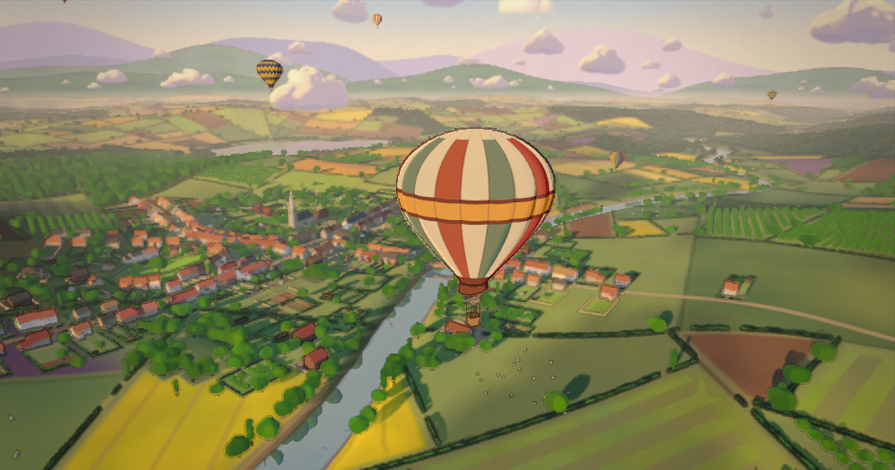

# Balloon Ride

A calm hot air balloon ride over a hand-painted countryside at golden hour. No score, no goals: rise, drift and look down.

**Play:** https://starknightt.github.io/balloon-ride/



## Controls

| Input | Action |
|---|---|
| Space (hold) | burner (rise) |
| S (hold) | vent (sink) |
| Mouse drag | look around |
| V | basket view / chase view |
| T | time of day (sunrise, golden hour, sunset, blue hour) |
| H | controls hint |
| C | cinematic camera |
| M | mute |

On phones and tablets, touch buttons in the bottom corners work the burner, the vent and the view; drag anywhere else to look.

## Steering

There is no steering wheel: the wind blows a different way at each height (east low down, north-east in the middle, north up high), so you pick your direction by climbing or sinking into the layer you want.

## Development

```sh
pnpm install
pnpm dev      # dev server on http://localhost:5441
pnpm build    # type-check and build to dist/
pnpm shoot p5 # capture the fixed comparison frames into shots/p5 (headless Chrome on the GPU)
pnpm record   # record the cinematic to recordings/balloon-ride-cinematic.mp4 (1080p60, NVENC)
```

`shoot` and `record` need a hardware GPU and refuse to run on a software rasteriser. `record` also needs ffmpeg with NVENC on the PATH.

## Credits

The environment code (toon shading, painted sky and clouds, terrain, village, trees, post-processing, sound) is adapted from the author's earlier games Summer Cycle and Bay Ride. The balloon is modelled in Blender by `tools/balloon.py`. All sound is synthesised in code. Built with [three.js](https://threejs.org/).

## Licence

[MIT](LICENSE)
