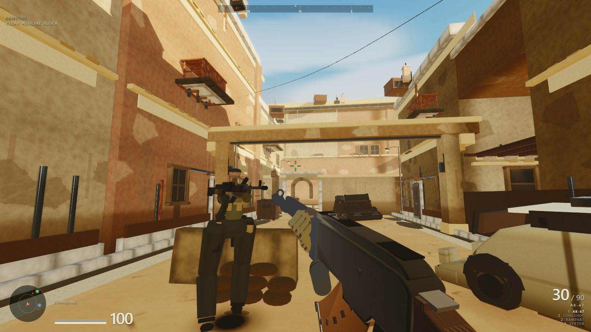
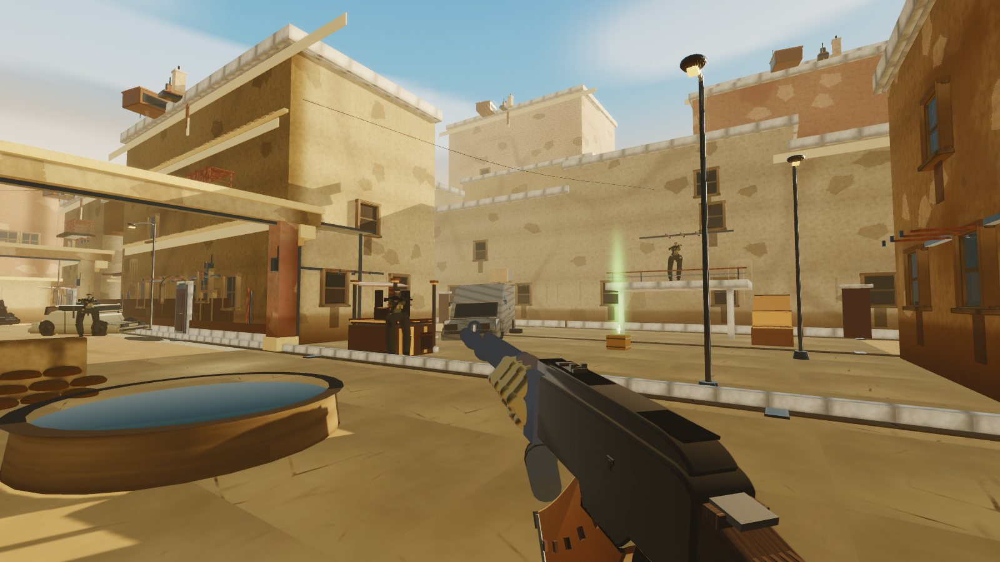
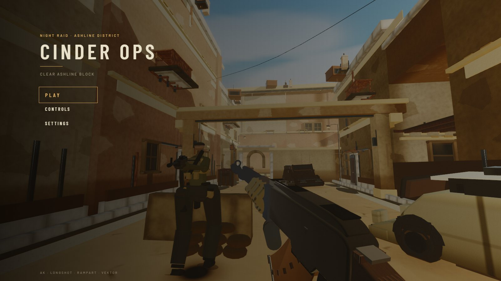
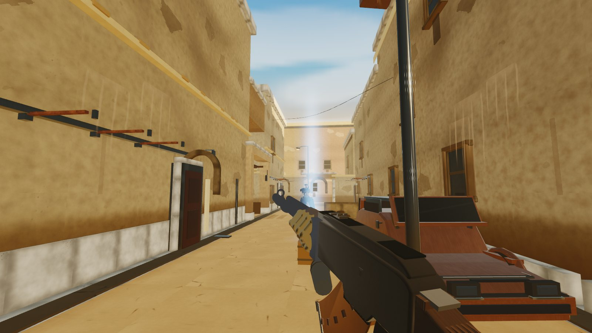
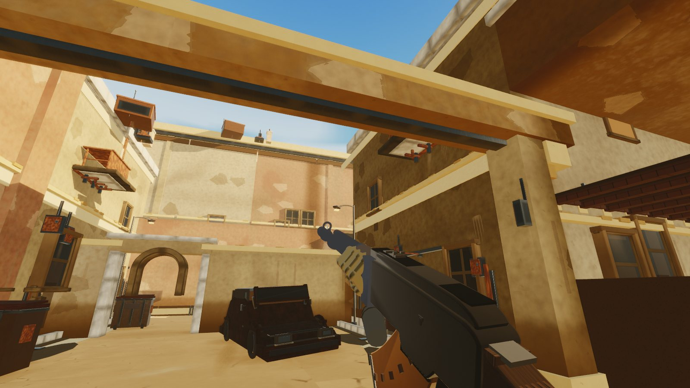
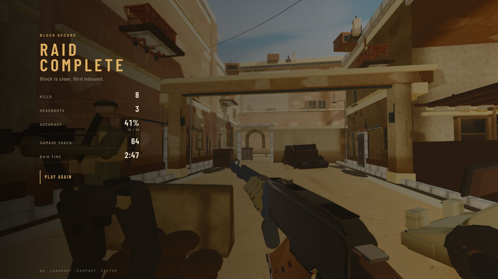

# Cinder Ops

A first-person shooter that runs in a browser tab. Clear **Ashline Block** — a
sunlit market district — then walk the extract. No build step, no models on
disk, and no assets beyond three.js from a CDN.

**[Play it here](https://starknightt.github.io/cinder-ops/)**



Eight hostiles hold the block. You spawn with the full kit, eight seconds of
quiet, and a map that marks the supply chests. Push the street or cut through
the market. When the last hostile drops, the extract bay opens.

The world, the weapons, the soldiers and the sound are all generated at
runtime. The page is plain ES modules with an import map: open it from a static
server and that is the whole installation.



## Running it

There is no build step. ES modules need a real HTTP origin, so opening
`index.html` from the filesystem will not work.

```bash
git clone https://github.com/StarKnightt/cinder-ops.git
cd cinder-ops
npm run serve
```

Then visit the URL the server prints, usually `http://localhost:8099/`. Any
other static server is fine:

```bash
python -m http.server 8099
```

Click **Play** to lock the pointer. `Esc` releases it and opens the pause menu.

Needs a desktop browser with WebGL and Pointer Lock. A discrete GPU is
recommended — Cinematic quality wants an RTX-class card. There is no touch
scheme, so it will not play on a phone.



## Controls

| Input | Action |
| --- | --- |
| `W` `A` `S` `D` | Move |
| Mouse | Look |
| Left click | Fire |
| Right click | Aim down sights; on the Longshot, cycle hip → 1× → 2× → hip |
| `R` | Reload |
| `Shift` | Sprint |
| `Space` | Jump |
| `Ctrl` / `C` | Crouch |
| `1` | AK-47 |
| `2` | Cycle Longshot / Rampart |
| `3` | Vektor |
| `Q` | Last weapon |
| Mouse wheel | Cycle every weapon |
| `E` | Interact |
| `[` `]` | Sensitivity (in raid) |
| `Esc` | Pause |

Movement steps up low lips and slides along walls instead of dead-stopping on a
graze. Sprint while aiming is slower; the Longshot unscope if you sprint, jump,
or fire.

## The raid

You start at 100 health and 50 armor in a service alley. Hostiles hold fire for
the first eight seconds. After that they take cover and return it.

Clear the block. The objective reads **Clear Ashline Block** until the last
hostile is down, then the HUD banners **Ashline block cleared** and the extract
at the warehouse bay unlocks. Walk onto the pad to finish.

Two supply chests sit on the map — green for +50 HP, blue for +50 armor. They
refill on a 45 second timer and show as beacons on the minimap.

A hit paints a directional damage arc and a low-health vignette. Dying or
extracting both open the same recap: kills, headshots, accuracy, damage taken,
raid time. Extract titles it **RAID COMPLETE**; a down titles it **KIA**.



## Weapons

All four are available from spawn. Viewmodels, brass, muzzle flash and tracers
are built from primitives; tracers leave the muzzle, not the camera.

| Slot | Weapon | Mag | Reserve | Behaviour |
| --- | --- | --- | --- | --- |
| 1 | AK-47 | 30 | 90 | 720 rpm full auto, learned recoil |
| 2 | Longshot | 5 | 10 | Bolt rifle, 1× / 2× scope, body shot kills |
| 2 | Rampart | 8 | 24 | Eight pellets, shell-by-shell reload |
| 3 | Vektor | 12 | 36 | 400 rpm sidearm, fastest raise |

`2` flips between the two heavies. Headshots multiply damage. The AK and Vektor
fall off with range; the Longshot does not; the Rampart is a closer.



## Settings

From the start menu or pause:

| Setting | What it does |
| --- | --- |
| Sensitivity | Look speed, 0.2× to 4.0× |
| Master volume | Synthesised gunfire, hits, footsteps |
| Quality | **Cinematic** (showcase shadows and MSAA) or **Competitive** (smoother frame) |
| FPS limit | Uncapped, 200, 180, 144, 120, or 60 |

Defaults are Cinematic and a 180 fps cap.



## What is in it

- An authored street canyon — main road, market cut-through, shop recesses, a
  burning van, and a warehouse extract — with no external meshes or textures.
- Four weapons with ADS, recoil, reload, hitmarkers and muzzle tracers.
- Eight hostiles that hold cover and shoot back after the spawn grace.
- Health, armor, directional damage, and a low-health vignette.
- Supply chests marked on the radar, plus a compass and a live objective.
- Start menu, loader, pause, settings, extract recap and KIA recap.

There are no image, audio or model files in the playable tree. Concrete,
plaster, rust, wood and gunmetal are painted into canvases at load. Soldiers
and guns are boxes, cylinders and spheres. Every sound is a Web Audio graph.

The only runtime dependency is [three.js](https://threejs.org/) r183, fetched
from jsDelivr through the import map in `index.html`.

## Stack

Three.js 0.183 · vanilla ES modules · WebGL2 · Web Audio · GitHub Pages.

`npm install` is not required to play. `npm run serve` is a 25-line static
server whose only job is a real origin.

## License

MIT. See [LICENSE](LICENSE).
