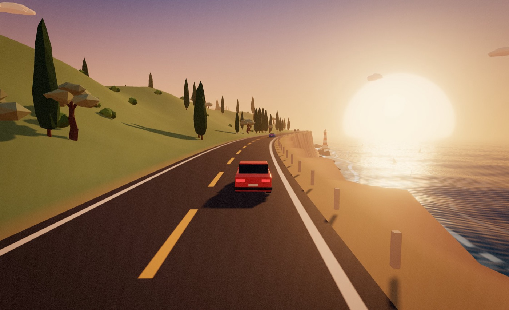

# Beach Road

A relaxing, endless coastal driving game that runs in the browser. Drive yourself, set cruise control,
or turn on autodrive and just watch the coast go by: palm beaches, clifftop roads, pine forests,
harbour villages, dunes and windy meadows. A generative radio plays alongside, and it never loops.

**Play it at [beach.achal.xyz](https://beach.achal.xyz).**



## Run it locally

```bash
python3 serve.py
```

Then open http://localhost:5173 and click **Start driving**. Browsers need a click before they can play audio.
Three.js loads from a CDN, so the first load needs an internet connection. `serve.py` is a plain
static server with caching turned off. Any static server works, but some cache the JS modules between edits.

## What's in it

- **Driving:**
  - **Manual:** steering, an automatic gearbox and engine sound per car.
  - **Cruise control:** holds your speed while you steer.
  - **Autodrive:** keeps its lane, slows for curves, follows traffic and overtakes when the other lane is clear.
  - **Free roam:** turn around (`R`) and drive the other way.
- **Six regions:** Palm Beach, Cypress Cliffs (the road climbs onto the clifftops), Pine Coast, Harbour Village,
  Dune Flats and Turbine Meadows. Each lasts about three kilometres and blends into the next, in a shuffled order.
  Each region has its own scenery:
  - lighthouses with beams that sweep at night
  - piers
  - beach huts and umbrellas
  - houses whose windows light up after dark
  - spinning wind turbines
  - fences, cypresses, olive trees and cacti
- **Nine cars:** an electric hatch, sedan, estate, roadster, GT coupe, 4x4, pickup, camper van and a classic.
  Each has its own handling and engine sound, plus seven paint colours.
- **Three looks:** Golden Hour (default), Synthwave Night and Pastel Low-Poly.
- **Time and weather:**
  - **Time of day:** seven presets, or a full day cycle every 30 minutes, with stars, moon and headlights at night.
  - **Weather:** clear, cloudy, overcast, rain (wet road included) or sea fog, or let it change by itself.
- **Radio:** nine generative stations: Island Marimba, Outrun FM, Golden Drift, Lo-fi Coast, Sea Glass,
  Breezy Afternoon, Deep Blue, Night Jazz and Seaside House. Each composes songs live, then changes key,
  tempo and arrangement between them. Ambience runs underneath: waves, wind, rain, night crickets and tyre noise.
- **Traffic in both directions:** it follows, brakes, and honks if you drive at it in its lane. Contact is a gentle bump, never a crash.
- **Cameras:** chase, far chase, driver, drone, and a cinematic mode that cuts between shots on its own.
  Drag with the mouse to look around; scroll to zoom.
- **Comfort:**
  - gamepad support
  - screenshots (`K`)
  - km/h or mph
  - a Graphics setting that adapts automatically (it drops a level when the frame rate does)
  - settings and lifetime distance saved in the browser

## Controls

| Keyboard | | Gamepad | |
| --- | --- | --- | --- |
| W / ↑ | accelerate | RT | accelerate |
| S / ↓ / Space | brake, reverse | LT | brake |
| A D / ← → | steer | left stick | steer |
| E | autodrive | A | autodrive |
| C | cruise control | X | cruise control |
| + / − | set speed | D-pad ↑ ↓ | set speed |
| V | camera | Y | camera |
| , / . (or N) | radio station | LB / RB | radio station |
| T / Y | next time of day / weather | D-pad ← → | time / weather |
| R | turn around (or straighten up) | | |
| L / G | headlights / horn | B | horn |
| 1 2 3 | switch look | | |
| H / M / K | hide HUD / mute / screenshot | Back | hide HUD |
| Esc / P | menu | Start | menu |

## Graphics quality

| | High | Medium | Low |
| --- | --- | --- | --- |
| Resolution | up to 1.75× (Retina) | up to 1.25× | 1× |
| Anti-aliasing | 2× MSAA | FXAA | FXAA |
| Shadows | 2048 shadow map | 1024 shadow map | soft blob under each car |
| Bloom | on | on | off |

**Auto** starts on High (Medium on phones and machines with 4 or fewer cores). It drops a level when the frame
rate stays under 45 fps, and never steps back up.

## Code map

| File | What it does |
| --- | --- |
| `src/main.js` | Game loop, looks, post-processing, settings, actions, HUD wiring |
| `src/road.js` | The endless road curve, elevation, shoreline and terrain height |
| `src/biomes.js` | The six regions: shape, colours, scatter tables, ordering and blending |
| `src/world.js` | Streams 80 m terrain chunks and places scenery, seeded per chunk |
| `src/assets.js` | Vegetation, rocks, boats, clouds and per-look materials |
| `src/props.js` | Houses, lighthouse, pier, lamps, turbines, huts, umbrellas, fences and plants |
| `src/cars.js` | The nine car models and their stats |
| `src/vehicle.js` | Car physics, plus the manual, cruise and autodrive driver |
| `src/traffic.js` | Traffic AI and gentle collisions |
| `src/camera.js` | Camera modes, including the cinematic shot director and garage showroom |
| `src/environment.js` | Time-of-day keyframes, sun and moon, weather blending |
| `src/shaders.js` | Sky, ocean (waves, shore foam, glitter), rain, neon grid, post passes |
| `src/music.js` | Generative radio stations, engine sound and ambience (pure Web Audio) |
| `src/styles.js` | The looks as data, including lighting keyframes per hour |
| `src/ui.js`, `style.css` | Menus, garage, HUD |
| `src/input.js` | Keyboard, mouse and gamepad |
| `src/quality.js`, `src/settings.js` | Graphics levels and the auto-tuner; saved preferences |

Everything is generated in code. There are no model, texture or audio files.

To add a region, add an entry to `BIOMES` in `src/biomes.js`. To add a look, add an entry to `src/styles.js`
and list its id in `STYLES`. Two looks from the original style lab, Sunny Cel-Shaded and Watercolour Mist,
still load with `?style=toon` and `?style=watercolor`; their stills are in `screenshots/lab/`.

In the browser console, `beachRoad.bench(60)` gives the average milliseconds per frame. `beachRoad.travelTo('village')`
jumps to a region, and `beachRoad.sim(600)` fast-forwards ten seconds.

## Contributing

Issues and pull requests are welcome. There's no build step: clone, run `python3 serve.py`, edit, reload.
Every push to `main` deploys to [beach.achal.xyz](https://beach.achal.xyz), and pull requests get a Vercel preview.

## License

[MIT](LICENSE)
