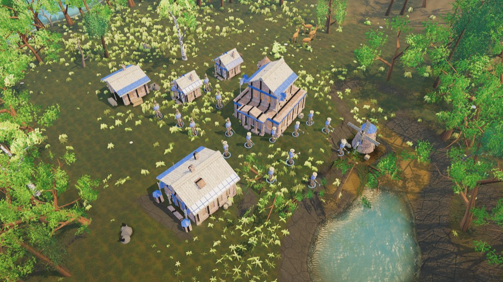
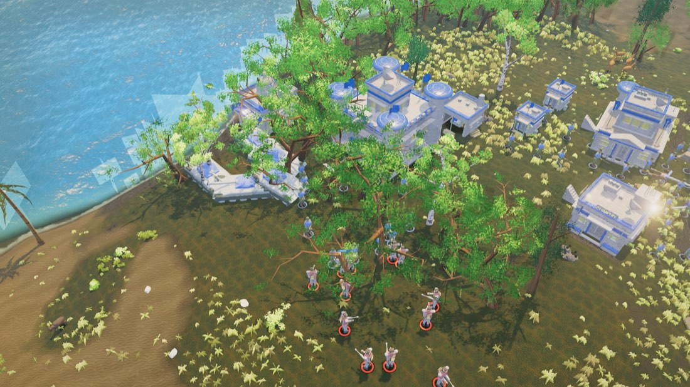
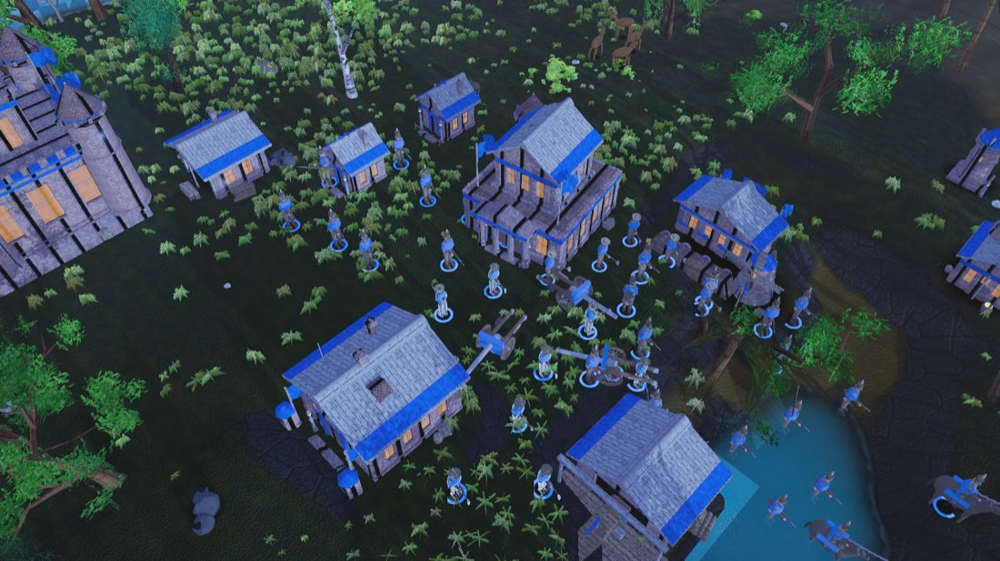
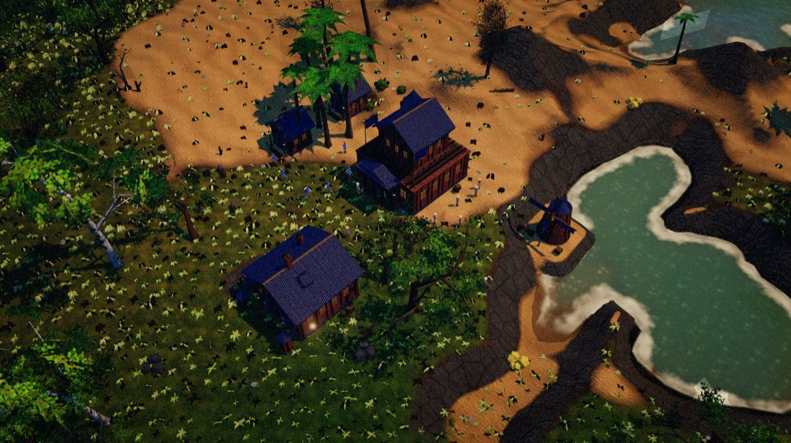

# Imperios 1800 – 2100

Un juego de estrategia en tiempo real en la tradición de *Age of Empires II*, con las cinco edades
corridas de 1800 a 2100: del vapor a la síntesis.

**Cero assets binarios.** No hay un solo `.png`, `.glb`, `.hdr`, `.mp3` ni fuente descargada. Cada textura
PBR, cada malla, cada disparo y cada compás de música se genera en código a partir de una semilla. El
repositorio pesa menos que una sola textura de un juego comercial.



```bash
npm install
npm run dev          # http://localhost:8910
```

El primer arranque tarda unos 40 segundos: está tejiendo el juego de texturas completo, píxel por píxel.

---

## Las cinco edades

| Edad | Años | Equivale a | Lo que abre |
|---|---|---|---|
| **Del Vapor** | 1800 – 1870 | Oscura | Colonos, milicianos, empalizada |
| **Eléctrica** | 1870 – 1945 | Feudal | Fundición, polígono de tiro, mercado, artillería |
| **Atómica** | 1945 – 1991 | Castillos | Ciudadela, instituto, blindados, hormigón |
| **De la Información** | 1991 – 2045 | Imperial | Drones, guerra electrónica, comercio global |
| **Sintética** | 2045 – 2100 | *(nueva)* | Autómatas, enjambres, fusión, Maravilla |

Los cuatro recursos —Alimento, Materiales, Capital y Energía— cambian de nombre con la edad. La Madera
pasa a Acero, a Hormigón, a Polímero, a Nanofibra. Mecánicamente son los mismos cuatro; narrativamente
cuentan doscientos años.

**Contenido:** 36 unidades, 22 edificios, 38 tecnologías, 8 civilizaciones con bono propio, unidad única y
bono de equipo, y 6 tipos de mapa (Arabia, Tierras Negras, Archipiélago, Río Grande, Fortaleza, Valle Alpino).

<table>
<tr>
<td width="50%"></td>
<td width="50%"></td>
</tr>
<tr>
<td><em>Edad Atómica: ciudadela, instituto, blindados de dos bandos.</em></td>
<td><em>Noche. Cae fuera de la banda tonal de la referencia a propósito.</em></td>
</tr>
</table>

---

## Cómo se juzgó

El juego se sometió a un **jurado a ciegas**. Se generan pares A/B mezclados entre capturas nuestras y
capturas oficiales de *Age of Empires II: Definitive Edition*; jurados independientes miran cada par sin
saber cuál es cuál y votan, con nivel de confianza y lista de defectos por imagen. Después se corrige y se
vuelve a medir.

| Ronda | Marcador | Confianza media del voto en contra |
|---|---|---|
| 1 | 0 – 6 | 0,96+ |
| 3 | 0 – 6 | 0,942 |
| 4 | 0 – 6 | 0,9275 |
| 6 | 0 – 12 votos | 0,9225 |

**No se ganó un solo par.** Lo que baja, ronda a ronda, es la convicción del jurado.

La misma aldea al principio y al final del proceso:

| | Ronda 1 | Final |
|---|---|---|
| Luma media | 5,5 | 111,1 |
| Píxeles bajo 32 | 99 % | 0,3 % |
| Altas luces | 0 % | 5,3 % |



*Ronda 1: el 99 % del cuadro por debajo de 32 de luma. Todo el contenido ya estaba ahí — el post-proceso
lo destruía.*

### Lo que costó descubrir

Tres hallazgos que valen más que cualquier lista de features, porque son el tipo de error que se repite:

**El shader que corría era otro.** Durante tres rondas, tres correcciones completas nunca llegaron a la
pantalla. La clave de caché de programa de three no distingue una cadena de `onBeforeCompile` incompleta de
la completa, así que devolvía el programa viejo para siempre. El código estaba bien. El jurado veía los
mismos defectos ronda tras ronda mientras cada agente daba su arreglo por hecho.

**Una doble conversión de color.** El color de bando estuvo roto cinco rondas por un
`new THREE.Color(hex).convertSRGBToLinear()`: el constructor ya convierte. El azul entraba a los materiales
como `(0.004, 0.059, 0.616)` — dos canales en cero, y cero por la luz que sea sigue siendo cero. Un solo bug
producía las dos quejas opuestas del panel: la tropa lavada y la arquitectura saturada.

**La métrica estaba saturada.** Cuatro rondas optimizando la luma media del cuadro, que ya estaba en rango,
mientras el panel repetía *"todo el cuadro en una sola banda verde-oliva"*. Recién al medir **contraste
local** —desvío estándar de luma en baldosas de 32×32— el problema tuvo número:

| | Nuestro (día) | Referencia |
|---|---|---|
| Luma media | 114,4 | 121,9 |
| Croma medio | 0,462 | 0,472 |
| **Contraste local** | **28,3** | **41,5** |
| **Rango intercuartil** | **52,6** | **81,7** |

Media y croma ya pasaban. Faltaba contraste, que es lo que sube cuando un edificio se despega de su fondo y
lo que **no** sube cuando simplemente subís la exposición.

Descartado midiendo, no opinando: no es la exposición global, no es el albedo del terreno, no es la caída de
valor del primer plano, y no son las sombras (bajar la luz ambiente de 1,0 a 0,28 deja el contraste local
clavado en 33,9 mientras la media cae 13 puntos). Queda una explicación estructural: **densidad de detalle de
alta frecuencia**. El 41,5 de la referencia sale de sprites dibujados a mano donde cada unidad y cada techo
tienen líneas oscuras internas a escala de pocos píxeles. Nuestras superficies son grandes y suaves.

---

## Controles

| | |
|---|---|
| `W A S D` · flechas · borde de pantalla | Mover la cámara (`Shift` acelera) |
| `Q` `E` · rueda del medio | Rotar · rueda: zoom hacia el cursor |
| Click izq. | Seleccionar · doble click: todos los del tipo · arrastre: recuadro |
| Click der. | Orden contextual: mover, atacar, recolectar, reparar, refugiarse |
| `Ctrl`+`1..9` / `1..9` | Guardar y recuperar grupos de control |
| `.` `,` | Saltar entre colonos ociosos · `H`: centrar en la Sede |
| `T` | Árbol tecnológico · `Escape`: pausa · `F3`: contadores |
| `Enter` | Panel de códigos (ver abajo) |

### Trucos

Como el chat de los *Age of Empires* originales: **Enter** abre el panel, se escribe el código, **Enter** lo
manda, **Escape** cancela.

| Código | Efecto |
|---|---|
| `klapaucius` | +1000 de Alimento, Materiales, Capital y Energía |

Se agregan sumando entradas a la tabla `TRUCOS` de [`src/sim/Trucos.js`](src/sim/Trucos.js).

### Parámetros de URL

| Parámetro | Valores | Qué hace |
|---|---|---|
| `calidad` | `baja` `media` `alta` `ultra` | Sombras, post-proceso, densidad de foliaje |
| `semilla` | número | Mismo número, mismo mapa, siempre |
| `civ` / `civRival` | ver `src/data/civilizaciones.js` | Civilizaciones de la partida |
| `dificultad` | `facil` `normal` `dificil` `brutal` | La IA enemiga |
| `arnes` | `1` | Herramientas de desarrollo |

---

## Arquitectura

```
src/core/     Motor a paso fijo (20 Hz) con interpolación, entidades en arrays
              tipados, bus de eventos, ruido y aleatoriedad deterministas
src/data/     Las tablas del juego: edades, unidades, edificios, tecnologías,
              civilizaciones, recursos
src/art/      Fábricas procedurales: texturas PBR, mallas de unidades y de
              edificios por edad, árboles, rocas, fauna
src/world/    Generación de mapa con erosión hidráulica y ríos, terreno con
              splatting triplanar, agua con olas de Gerstner, foliaje instanciado
src/render/   Post-proceso, cámara RTS, cielo con dispersión de Rayleigh y Mie,
              sombras en cascada, vista de entidades, partículas
src/sim/      Navegación (A* y campos de flujo), movimiento, combate, economía,
              edades, producción, IA, niebla de guerra, órdenes, trucos
src/ui/       HUD que evoluciona de estilo con la edad, minimapa, selección
src/audio/    Todo sintetizado con WebAudio: sin un solo archivo de sonido
```

El contrato entre módulos está en [`CONTRATOS.md`](CONTRATOS.md) y en `src/core/Ctx.js`. Ningún módulo
importa a un hermano por su ruta: todo pasa por `ctx`. Eso es lo que permitió que veinte agentes escribieran
subsistemas distintos en paralelo sin pisarse.

### Herramientas

```bash
node tools/capturador.mjs <carpeta>              # recibe capturas del juego corriendo
node tools/pares-ciegos.mjs <nuestras> <ref> <salida> <semilla>
node tools/exportar-conversacion.mjs <jsonl> <salida.json>
node tools/render-conversacion.mjs <json>  <salida.html>
```

`pares-ciegos.mjs` arma los pares A/B mezclados sin reposición. `capturador.mjs` existe porque el panel del
navegador integrado corre la pestaña oculta: `requestAnimationFrame` queda congelado y las capturas nativas
salen negras, así que el propio juego renderiza a mano y manda el PNG por POST.

---

## Cómo se construyó

Está entero acá: **[la conversación completa](docs/index.html)**, extraída de la transcripción de la
sesión. 22 turnos, 162 mensajes, 470 acciones ejecutadas, con las capturas de cada momento. Se descarga y se
abre sin servidor.

El juego lo escribieron unos 121 subagentes trabajando en paralelo, coordinados por contratos de módulo, más
seis rondas de jurado a ciegas. Consumo medible: **12,9 millones de tokens** de subagentes. El error de
orquestación más caro fueron 2,1 M gastados en dos oleadas de 19 agentes que murieron simultáneamente contra
el límite de sesión.

## Pendientes conocidos

- El arranque tarda ~40 s tejiendo texturas. Debería ir a un Web Worker.
- Falta un tercio del contraste local de la referencia, por densidad de detalle de alta frecuencia.
- El agua somera sigue siendo el elemento más claro del cuadro.
- Los muros de algunos edificios dejan ver junturas sin cerrar.

## Licencia

MIT.
