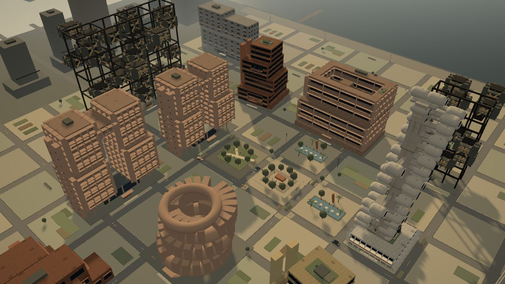

# MONUMENT

[](https://github.com/emollick/monument-brutalist-city-builder/actions/workflows/ci.yml)
[](LICENSE)

**A playable brutalist toy city about mass, light, public life, and guided growth.**

[Play Monument on Netlify](https://monument-brutalist-city-builder.netlify.app/) · [Read the controls](docs/CONTROLS.md) · [Understand the architecture](docs/ARCHITECTURE.md)



Monument combines direct architectural massing with a living, atmospheric city. Pull colored handles to reshape individual structures, change their construction and use, guide the character of a district, and move between analytical, street-level, aerial, and cinematic views. There is no economy or win-state gate: it is a design toy about making, inhabiting, and revisiting cities.

## Highlights

- Nine generative compositions—bar, split, cluster, stack, court, bridge, ring, capsule, and megaframe—crossed with six growth profiles.
- Direct 3D controls for position, rotation, height, span, depth, cantilever, void, taper, repetition, articulation, branches, and crown.
- Six architectural languages, six concrete palettes, multiple structural and facade systems, and five occupiable programs.
- Material, program, structure, daylight, activity, and embodied-carbon lenses.
- Default, Cyberpunk, Green, Totalitarian, and University atmospheres that change lighting, streets, skyline details, signage, and post-processing.
- Orbit, street, aerial, and cinematic cameras with a controllable day/night cycle, traffic, people, public spaces, and lived-in building light.
- Three ready cities, a blank site, named local saves, undo/redo, growth choices, and a minimal Focus mode.
- Responsive desktop, tablet, landscape-phone, and portrait-phone interfaces. Mobile building selection opens in a handle-first Direct Edit view before the full design panel.

## Quick start

Requirements: Node.js 20 or newer and npm.

```bash
git clone https://github.com/emollick/monument-brutalist-city-builder.git
cd monument-brutalist-city-builder
npm ci
npm run dev
```

Open the local URL printed by Vite.

## How to play

1. Open a ready city or begin with Open Ground.
2. Select a building and drag its colored handles to reshape it. On mobile, tap **Design** when you want the detailed inspector.
3. Change composition, growth profile, architectural language, structure, facade, use, and material in the inspector.
4. Add buildings and public spaces from the build rail.
5. Change the lens, mood, camera, and time of day to inspect or experience the city differently.
6. Save named versions locally and reopen them from the City Library.

Keyboard essentials: `1–6` build, `V` select, `X` demolish, `Space` pause, `F` Focus mode, `?` field manual, and `Ctrl/Cmd+Z` undo. Direct form handles support arrow-key precision. See [Controls](docs/CONTROLS.md) for the complete desktop and touch guide.

## Project map

| Path | Responsibility |
| --- | --- |
| `src/App.tsx` | Application state, interface panels, analysis, growth choices, undo/redo, saving, and responsive editing flow |
| `src/CityScene.tsx` | React Three Fiber scene, procedural building geometry, streets, moods, cameras, lighting, handles, and adaptive rendering |
| `src/data.ts` | Programs, materials, typologies, design languages, compositions, profiles, trajectories, parcel grid, and starter buildings |
| `src/cityLibrary.ts` | Ready-city templates, save records, local-storage persistence, and legacy migration |
| `src/controlApplicability.ts` | Shared rules explaining which controls have a visible effect for each architectural grammar |
| `src/types.ts` | Core city, building, graphics, charter, and snapshot types |
| `src/styles.css` | Desktop and responsive interface system, mood overlays, panels, handles, and welcome presentation |
| `src/__tests__/` | Fast tests for data invariants, templates, persistence, and architectural control rules |
| `docs/` | Architecture, controls, development, and testing guides |
| `.github/workflows/ci.yml` | GitHub validation on pushes and pull requests |

For the full data and rendering flow, read [Architecture](docs/ARCHITECTURE.md).

## Scripts

| Command | Purpose |
| --- | --- |
| `npm run dev` | Start Vite on the local network |
| `npm run typecheck` | Run TypeScript project checks |
| `npm test` | Run the Vitest suite once |
| `npm run test:watch` | Run tests interactively while developing |
| `npm run build` | Typecheck and create the production bundle in `dist/` |
| `npm run preview` | Serve the production bundle locally |
| `npm run check` | Run typechecking, tests, and the production build—the same validation used by CI |

## Persistence and privacy

Monument has no backend and requires no environment variables. City saves and display preferences remain in the browser's local storage:

- `monument-city-library-v1` stores up to 30 named city snapshots.
- `monument-graphics-v2` stores display preferences.
- A legacy `monument-city-v2` save is migrated automatically when possible.

Saves do not sync between browsers or devices. Clearing site data removes them. Do not treat browser storage as archival storage.

## Testing and quality

GitHub Actions runs `npm run check` for every pull request and every push to `main`. The current automated suite checks the deterministic, non-WebGL portions of the app; visual rendering, touch behavior, mood changes, and performance still require the documented manual matrix.

Read [Testing](docs/TESTING.md) before shipping a visual or architectural change.

## Deploying

The included `netlify.toml` runs `npm run build` and publishes `dist/` with a single-page-app redirect. Connect the repository to Netlify; no environment variables are required.

For a local production check:

```bash
npm run check
npm run preview
```

The `dist/`, `node_modules/`, and `.netlify/` directories are intentionally ignored. They are generated artifacts, not missing source code.

## Documentation

- [Architecture](docs/ARCHITECTURE.md)—state ownership, generative geometry, rendering, persistence, and performance.
- [Controls](docs/CONTROLS.md)—desktop, touch, camera, lens, mood, and direct-manipulation behavior.
- [Development](docs/DEVELOPMENT.md)—setup, conventions, and safe extension paths for new forms, moods, controls, and templates.
- [Testing](docs/TESTING.md)—automated scope, manual QA matrix, and performance checks.
- [Contributing](CONTRIBUTING.md)—branch, pull request, accessibility, and visual-review expectations.

## Contributing

Contributions are welcome. Run `npm run check`, describe the architectural intent of the change, and include before/after captures for visual work. Start with [CONTRIBUTING.md](CONTRIBUTING.md).

## License

Monument is released under the [MIT License](LICENSE). Copyright © 2026 Ethan Mollick.
