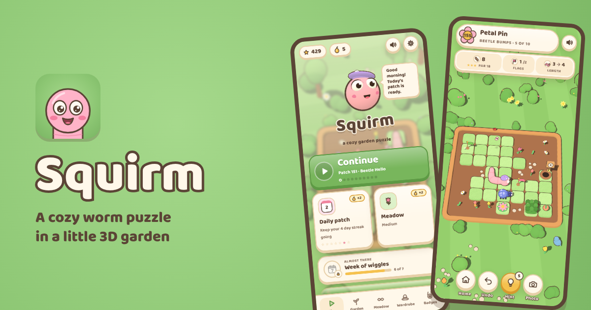

# Squirm

[](https://github.com/farzinmirzaie/squirm/actions/workflows/deploy.yml)

[](https://farzinmirzaie.github.io/squirm/)

A cozy, turn-based worm puzzle set in a little 3D garden. Steer a worm through garden patches, touch
every flag, and slip into the burrow at exactly the right length.

**Play it at <https://farzinmirzaie.github.io/squirm/>.** It installs as an app and plays offline.

## What's inside

- Handmade patches grouped into chapters, each bringing a new idea: snacks that change your length,
  keys and gates, tunnels, rain, rivers, snails, beetles and more. A solver checks every patch, and
  par is always the shortest solution.
- An endless meadow of generated patches, with the difficulty and mechanics you choose, and a daily
  patch that's the same for everyone.
- Stars, badges and a wardrobe of hats, colours, patterns and extras to earn.
- Hints grown as hint seeds in the daily and the meadow, undo, and photo mode.
- A little song for every patch, composed as you play, plus light and dark themes and reduced motion support.
- No assets: every 3D model is built in code and every sound is synthesized.

## How to play

Swipe (or use the arrow keys) to crawl one tile at a time. The worm keeps its length and can't turn
back into itself. Touch every flag, then crawl into the burrow at the length on its sign. Finish in
par moves for three stars.

Keys: arrows or WASD to crawl, `Z` undo, `R` restart, `H` hint, `M` mute, `P` photo, `Esc` back.

## Develop

Needs Node 22 or newer. Plain JavaScript and [three.js](https://threejs.org/), no bundler or
framework.

```
npm install      # three.js and the font
npm run build    # build into dist/
npm run serve    # serve dist/ locally
npm run check    # unit tests, level checks, build and a headless smoke test
```

The game lives in `src/` (page and styles, rules, levels, everything else) and the tooling in
`tools/` (build, local server, level solver and checks). Every push to `master` is tested and
deployed to GitHub Pages.

[`CLAUDE.md`](CLAUDE.md) is the full guide: architecture, the level format, workflows and
conventions. It's written for AI coding agents and works just as well for people.

## Credits

- [three.js](https://threejs.org/) r128 (MIT)
- [Baloo 2](https://github.com/EkType/Baloo2) font (SIL Open Font License 1.1), via
  [Fontsource](https://fontsource.org/)

## License

MIT. See [LICENSE](LICENSE).
