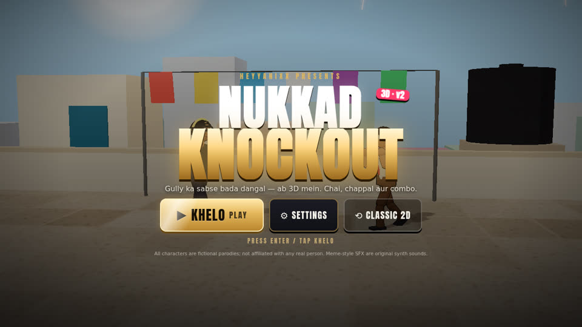
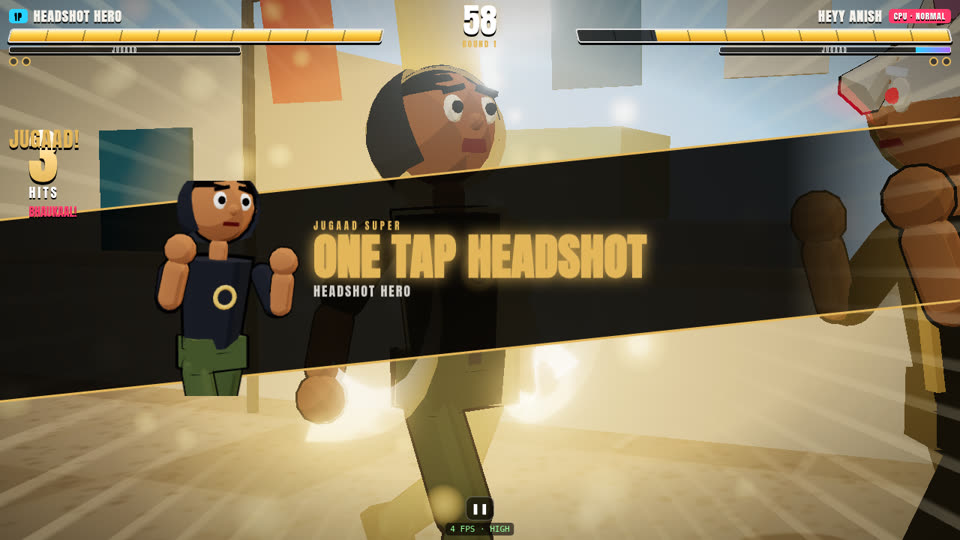
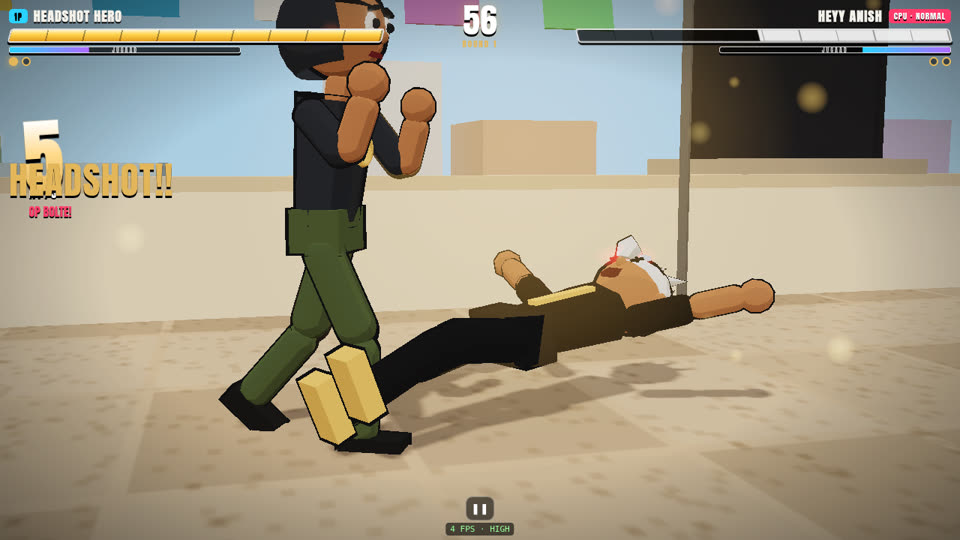
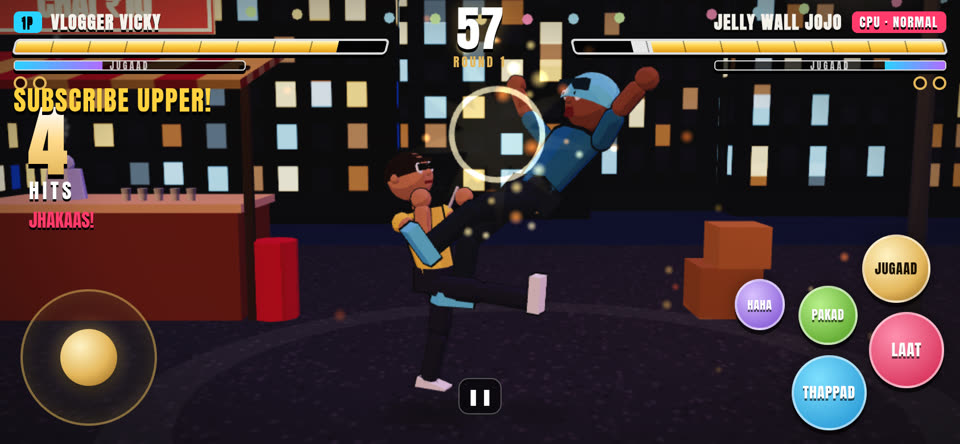

# Nukkad Knockout 3D (v2) 🥊🔥

**Desi meme street-fighting game — ab 3D mein.** Chaiwala vs Dadi vs Streamer, chappal boomerang, Auto Ram, slow-mo K.O. and meme-style SFX. Free, in the browser, phone + PC. By **HEYYANIXX**.

▶ **Play:** https://heyyanixx-fight.sites.tab.bot/  ·  Classic 2D (v1): https://heyyanixx-fight.sites.tab.bot/classic/






---

## Hinglish 🇮🇳

**Kya naya hai v2 mein?**
- Pura game **3D** (Three.js) — 2.5D side-view fighting, low-poly toon fighters (khud ke banaye, koi download kiya hua model nahi), outline + cel shading.
- **3 naye 3D stages:** Chai Tapri Night (string lights, steam, street lamp), Patang Terrace (udti patang, kapde, water tank), Nukkad Junction (railway platform, train guzarti hai!).
- **Dynamic camera:** dono fighters ko follow karta hai, super pe zoom-in, hit pe shake, K.O. pe slow-mo close-up.
- **Effects:** hit sparks, shockwave, trails on specials, super cut-in (naam + portrait), screen flash, confetti, chaos events (gaai, power cut, baarish, patang, lag, chand pe dangal).
- **Pro UI:** animated main menu (peeche CPU vs CPU live fight), 3D character previews, glowing gold buttons (ripple + press animation), health bar drain, combo counter, "ROUND 1 — FIGHT!", K.O. banner, pause menu, settings.
- **Settings:** Graphics Auto/Low/Med/High (FPS 45 se neeche gaya toh auto quality kam), Sound, Music, **Meme SFX**, Vibration, FPS counter.
- **Meme-style SFX:** bass boom, "bruh" voice blip, air horn, record scratch, sad trombone, "EMOTIONAL DAMAGE" pop — sab khud synth kiye hue (WebAudio). Koi asli meme clip / gaana / movie audio use nahi hua (copyright safe).
- **Balance fix:** Streamer Sid ka super bug (7 mein se sirf 1 like lagta tha) fix. Ab NORMAL CPU vs CPU mein saare 9 regular fighters 45–55%, boss HEYY ANISH ~59% (pehle Sid 19%, ANISH 79%).
- Purana 2D game `/classic/` pe abhi bhi khelne ko milta hai.

**Kaise khelein:** Phone landscape mein ghumao. Left stick = chalo/jump/crouch, peeche = block. THAPPAD (punch), LAAT (kick), PAKAD (grab), JUGAAD (super, bar full hone pe), HAHA (taunt).
**Secret boss HEYY ANISH:** CPU ko ek baar haraao, ya ??? tile ko 5 baar tap karo, ya select screen pe `ANISH` type karo.

## English 🌍

**What's new in v2**
- Full **3D renderer** (Three.js, Vite build): 2.5D side-view plane, procedural low-poly toon fighters with ink outlines, 3 lit 3D stages with particles and stage hazards (passing train, cow, power cut, rain, kites).
- **Cinematics:** camera that frames both fighters, punch-in + speed lines + cut-in on supers, hit-shake, slow-motion K.O. close-up, winner shot.
- **Juice:** hit sparks, ground shockwaves, ribbon trails on specials and supers, screen flash, confetti, damage-drain health bars, combo counter, round intro, K.O. banner.
- **Pro UI:** attract-mode main menu, select screen with 3D portraits + live 3D preview, gold-on-black brand (#e3b65a / #060608), ripple buttons, pause + settings.
- **Settings:** quality Auto/Low/Med/High (auto drops a level when FPS stays under 45), SFX, music, Meme SFX, vibration, FPS overlay.
- **Meme-style SFX** — all original WebAudio synth sounds made *in the style of* popular meme sounds. No real meme clips, songs or film audio are included.
- **Balance:** fixed a bug where multi-hit supers (Sid's likes, Goblin's pans) shared one hit-tracker and only landed once; re-tuned damage. NORMAL CPU-vs-CPU over 1,080 seeded matches: regulars 45–55 %, boss ~59 %.
- **PWA / offline** still works (service worker cache bumped to `nukkad-ko-v2-…`, precaches the build).
- v1 kept playable at **/classic/**.

### Controls
| | Keyboard (vs CPU) | 2 Player | Touch |
|---|---|---|---|
| Move / jump / crouch | WASD or arrows | P1 WASD · P2 arrows | left stick |
| Block | hold back | hold back | stick back |
| THAPPAD (punch) | J / Z | F · K/Num1 | THAPPAD |
| LAAT (kick) | K / X | G · L/Num2 | LAAT |
| PAKAD (grab, J+K too) | I / C | H · O/Num3 | PAKAD |
| JUGAAD (super) | L / Space | T · P/Num0 | JUGAAD |
| Taunt | U | R · U/Num4 | HAHA |

Specials: →+THAPPAD rush, →+LAAT flying kick, ↓+LAAT sweep. Combos: P,P,P · P,P,K · K,K · ↓P,K. Pause: Esc/P.

### Develop
```bash
npm install
npm run dev        # local dev server
npm run build      # builds 3D game to site/ and classic 2D to site/classic/
npm test           # 22 tests: game logic, balance, build checks
npm run balance    # CPU vs CPU win-rate table
```

### Project layout
```
index.html, src/main.js     screens, HUD, settings, loop, touch + keyboard
src/game.js fighter.js moves.js ai.js roster.js   game logic (pure JS, unit-tested)
src/r3d/world.js            Three.js renderer, camera director, quality levels
src/r3d/fighterModel.js     procedural toon fighter rig + poses
src/r3d/stages.js           the three 3D stages + chaos props
src/r3d/fx3d.js             particles, trails, impacts, projectiles
src/audio.js                WebAudio SFX, meme-style SFX, music (no audio files)
classic/                    v1 2D game (kept playable)
test/                       node --test suites
```

### Credits & licences
- Code, characters, stages and sounds: original, by HEYYANIXX (built with Tab). MIT licence (see LICENSE).
- [Three.js](https://threejs.org) — MIT.
- Anton font — SIL Open Font License 1.1 (`public/fonts/OFL.txt`).
- All characters are fictional parodies; not affiliated with any real person. CARRY MINTU is a labelled parody archetype. HEYY ANISH is the game's owner.
