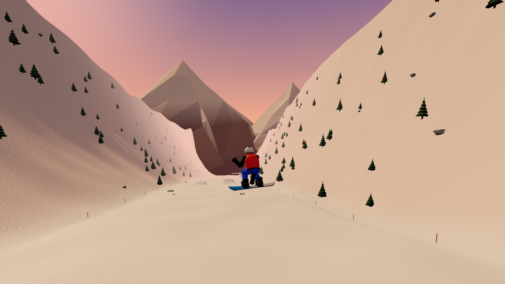
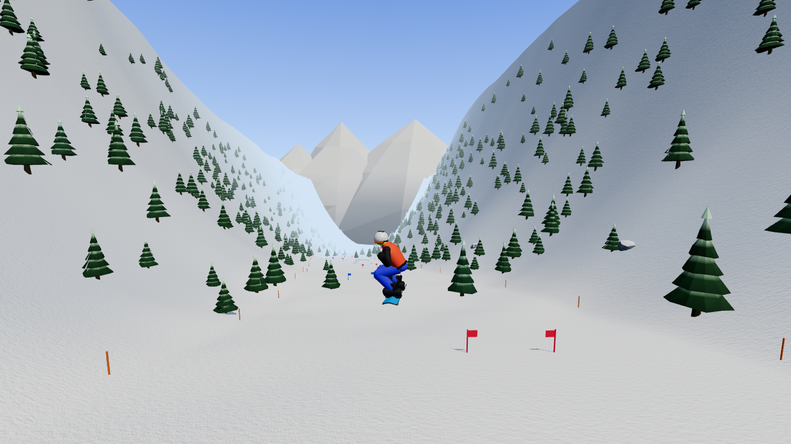
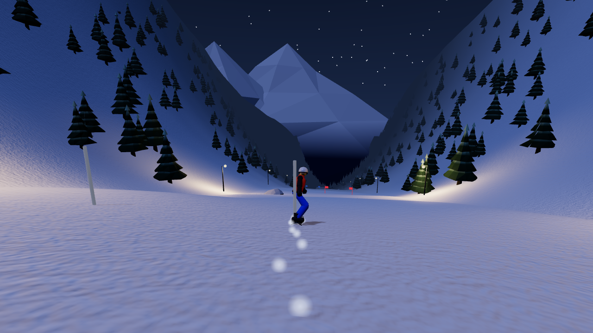
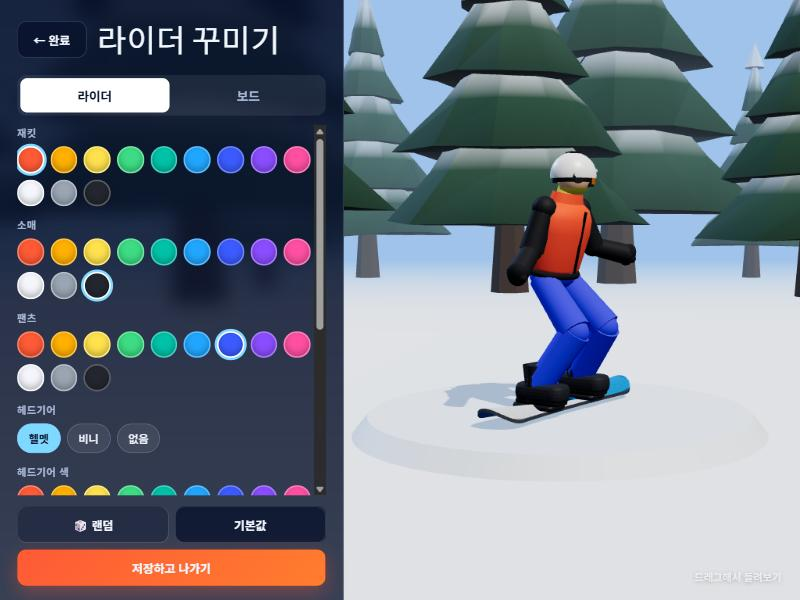
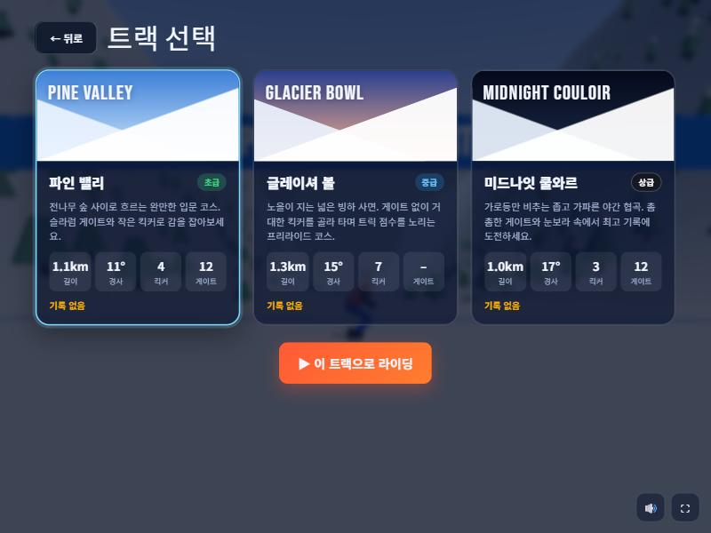

<div align="center">

# 🏂 POWDER LINE

**브라우저에서 바로 즐기는 3D 스노보드 게임**

라이더와 보드를 내 스타일로 꾸미고, 세 개의 설산 트랙을 골라<br/>
카빙 · 킥커 · 스핀 · 플립 · 그랩으로 기록과 점수에 도전하세요.

[](https://jeiel85.github.io/powder-line/)




</div>

---

## ✨ 특징

| | |
|---|---|
| 🏔 **트랙 선택** | 숲길 입문 코스, 노을 진 빙하 사면, 가로등만 비추는 야간 협곡 — 분위기와 난이도가 다른 3개 코스 |
| 🎨 **라이더 꾸미기** | 재킷 · 소매 · 팬츠 · 헤드기어(헬멧/비니/없음) · 고글 렌즈 · 장갑 · 넥워머 색상 |
| 🛹 **보드 꾸미기** | 8가지 그래픽(플레임, 체커, 웨이브, 피크…) × 베이스/포인트 색, 바인딩 색, 레귤러/구피 스탠스 |
| ⚙️ **보드 종류** | 파크(스핀·팝) / 올마운틴(밸런스) / 프리라이드(속도·카빙) — 실제 물리 수치가 달라집니다 |
| 🕹 **쉬움 / 프로 조작** | 쉬움: 탭 한 번에 360° 스핀·플립 완성, 착지 각도·그랩 자동 보정, 즉시 점프 · 프로: 회전·착지·알리 높이를 직접 컨트롤 (기록은 모드별 따로 저장) |
| 🤸 **트릭 시스템** | 180~1080 스핀, 프론트/백플립, 코크, Indy·Method·Mute 그랩, 스위치 착지, 퍼펙트 랜딩, 최대 ×5 콤보 |
| 🚩 **레이스 요소** | 슬라럼 게이트(놓치면 +3초), 체크포인트 리스폰, 트랙별 최고 기록·점수 저장 |
| 📱 **어디서나** | 설치·빌드 없음. 데스크톱 키보드와 모바일 터치 컨트롤 모두 지원 |
| 🔊 **합성 사운드** | 오디오 파일 없이 WebAudio로 바람 · 카빙 · 착지 · 트릭 효과음을 실시간 합성 |

## 🗺 트랙

<table>
<tr>
<td width="33%"></td>
<td width="33%"></td>
<td width="33%"></td>
</tr>
<tr>
<td><b>파인 밸리</b> · 초급<br/><sub>1.1km · 11° · 킥커 4 · 게이트 12<br/>전나무 숲 사이 완만한 입문 코스</sub></td>
<td><b>글레이셔 볼</b> · 중급<br/><sub>1.3km · 15° · 킥커 7 · 게이트 없음<br/>거대한 킥커를 골라 타는 프리라이드</sub></td>
<td><b>미드나잇 쿨와르</b> · 상급<br/><sub>1.0km · 17° · 킥커 3 · 게이트 12<br/>눈보라 속 좁고 가파른 야간 협곡</sub></td>
</tr>
</table>

## 🎨 꾸미기 & 트랙 선택

<p align="center">


</p>

## 🎮 조작법

메인 메뉴에서 **조작 모드**를 고를 수 있습니다. 처음이라면 **쉬움**(기본값)으로 시작하세요.

### 쉬움 모드

| 키 | 지상 | 공중 |
|---|---|---|
| `←` `→` / `A` `D` | 방향 전환 (곧게 가면 자동 가속) | **한 번 누를 때마다 360° 스핀** — 여러 번 누르면 720°, 1080° |
| `↑` `↓` / `W` `S` | `↓` 브레이크 | **한 번 누르면** 프론트플립 / 백플립 |
| `Space` | 바로 점프 | — |
| 자동 | 나무·바위에 부딪히면 넘어지지 않고 튕겨 나가며 감속 | 그랩, 착지 직전 각도 보정 (남은 체공 시간이 모자라면 가장 가까운 착지 각도로 맞춤) · 예약된 회전이 화면 가운데에 표시 |

### 프로 모드

| 키 | 지상 | 공중 |
|---|---|---|
| `←` `→` / `A` `D` | 카빙 회전 | 스핀 |
| `↑` / `W` | 턱(가속) | 프론트플립 |
| `↓` / `S` | 브레이크 | 백플립 |
| `Space` | 누르고 있다 떼면 알리 — 킥커 립에서 떼면 추가 팝 | — |
| `Shift` / `K` | — | 그랩 (스핀 중 Indy · 플립 중 Mute · 그 외 Method) |
| `R` · `C` · `M` · `Esc` | 체크포인트 복귀 · 카메라 전환 · 소리 · 일시정지 | |

> 💡 착지할 때 보드가 진행 방향(또는 정반대 = 스위치)과 맞아야 넘어지지 않습니다. 5초 안에 트릭을 이어가면 콤보 배수가 올라가요.

모바일에서는 화면 하단의 ◀ ▶ ▲ ▼ GRAB JUMP 버튼을 사용합니다.

## 🚀 로컬에서 실행

빌드 단계가 없는 정적 사이트입니다. three.js도 `vendor/`에 들어 있어 외부 CDN 없이 동작합니다. ES 모듈 때문에 `file://`로는 열 수 없으니 아무 정적 서버로 띄우세요.

```bash
git clone https://github.com/jeiel85/powder-line.git
cd powder-line
python -m http.server 8080
# → http://localhost:8080
```

딥링크로 특정 화면을 바로 열 수 있습니다: `?track=glacier`, `?screen=locker|tracks|play`

### 테스트 · 배포

```bash
npm install   # 테스트용 three (devDependency)
npm test      # 헤드리스 물리·트릭 판정 회귀 테스트
```

- `main`에 푸시하면 GitHub Actions가 테스트를 돌린 뒤 Pages로 배포합니다. 이때 `index.html`의 `__BUILD__`가 커밋 SHA로 바뀌어 브라우저 캐시가 무효화됩니다.
- `src/`에 모듈을 추가하면 `index.html` importmap에도 등록하세요(테스트가 검사합니다).
- three.js 버전을 올릴 때는 `package.json`을 바꾼 뒤 `npm install && npm run vendor`.

## 🧩 구조

```
index.html          화면 마크업(메뉴·HUD·모달) + importmap(캐시 무효화 버전 포함)
style.css           UI 스타일 (글래스모피즘, 반응형, 터치 패드)
src/
├─ main.js          화면 전환, 기록 저장, 꾸미기 UI, 메인 루프
├─ game.js          라이더 물리(카빙·에지 그립·공기저항), 트릭 판정, 카메라, HUD
├─ tracks.js        트랙 정의 → 높이 함수·킥커·게이트·나무·충돌 버킷 생성
├─ world.js         지형 메쉬, 인스턴싱 숲/바위, 하늘 셰이더, 원경 산, 눈/스프레이 파티클
├─ rider.js         프리미티브 + 2본 IK로 만든 스노보더와 보드 메쉬
├─ customize.js     꾸미기 옵션·보드 종류 스탯·보드 그래픽 캔버스 페인터
├─ locker.js        꾸미기 화면 3D 미리보기
├─ audio.js         WebAudio 합성 사운드
└─ input.js         키보드/터치 입력 (짧은 탭 래치)
vendor/             three.js r160 (CDN 대신 함께 배포)
tests/              Node 헤드리스 회귀 테스트
.github/workflows/  CI(테스트) · Pages 배포
```

**기술 포인트**

- **절차적 지형** — 시드 기반 value noise + 사인 합 중심선으로 코스가 휘어지고, 코스 밖은 둔덕이 솟아 자연스러운 경계가 됩니다. 격자는 중심선을 따라 휘며 코스 안쪽만 촘촘합니다.
- **스노보드 물리** — 지면 접선 평면으로 중력을 투영하고, 보드 방향 성분은 살리고 횡방향 성분은 에지 그립으로 줄여 카빙을 표현합니다. 킥커 립은 지형 대비 상대 수직 속도로 이륙을 판정합니다.
- **트릭 판정** — 공중 스핀·플립 각도를 누적해 착지 시 진행 방향과의 오차로 성공/실패와 스위치 여부를 판정하고, 회전을 보드 yaw에 합쳐 시각적으로 끊김 없이 이어갑니다.
- **경량 렌더링** — 나무·바위는 `InstancedMesh`, 그림자는 라이더를 따라다니는 좁은 프러스텀, 야간 가로등은 가까운 6개에만 실제 광원을 붙입니다.
- **적응형 품질** — 실제 FPS를 2초 단위로 재서 40fps 아래면 렌더 해상도를 낮추고 여유가 생기면 되돌립니다. GPU 컨텍스트가 끊겨도 일시정지 후 자동 복구합니다.
- **접근성** — 슬라럼 게이트는 색뿐 아니라 모양으로도 구분됩니다(통과 = 폴 위 고리, 놓침 = 깃발 사라짐).

## 💾 저장 데이터

꾸미기 설정, 선택한 트랙, 트랙별 최고 기록은 브라우저 `localStorage`에만 저장됩니다. 서버로 전송되는 데이터는 없습니다.

## 📄 라이선스

[MIT](LICENSE)
