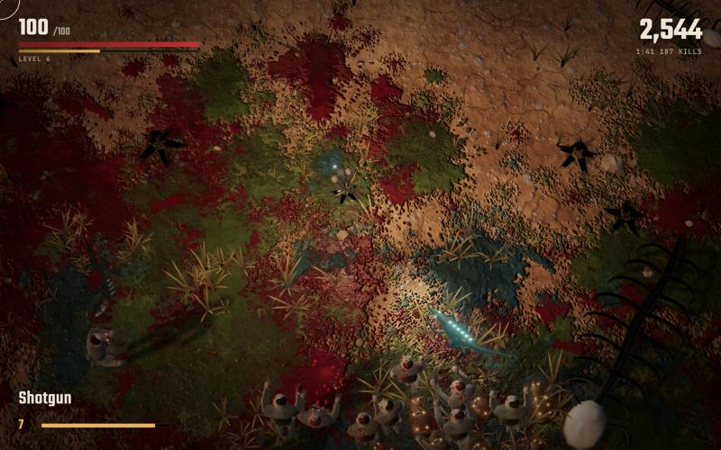

# Crimsonland

**[Play it in your browser](https://lorsabyan.github.io/crimsonland/)**

An unofficial, open source web version of the top-down horde shooter, built on three.js with WebGPU
and a WebGL2 fallback. All art and sound are generated at load time, so there are no asset files.



## Run it locally

```bash
npm install
npm run dev
```

Every push to `main` builds the game and deploys it to GitHub Pages (`.github/workflows/deploy.yml`).

## Controls

| Input | Action |
|---|---|
| WASD or arrows | Move |
| Mouse | Aim |
| Left click (hold) | Fire |
| R | Reload |
| E or Space | Open perk choice when one is ready |
| 1 to 6 | Pick a perk card |
| Q or right click | Swap weapons (needs the Second Holster perk) |
| Esc or P | Pause |

Gamepads work (left stick, right stick to aim and fire). Phones get twin virtual sticks.

## Modes

- **Survival**: endless escalating horde, weapon drops, perks, a boss every four minutes.
- **Rush**: one rifle, no perks, no drops, score by kills.
- **Missions**: 20 scripted arenas across four terrains. Each one unlocks the next, and later tiers start you with free perks.
- **Type to Kill**: stand still, type the word over a creature to kill it. Keyboard only.

## Progression

A new profile starts with 4 weapons and 22 perks. Clearing a mission for the first time unlocks more
in every mode, up to all 20 weapons and 51 perks. The Armory screen shows what you have and which
mission earns the rest. Options has an "Unlock everything" switch if you would rather skip that.

## URL flags

`?debug` tuning GUI, `?webgl` force WebGL2, `?quality=high|medium|low`, `?mute`,
`?autoplay` (a perfect-aim bot plays a real run; combine with `?mode=survival|rush` and `?biome=dust|moss|ash|frost`),
`?autoplay=human` (the same, with reaction lag and aim error).

## Testing

Open `http://localhost:5173/?selftest&mute` on the dev server. It runs behaviour tests for every perk,
drop, weapon and creature in the real game and prints the result to the console (`window.__selftest`).
The tests live in `src/dev/selftest.js` and are not included in production builds.

## Balance

Difficulty is tuned against `?autoplay=human`, not the perfect bot, which makes everything look easy.
That model survives Survival for a median of about 2:40 on a new profile and 3:05 with everything unlocked. Simulated typists last about 1:40 at 35 wpm,
2:40 at 50 wpm and 3:35 at 70 wpm. These are simulations, so expect real players to differ.

## Layout

- `src/data`: weapons, enemies, perks, bonuses, missions and biomes. Most balance changes live here.
- `src/game`: simulation (player, horde AI, projectiles, drops, wave director).
- `src/gfx`: rendering (crowd shader, procedural creatures, the persistent ground layer, scenery, particles).
  Creatures are posed by a small skeleton in the vertex shader: each part names its joints in `rig.js`, and
  `creatures.js` sets how each body walks, lunges and falls.
- `src/ui`: HUD and menus.

Stack decisions are recorded in `3d-stack.md`.

## Credits and license

This is a fan project. It is not affiliated with or endorsed by 10tons, who made the original
Crimsonland. The gameplay follows the original's formula, but the code, models, textures, icons and
sound here are all new.

The code is under the [MIT license](LICENSE), which grants no rights to the Crimsonland name. Built
with [three.js](https://threejs.org) and [lil-gui](https://lil-gui.georgealways.com) (both MIT). The
bundled Teko and JetBrains Mono fonts are under the SIL Open Font License.
