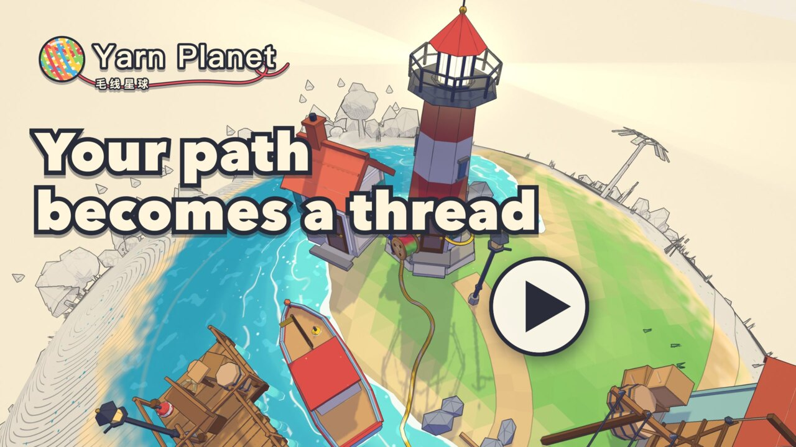

# 毛线星球 · Yarn Planet

[](https://yarn.ynot.games/)
[](LICENSE)
[](docs/making-of.en.md)

**Your path becomes a thread.** A small-planet walking game in the browser: carry a big spool across a
pencil-sketch planet, plug the thread into whatever needs it, and watch color flood back.

**你走过的每一步，都会变成星球上的一根彩线。** 一个在浏览器里玩的小星球散步游戏。

[](https://www.youtube.com/watch?v=EATwc16lWoM)

▶ **Trailer (27 s):** [YouTube](https://www.youtube.com/watch?v=EATwc16lWoM) · [Bilibili 中文版](https://www.bilibili.com/video/BV1xnJo69EHs/) · [1080p downloads](https://github.com/makerjackie/yarn-planet/releases/tag/v1.0.0)
&nbsp;&nbsp;🎮 **Play:** https://yarn.ynot.games/ (desktop and phone, no install)

📝 **Making of, plus a prompt to build your own planet:** [中文长文](docs/making-of.md) · [English article](docs/making-of.en.md)

## About · 简介

You carry a spool bigger than your head across a tiny planet drawn like an unfinished pencil sketch.
The thread lays down along the path you actually walk. Run power from the generator to the lighthouse,
water from the hilltop spring to the waterwheel, a string of lights down the old street. The moment a
thread connects, color spreads from that spot like watercolor and the town wakes up.

You may meet other players and wave with a few preset greetings. When you finish chapter 1, your walk
stays on the planet as one colored thread, and the night-time title screen shows everyone's threads
wrapped around the planet together.

背着比头还大的线轴，在一颗铅笔速写的小星球上散步，线会铺在你实际走过的路上。把电牵到灯塔、把泉水牵到水车、在老街拉一串灯，
接通的那一刻，颜色就从那里像水彩一样晕开，小镇也跟着醒过来。路上可能遇到别的玩家，可以用预设短句打招呼。
走完第一章，你走过的路会作为一根彩线留在星球上；夜晚的标题画面里，是所有人留下的线。

- **Chapter 1:** 3 districts (harbor, workshop hill, old street) and a great tree, 9 threads to connect
- **Languages:** 简体中文 · 繁體中文 · English · 日本語 · 한국어
- **Saves:** progress stays in your browser; no account
- **Everything is code:** every model, character, animation, shader and sound is generated in code;
  there are no imported art or audio files

## How to play · 怎么玩

| Keyboard / mouse | Phone | Action |
|---|---|---|
| `W` `A` `S` `D` / arrow keys | joystick | Walk 走动 |
| `Shift` | | Run 快跑 |
| `Space` | jump button | Jump 跳跃 |
| `E` | action button | Talk, pick up a thread, connect 交谈 · 拿起线头 · 接上 |
| `R` | reel button | Reel the thread back in 收线 |
| Drag / wheel | drag | Look around, zoom 转动视角 · 拉近拉远 |
| `J` | | Connections journal 连接手册 |
| `Esc` | | Settings, close a window 设置 · 关闭窗口 |

Pick up a thread at a glowing source socket, walk it to the socket that needs it, and press `E`. The
spool holds only so much thread: when it pulls tight, reel in and take a shorter way.

## About the trailer · 关于宣传片

The thread-wrapped night planet at the start and end of the trailer is rendered from **simulated**
routes, to show what the planet becomes after many players. Everything else is captured from the real
game, including four real game clients greeting each other through a local copy of the online server. The title screen in
the live game only shows threads that real players left.

宣传片开头和结尾那颗缠满彩线的星球，是用模拟路线渲染的效果；其余画面都是游戏实录。线上游戏的标题画面只显示真实玩家留下的线。

## How it was made · 制作方式

- The game was built with AI. Claude Opus 5.5 (in Claude Code) did most of the planning, coding and
  integration; five Claude Sonnet 5.5 subagents wrote modules of the first version in parallel; DeepSeek
  handled a few small follow-ups. A person (Maker Jackie) set the direction, playtested and gave feedback.
- The first playable version took one evening (about 3.6 hours). Online play, polish and the trailer
  added up to about 11 hours over 5 days.
- Rendering uses [three.js](https://threejs.org/): toon shading with ink outlines, plus "revival" waves
  that turn the paper sketch into color. Online features run on a Cloudflare Worker with one Durable
  Object class (`worker/index.ts`).
- The trailer is captured from the game with a virtual clock (one exact frame per screenshot) and cut
  with ffmpeg. See [scripts/promo/README.md](scripts/promo/README.md).
- Development happened in a private repository; this public repository starts from a cleaned snapshot.

The full story is in the [making-of article](docs/making-of.en.md) ([中文](docs/making-of.md)). It ends with
the prompt we would give an AI coding tool to make a small planet of your own, and what we learned.

## Run it

```bash
npm ci
npm run dev        # http://127.0.0.1:4173
npm test
npm run build      # type-check + production bundle in dist/
```

Online play needs the Worker. Run `npx wrangler dev` and open the game with
`?online=http://127.0.0.1:8787`. To deploy your own copy, change `name` and `routes` in
`wrangler.jsonc`, then run `npm run deploy`.

## Code map

| Path | What |
|---|---|
| `src/main.ts` | Wiring: loop, input, camera, chapter director, online |
| `src/chapter/` | Chapter data (ids, coordinates, copy) and the director |
| `src/physics.ts`, `src/sphere.ts`, `src/camera.ts`, `src/player.ts` | Capsule physics on a sphere, transported headings, collision-aware follow camera |
| `src/world/`, `src/character/`, `src/residents/` | The planet, buildings, props and characters, all built from primitives |
| `src/thread/` | The thread you lay: path recording, sag and tension, cord mesh, sockets |
| `src/art/`, `src/render.ts`, `src/sky.ts`, `src/fx/` | Toon materials, outlines, paper-to-color revival, sky, effects |
| `src/audio/` | Synthesized sound and character babble (Web Audio) |
| `src/net/`, `worker/` | Presence, greetings and stored walks (client and Worker) |
| `src/ui*`, `src/locales/` | Interface and the five languages |
| `tests/` | Unit tests (`npm test`), plus the nav grid used by the keyboard-only playtest |
| `scripts/` | Screenshots (`shot.mjs`), keyboard-only playtest, deployment check, trailer pipeline |
| `docs/DESIGN.md` | Design document (Chinese): pillars, palette, map, chapter flow, cast |

## Online play and privacy

- **Presence:** while you play, the game shares your position and facing with the other players in
  your room (up to 24 per room). It does not send a name or account.
- **Greetings:** only preset greeting ids travel; there is no free-text chat.
- **Stored walks:** a finished walk is uploaded as quantized points on the planet's surface.
- **Rate limit:** uploads are limited per day by a salted hash of the IP address. That counter is
  deleted after about two days.

## License

The code is released under the [MIT License](LICENSE). Third-party code and its licenses are listed in
[THIRD_PARTY_NOTICES.md](THIRD_PARTY_NOTICES.md). The trailer's music (“Carefree” by Kevin MacLeod,
CC BY 4.0) is not part of this repository.

The MIT license covers the code. It does not grant use of the names “Yarn Planet”, “毛线星球” or
“Maker Jackie” as a brand. If you publish a modified version, please give it your own name.

Inspired by small-planet games such as [Messenger](https://messenger.abeto.co/) by abeto. This
project contains no assets or code from that game.

Made by **Maker Jackie**（全网同名 · X [@maker_jackie](https://x.com/maker_jackie)）.
