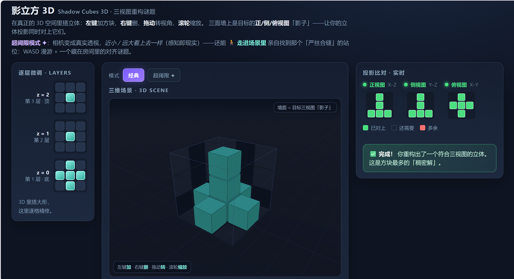
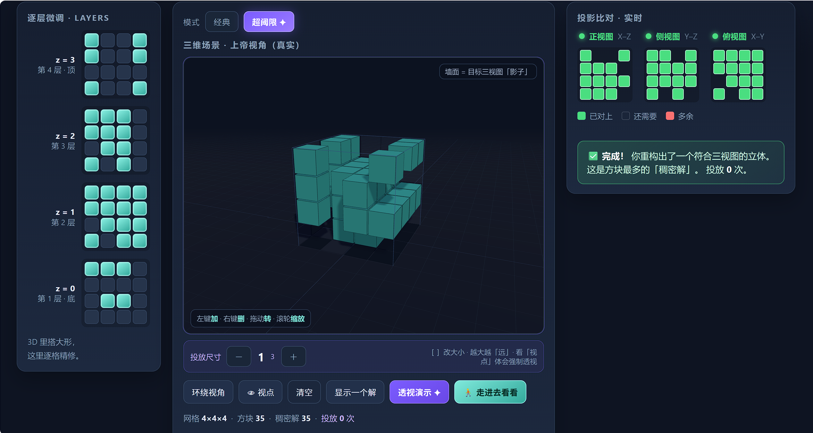
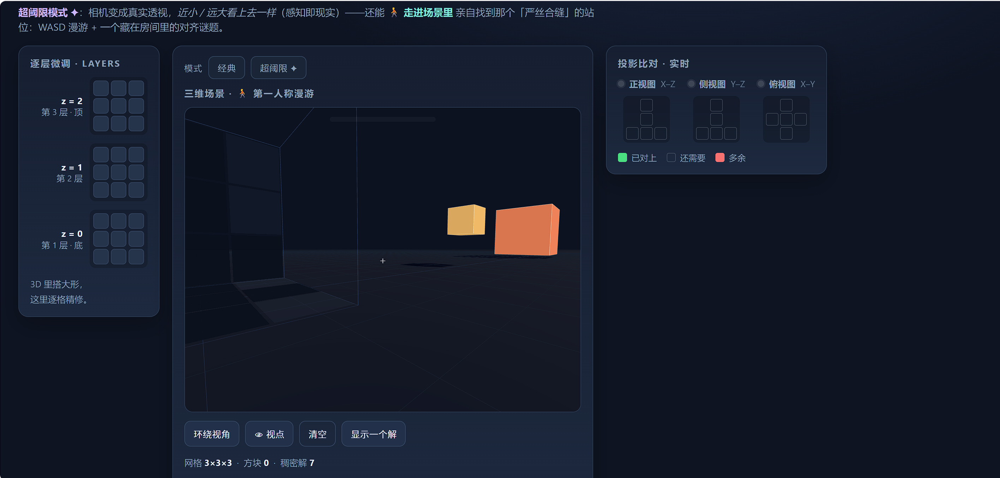

# 影立方 3D · 三视图重构谜题

一个用 Three.js 写的浏览器解谜小游戏：给你三视图（正视 / 俯视 / 侧视），你在 3D 网格里把方块摆回去，让三个方向的投影同时对上。

> 关键玩法不止于"还原"——内置一个 **超阈限模式 ✦**：相机切换到真实透视，把 *近小 / 远大* 看上去一样大，让你用第一人称走进场景，亲身找到那个「严丝合缝」的站位。

---

## 截图

### 经典模式 — 三视图重构


### 超阈限模式 ✦ — 真实透视下的"近小远大"


### 第一人称 — 走进房间寻找严丝合缝的站位


---

## 玩法

### 经典模式
- 屏幕右侧给出**正视图 / 俯视图 / 侧视图**三张目标投影
- 在 3D 网格里左键添加 / 右键删除方块（支持分层编辑器微调）
- 让三个方向投影同时匹配 → 过关
- **12 个渐进关卡**：入门（十字塔、字母F、舒适王座）、进阶（拱门、空心回字框、角锥阶梯、悬空双天桥、螺旋旋转柱、彭罗斯错觉回廊）、挑战（角隅幽灵、三向对称星、极简几何幻影）
- **撤销 / 重做**：支持 `Ctrl+Z` / `Ctrl+Y` 与界面快捷按键，操作失误可随时回溯
- **纯原生 Web Audio 音效**：放置木质敲击音、删除低音、清空扫风音、过关和弦升调与超阈限对齐泛音
- **通关庆贺与战报**：3D 彩色粒子烟花雨，实时记录用时与步数
- **关卡创作与分享**：支持将当前空间立体压缩编码为 URL，一键复制链接与朋友对决，或导入自定义关卡
- 工具：`↩ 撤销` / `↪ 重做` / `显示一个解` / `清空` / `下一关` / `📤 分享谜题` / `📥 导入`

### 超阈限模式 ✦
- 相机变成**真实透视投影**
- 远处的大方块和近处的小方块在画面上"看上去一样大"
- 点击 `🚶 走进去看看` 进入第一人称漫游
- 在房间里找到那个唯一让远近方块严丝合缝重叠的站位
- 这是一个关于 **感知 vs 几何** 的小哲学实验

---

## 操作

| 操作 | 经典 / 超阈限 | 第一人称 |
|------|------|------|
| 左键 | 添加方块 | 锁定视角（点击画面） |
| 右键 / 长按 | 删除方块 | — |
| 鼠标拖拽 | 旋转视角 | 转头（指针锁定后） |
| 滚轮 | 缩放 | — |
| W / S | — | 前进 / 后退 |
| A / D | — | 左移 / 右移 |
| Space / Shift | — | 上升 / 下降 |
| Esc | — | 退出指针锁定 |

---

## 一键启动

为了让浏览器正常加载 ES Module，**不能**直接双击 HTML 用 `file://` 打开。仓库提供了启动脚本：

```
双击 启动.bat
```

脚本会自动：
1. 检测系统的 Python 或 Node.js
2. 在本目录启动一个本地 HTTP 服务器（默认端口 8000）
3. 用默认浏览器打开页面

如果两者都没装，会提示去安装。

> 也可手动起服务器：
> - Python：`python -m http.server 8000`
> - Node：`npx serve -l 8000 .`
> 然后访问 `http://localhost:8000/shadow-cubes-3d.html`

---

## 技术

- **Three.js** (ES Module via importmap，CDN)
- 单文件 `shadow-cubes-3d.html`，无构建步骤
- 自带本地 `lib/` 目录作为离线兜底
- 投影匹配算法：枚举每个体素对三个轴向的投影占用做布尔比对
- 超阈限模式：动态切换 `PerspectiveCamera` FOV + 摄像机位姿求解，让两组方块在透视下投影重合

---

## 文件结构

```
.
├── shadow-cubes-3d.html      # 主游戏文件
├── 启动.bat                   # 一键启动脚本（Windows）
├── lib/                       # Three.js 本地副本（离线兜底）
├── docs/
│   └── screenshots/           # 截图
└── README.md
```

---

## 许可

MIT
