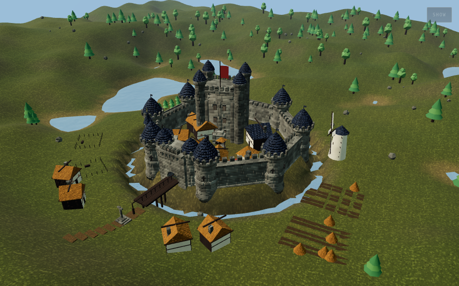
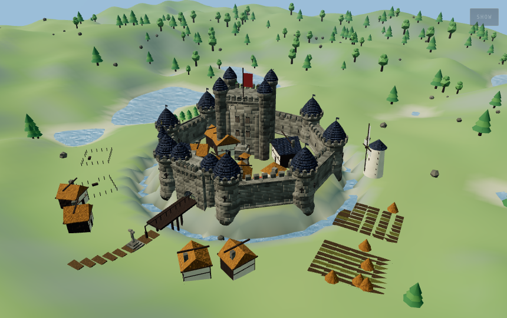
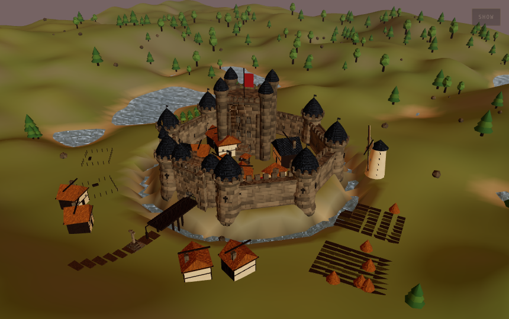
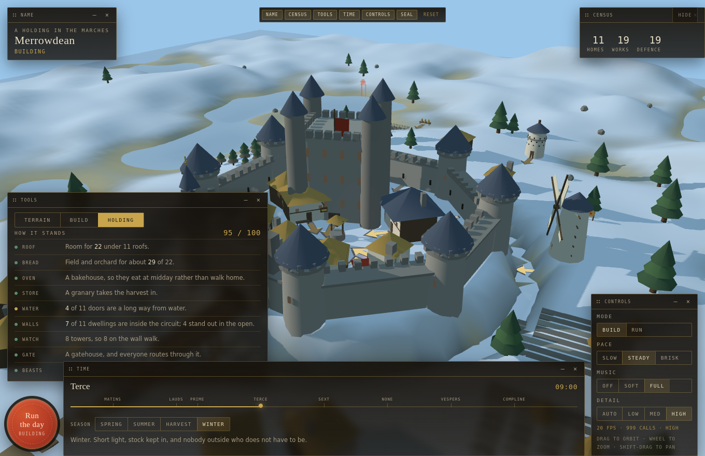
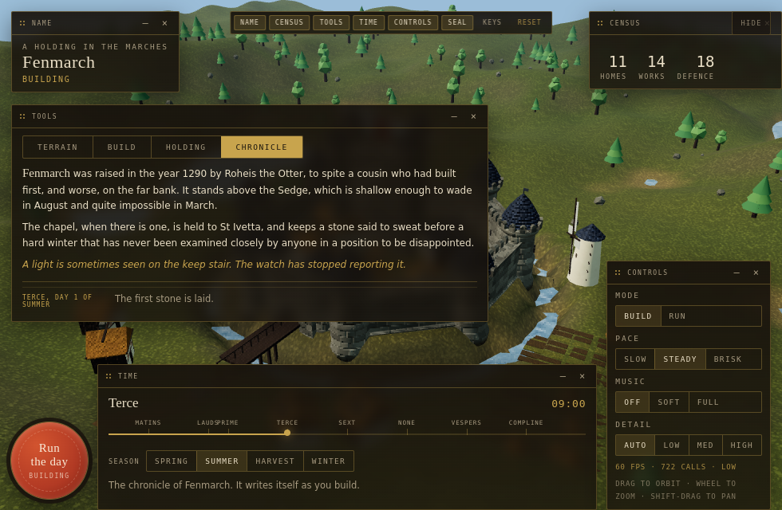

# Castellan

**Cut the ground, raise a castle, then run a day through it and see whether anyone can actually live in it.**

A castle builder and settlement simulation that runs in one HTML file. No assets, no build
step for the player, no dependencies beyond three.js from a CDN. Every texture is painted
onto a canvas at boot, every stone is turned or extruded from a drawn profile, the music is
synthesised from oscillators, and the holding's history is generated from the name you give it.



---

## Play it

**In a browser, from GitHub Pages.** The repository root carries a built `index.html`, so
turning Pages on publishes a playable build with no configuration — see
[Publishing](#publishing) below.

**From a file.** Open `index.html`, or the identical `dist/castellan.html`, in any browser.
That is the whole game.

> Clicking the `.html` file on github.com shows you the source, not the game — GitHub serves
> repository files as text. Use Pages, or a raw HTML proxy such as `raw.githack.com`.

To run it from a server instead — which you will want if you are editing it, because ES
modules will not load over `file://`:

```bash
npm start          # builds, then serves on http://localhost:8080
```

There is nothing to install. `npm start` runs two Node scripts with no dependencies.

---

## What it is

Two modes, and a workbench with four tabs.

**Build.** Generate a valley from a seed, then cut it by hand with raise, lower, flatten and
smooth brushes. Adjust the relief, the water line, and whether the site sits on a mount with
a wet ditch round it. Then place from a palette of thirty-odd pieces: curtain wall, towers, a
gatehouse, a keep, cottages, a hall, a tavern, a chapel, a mill, a smithy, a bakehouse, a
granary, a dovecote, beehives, a jetty, archery butts, a herb garden, a beacon, fields,
orchards, pens, bridges, paths, fences. Arrows on the ground show which way every door faces
and which side of a wall carries the parapet.

**Run.** The population is derived from what you actually built. Cottages house two apiece.
Fields make ploughmen, stalls make traders, a chapel makes monks, a pen makes a shepherd and
a flock, towers put the watch on the walls. Everyone follows the canonical hours — out at
Prime, at the well or the bakehouse at Sext, the tavern after Vespers, indoors by Compline.
Nobody walks on water and nobody walks through walls: if a straight line crosses one of your
curtain walls they route through the nearest gatehouse, and if you built a moat with no
bridge they will mill about on the bank, which is the honest consequence.

**Holding.** Eleven measures of whether the place works, each with a plain verdict. The
interesting one casts three rays from every door and counts crossings against your wall
segments — treating each gatehouse as closing the gap it stands in — to tell you how many
dwellings are genuinely inside the circuit.

**Chronicle.** The founding legend, derived from a hash of the holding's name, so the same
name always yields the same founder, river, patron saint, relic and superstition. It then
writes itself as you build and as the days and seasons turn.

| | |
|---|---|
|  |  |
|  |  |

---

## How it works

A handful of things here are more interesting than the usual low-poly castle demo.

**Nothing is loaded.** Seven surfaces — coursed ashlar, limewash, wood grain, roof tile,
thatch, earth, cloth — are drawn onto canvases at startup, with albedo in RGB and **height
packed into the alpha channel**. They are then mapped **triplanar in world space** through a
shader patched into `MeshStandardMaterial`, so one course of masonry runs at the same scale
across a tower, a curtain wall and a twenty-metre keep with no UVs authored anywhere, and the
joints line up where pieces meet. The height channel drives a derivative-based bump, which is
where the relief in the stone comes from.

**The architecture is turned, not boxed.** Towers come off a fifteen-point lathe profile:
plinth, batter, string course, corbel table under the parapet, ogee cap. Walls are an
extruded cross-section that leans inward as it rises. Gatehouses have a real arch cut through
the mass with a `Shape` and a hole. The keep is a battered block built from a four-segment
cylinder with a per-vertex taper.

**The sky is a shader, and it lights the scene.** Gradient, sun disc with layered falloff, a
scrolling fbm cloud deck projected onto a ceiling, stars arriving with the dark. That same
sky is rendered small into a PMREM environment map on a timer, so every surface has something
to reflect.

**The terrain is analytic plus an edit layer.** Height is a seeded fbm field with a ridge
octave, plus a hand-cut layer stored per grid cell. Both the mesh and every agent read the
same `ground(x, z)`, so nothing can disagree about where the ground is. Sculpting writes into
the edit layer, updates only the affected patch of vertices with analytic normals, and rebuilds
every placed piece when the stroke ends so nothing is left floating.

**The simulation is a real ECS.** `EntityManager`, `ComponentManager`, `System` with cached
queries, and a `World` that runs thirteen systems in order each frame. Villagers, the watch,
beasts, crows and the cart are entities with components; the clock is a singleton component
that is a live view of the interface's own state.

**Everything repeated is instanced.** Merlons, arrow slits, fence and pen posts, bridge piles,
field furrows, orchard trees and the entire forest — around 2,600 trees at high detail — are
`InstancedMesh`. The standard plan renders in roughly 500 draw calls, down from 1,162 before
instancing.

**The music is synthesised.** A bagpipe drone from detuned sawtooths, a plucked psaltery built
with Karplus-Strong, a recorder, and a tabor from filtered noise. Phrases are generated over
eight eighth-notes with alternating *ouvert* and *clos* endings, in the estampie manner. The
season chooses the mode — Dorian, Mixolydian, Aeolian, Phrygian — and the hour chooses the
tempo and which instruments play. It is off unless you ask for it.

More detail in [docs/ARCHITECTURE.md](docs/ARCHITECTURE.md).

---

## Controls

Press <kbd>?</kbd> in the game for the full list, or read
[docs/CONTROLS.md](docs/CONTROLS.md).

The short version: **left mouse uses the tool**, right-drag or shift-drag orbits, middle-drag
or alt-drag pans, wheel zooms. <kbd>W</kbd><kbd>A</kbd><kbd>S</kbd><kbd>D</kbd> pans and
<kbd>Q</kbd><kbd>E</kbd> turns. <kbd>1</kbd>–<kbd>9</kbd> picks a tool, <kbd>Z</kbd> undoes,
<kbd>H</kbd> hides the panels, <kbd>P</kbd> is photo mode, <kbd>R</kbd> rings the bell.

---

## Repository layout

```
castellan/
├── build.mjs              concatenates src/js into src/shell.html
├── serve.mjs              a static server with no dependencies
├── src/
│   ├── shell.html         document, styles, HUD markup, three.js loader
│   └── js/                28 ordered fragments of one closure
├── index.html             the build, served at the root by GitHub Pages
├── dist/castellan.html    the same build, named for downloading
└── docs/
    ├── ARCHITECTURE.md
    ├── CONTROLS.md
    └── screenshots/
```

### A note on the "modules"

The files in `src/js` are **not** ES modules. The game is a single closure with one shared
scope, and the fragments are ordered slices of it — which is why `build.mjs` simply
concatenates them in filename order. That is a deliberate trade: it keeps the shipped artifact
a single file with no bundler, at the cost of not being able to reorder the fragments freely.
The numeric prefixes are load-bearing. If you add a fragment, its number decides when it runs.

```bash
npm run build     # → dist/castellan.html and docs/index.html
npm run check     # build, then verify braces balance and the closure closes
```

---

## Publishing

`index.html` at the repository root is written by the build, so:

**Settings → Pages → Source: Deploy from a branch → Branch: `main`, folder: `/ (root)`**

That is the whole setup. The game will be live at
`https://<user>.github.io/<repo>/` within a minute or two. A `.nojekyll` file is included so
Pages serves the tree as-is rather than running it through Jekyll.

CI builds the bundle on every push and fails if `index.html` or `dist/` has drifted from
`src/` — commit the build output along with your changes.

---

## Browser support

WebGL2 and ES modules, so any current Chrome, Edge, Firefox or Safari. three.js loads from
cdnjs as an ES module, with a fallback to the last UMD release if importmaps are blocked.
Quality auto-detects from cores, memory, pointer type and the WebGL renderer string, and
steps down on its own if the frame rate sags; you can override it under **Detail**.

On Windows the Direct3D shader compiler emits harmless `X4122` constant-folding warnings
about three.js's own depth-packing constants. Shader checking stays on for the first six
frames — long enough to catch a genuine failure — and then goes quiet.

---

## Licence

MIT. See [LICENSE](LICENSE).

three.js is loaded from a CDN and is MIT licensed, copyright the three.js authors.
Everything else here — geometry, textures, shaders, music and text — is generated by the
code in this repository.
