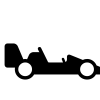

<p align="center">
  
</p>

# Drift Shift

[](https://github.com/remarkablegames/drift-shift/releases)
[](https://github.com/remarkablegames/drift-shift/actions/workflows/build.yml)

🏎️ Drift, shift, drive.

Play in your browser:

- [remarkablegames](https://remarkablegames.org/drift-shift/)

Or download for desktop:

- [Windows](https://github.com/remarkablegames/drift-shift/releases/latest/download/windows.zip)
- [macOS](https://github.com/remarkablegames/drift-shift/releases/latest/download/macos.zip)
- [Linux](https://github.com/remarkablegames/drift-shift/releases/latest/download/linux.zip)

## Prerequisites

[nvm](https://github.com/nvm-sh/nvm#installing-and-updating):

```sh
brew install nvm
```

## Install

Clone the repository:

```sh
git clone https://github.com/remarkablegames/drift-shift.git
cd drift-shift
```

Install the dependencies:

```sh
npm install
```

## Available Scripts

In the project directory, you can run:

### `npm start`

Runs the game in development mode.

Open [http://localhost:5173](http://localhost:5173) to view it in the browser.

The page will reload if you make edits.

You will also see any errors in the console.

### `npm run build`

Builds the game for production to the `dist` folder.

It correctly bundles in production mode and optimizes the build for the best performance.

The build is minified and the filenames include the hashes.

Your game is ready to be deployed!

### `npm run bundle`

Builds the game and compresses the contents into a ZIP archive in the `dist` folder.

Your game can be uploaded to your server, [itch.io](https://itch.io/), etc.

## License

[MIT](LICENSE)
