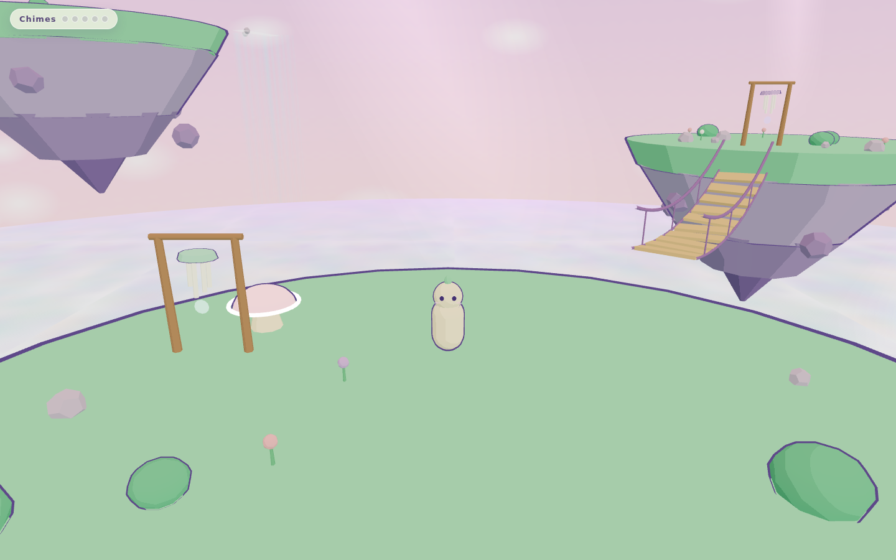
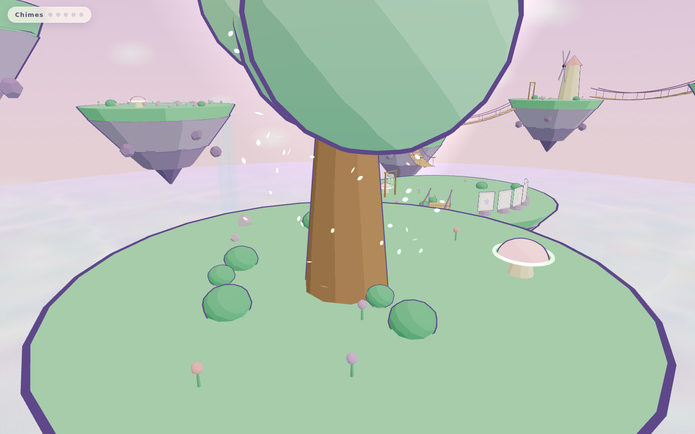
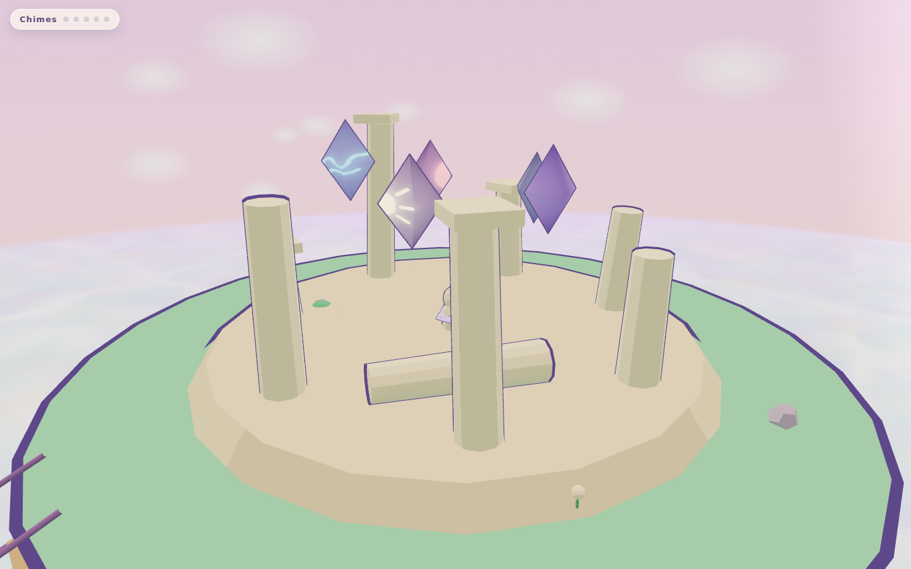
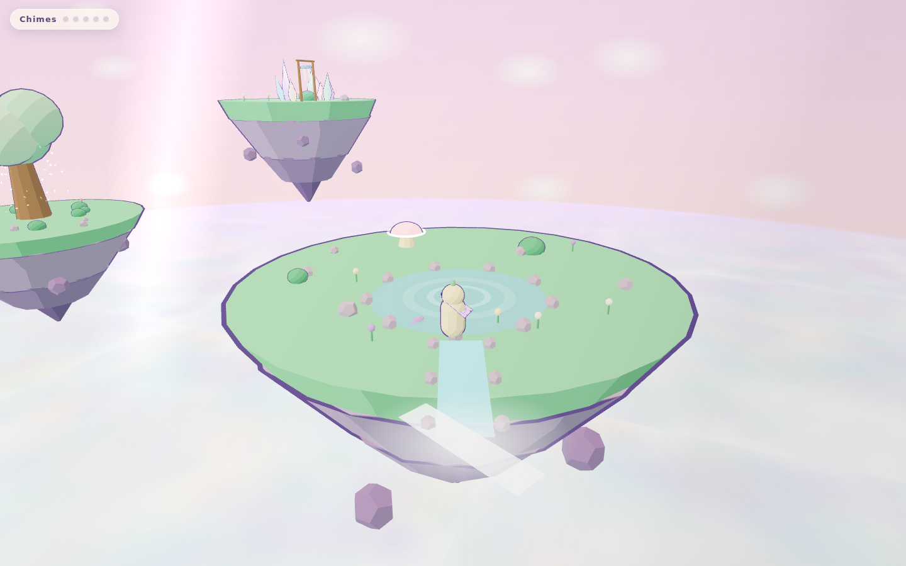

# Sky Isles ☁️🏝️

A complete, dreamlike **floating-islands browser game** built with Three.js — 9 grass-topped sky islands at different altitudes, rope bridges, jump pads, an ancient glowing tree, hidden temples, and an endless animated cloud sea below.

**▶ Play it live:** https://sky-isles.bles-software.com

**More to explore:** [20 full-screen UI concepts](https://www.bles-software.com/inspiration/ui-systems/?utm_source=bles-demo&utm_medium=github-sky-isles&utm_campaign=demo-exit) from Bles Software, the team behind this repo. Free to browse and download, no sign-up.



## Why this repo matters

This is not a demo scene — it's a **full, playable game** with movement physics, collectibles, puzzles, touch controls, and a real test suite. And it's **MIT licensed**: fork it, reskin it, ship it, monetize it. Ad-wrap it, sell skins, turn it into a client deliverable — the license says yes.

Built 100% by an AI agent (Kimi K3 via the Teleclaudious autonomous stack): world generation, shading, gameplay, QA tests, deploy, and this repo.

## Features

- **9 floating islands** at different altitudes, connected by rope bridges and jump pads
- **Third-person controller** with double-jump and a glide cape (hold jump mid-air)
- **Toon shading + outline pass**, god-rays through drifting cloud wisps
- **Soft pastel palette** — mint, lavender, cream
- **Collectibles & puzzles**: shell/star collecting, ancient tree, hidden temple, koi waterfall
- **Full touch support** — virtual joystick with deadzone, camera drag, mobile-tested
- **Zero binary assets** — geometry, textures and effects generated procedurally in code
- **Real QA**: unit tests + Playwright browser tests on desktop and mobile viewports

## Controls

| Input | Desktop | Mobile |
|---|---|---|
| Move | WASD / arrows | Virtual joystick |
| Camera | Mouse drag | Touch drag |
| Jump / double-jump | Space | Jump button |
| Glide | Hold Space mid-air | Hold jump mid-air |

## Run it

```bash
npm install
npm run dev        # local dev server
npm run build      # production bundle in dist/
npm test           # unit tests
npm run test:e2e   # browser tests (Playwright, desktop + mobile)
```

## Screenshots

| Ancient tree | Temple | Koi waterfall |
|---|---|---|
|  |  |  |

## Stack

Three.js (WebGL), Vite, vanilla JS. No engine, no build magic, no assets pipeline — read the source in `src/` and you'll understand the whole game in an afternoon.

## License

MIT — see [LICENSE](LICENSE). Yes, you can use this commercially.

---

Built autonomously by [Teleclaudious](https://www.bles-software.com/?utm_source=bles-demo&utm_medium=github-sky-isles&utm_campaign=demo-exit) — an AI operator that designs, codes, tests, deploys and open-sources complete games from a single prompt.
