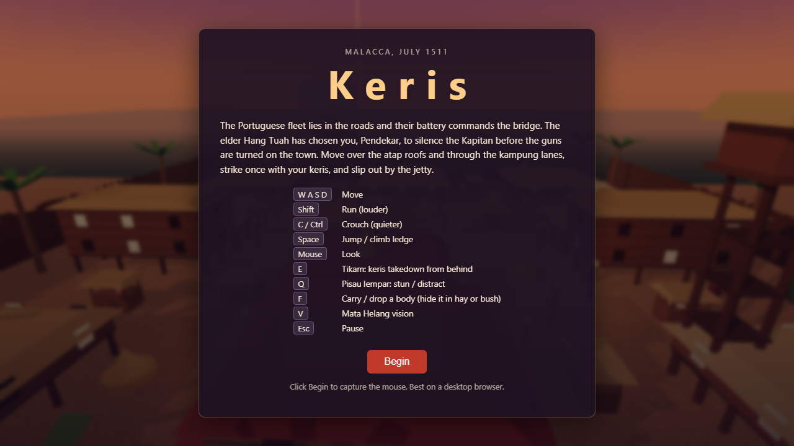
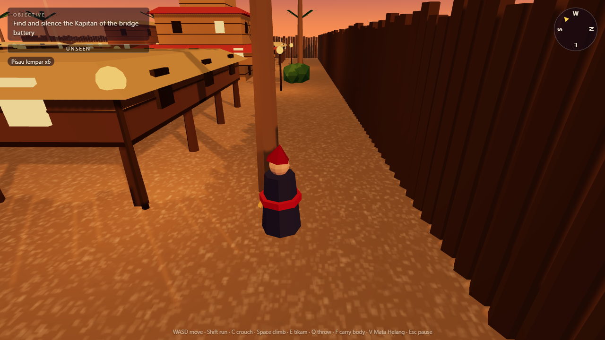
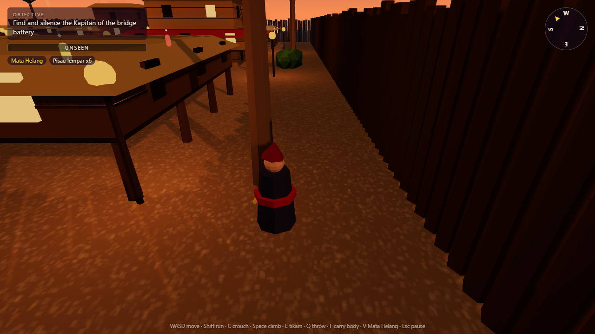
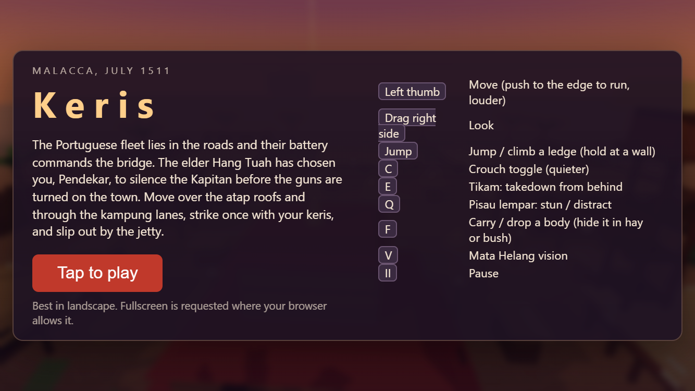
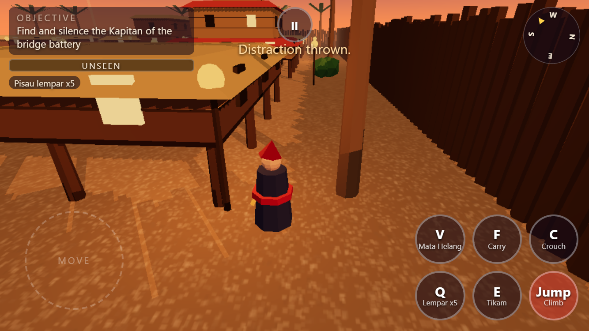
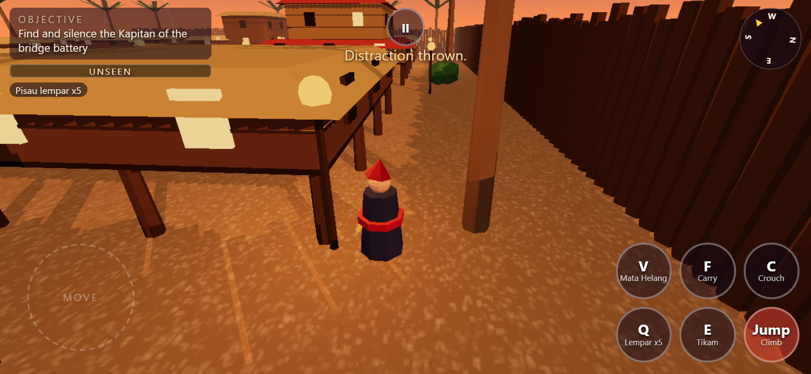
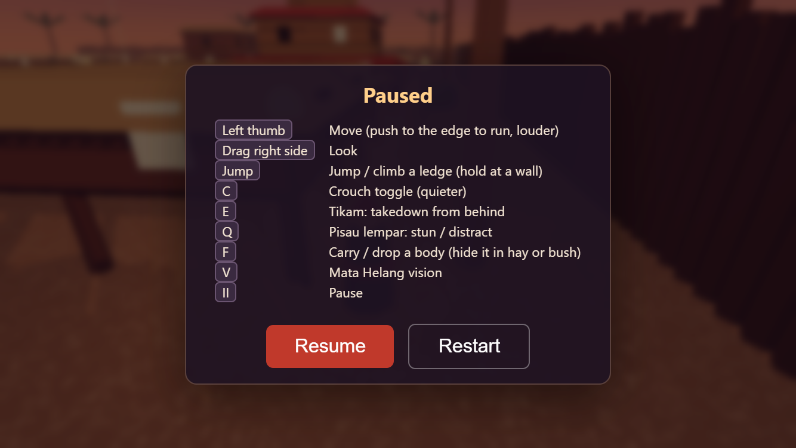
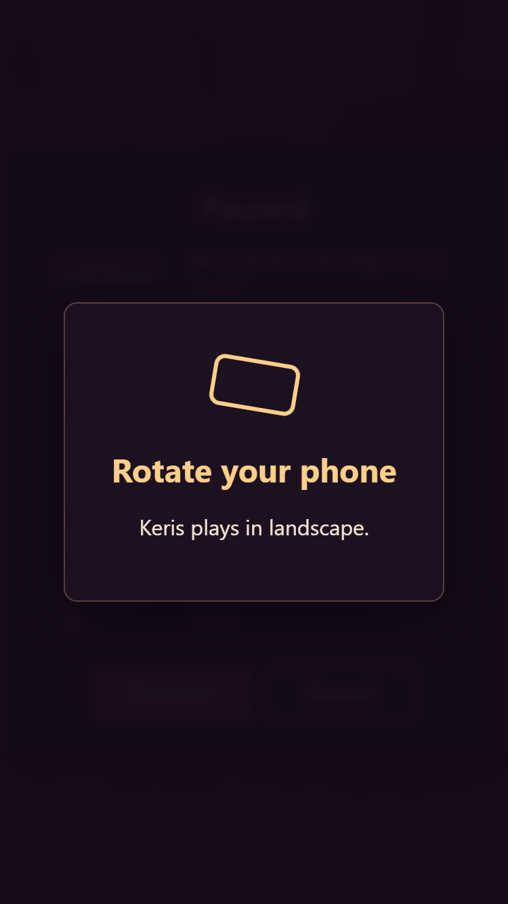

# Keris

A stealth-parkour browser game set in Malacca, 1511. You are a Pendekar sent to silence the Portuguese Kapitan of the bridge battery, then slip out by the jetty. Procedural geometry only, built with three.js.

**Live:** https://keris.taufikhamid.com (desktop keyboard and mouse, or phone in landscape)





## Controls

| Key | Action |
| --- | --- |
| W A S D | Move |
| Shift | Run (louder) |
| C or Ctrl | Crouch (quieter). Ctrl+W closes the tab in most browsers, so C is the safe choice |
| Space | Jump, or climb a ledge in front of you |
| Mouse | Look (pointer lock) |
| E | Tikam: keris takedown from behind, or on a stunned guard |
| Q | Pisau lempar: throw a knife to stun a guard, or make noise to distract |
| F | Carry the nearest body, or drop it. Drop it inside a haystack or bush to hide it |
| V | Mata Helang: shows guards, their vision cones and the target through walls |
| Esc | Pause |

A controller works too (Xbox, PlayStation, Steam Deck, via the browser Gamepad API): left stick moves, right stick looks, A jump/climb, X tikam, RT throw knife, Y carry, B crouch, RB Mata Helang, LB or L3 run, Start pause. A or Start also picks the main button on menus and skips the intro.

Hide in haystacks and bushes to disappear from view. A takedown made while you are hidden in cover leaves the body hidden too. If an alert guard keeps you in reach for 2 seconds, you are caught and can restart.

## Playing on phone

Touch controls appear on touch devices (detected by `pointer: coarse`, not user agent). Tap to play, which requests fullscreen and a landscape lock where the browser allows it. Portrait shows a "rotate your phone" prompt and pauses.

- Left thumb: floating joystick. Push to the edge to run (louder).
- Drag the right side: look.
- Buttons: Jump/Climb, C crouch (toggle), E Tikam, Q knife, F carry/drop, V Mata Helang, and a pause button. Multi-touch works, so you can move, look and press at once.
- Phones default to a lighter quality tier (pixel ratio capped at 1.5, no antialiasing, smaller basic shadows, shorter fog, 5 real lantern lights). Force it with `?quality=low` or `?quality=high`. `?touch=1` or `?touch=0` forces the control scheme.







Checked with `node scripts/mobile-check.mjs <url>` (headless Chromium, touch emulation at 667x375 and 844x390). Real-device framerate is untested: it only ran in software-rendered headless Chromium, so the quality tier is a best guess. iPhone Safari does not allow page fullscreen or orientation lock, so rotate manually there.

## Saving progress

Progress is saved in your browser's localStorage under the single key `keris:save` (versioned, with a migration path). It is per browser and per device, and clearing site data erases it. Nothing is sent to a server.

- Saved: the last checkpoint (mission start, or "Kapitan is down"), your best time and stealth rating, and settings (quality, look sensitivity, invert Y). Guard and alert state is never saved, so Continue rebuilds the world with guards on patrol.
- Title screen: Continue (only when a save exists) and New game. Settings has Reset progress (with a confirm step) and an export/import save code (base64 of the JSON, validated on import).
- `?quality=low|high` in the URL beats the saved quality for that session without changing it.
- Corrupt, unrecognised or newer-version data falls back to defaults, and if storage is blocked the game runs with in-memory progress.

Checked with `node scripts/save-check.mjs <url>` (headless Chromium, desktop and touch) plus unit tests in `src/game/save.test.ts`.

## Stack

Next.js 16 (App Router), React 19, TypeScript, plain three.js in a client component, Vitest, ESLint, GitHub Actions CI. No backend.

## How it works

Game rules are pure functions in `src/game/logic.ts`, separate from rendering, so they are unit tested.

- **Vision:** a guard sees the player only if the player is within range, inside the cone half-angle, and an analytic ray-vs-box test finds no tall occluder in between. A hidden player is only seen at very close range.
- **Detection meter:** a 0..1 value per guard. It fills faster when the player is closer, running, and decays when unseen. Crouching slows it.
- **Guard state machine:** `patrol -> suspicious -> alert -> search -> patrol`. A meter above 0.25 or a heard noise makes a guard suspicious, a full meter makes it alert (and alerts nearby guards), losing sight for 3 s starts a search, and searching ends after 8 s.
- **Noise:** crouching, walking and running have different noise radii. Thrown knives that miss make noise where they land.
- **Takedown:** needs you within 2 m, behind the guard (or the guard stunned), and the guard not alert.
- **Body discovery:** a guard whose cone sees a downed guard fills a body-awareness meter (faster when close). Past 0.3 it goes to investigate; at full it raises the alarm at the body. A body inside cover is only seen at about 1.8 m, so hide them. Hay on a patrol lane is still risky.
- **Pathfinding:** `src/game/nav.ts` (pure, no three.js) rasterises the level colliders into a 0.5 m layered grid: ground (including the open space under stilt houses) plus one layer per rooftop height. A* with octile moves and no corner cutting runs over it, and the result is string-pulled into a few waypoints. Guards use it for patrol legs, investigating noises and bodies, chasing, searching, and returning to patrol. Re-pathing is throttled (goal moved >1.5 m, at most every 0.4 s, refreshed every 4 s). Stuck detection escalates replan, snap to the nearest walkable cell, then the old straight-line movement. An unreachable target gives a partial path to the closest reachable point.
- **Climbing guards:** the grid has explicit bidirectional climb links wherever a surface is 0.6-3.7 m above another with a clear column (ground to roof, or a lower roof as a stepping stone). A guard paths to the nearest link, then follows its keyframes up the wall face and over the lip, slower than you. Guards have gravity, so they drop back down if they walk off a roof.
- **Debug overlay:** in `npm run dev` only, F3 draws the nav grid per layer, climb links (magenta) and each guard path (yellow, red if the goal is unreachable). It is not built in production.
- **Stilt houses:** the body of a house is raised above head height with thin post colliders, so you and guards can walk and hide under the floors while walls and roofs stay solid.
- **Lighting:** dusk hemisphere and ambient fill, 17 lantern point lights along the lanes, and light fog. Mata Helang lowers the fill and tints the fog blue for contrast.
- **Level:** `src/game/level.ts` builds stilt houses, atap roofs, kampung lanes, a three-tier palace, a harbour and a jetty from boxes and cones. Collision is circle-vs-box push-out; ledge climbing lerps onto a box top.

Tests (`src/game/nav.test.ts` too) cover A*, climb links, unreachable goals, re-path throttling, stuck handling, the vision cone, line of sight, detection meter, noise, behind check, the guard state machine, stilt colliders, climb planning and body discovery (`npm test`).

## How I use AI

This was built with Claude Code, which wrote the code, tests and this README from my spec. What was checked: lint, typecheck, unit tests and the production build all pass, and a headless Playwright run loaded the page, started the game, walked the player, toggled Mata Helang and captured the screenshots above with no console errors. I have not playtested it thoroughly by hand, so expect balance and feel issues.

## Rough edges

- Guard pathing and climbing are new and only lightly playtested. Climbs are keyframed, not skeletal animation. The grid is fixed at load, so guards ignore dynamic changes, and very tall roofs (over 3.7 m, such as the tower top) are unreachable for them. `npm run smoke:ai` (needs a running build) puts the player on a roof and checks a guard climbs up; headless software rendering is slow, so it can take about a minute.
- Art is low-poly primitives, no audio, no in-game quality toggle (URL parameter only). The takedown (E) and carry (F) buttons are checked to send their keys, but their outcomes were not tested on touch.

## Local dev

```bash
npm install
npm run dev        # http://localhost:3000
npm run lint && npm run typecheck && npm test && npm run build
```

## Credit

Inspired by the stealth genre. Not affiliated with Ubisoft. Setting and story draw on my earlier Malacca 1511 prototype.

## License

MIT, see [LICENSE](LICENSE).
