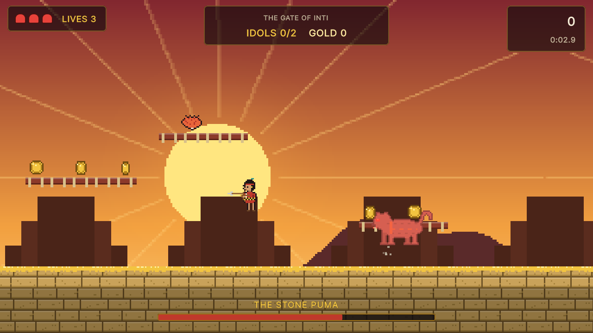
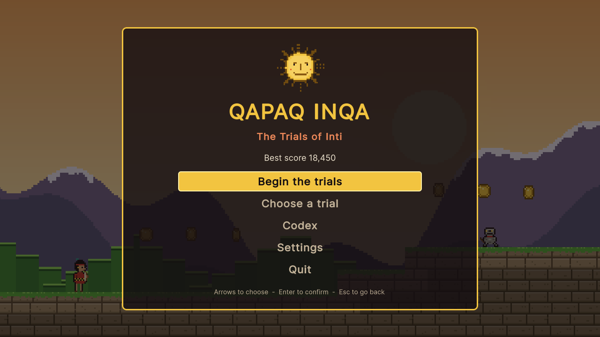
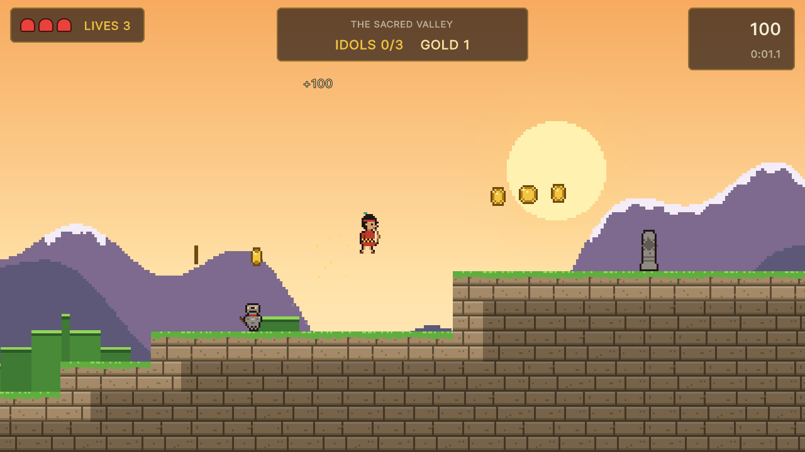
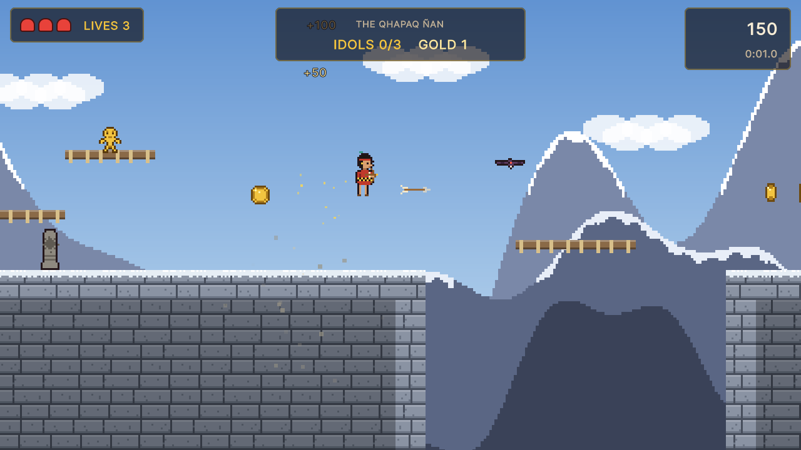
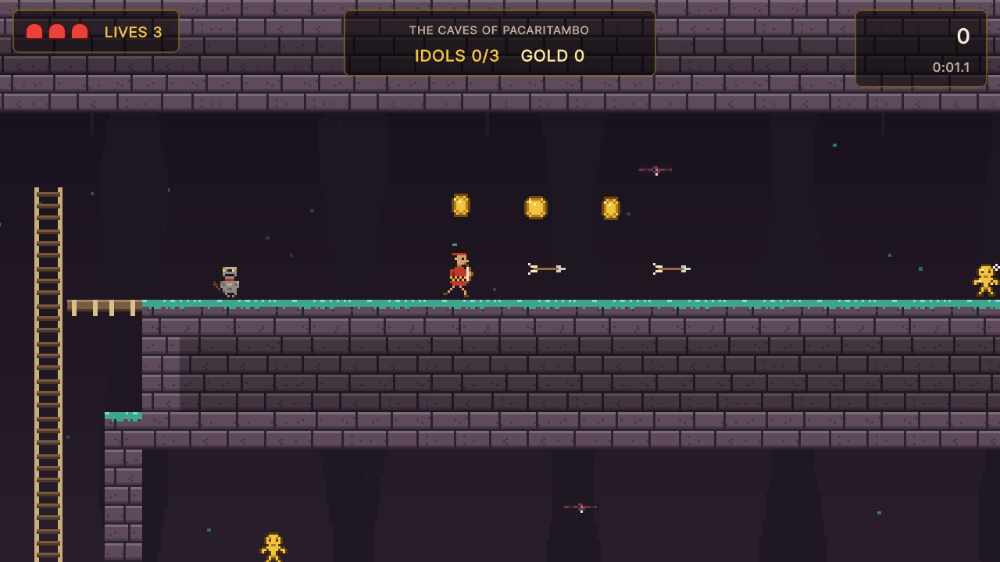
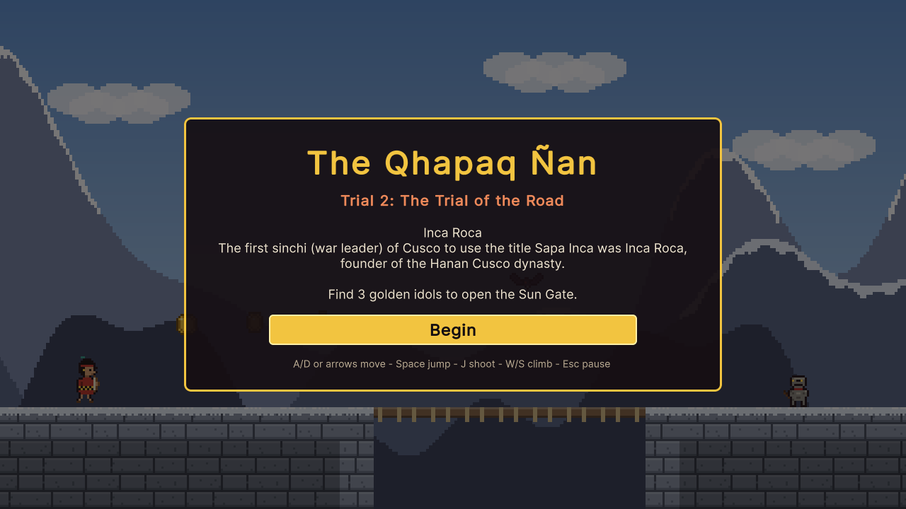
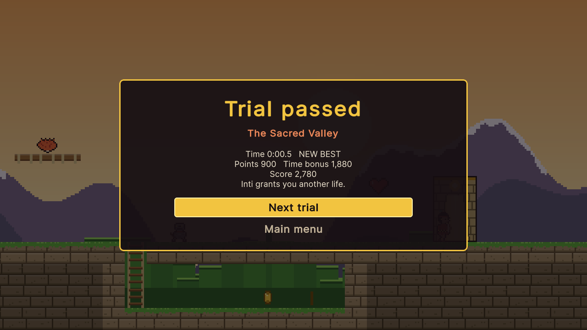

# Qapaq Inqa: The Trials of Inti

A 2D pixel-art platformer built with Unity about the Inca. As a young candidate to become
Sapa Inca, run, climb and shoot your bow through four trials of the sun god Inti, find the
golden idols that open each Sun Gate, and face the Stone Puma that guards the last one.



| | |
|---|---|
|  |  |
|  |  |
|  |  |

## Run it

1. Install **Unity 6000.3.27f1 (Unity 6 LTS)** with Unity Hub (add the Windows or Web build
   support module if you want to build players).
2. In Unity Hub choose **Add → Add project from disk** and select the repository folder.
3. Open `Assets/Scenes/QapaqInqa.unity` and press **Play**.

To build a player use **File → Build Profiles** (Windows or Web), or build from a terminal into
a folder outside the repository:

```bash
Unity -batchmode -quit -projectPath . -executeMethod QapaqInqa.EditorTools.ProjectBuilder.BuildWebGL -buildOutput ../build/web
```

(`BuildWindows` works the same way.) The WebGL build is uncompressed, so it runs from any
static host such as GitHub Pages.

The tests run from **Window → General → Test Runner** (EditMode and PlayMode), or from a terminal:

```bash
Unity -batchmode -projectPath . -runTests -testPlatform EditMode -testResults editmode.xml
Unity -batchmode -projectPath . -runTests -testPlatform PlayMode -testResults playmode.xml
```

The README screenshots come from an opt-in hook: run a built player with
`-screenshot <folder>` (optionally `-scenario title,intro,valley,mountain,cave,boss,pause,complete,gameover,victory`),
or, without a player,
`Unity -batchmode -projectPath . -executeMethod QapaqInqa.EditorTools.ProjectBuilder.CaptureScreenshots -screenshot <folder>`.

All art and audio are generated. To change them, edit and rerun the generators (Python 3
standard library; the audio script also needs `ffmpeg` on the PATH), then let Unity pick up
the files:

```bash
python tools/art/build.py
python tools/audio/build.py
Unity -batchmode -quit -projectPath . -executeMethod QapaqInqa.EditorTools.ProjectBuilder.SetUpProject
```

## Controls

| Action | Keyboard | Gamepad |
|---|---|---|
| Move | A / D or the arrow keys | Left stick or d-pad |
| Jump (hold for a higher jump) | Space, Z or K | A |
| Shoot an arrow (hold to keep shooting) | J, X, T or Left Ctrl | X, RB or RT |
| Climb a ladder | W / S or up / down | Stick or d-pad up / down |
| Drop through a wooden ledge | Down + jump | Down + A |
| Pause | Esc or P | Start |
| Menus | Arrows, Enter, Esc (or the mouse) | D-pad, A, B |

## How it plays

- **The trials.** The Sacred Valley (terraces and a hidden hollow), the Qhapaq Ñan (cliffs,
  ladders and rope bridges over chasms), the Caves of Pacaritambo (low galleries, spikes and a
  chute into the depths) and the Gate of Inti (a temple stair and the Stone Puma's court).
  Each opens with a codex page about the Inca.
- **The goal.** Every trial hides 2 or 3 golden idols. The Sun Gate, a trapezoidal Inca
  doorway, opens only when all of them are found (and, in the last trial, the Stone Puma is
  defeated). Huaca stones are checkpoints: touch one and you come back there.
- **You** have 3 hearts and a short mercy time after each hit, and 3 lives; losing all
  hearts or falling into a chasm costs a life. Clearing a trial grants a life, as the original
  game did. The bow fires about three arrows a second; landing on an enemy also defeats it.
- **Enemies.** Stone warriors pace their ledge and take two arrows; bats swoop back and forth
  and take one. The Stone Puma (24 hits) sleeps until you come close, then prowls, crouches
  and leaps at you, and hurls arcs of rocks; below half health it is faster and throws more.
- **Score and records.** Gold 100, idol 300, mullu (Spondylus shell, a treasured offering)
  500, enemies 50 to 2,000, a bonus for every second under the trial's par time, and 1,000
  per life left at the end. The best campaign score, the best full-run time and the best time
  per trial are saved on the device (PlayerPrefs), and the level select opens trials as you
  pass them.
- **Settings.** Music and effects volume, screen shake, the timer and fullscreen, saved
  between sessions.

## What I learned / technically interesting

- **A platformer without the physics engine.** Movement is a small kinematic controller in
  `Assets/Scripts/Core`, a plain C# assembly with no Unity references: move along x then y
  against a tile grid, one-way ledges that only hold from above, ladders whose top rung is
  also a ledge, acceleration, variable jump height, coyote time, jump buffering and knockback.
  Enemies, the boss's state machine, pickups, checkpoints, the gate, lives, score, records and
  settings live there too, covered by 62 EditMode tests, including a coarse reachability
  search that proves every idol, checkpoint and gate in the four maps can be reached.
- **Levels are text.** Each trial is a grid of characters (`#` stone, `=` ledge, `H` ladder,
  `A` idol, `B` the boss...). The view bakes the whole map into one texture at load, picking
  grassy or snowy tops, varied stone and darker buried blocks, so a level is a single sprite.
- **A fixed-step simulation.** The rules step at 60 Hz whatever the frame rate; a jump
  pressed between steps is carried to the next one, and hit-stop and pause stop the game's own
  clock instead of `Time.timeScale`. Six PlayMode tests drive the real scene: start, death and
  respawn at a checkpoint, game over, clearing a trial, pause and settings.
- **A bug from the original, pinned first.** The 2021 version reloaded the scene on death
  but kept the score, so every coin and artifact came back to be collected again. The core was
  first ported with that behaviour, a test showed the doubled score (RED), and the fix keeps
  pickups taken across a respawn.
- **Everything is generated.** The pixel art (characters, tiles with fitted Inca stonework,
  backdrops, the Inti icon) is drawn by `tools/art` from ASCII templates; the Andean-flavoured
  pentatonic music (quena-like flute, charango strums, bombo) and the effects come from a tiny
  synthesizer in `tools/audio`; the scene, UI panel and player settings come from
  `ProjectBuilder.cs`. The UI is UI Toolkit built in code, and input goes through the Input
  System, so keyboard and gamepad both work.

## History

This started in 2021 as a university homework (UTP) built on the TileVania project of the
GameDev.tv *Complete Unity 2D Developer* course, with Unity 2020.1, Asset Store art and a
Spanish plot about the trials of Inti. A video of that version is on
[YouTube](https://youtu.be/lrVdVdEk6zU). It was upgraded to Unity 6, the store assets and the
audio of unknown origin were removed, the rules were rewritten as a tested engine-free core,
and the idea was grown into the complete game above. The codex pages are an English rendering
of the original game's Spanish notes about the Inca.

## Credits

The code base began with the GameDev.tv course (MIT). Everything in the game today was made
for this project: generated pixel art, synthesized audio, and Unity's default font. See
[CREDITS.md](CREDITS.md).

## License

[MIT](LICENSE), keeping the GameDev.tv course notice.
