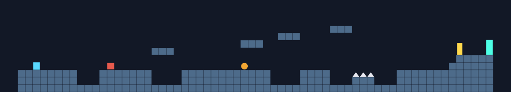
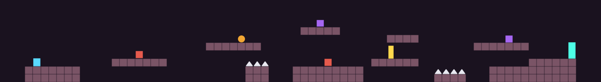
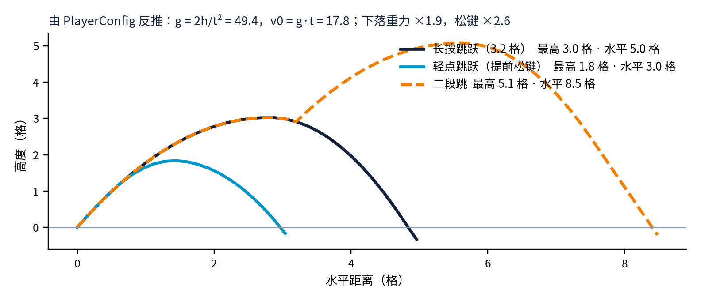

# 像素跃迁 Pixel Leap（Unity 2D 平台跳跃）





**[⬇ 下载工程压缩包](https://github.com/bailiyyds/PixelLeap-Unity2D/archive/refs/heads/main.zip)**

个人项目 · 2026.03—2026.06 · Unity 2022.3 LTS（内置渲染管线）· C#

## 运行
1. Unity Hub → Add → 选择本文件夹（首次打开会自动生成 Library 等目录）
2. 菜单栏 **PixelLeap → 创建演示场景**（自动生成场景和全部配置资源）
3. 点击 Play

操作：A/D 移动 · 空格 跳跃（可二段跳）· J / 鼠标左键 射击 · R 重开 · 通关后 Enter 进入下一关

## 项目结构
```
Assets/Scripts
├─ Core     ObjectPool（通用对象池）· Health（受击/无敌帧/闪白）· SaveSystem（JSON 存档）· SpriteFactory（运行时生成纯色精灵）
├─ Player   PlayerConfig（手感参数 SO）· PlayerController2D · Bullet · CameraFollow2D
├─ Enemy    EnemyConfig（SO）· StateMachine · EnemyStates（巡逻/追击/攻击/受击/死亡）· EnemyBrain
└─ Level    LevelConfig（字符画关卡 SO）· LevelBuilder · LevelTrigger · GameManager（流程 + HUD）
Assets/Editor  PixelLeapSetup（一键生成场景）
```

## 设计要点
- **手感**：跳跃由"高度 + 到顶时间"反推重力与初速度（g = 2h/t²）；土狼时间 0.1s、跳跃缓冲 0.12s；松键小跳、下落加重；挤压拉伸。
- **状态机敌人**：冲撞虫 / 跳跃虫 / 射手虫共用一套 FSM，差异只在 EnemyConfig 数据与攻击分支；攻击带前摇提示。
- **数据驱动关卡**：关卡用字符画描述（`#` 地面、`^` 尖刺、`W/J/S` 敌人、`C` 检查点、`G` 终点），改文本即可出新关。
- **性能**：子弹走对象池，消除高频 Instantiate/Destroy 带来的 GC 卡顿；同一行连续地块合并为一个碰撞体，三关碰撞体从 178/106/129 个降到 18/16/15 个。HUD 实时显示对象池与碰撞体数量。
- **存档**：先写临时文件再替换，防止写入中断损坏存档。

## 跳跃轨迹



---
作者：贺奕博 · 南通大学 · 更多作品见 [github.com/bailiyyds](https://github.com/bailiyyds)
